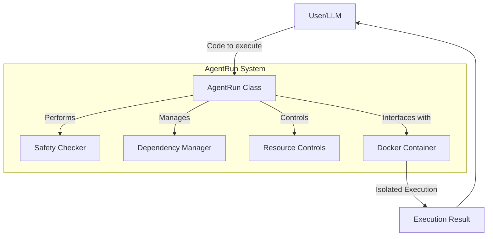
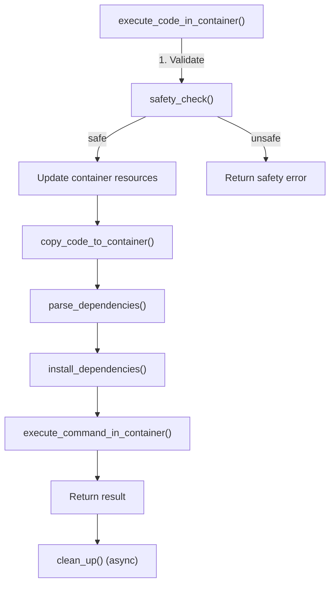
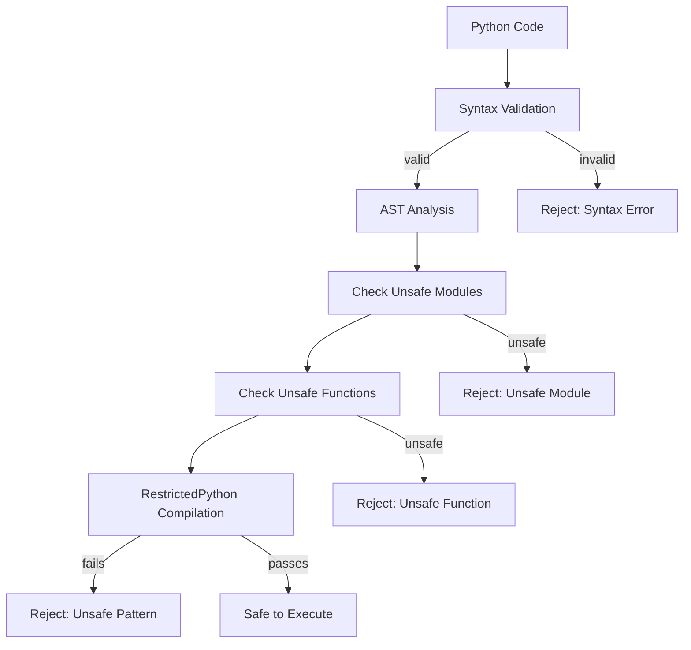
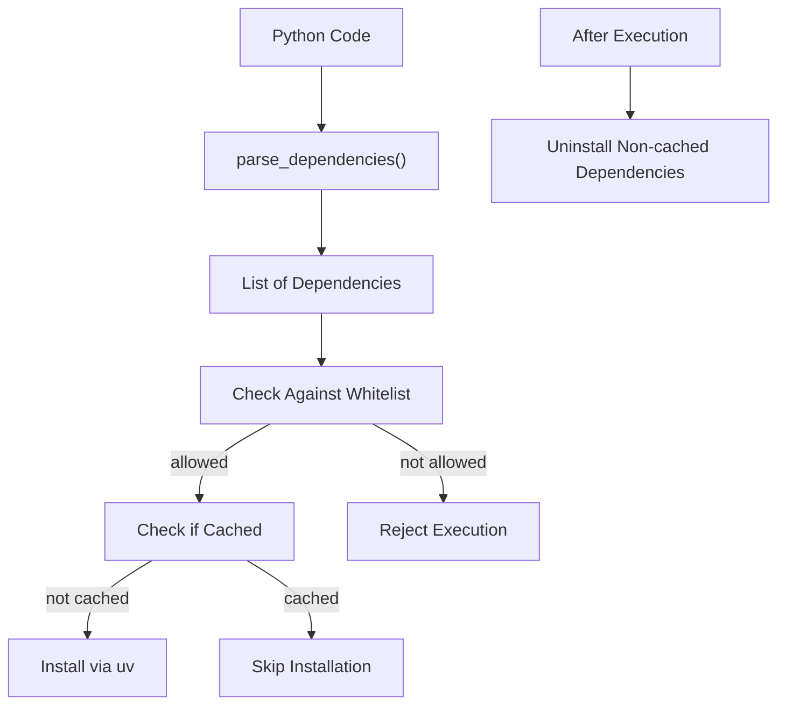
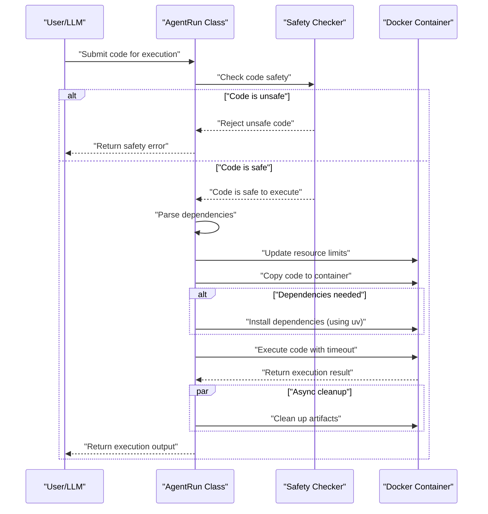
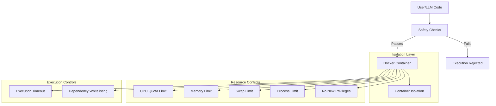
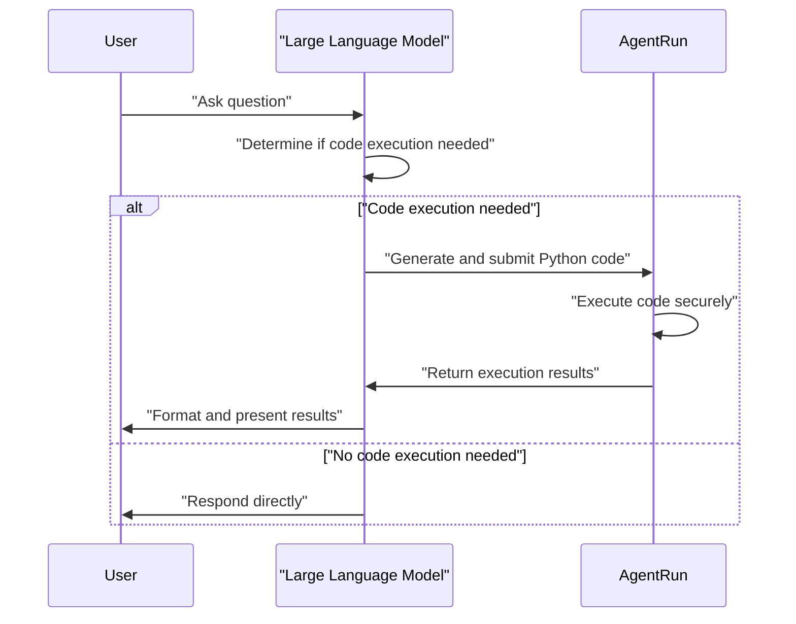

<!-- source: DeepWiki mcp.deepwiki.com · repo tjmlabs/AgentRun · page 1.2 Architecture Overview · fetched 2026-10-26 -->

# Architecture Overview

<details>
<summary>Relevant source files</summary>

The following files were used as context for generating this wiki page:

- [README.md](README.md)
- [agentrun-api/docker-compose.yml](agentrun-api/docker-compose.yml)
- [agentrun/__init__.py](agentrun/__init__.py)
- [pyproject.toml](pyproject.toml)

</details>


This document provides a high-level overview of the AgentRun architecture, explaining how its components interact to provide secure code execution for LLM-generated or user-provided Python code. For installation details, see [Installation and Setup](#2).

## System Overview

AgentRun is a system designed to safely execute Python code in isolated Docker containers. It features multiple layers of security, resource controls, and dependency management to prevent malicious code execution while providing flexibility for legitimate code to run.



Sources: [agentrun/__init__.py:17-455](), [README.md:12-14]()

## Deployment Options

AgentRun offers two primary deployment options:

```mermaid
graph TD
    subgraph "Option 1: Python Package"
        PyApp["Python Application"] -->|"Import"| AgentRunPkg["AgentRun Package"]
        AgentRunPkg -->|"Uses"| UserDocker["User-configured Docker"]
        UserDocker -->|"Executes"| Code1["User/LLM Code"]
    end
    
    subgraph "Option 2: REST API Service"
        Client["Client Application"] -->|"HTTP POST"| ApiEndpoint["'/v1/run/' Endpoint"]
        ApiEndpoint -->|"Managed by"| FastAPI["FastAPI Application"]
        FastAPI -->|"Uses"| AgentRunAPI["AgentRun Instance"]
        AgentRunAPI -->|"Uses"| DockerCompose["Pre-configured Docker"]
        DockerCompose -->|"Executes"| Code2["User/LLM Code"]
    end
```



Sources: [README.md:55-121](), [agentrun-api/docker-compose.yml:1-28]()

### Python Package

With this option, users install AgentRun via pip and manage their own Docker setup:

```python
from agentrun import AgentRun

runner = AgentRun(container_name="my_container")  # container must be running
result = runner.execute_code_in_container("print('Hello, world!')")
```

### REST API Service

This ready-to-use deployment option comes with pre-configured Docker setup and exposes an HTTP endpoint that accepts code for execution:

```bash
curl -X POST http://localhost:8000/v1/run/ \
  -H "Content-Type: application/json" \
  -d '{"code": "print(\"hello, world!\")"}'
```

## Core Components

### AgentRun Class

The `AgentRun` class is the primary orchestrator for the system. It handles:

- Validating code safety
- Managing Docker container resources
- Installing and uninstalling dependencies
- Executing code with timeout constraints
- Cleaning up after execution



Sources: [agentrun/__init__.py:17-455](), [agentrun/__init__.py:385-454]()

### Safety Mechanism

The safety checker performs multi-level analysis of Python code:



The safety checker blocks dangerous operations including:
- System module imports (`os`, `sys`, `subprocess`)
- Dangerous built-ins (`exec`, `eval`, `compile`)
- File operations (`open`)
- Environment inspection (`globals`, `locals`)

Sources: [agentrun/__init__.py:159-252]()

### Dependency Management

AgentRun handles Python dependencies through:

1. **Dependency Parsing**: Analyzes code to identify import statements
2. **Whitelisting**: Validates dependencies against configurable whitelist
3. **Installation**: Uses `uv` package manager for fast installation
4. **Caching**: Optional caching of frequently used dependencies
5. **Cleanup**: Automatic uninstallation of non-cached dependencies



Sources: [agentrun/__init__.py:254-341]()

## Execution Flow

This sequence diagram shows the complete execution flow through the system:



Sources: [agentrun/__init__.py:385-454]()

## Security Architecture

Security is implemented through multiple layers:



Sources: [agentrun/__init__.py:159-252](), [agentrun-api/docker-compose.yml:22-24](), [agentrun/__init__.py:40-46]()

### Container Security Settings

The Docker container for code execution is configured with strict security settings:

- `pids_limit: 10`: Limits number of processes to prevent fork bombs
- `no-new-privileges:true`: Prevents privilege escalation
- Resource limits for CPU, memory, and swap

Sources: [agentrun-api/docker-compose.yml:22-24]()

## Configuration Options

AgentRun provides several configuration parameters:

| Parameter | Description | Default | File Path |
|-----------|-------------|---------|-----------|
| `container_name` | Name of Docker container | (Required) | [agentrun/__init__.py:38]() |
| `dependencies_whitelist` | Allowed dependencies | `["*"]` | [agentrun/__init__.py:40]() |
| `cached_dependencies` | Dependencies to cache | `[]` | [agentrun/__init__.py:41]() |
| `cpu_quota` | CPU quota (microseconds) | 50000 | [agentrun/__init__.py:42]() |
| `default_timeout` | Execution timeout (seconds) | 20 | [agentrun/__init__.py:43]() |
| `memory_limit` | Memory limit | "100m" | [agentrun/__init__.py:44]() |
| `memswap_limit` | Memory + swap limit | "512m" | [agentrun/__init__.py:45]() |

Sources: [agentrun/__init__.py:37-46](), [README.md:271-302]()

## Performance Considerations

AgentRun is optimized for efficiency with typical performance metrics:
- ~200ms execution time without dependencies
- ~400ms with typical dependencies like `requests`

The main performance bottleneck is dependency installation, which can be mitigated by using the cached dependencies feature.

Sources: [README.md:328-336]()

## Integration Points

AgentRun can be integrated with any LLM capable of generating Python code:



For more detailed information about LLM integration patterns, see [Integration with LLMs](#5).

Sources: [README.md:124-267]()

---

