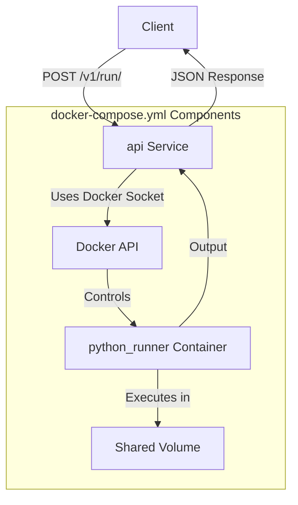
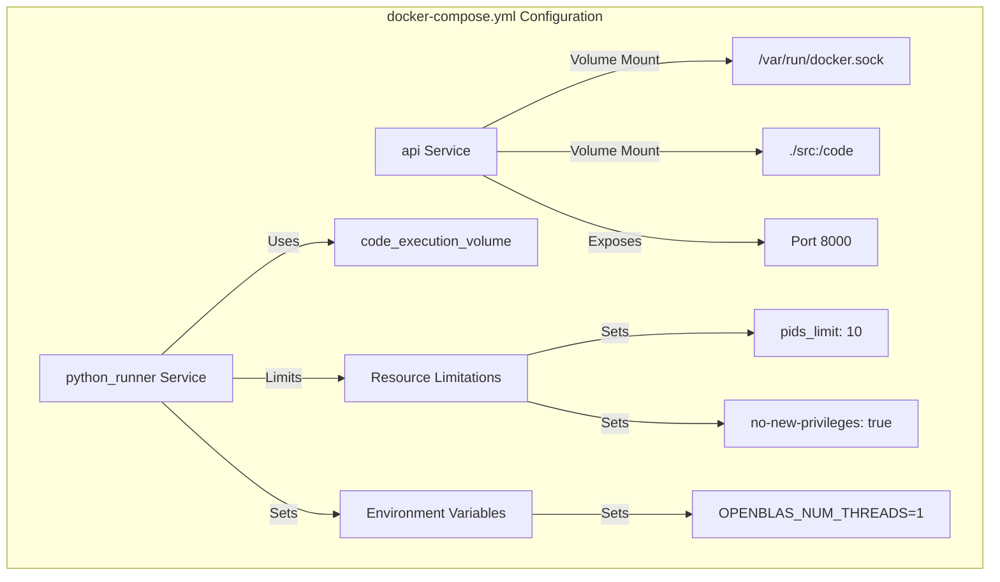

<!-- source: DeepWiki mcp.deepwiki.com · repo tjmlabs/AgentRun · page 2 Installation and Setup · fetched 2026-10-26 -->

# Installation and Setup

<details>
<summary>Relevant source files</summary>

The following files were used as context for generating this wiki page:

- [README.md](README.md)
- [agentrun-api/docker-compose.yml](agentrun-api/docker-compose.yml)
- [docs/index.md](docs/index.md)
- [pyproject.toml](pyproject.toml)

</details>


This page provides comprehensive instructions for installing and configuring AgentRun, a system designed to safely execute Python code generated by LLMs (Large Language Models). AgentRun offers two distinct installation methods to accommodate different user needs and technical skill levels.

For information about specific configuration options after installation, see [Configuration Options](#4).

## Prerequisites

Before installing AgentRun, ensure you have:

- Python 3.10 or higher
- Docker installed and running on your system
- Basic familiarity with Docker concepts (for Python package option)

Sources: [pyproject.toml:6-7](), [README.md:6-7]()

## Installation Options Overview

AgentRun offers two deployment approaches with different characteristics:

```mermaid
graph TD
    subgraph "Option 1: Python Package"
        PyApp["Python Application"] -->|"import agentrun"| AgentRunPkg["AgentRun Class"]
        AgentRunPkg -->|"execute_code_in_container()"| UserDocker["User Docker Container"]
        UserDocker -->|"Executes"| Code1["LLM/User Code"]
    end
    
    subgraph "Option 2: REST API Service"
        Client["Client Application"] -->|"POST /v1/run/"| ApiEndpoint["FastAPI Endpoint"]
        ApiEndpoint -->|"Uses"| AgentRunAPI["AgentRun Instance"]
        AgentRunAPI -->|"Uses"| PythonRunner["python_runner Container"]
        PythonRunner -->|"Executes"| Code2["LLM/User Code"]
    end
```



Sources: [README.md:57-58](), [README.md:51-52]()

| Feature | Python Package | REST API Service |
|---------|---------------|------------------|
| Docker setup | You configure and manage | Pre-configured with docker-compose |
| Installation | `pip install agentrun` | Git clone & docker-compose |
| Requirements | Running Docker container | Docker and Docker Compose |
| Customization | Full control over all settings | Configured via environment variables |
| Integration | Direct integration in Python code | HTTP API accessible from any language |
| Recommended for | Advanced users comfortable with Docker | Beginners or those wanting a quick setup |

Sources: [README.md:114-120]()

## Python Package Installation

Follow these steps to install AgentRun as a Python package:

1. Ensure Python 3.10+ and Docker are installed
2. Install the package via pip:

```bash
pip install agentrun
```

3. Set up a Docker container for code execution (you must manage this yourself)

### Basic Python Package Usage

```python
from agentrun import AgentRun

# Initialize with your container
runner = AgentRun(container_name="your_container_name")

# Execute LLM-generated code
code = "print('Hello, world!')"
result = runner.execute_code_in_container(code)
print(result)  # Outputs: Hello, world!
```

Sources: [README.md:90-110]()

### Python Package Configuration

When initializing the `AgentRun` class, you can customize various parameters:

```python
from agentrun import AgentRun

runner = AgentRun(
    container_name="my_container",
    dependencies_whitelist=["requests", "pandas"],  # Only allow these packages
    cached_dependencies=["requests"],  # Pre-install for faster execution
    default_timeout=60,  # Timeout in seconds (default: 20s)
    memory_limit="512mb",  # Memory limit (default: 100mb)
    memswap_limit="1gb",  # Memory+swap limit (default: 512mb)
    cpu_quota=50000  # CPU quota (default: 50000, 50% of a core)
)
```

Sources: [README.md:302-322]()

## REST API Installation and Setup

The REST API approach provides a pre-configured Docker Compose setup that's easier to get started with:

1. Clone the AgentRun repository:

```bash
git clone https://github.com/jonathan-adly/agentrun
cd agentrun/agentrun-api
```

2. Create an environment file:

```bash
cp .env.example .env.dev
```

3. Start the Docker Compose setup:

```bash
docker-compose up -d --build
```

This will start two containers:
- `api`: The FastAPI service that receives code execution requests
- `python_runner`: A container that executes the Python code in isolation

Sources: [README.md:60-68](), [agentrun-api/docker-compose.yml:1-27]()

### REST API Architecture



Sources: [agentrun-api/docker-compose.yml:1-27]()

### REST API Usage Examples

**Using cURL:**
```bash
curl -X POST http://localhost:8000/v1/run/ \
  -H "Content-Type: application/json" \
  -d '{"code": "print(\"Hello, world!\")"}'
```

**Using JavaScript fetch:**
```javascript
fetch('http://localhost:8000/v1/run/', {
    method: 'POST',
    headers: {
        'Content-Type': 'application/json'
    },
    body: JSON.stringify({
        code: "print('hello, world!')"
    })
})
.then(response => response.json())
.then(data => console.log(data))
```

**Expected response format:**
```json
{
    "output": "Hello, world!"
}
```

Sources: [README.md:69-85]()

## Docker Configuration Details

The REST API's Docker Compose setup includes the following configuration:



Sources: [agentrun-api/docker-compose.yml:1-27]()

The Docker Compose file configures:

1. An `api` service that runs FastAPI and communicates with the Docker daemon
2. A `python_runner` service with resource limits for secure code execution
3. A shared volume (`code_execution_volume`) for transferring code and execution results

## Security Features

AgentRun implements multiple security layers:

1. **Code safety checks**: Analyzes code for dangerous patterns before execution
2. **Docker isolation**: Executes code in a containerized environment
3. **Resource limitations**: Controls CPU, memory, and execution time
4. **Dependency whitelisting**: Optionally restricts which packages can be installed
5. **Process limits**: Prevents fork bombs with process count limits (REST API)

Sources: [README.md:39-49](), [agentrun-api/docker-compose.yml:22-24]()

## Resource Configuration

Both installation methods allow control over resource usage:

| Resource | Default Value | Description |
|----------|---------------|-------------|
| CPU Quota | 50,000 | Microseconds per 100ms scheduling period (50% of a CPU core) |
| Memory Limit | 100MB | Container RAM limit |
| Swap Limit | 512MB | Combined memory and swap space limit |
| Execution Timeout | 20s | Maximum code execution duration |
| Process Limit | 10 (REST API) | Maximum number of processes (prevents fork bombs) |

Sources: [README.md:279-297]()

## Dependency Management

AgentRun offers two strategies for managing dependencies:

1. **Dependencies Whitelist**: Restrict which packages can be installed
   - Default: All packages allowed
   - Recommended: Limit to trusted packages only

2. **Cached Dependencies**: Pre-install frequently used packages
   - Default: None (empty list)
   - Benefits: Faster execution for subsequent runs
   - Trade-off: Longer initial container startup time

Sources: [README.md:271-274]()

## Troubleshooting

Common issues and solutions:

1. **Docker not running**: Ensure Docker daemon is running with `docker info`
2. **Permission issues**: You may need to run as sudo or add your user to the Docker group
3. **Container not found**: For Python package, ensure your specified container exists and is running
4. **Dependencies not installing**: Check your whitelist configuration
5. **API not responding**: Check Docker Compose logs with `docker-compose logs api`

## Next Steps

After installation, you may want to explore:

- [Python Package Installation](#2.1) for more details on the Python package approach
- [REST API Setup](#2.2) for more details on the REST API approach
- [Core Components](#3) to understand the system architecture
- [Configuration Options](#4) for advanced configuration details
- [Integration with LLMs](#5) to connect AgentRun with language models

Sources: [README.md:16-18]()

---

