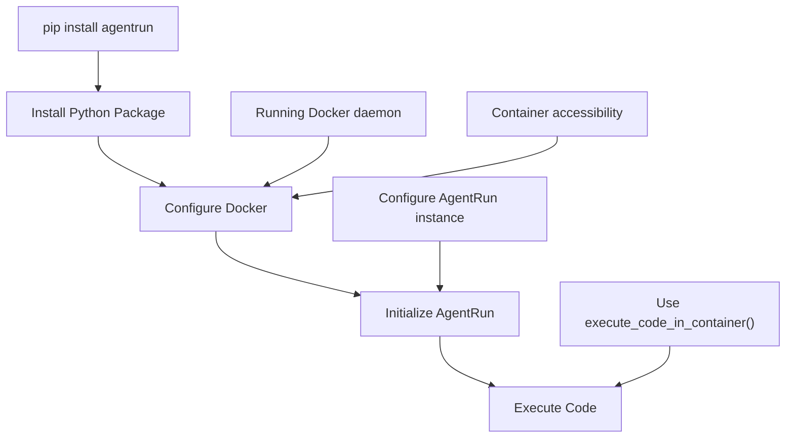
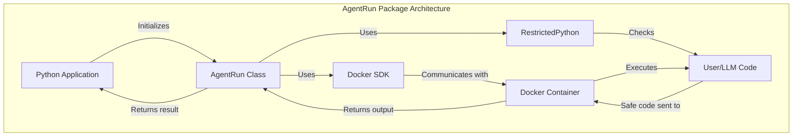
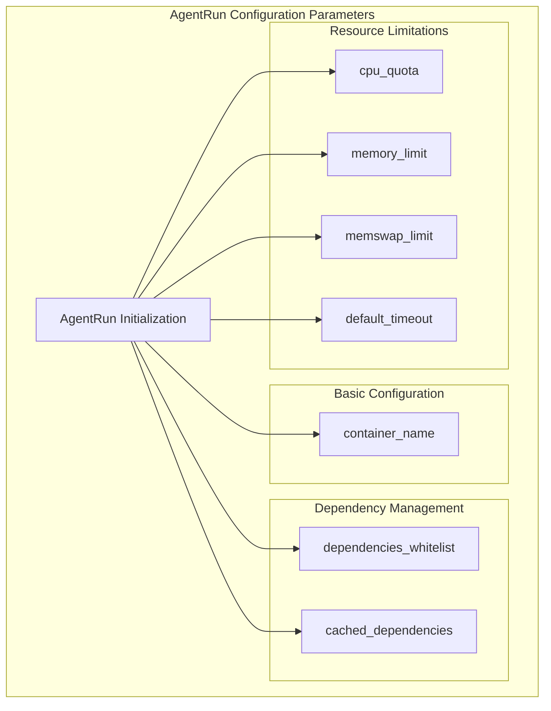

<!-- source: DeepWiki mcp.deepwiki.com · repo tjmlabs/AgentRun · page 2.1 Python Package Installation · fetched 2026-10-26 -->

# Python Package Installation

<details>
<summary>Relevant source files</summary>

The following files were used as context for generating this wiki page:

- [README.md](README.md)
- [agentrun-api/docker-compose.yml](agentrun-api/docker-compose.yml)
- [docs/index.md](docs/index.md)
- [pyproject.toml](pyproject.toml)

</details>


This document provides detailed instructions for installing and configuring AgentRun as a Python package. For information about setting up the standalone REST API service, see [REST API Setup](#2.2).

## Purpose and Requirements

AgentRun requires Python 3.10 or higher and a running Docker installation. The Python package provides a programmatic interface to safely execute untrusted code within isolated Docker containers with configurable resource limits and dependency management.

Sources: [README.md:90-107](). [pyproject.toml:6]()

## Installation Process



### Basic Installation

Install AgentRun using pip:

```bash
pip install agentrun
```

This command installs the package with its two required dependencies:
- Docker SDK for Python: Communicates with Docker to create/manage containers
- RestrictedPython: Performs code safety checks

Sources: [README.md:92-94](). [pyproject.toml:12-14]()

### Prerequisites Verification

Before using AgentRun, verify:

1. Python version meets requirements (3.10+)
2. Docker is installed and running
3. Your user has permissions to interact with Docker
4. A Docker container is available for AgentRun to use

You can verify your Python version and Docker installation with:

```bash
python --version  # Should show 3.10.x or higher
docker info       # Should display Docker system information
```

Sources: [pyproject.toml:6](). [README.md:50-52]()

## Basic Configuration



### Initializing AgentRun

After installation, initialize the AgentRun class by providing a running Docker container name:

```python
from agentrun import AgentRun

# Initialize with a running container
runner = AgentRun(container_name="my_container")
```

The Docker container must be running before AgentRun is initialized. AgentRun communicates with this container to execute code in an isolated environment.

Sources: [README.md:101-104]()

## Configuration Options

When initializing AgentRun, you can customize several parameters:

| Parameter | Default | Description |
|-----------|---------|-------------|
| `container_name` | Required | Name of the Docker container to use |
| `dependencies_whitelist` | `[]` (allow all) | List of packages allowed to be installed |
| `cached_dependencies` | `[]` | Dependencies to pre-install for faster execution |
| `cpu_quota` | `50000` | CPU time limit (50% of one core) |
| `memory_limit` | `"100mb"` | RAM usage limit |
| `memswap_limit` | `"512mb"` | Total memory + swap limit |
| `default_timeout` | `20` | Execution timeout in seconds |



### Example with Custom Configuration

```python
runner = AgentRun(
    container_name="my_container",
    dependencies_whitelist=["requests", "pandas"],  # Only allow these packages
    cached_dependencies=["requests"],  # Pre-install requests
    default_timeout=60,  # Allow 60 seconds for execution
    memory_limit="512mb",  # Allow 512MB of RAM
    memswap_limit="1gb"  # Allow 1GB total memory+swap
)
```

Sources: [README.md:302-321](). [docs/index.md:268-322]()

## Dependency Management

AgentRun provides two methods to manage Python package dependencies:

### Dependencies Whitelist

The `dependencies_whitelist` parameter restricts which packages can be installed by the executed code:

- Empty list (`[]`): Allow any package to be installed (default)
- List of packages: Only the specified packages can be installed
- No dependencies allowed: Set to `None`

Example:
```python
# Only allow requests and pandas to be installed
runner = AgentRun(
    container_name="my_container",
    dependencies_whitelist=["requests", "pandas"]
)
```

### Cached Dependencies

The `cached_dependencies` parameter allows pre-installing packages to improve performance:

- Empty list (`[]`): No cached dependencies (default)
- List of packages: Pre-install and cache these packages

Caching dependencies improves performance for code that repeatedly uses the same libraries, as the installation step can be skipped.

```python
# Pre-install and cache requests
runner = AgentRun(
    container_name="my_container",
    cached_dependencies=["requests"]
)
```

Note: Pre-installing dependencies increases the initial container startup time but reduces subsequent execution times.

Sources: [README.md:271-274](). [docs/index.md:271-274]()

## Resource Limitations

AgentRun provides several parameters to limit resource usage of executed code:

### CPU Limits

The `cpu_quota` parameter (default: 50000) limits CPU usage to 50% of one CPU core. This value represents microseconds of CPU time per 100 milliseconds period.

### Memory Limits

- `memory_limit` (default: "100mb"): Maximum RAM usage
- `memswap_limit` (default: "512mb"): Maximum combined RAM and swap usage

### Execution Timeout

The `default_timeout` parameter (default: 20 seconds) specifies the maximum time a script can run before being terminated.

Example:
```python
# Allow more resources for computation-heavy tasks
runner = AgentRun(
    container_name="my_container",
    cpu_quota=80000,  # 80% of one CPU core
    memory_limit="1gb",
    memswap_limit="2gb",
    default_timeout=120  # 2 minutes
)
```

Sources: [README.md:276-297](). [docs/index.md:276-297]()

## Basic Usage

Once you've initialized AgentRun, you can execute Python code using the `execute_code_in_container` method:

```python
# Simple example
code = "print('Hello, world!')"
result = runner.execute_code_in_container(code)
print(result)  # Outputs: Hello, world!

# Example with dependencies
code_with_dependencies = """
import requests
response = requests.get('https://api.github.com')
print(f'Status code: {response.status_code}')
"""
result = runner.execute_code_in_container(code_with_dependencies)
print(result)  # Outputs: Status code: 200 (or another status code)
```

The `execute_code_in_container` method:
1. Checks the code for safety using RestrictedPython
2. Identifies dependencies in the code
3. Installs required dependencies (if allowed)
4. Executes the code with the specified resource limits
5. Returns the execution result as a string

Sources: [README.md:96-109](). [docs/index.md:96-107]()

## Performance Considerations

AgentRun's execution performance varies depending on:

1. Whether dependencies need to be installed
2. The size and complexity of dependencies
3. Whether cached dependencies are used

According to benchmarks, median execution time is:
- <200ms without dependencies
- ~400ms with one average-sized dependency like `requests`

Dependency installation is typically the performance bottleneck. Using cached dependencies can significantly improve performance for frequently used packages.

Sources: [README.md:326-332](). [docs/index.md:326-329]()

## Next Steps

After successfully installing and configuring the AgentRun Python package:

- For detailed information about the AgentRun class and its methods, see [AgentRun Class](#3.1)
- To learn more about safety mechanisms, see [Safety Mechanisms](#3.2)
- For advanced dependency management, see [Dependency Management](#3.3)
- For integration with Large Language Models, see [Integration with LLMs](#5)

---

