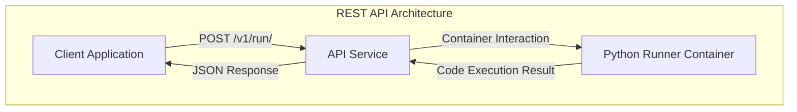
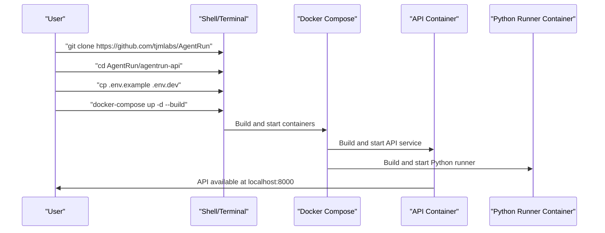
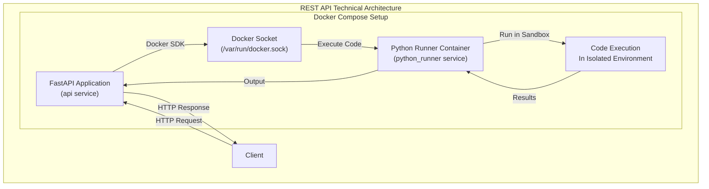
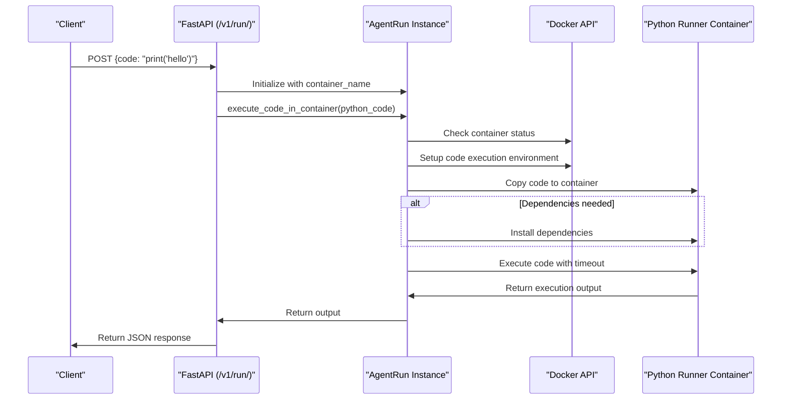

<!-- source: DeepWiki mcp.deepwiki.com · repo tjmlabs/AgentRun · page 2.2 REST API Setup · fetched 2026-10-26 -->

# REST API Setup

<details>
<summary>Relevant source files</summary>

The following files were used as context for generating this wiki page:

- [README.md](README.md)
- [agentrun-api/docker-compose.yml](agentrun-api/docker-compose.yml)
- [agentrun-api/requirements.txt](agentrun-api/requirements.txt)
- [agentrun-api/src/api/main.py](agentrun-api/src/api/main.py)
- [pyproject.toml](pyproject.toml)

</details>


This guide provides instructions for setting up and using the AgentRun REST API with Docker Compose. The REST API offers a simpler way to use AgentRun's code execution capabilities through HTTP requests, without having to directly manage Docker containers or the Python AgentRun package. For details on using AgentRun as a Python package, see [Python Package Installation](#2.1).

## Overview

The AgentRun REST API is a standalone service that exposes AgentRun's code execution capabilities through HTTP endpoints. It uses Docker Compose to set up two containers:

1. A FastAPI-based API service that receives code execution requests
2. A Python runner container where the code is actually executed in isolation

This setup is recommended for users who want the simplest possible integration path or who aren't familiar with Docker configuration.



Sources: [README.md:59-121](), [agentrun-api/docker-compose.yml:1-28]()

## Prerequisites

Before setting up the AgentRun REST API, ensure you have:

1. Docker and Docker Compose installed on your system
2. Git installed to clone the repository
3. Basic understanding of API usage (for consuming the API)

## Installation Steps

Follow these steps to set up the AgentRun REST API:

1. Clone the AgentRun repository
2. Configure environment variables
3. Build and start the Docker containers

### 1. Clone the Repository

```bash
git clone https://github.com/tjmlabs/AgentRun
cd AgentRun/agentrun-api
```

### 2. Configure Environment Variables

Copy the example environment file:

```bash
cp .env.example .env.dev
```

You can edit `.env.dev` if you need to customize any environment variables.

### 3. Build and Start Docker Containers

```bash
docker-compose up -d --build
```

This command builds the necessary Docker images and starts the containers in detached mode. When completed, the API will be available at `http://localhost:8000`.



Sources: [README.md:63-68](), [agentrun-api/docker-compose.yml:1-28]()

## API Endpoints

The AgentRun REST API provides the following endpoints:

| Endpoint | Method | Description |
|----------|--------|-------------|
| `/v1/run/` | POST | Executes Python code and returns the output |
| `/v1/health/` | GET | Returns API health status |
| `/` | GET | Redirects to API documentation |

### Code Execution Endpoint

The main endpoint for code execution is `/v1/run/`. Here's how to use it:

**Request format:**

```json
{
  "code": "print('hello, world!')"
}
```

**Response format:**

```json
{
  "output": "hello, world!"
}
```

Sources: [agentrun-api/src/api/main.py:45-56](), [README.md:72-91]()

## Using the API

You can interact with the API using any HTTP client. Here are examples using different methods:

### Using JavaScript Fetch

```javascript
fetch('http://localhost:8000/v1/run/', {
    method: 'POST',
    headers: {
        'Content-Type': 'application/json'
    },
    body: JSON.stringify({
        code: "print('hello, world!')"
    })
})
.then(response => response.json())
.then(data => console.log(data))
.catch(error => console.error('Error:', error));
```

### Using cURL

```bash
curl -X POST http://localhost:8000/v1/run/ -H "Content-Type: application/json" -d '{"code": "print(\"hello, world!\")"}'
```

### Using Python Requests

```python
import requests

def execute_python_code(code: str) -> str:
    response = requests.post("http://localhost:8000/v1/run/", json={"code": code})
    output = response.json()["output"]
    return output

# Example usage
result = execute_python_code("print('hello, world!')")
print(result)  # Output: hello, world!
```

Sources: [README.md:72-91](), [README.md:147-152]()

## Technical Architecture

The AgentRun REST API consists of two Docker containers working together to provide secure code execution:



Sources: [agentrun-api/docker-compose.yml:1-28](), [agentrun-api/src/api/main.py:1-56]()

### API Service Container

The API service is a FastAPI application that:

1. Receives HTTP requests for code execution
2. Communicates with the Docker daemon through the Docker socket
3. Uses the AgentRun library to execute code in the Python runner container
4. Returns the execution results

Key technical details:

- Built on FastAPI framework
- Uses a ThreadPoolExecutor to run code execution asynchronously
- Has access to the Docker socket to control the Python runner container
- Runs on port 8000 by default

Sources: [agentrun-api/docker-compose.yml:2-13](), [agentrun-api/src/api/main.py:5-56]()

### Python Runner Container

The Python runner is a dedicated container where code execution actually takes place:

- Pre-installed with common dependencies (requests, yfinance)
- Security-hardened with process limits and privilege restrictions
- Uses a dedicated volume for code execution artifacts
- Runs continuously as a service

Key security features:

- Process limit (`pids_limit: 10`): Prevents fork bombs and excessive process creation
- Security opt (`no-new-privileges:true`): Prevents privilege escalation
- Isolated volume: Keeps code execution artifacts contained

Sources: [agentrun-api/docker-compose.yml:15-26]()

## Code Execution Flow

When you send a code execution request, here's what happens behind the scenes:



Sources: [agentrun-api/src/api/main.py:45-56]()

## Default Configuration

The REST API comes with these default configurations:

| Configuration | Value | Description |
|---------------|-------|-------------|
| Container Name | `agentrun-api-python_runner-1` | Name of the Python runner container |
| Cached Dependencies | `requests`, `yfinance` | Pre-installed dependencies |
| Default Timeout | 300 seconds (5 minutes) | Maximum execution time |
| API Port | 8000 | Port the API listens on |

These settings provide a good balance between usability and security. The cached dependencies allow common operations without needing to install packages at runtime, which improves performance.

Sources: [agentrun-api/src/api/main.py:47-51](), [agentrun-api/docker-compose.yml:1-28]()

## Customizing the REST API

You can customize the API by:

1. **Modifying environment variables**: Edit `.env.dev` to change environment-specific settings
2. **Editing `docker-compose.yml`**: Adjust container configurations, resource limits, and volume mappings
3. **Modifying `main.py`**: Change cached dependencies, timeouts, or other AgentRun parameters

For example, to add more cached dependencies, you would modify the `cached_dependencies` list in [agentrun-api/src/api/main.py:49]().

## Comparison with Python Package

The REST API approach offers several advantages and differences compared to using AgentRun as a Python package:

| Aspect | REST API | Python Package |
|--------|----------|----------------|
| Installation | Git clone + Docker Compose | pip install |
| Docker setup | Pre-configured | Manual configuration |
| Integration | Any language via HTTP | Python only |
| Deployment | Standalone service | Embedded in application |
| Configuration | Limited through files | Full programmatic control |
| Isolation | Complete service separation | Library within application |

Sources: [README.md:114-121]()

## Troubleshooting

Common issues you might encounter:

1. **Docker socket permission denied**: Ensure your user has permissions to access the Docker socket
2. **Port already in use**: Change the port mapping in `docker-compose.yml` if port 8000 is already used
3. **Container name conflicts**: If you see conflicts with container names, you may need to adjust the container name in [agentrun-api/src/api/main.py:48]()

## Summary

The AgentRun REST API provides a simple way to execute Python code safely through HTTP requests. By using Docker Compose, it manages all the complexity of Docker container setup and configuration, allowing you to focus on using the API rather than managing infrastructure.

For more advanced usage and customization options, see [Configuration Options](#4) and [Performance Optimization](#4.2).

---

