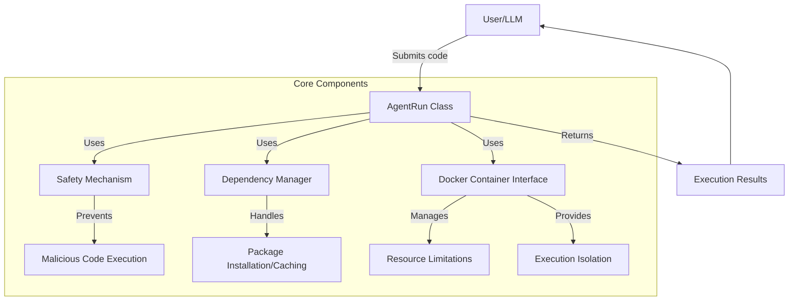
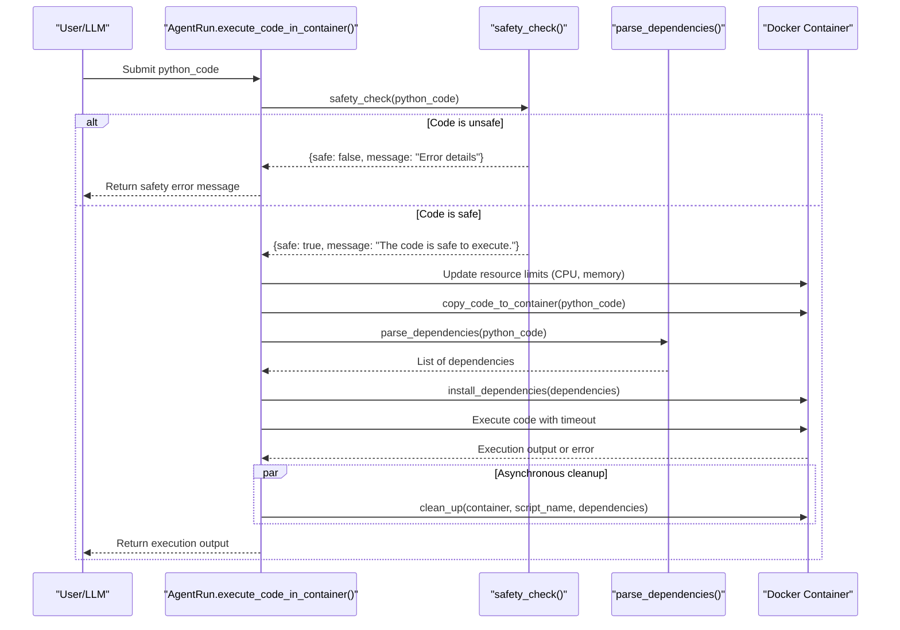
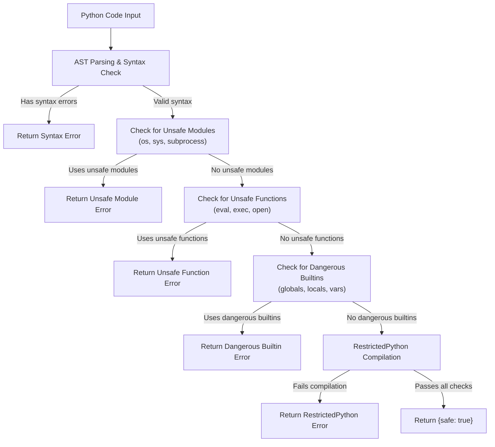
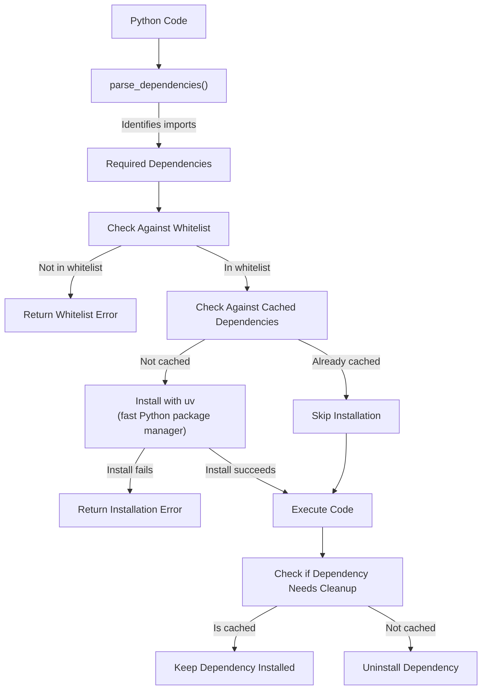
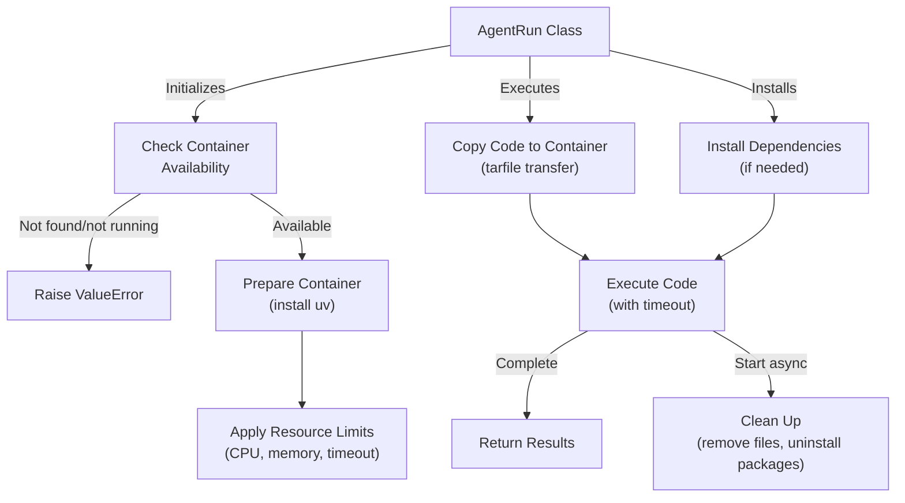

<!-- source: DeepWiki mcp.deepwiki.com · repo tjmlabs/AgentRun · page 3 Core Components · fetched 2026-10-26 -->

# Core Components

Relevant source files

The following files were used as context for generating this wiki page:

- [agentrun/__init__.py](agentrun/__init__.py)
- [docs/index.md](docs/index.md)
- [tests/test_agentrun.py](tests/test_agentrun.py)

This page provides a comprehensive overview of the core components that make up the AgentRun system. These are the fundamental building blocks that enable safe code execution for LLMs in isolated Docker environments. For installation instructions, see [Installation and Setup](#2).

## System Overview

AgentRun consists of several integrated components that work together to provide secure code execution. The system is designed around the central `AgentRun` class which coordinates safety checks, dependency management, Docker container interactions, and code execution.

Sources: [agentrun/__init__.py:17-454]()

## AgentRun Class

The `AgentRun` class is the primary interface for interacting with the AgentRun system. It orchestrates the entire execution process, from safety checks to running code in Docker containers.

### Constructor Parameters

| Parameter | Default | Description |
|-----------|---------|-------------|
| `container_name` | (required) | Name of the Docker container to use |
| `dependencies_whitelist` | `["*"]` | List of allowed dependencies (or `["*"]` to allow all) |
| `cached_dependencies` | `[]` | Dependencies to install and cache in the container |
| `cpu_quota` | `50000` | CPU quota in microseconds (50% of a CPU core) |
| `default_timeout` | `20` | Default execution timeout in seconds |
| `memory_limit` | `"100m"` | Memory limit for container |
| `memswap_limit` | `"512m"` | Memory + swap limit |

### Key Methods

| Method | Purpose |
|--------|---------|
| `execute_code_in_container(python_code)` | Main method to execute Python code safely |
| `safety_check(python_code)` | Analyzes code for unsafe patterns |
| `parse_dependencies(python_code)` | Extracts required dependencies from code |
| `install_dependencies(container, dependencies)` | Installs packages in the container |
| `clean_up(container, script_name, dependencies)` | Removes artifacts after execution |

Sources: [agentrun/__init__.py:17-89](), [agentrun/__init__.py:385-454]()

## Code Execution Flow

This diagram illustrates the complete execution flow from code submission to result retrieval:

Sources: [agentrun/__init__.py:385-454]()

## Safety Mechanism

The safety mechanism is a critical component that prevents execution of malicious or dangerous code. It uses a multi-layered approach to detect potentially harmful code patterns.

### Security Checks

1. **Syntax Validation**: Verifies code has valid Python syntax
2. **AST Analysis**: Inspects the Abstract Syntax Tree to detect:
   - Unsafe module imports (`os`, `sys`, `subprocess`, etc.)
   - Dangerous built-in functions (`eval`, `exec`, `globals`, etc.)
   - Unsafe function calls (`open`, `__import__`, etc.)
3. **RestrictedPython Compilation**: Uses RestrictedPython to detect more complex unsafe patterns

Sources: [agentrun/__init__.py:159-252](), [tests/test_agentrun.py:36-106]()

## Dependency Management

The dependency management system automatically detects, installs, and manages Python package dependencies required by the code being executed.

### Key Features

1. **Automatic Detection**: Parses the code to identify third-party imports
2. **Dependency Whitelisting**: Controls which packages can be installed
3. **Dependency Caching**: Pre-installs frequently used packages for better performance
4. **Automatic Cleanup**: Uninstalls non-cached dependencies after execution

Sources: [agentrun/__init__.py:254-341]()

## Docker Container Interface

The Docker interface handles all interactions with the Docker container, providing isolation and resource control for code execution.

### Key Responsibilities

1. **Container Management**: Verifies container existence and status
2. **Resource Controls**: Applies CPU, memory, and other resource limits
3. **File Operations**: Transfers code and dependencies to the container
4. **Command Execution**: Runs commands with proper timeout handling
5. **Cleanup**: Removes temporary files and dependencies after execution

### Resource Limitations

| Resource | Default | Description |
|----------|---------|-------------|
| CPU quota | 50000 | Limits CPU usage to 50% of one core |
| Memory limit | 100MB | Restricts RAM usage |
| Swap limit | 512MB | Limits total memory including swap |
| Execution timeout | 20 seconds | Terminates long-running code |
| Process limit | 10 | Limits number of processes (set during container creation) |
| Privileges | No new privileges | Prevents privilege escalation |

Sources: [agentrun/__init__.py:128-158](), [agentrun/__init__.py:343-383]()

## Integration

The core components are tightly integrated to provide a seamless execution environment. This integration ensures code is safely executed with proper resource controls and dependency management.

| Component | Interacts With | Purpose |
|-----------|---------------|---------|
| AgentRun | Safety Mechanism | Prevent dangerous code execution |
| AgentRun | Dependency Manager | Handle package dependencies |
| AgentRun | Docker Interface | Execute code in isolation |
| Safety Mechanism | AST Parser | Analyze code structure for safety |
| Dependency Manager | Docker Interface | Install packages in container |
| Docker Interface | Container | Apply resource limits and execute code |

Sources: [agentrun/__init__.py:17-454](), [docs/index.md:35-46]()

## Summary

The core components of AgentRun work together to enable secure execution of untrusted code:

1. The **AgentRun** class provides the main interface and orchestration
2. The **Safety Mechanism** prevents execution of dangerous code
3. The **Dependency Management** system handles package requirements
4. The **Docker Container Interface** provides isolation and resource control

These components combine to create a secure, efficient system for executing LLM-generated code in a controlled environment. For more details on the AgentRun class specifically, see [AgentRun Class](#3.1).

---

