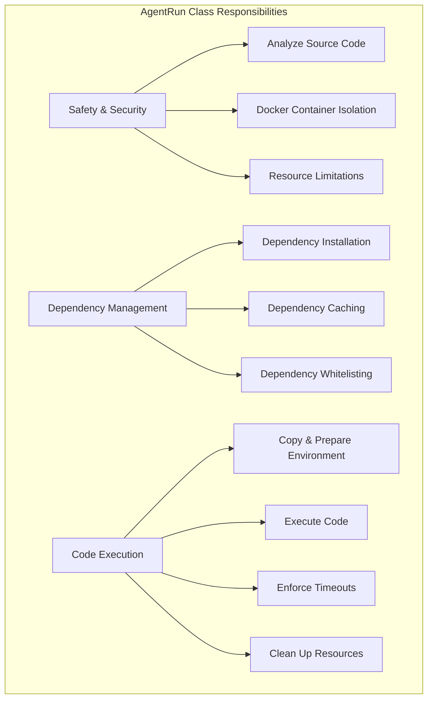
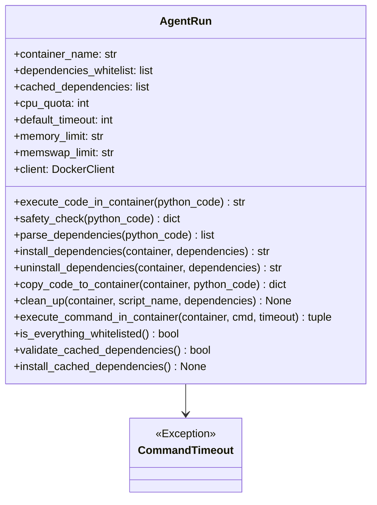
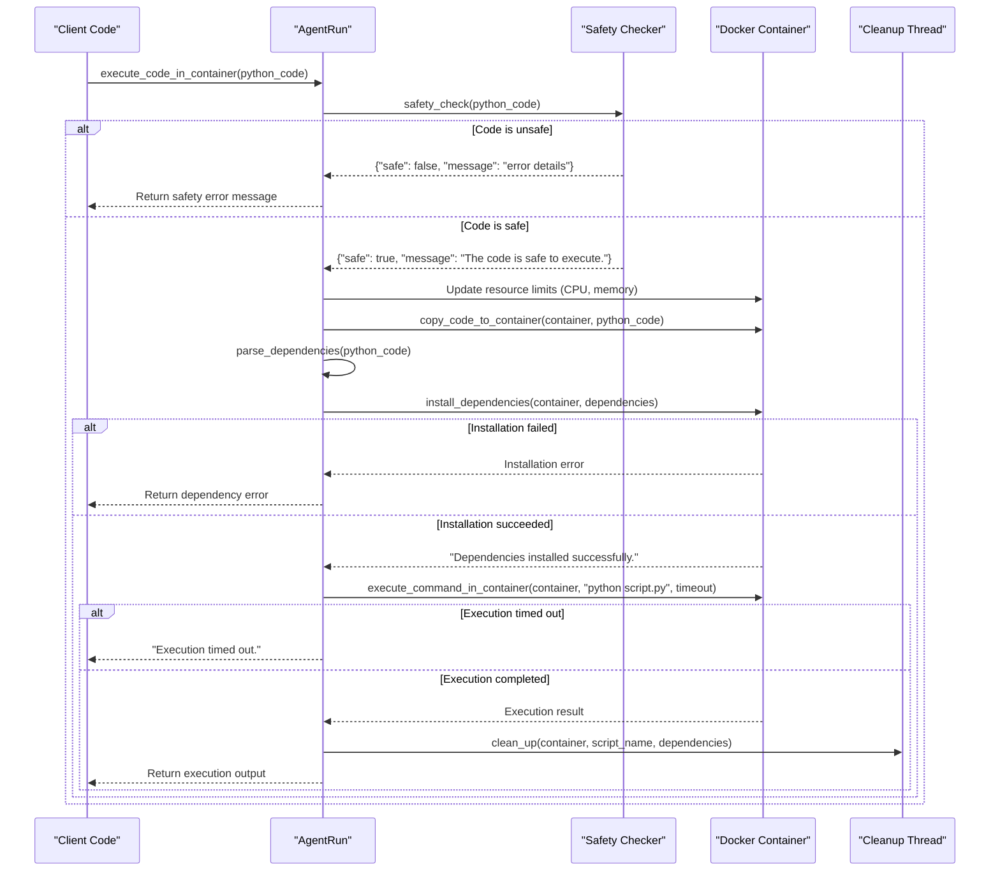
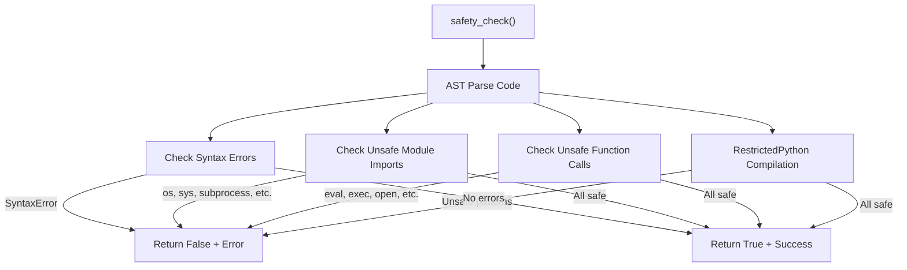
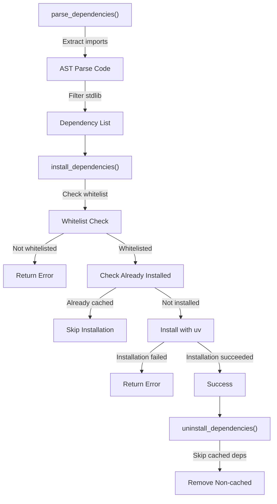
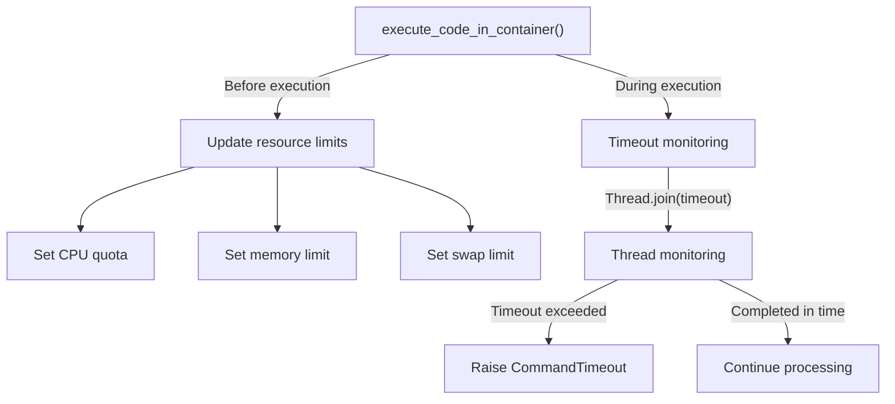
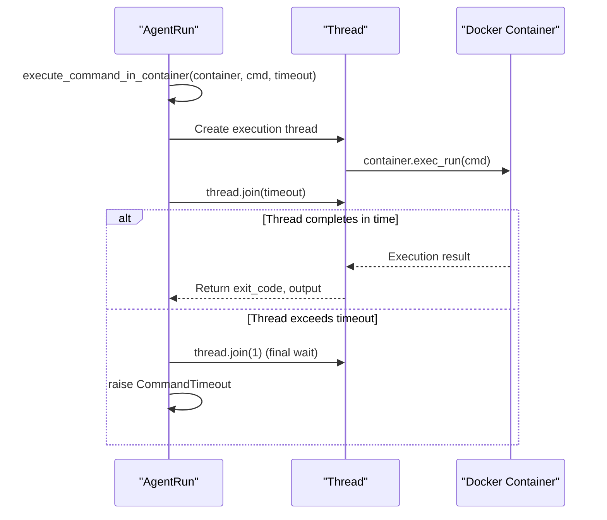
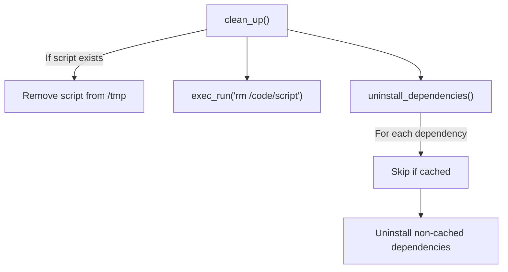
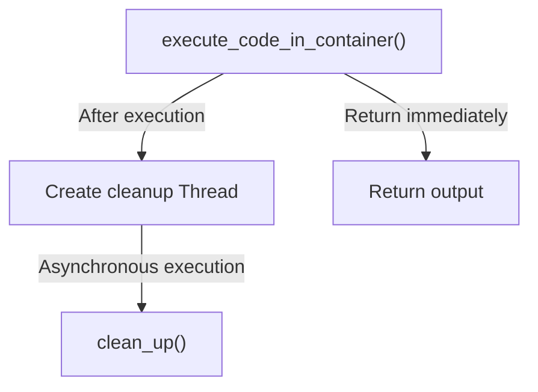

<!-- source: DeepWiki mcp.deepwiki.com · repo tjmlabs/AgentRun · page 3.1 AgentRun Class · fetched 2026-10-26 -->

# AgentRun Class

<details>
<summary>Relevant source files</summary>

The following files were used as context for generating this wiki page:

- [agentrun/__init__.py](agentrun/__init__.py)
- [docs/api.md](docs/api.md)
- [tests/test_agentrun.py](tests/test_agentrun.py)

</details>


This document provides comprehensive technical documentation for the `AgentRun` class, which serves as the core component of the AgentRun system for secure code execution in isolated Docker containers. The class handles all aspects of safely executing Python code provided by users or LLMs, including safety validation, dependency management, Docker container interaction, and resource control.

For a high-level overview of the entire system, see [Architecture Overview](#1.2).

## Class Purpose and Responsibility

The `AgentRun` class is the primary interface for executing Python code in a sandboxed Docker environment. It provides a controlled execution context with configurable resource limits and dependency management while maintaining strict security isolation.



Sources: [agentrun/__init__.py:17-37]()

## Class Initialization

The `AgentRun` class initializer accepts several configuration parameters that control its behavior.

### Parameters

| Parameter | Type | Default | Description |
|-----------|------|---------|-------------|
| `container_name` | str | (required) | Name of the Docker container to use |
| `dependencies_whitelist` | list[str] | `["*"]` | List of allowed package dependencies |
| `cached_dependencies` | list[str] | `[]` | Dependencies to pre-install and cache |
| `cpu_quota` | int | 50000 | CPU quota in microseconds |
| `default_timeout` | int | 20 | Execution timeout in seconds |
| `memory_limit` | str | "100m" | Container memory limit |
| `memswap_limit` | str | "512m" | Container memory+swap limit |
| `client` | docker.client.DockerClient | auto-created | Docker client instance |

During initialization, the class performs several validations:
1. Verifies Docker daemon is running
2. Confirms the specified container exists and is running
3. Validates cached dependencies against the whitelist
4. Installs the `uv` package manager in the container
5. Pre-installs any cached dependencies

Sources: [agentrun/__init__.py:37-89]()

## Class Architecture



Sources: [agentrun/__init__.py:17-94](), [docs/api.md:1-17]()

## Code Execution Flow

The primary method `execute_code_in_container` orchestrates the entire execution process with multiple stages to ensure security and proper resource management.



Sources: [agentrun/__init__.py:385-454]()

## Key Methods

### Safety Validation

The `safety_check` method performs multiple security validations on provided code:



The method detects:
- Syntax errors
- Imports of unsafe modules (`os`, `sys`, `subprocess`, etc.)
- Calls to unsafe functions (`eval`, `exec`, `open`, etc.)
- Uses of dangerous builtins (`globals`, `locals`, etc.)
- Additional patterns caught by RestrictedPython

Sources: [agentrun/__init__.py:159-252](), [tests/test_agentrun.py:36-107]()

### Dependency Management

The `AgentRun` class includes robust dependency management functionality:

1. `parse_dependencies`: Extracts required dependencies from code using AST parsing
2. `install_dependencies`: Installs dependencies with whitelist validation
3. `uninstall_dependencies`: Removes non-cached dependencies after execution
4. Dependency caching for improved performance



Sources: [agentrun/__init__.py:254-342](), [tests/test_agentrun.py:140-204]()

### Resource Management

The class manages Docker container resources through:

1. CPU quota limits (default: 50,000 microseconds)
2. Memory limits (default: 100MB) 
3. Swap limits (default: 512MB)
4. Execution timeouts (default: 20 seconds)



Sources: [agentrun/__init__.py:37-53](), [agentrun/__init__.py:128-157](), [agentrun/__init__.py:416-420]()

## Usage Example

The following example demonstrates basic usage of the `AgentRun` class:

```python
from agentrun import AgentRun

# Initialize with a running Docker container
runner = AgentRun(
    container_name="my_container",
    dependencies_whitelist=["numpy", "pandas", "matplotlib"],
    cached_dependencies=["numpy"],
    default_timeout=30
)

# Execute Python code
result = runner.execute_code_in_container("""
import numpy as np
import matplotlib.pyplot as plt

# Generate some data
x = np.linspace(0, 10, 100)
y = np.sin(x)

# Print result
print(f"Max value: {y.max()}")
""")

print(result)
```

Sources: [agentrun/__init__.py:17-25](), [tests/test_agentrun.py:132-154](), [tests/test_agentrun.py:217-222]()

## Error Handling

The `AgentRun` class implements comprehensive error handling for various failure scenarios:

| Error Type | Handling Method | Return Value |
|------------|----------------|--------------|
| Docker connection failures | Constructor raises `RuntimeError` | N/A |
| Container not found | Constructor raises `ValueError` | N/A |
| Container not running | Constructor raises `ValueError` | N/A |
| Dependency whitelist mismatch | Constructor raises `ValueError` | N/A |
| Unsafe code | Error message returned from `execute_code_in_container` | Error description string |
| Dependency installation failures | Error message returned from `execute_code_in_container` | Error description string |
| Execution timeout | Error message returned from `execute_code_in_container` | "Execution timed out." |
| Runtime errors in code | Error captured and returned from `execute_code_in_container` | Error description string |

Sources: [agentrun/__init__.py:63-78](), [agentrun/__init__.py:400-445](), [tests/test_agentrun.py:225-269]()

## Command Execution and Timeout Mechanism

The `execute_command_in_container` method leverages threading to implement robust timeout handling for command execution:



Sources: [agentrun/__init__.py:128-157](), [agentrun/__init__.py:90-93]()

## Internal Cleanup Process

After code execution, the `clean_up` method performs asynchronous cleanup to maintain container health:



The cleanup process runs in a separate thread to avoid blocking the main execution flow:



Sources: [agentrun/__init__.py:371-383](), [agentrun/__init__.py:446-452]()

## Thread Safety Considerations

The `AgentRun` class uses threading in two key areas:

1. For timeout enforcement in `execute_command_in_container`
2. For asynchronous cleanup in `execute_code_in_container`

The class is designed to be thread-safe for individual method calls, but concurrent calls to `execute_code_in_container` on the same instance may lead to race conditions since they would operate on the same Docker container. For concurrent execution, separate `AgentRun` instances with different containers should be used.

Sources: [agentrun/__init__.py:128-157](), [agentrun/__init__.py:446-452]()

---

