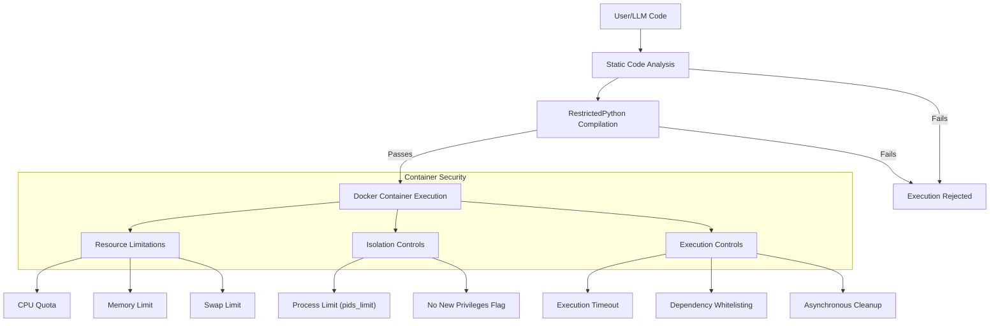
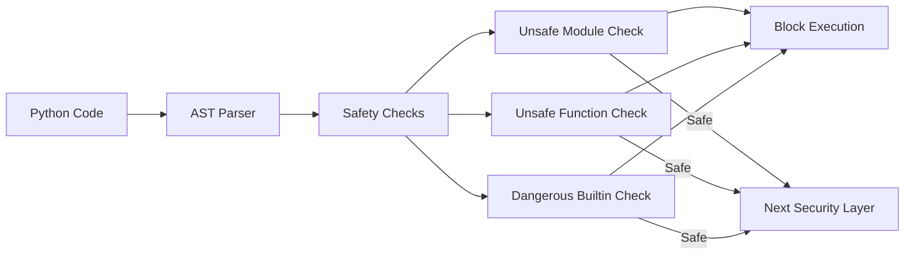
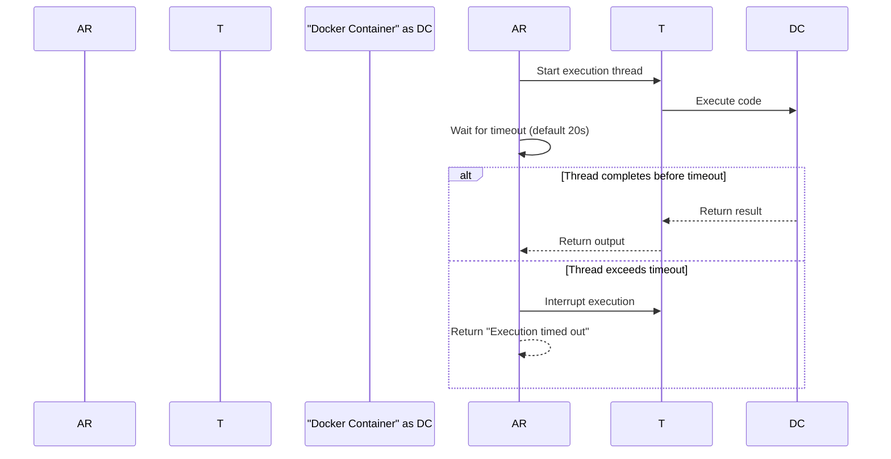
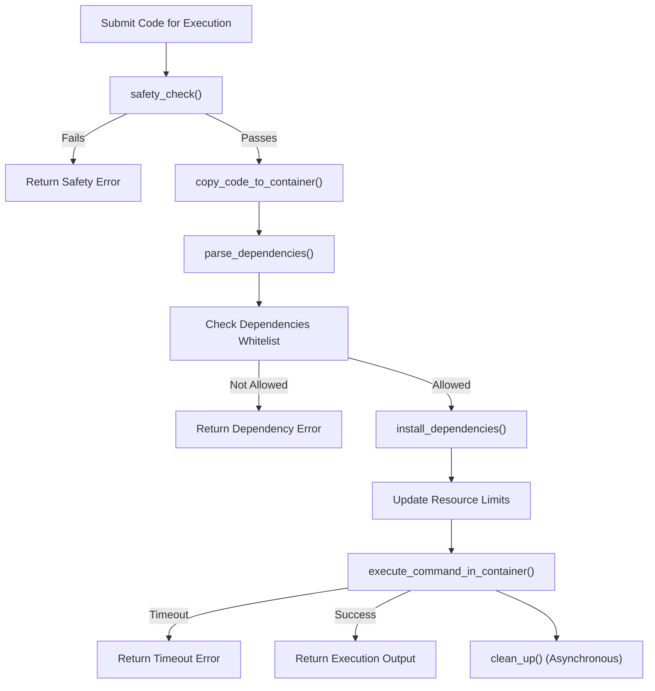

<!-- source: DeepWiki mcp.deepwiki.com · repo tjmlabs/AgentRun · page 3.2 Safety Mechanisms · fetched 2026-10-26 -->

# Safety Mechanisms

<details>
<summary>Relevant source files</summary>

The following files were used as context for generating this wiki page:

- [agentrun-api/docker-compose.yml](agentrun-api/docker-compose.yml)
- [agentrun/__init__.py](agentrun/__init__.py)
- [pyproject.toml](pyproject.toml)
- [tests/test_agentrun.py](tests/test_agentrun.py)

</details>


This document provides a comprehensive overview of the security mechanisms implemented in AgentRun to ensure the safe execution of user or LLM-generated Python code. AgentRun employs multiple layers of protection to mitigate security risks while allowing flexible code execution capabilities. For information about dependency management related to security, see [Dependency Management](#3.3).

## 1. Security Architecture Overview

AgentRun implements a defense-in-depth approach with multiple security layers that work together to provide comprehensive protection.



Sources: [agentrun/__init__.py:159-252](), [agentrun/__init__.py:385-454](), [agentrun-api/docker-compose.yml:22-24]()

## 2. Code Analysis Security

AgentRun implements a two-stage code analysis process to detect and block unsafe code before execution:

### 2.1 Static Code Analysis

The first layer of defense is a static code analyzer that examines Python code using the `ast` module to detect potentially dangerous patterns:



The static analyzer specifically checks for:

1. **Unsafe Module Imports**: Blocks access to sensitive system modules
   - Blacklisted modules include: `os`, `sys`, `subprocess`, `builtins`

2. **Unsafe Function Calls**: Prevents calls to potentially dangerous functions
   - Blocks functions like: `exec`, `eval`, `compile`, `open`, `__import__`, etc.

3. **Dangerous Built-ins**: Blocks access to built-in functions that could escape the sandbox
   - Includes: `globals`, `locals`, `vars`, `dir`, `eval`, `exec`, etc.

Sources: [agentrun/__init__.py:159-252](), [tests/test_agentrun.py:36-114]()

### 2.2 RestrictedPython Compilation

If code passes the static analysis, it undergoes a second check using RestrictedPython:

```python
# Example from the implementation
compiled_code = compile_restricted(
    python_code, filename="<dynamic>", mode="exec"
)
```

RestrictedPython creates a restricted execution environment that:
- Prevents access to object attributes starting with underscore `_`
- Limits access to certain built-in functions
- Restricts access to object internals

This provides an additional layer of security beyond the static analysis.

Sources: [agentrun/__init__.py:239-250](), [pyproject.toml:13]()

## 3. Docker Container Isolation

AgentRun executes all code within a Docker container, providing strong isolation from the host system:

### 3.1 Resource Limitations

The Docker container is configured with strict resource limitations to prevent resource exhaustion attacks:

| Resource Type | Default Limit | Configuration Method |
|---------------|---------------|----------------------|
| CPU Quota | 50,000 microseconds | `container.update(cpu_quota=self.cpu_quota)` |
| Memory Limit | 100MB | `container.update(mem_limit=self.memory_limit)` |
| Memory Swap | 512MB | `container.update(memswap_limit=self.memswap_limit)` |
| Process Limit | 10 processes | `pids_limit: 10` in Docker configuration |

These limits prevent runaway processes from consuming excessive resources and protect against denial-of-service attacks.

Sources: [agentrun/__init__.py:415-420](), [agentrun-api/docker-compose.yml:22]()

### 3.2 Privilege Restrictions

The Docker container runs with the `no-new-privileges:true` flag, which prevents processes inside the container from gaining additional privileges through mechanisms like setuid or setgid binaries.

```yaml
security_opt:
  - no-new-privileges:true
```

This is a critical security feature that helps maintain the container's security boundary.

Sources: [agentrun-api/docker-compose.yml:23-24]()

## 4. Execution Controls

AgentRun implements several controls over code execution to provide additional security guarantees:

### 4.1 Execution Timeout

All code execution is subject to a timeout (default: 20 seconds) to prevent infinite loops and resource exhaustion:



The timeout mechanism uses a separate thread to run the command and joins it with a timeout value. If the thread doesn't complete within the timeout period, the execution is interrupted and a timeout message is returned.

Sources: [agentrun/__init__.py:128-157](), [agentrun/__init__.py:437-441]()

### 4.2 Dependency Management

AgentRun implements dependency whitelisting to control which external packages can be installed:

- Dependencies are parsed from import statements using AST analysis
- Only whitelisted dependencies are allowed to be installed
- A wildcard `*` can be used to allow all dependencies
- Cached dependencies can be pre-installed for frequently used packages

This prevents the installation of potentially malicious or unauthorized packages.

Sources: [agentrun/__init__.py:254-283](), [agentrun/__init__.py:285-322]()

### 4.3 Asynchronous Cleanup

AgentRun performs cleanup operations after code execution:

- Removes the temporary script file from the container
- Uninstalls dependencies that are not cached
- Runs cleanup in a separate thread to avoid blocking

This ensures that subsequent code executions start with a clean environment.

Sources: [agentrun/__init__.py:371-383](), [agentrun/__init__.py:448-452]()

## 5. Security Implementation Flow

The following diagram illustrates the entire security workflow from code submission to execution:



This implementation ensures that:
1. Code is analyzed for safety before execution
2. Dependencies are checked against a whitelist
3. Resource limits are applied to the container
4. Execution is time-limited
5. Cleanup is performed after execution

Sources: [agentrun/__init__.py:385-454]()

## 6. Test Coverage of Safety Mechanisms

The safety mechanisms are extensively tested to ensure their effectiveness:

| Security Feature | Test Coverage |
|--------------------|--------------|
| Static Code Analysis | Multiple test cases for unsafe imports, function calls, and patterns |
| Execution Timeout | Tests for code that exceeds the timeout limit |
| Dependency Whitelisting | Tests for allowed and blocked dependencies |
| Docker Container | Tests for container initialization and resource limits |

The test suite includes a wide range of potential security bypass attempts, including obfuscated malicious code patterns.

Sources: [tests/test_agentrun.py:36-114](), [tests/test_agentrun.py:117-137](), [tests/test_agentrun.py:140-204]()

## 7. Security Limitations

Despite the robust safety mechanisms, users should be aware of the following limitations:

1. Network access is not restricted by default
2. Some standard library modules might provide indirect access to system resources
3. Resource-intensive operations may still impact container performance

For maximum security in production environments, consider implementing additional network isolation and more restrictive Docker configurations.

Sources: [tests/test_agentrun.py:93-97]()

## 8. Security Best Practices

For optimal security when using AgentRun:

1. Always use the latest version with all security patches
2. Configure strict dependency whitelists for production environments
3. Set appropriate resource limits based on your workload requirements
4. Monitor container resource usage for anomalies
5. Run the AgentRun API service in a separate, isolated environment

Following these practices helps ensure the secure execution of code while minimizing potential security risks.

Sources: [agentrun/__init__.py:37-79]()

---

