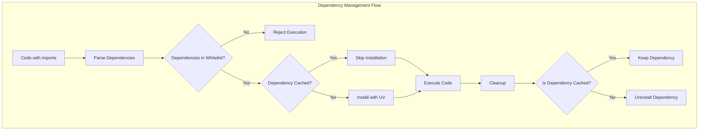
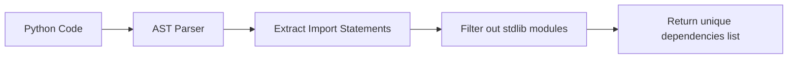
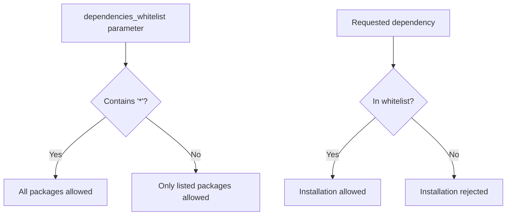
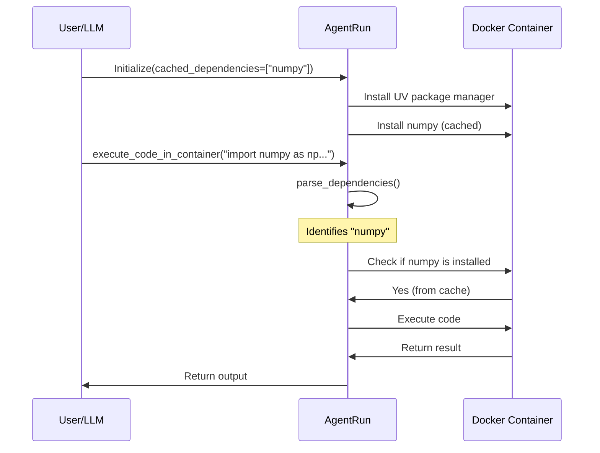

<!-- source: DeepWiki mcp.deepwiki.com · repo tjmlabs/AgentRun · page 3.3 Dependency Management · fetched 2026-10-26 -->

# Dependency Management

<details>
<summary>Relevant source files</summary>

The following files were used as context for generating this wiki page:

- [agentrun/__init__.py](agentrun/__init__.py)
- [docs/index.md](docs/index.md)
- [tests/test_agentrun.py](tests/test_agentrun.py)

</details>


This document explains how AgentRun handles Python package dependencies when executing code in isolated Docker containers. The dependency management system allows for safe installation and removal of packages while providing performance optimizations through caching.

For information about resource limitations and timeout configuration, see [Resource Limitations](#4.1).

## Overview

AgentRun's dependency management consists of four key components:

1. Dependency parsing - extracting required packages from code
2. Dependency whitelisting - controlling which packages can be installed
3. Dependency installation - using the UV package manager for fast installation
4. Dependency caching - optimizing performance by pre-installing common packages



Sources: [agentrun/__init__.py:254-341](), [docs/index.md:37-42]()

## Dependency Parsing

AgentRun analyzes Python code to identify required dependencies by parsing the import statements and filtering out standard library modules.

The `parse_dependencies` method uses the `ast` module to walk through the abstract syntax tree of the code, looking for both `import` and `from ... import` statements. It then extracts the module names and filters out Python's built-in and standard library modules.



Sources: [agentrun/__init__.py:254-283]()

### Example

For the following code:

```
import numpy as np
from scipy.optimize import minimize
import math
from collections import namedtuple
```

The parser would identify `numpy` and `scipy` as external dependencies, while `math` and `collections` would be recognized as standard library modules and excluded.

Sources: [tests/test_agentrun.py:140-157]()

## Dependency Whitelisting

AgentRun provides control over which packages can be installed through a whitelist mechanism. This is particularly important for security, as some packages might have undesired functionality or excessive resource requirements.

The whitelist is configured through the `dependencies_whitelist` parameter when initializing the `AgentRun` class:

- Default value is `["*"]`, which means all packages are allowed
- To restrict to specific packages, provide a list of allowed package names
- Cached dependencies must be included in the whitelist



Sources: [agentrun/__init__.py:95-116](), [agentrun/__init__.py:285-322]()

## Dependency Installation

AgentRun uses the [UV package manager](https://github.com/astral-sh/uv) to install Python dependencies quickly. The installation process occurs in the Docker container before code execution.

Key aspects of the installation process:

1. The system first checks if dependencies are allowed by the whitelist
2. For cached dependencies, it checks if they're already installed
3. Dependencies are installed using the command `uv pip install {dep} --system`
4. Installation failures are reported back to the caller

Sources: [agentrun/__init__.py:285-322]()

## Dependency Caching

To improve performance for frequently used packages, AgentRun provides a caching mechanism. Cached dependencies are installed when the `AgentRun` instance is initialized and remain in the container for subsequent code executions.

Benefits of dependency caching:
- Eliminates reinstallation time for common packages
- Reduces execution time for code that uses popular libraries
- Allows for preparation of environments with specific dependency versions



Sources: [agentrun/__init__.py:37-89](), [agentrun/__init__.py:117-126](), [docs/index.md:42]()

## Dependency Cleanup

After code execution, AgentRun automatically cleans up by uninstalling non-cached dependencies. This ensures the container remains clean for future executions and prevents package version conflicts.

The cleanup process:
1. Runs in a separate thread to avoid blocking the main execution
2. Skips cached dependencies, keeping them installed
3. Uses `uv pip uninstall -y {dep}` to remove non-cached dependencies

Sources: [agentrun/__init__.py:324-341](), [agentrun/__init__.py:371-383](), [agentrun/__init__.py:446-452]()

## Configuration Options

### Dependency Whitelist

Controls which packages can be installed:

```python
# Allow any package to be installed
runner = AgentRun(
    container_name="my_container",
    dependencies_whitelist=["*"]
)

# Allow only specific packages
runner = AgentRun(
    container_name="my_container",
    dependencies_whitelist=["numpy", "pandas", "requests"]
)

# Allow no external packages
runner = AgentRun(
    container_name="my_container",
    dependencies_whitelist=[]
)
```

### Cached Dependencies

Pre-install packages for better performance:

```python
# Cache commonly used data science packages
runner = AgentRun(
    container_name="my_container",
    cached_dependencies=["numpy", "pandas", "matplotlib"],
    dependencies_whitelist=["*"]  # Must include cached deps
)
```

Sources: [docs/index.md:301-321](), [agentrun/__init__.py:37-89]()

## Best Practices

1. **Security**: Use the whitelist to restrict which packages can be installed, especially in production environments
   
2. **Performance**: Cache frequently used packages to improve execution speed:
   ```python
   # For data science workloads
   cached_dependencies=["numpy", "pandas", "matplotlib", "scikit-learn"]
   
   # For web/API workloads
   cached_dependencies=["requests", "beautifulsoup4", "httpx"]
   ```

3. **Resource Management**: Be mindful that large packages can consume significant disk space and memory in the container

4. **Dependency Conflicts**: Avoid caching packages with conflicting dependencies

Sources: [docs/index.md:36-43](), [tests/test_agentrun.py:160-204]()

## Common Issues and Solutions

| Issue | Possible Cause | Solution |
|-------|----------------|----------|
| "Dependency X is not in the whitelist" | Package requested but not allowed | Add package to `dependencies_whitelist` |
| "Failed to install dependency X" | Package doesn't exist or installation error | Check package name or try a different version |
| "Some cached dependencies are not in the whitelist" | Configuration error | Ensure all cached dependencies are included in whitelist |
| Slow execution with dependencies | Dependencies being reinstalled each time | Use `cached_dependencies` for frequently used packages |

Sources: [tests/test_agentrun.py:160-204](), [agentrun/__init__.py:73-78]()

## Implementation Details

The dependency management system in AgentRun is implemented in the following key methods:

1. `parse_dependencies(python_code)`: Extracts required packages from code
2. `install_dependencies(container, dependencies)`: Installs packages in the container
3. `uninstall_dependencies(container, dependencies)`: Removes packages after execution
4. `is_everything_whitelisted()`: Checks if all packages are allowed
5. `validate_cached_dependencies()`: Ensures cached dependencies are in the whitelist

Sources: [agentrun/__init__.py:95-383]()

---

