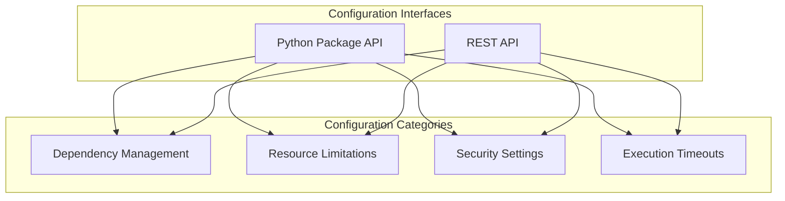
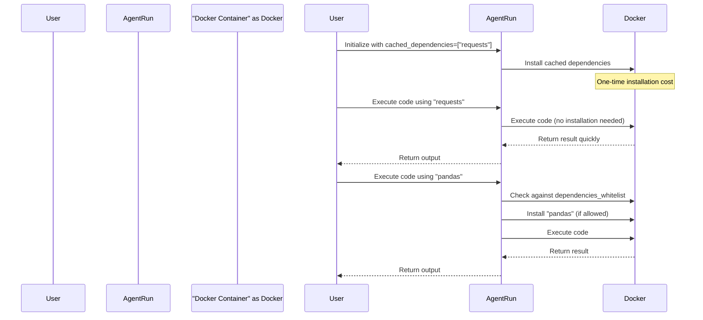
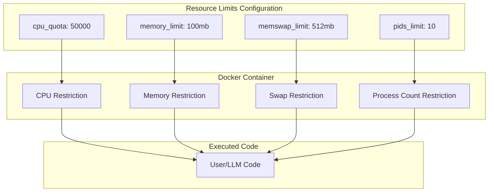
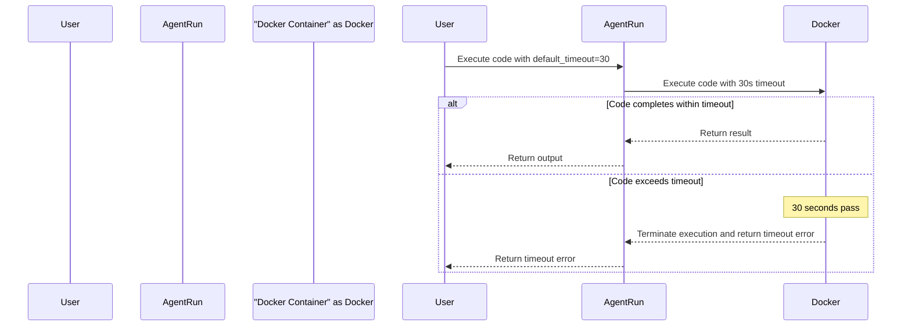
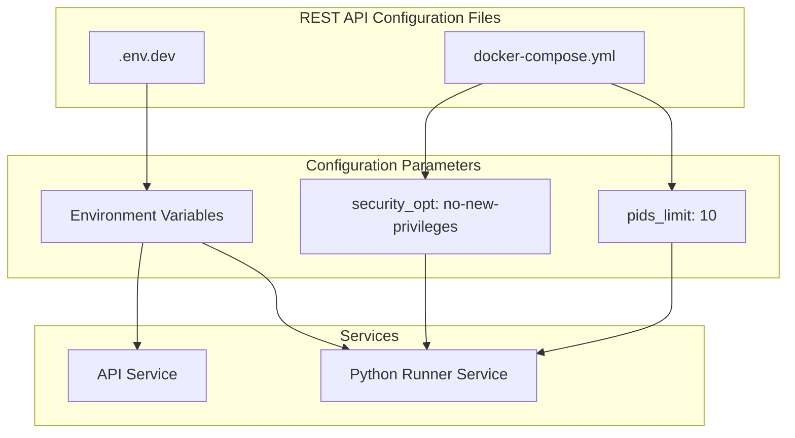
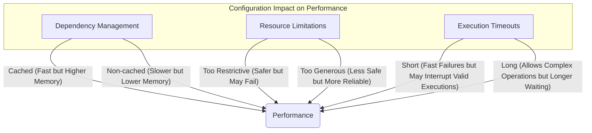

<!-- source: DeepWiki mcp.deepwiki.com · repo tjmlabs/AgentRun · page 4 Configuration Options · fetched 2026-10-26 -->

# Configuration Options

<details>
<summary>Relevant source files</summary>

The following files were used as context for generating this wiki page:

- [README.md](README.md)
- [agentrun-api/docker-compose.yml](agentrun-api/docker-compose.yml)
- [docs/index.md](docs/index.md)
- [pyproject.toml](pyproject.toml)

</details>


This page documents all available configuration options for AgentRun, a system that enables safe execution of code generated by LLMs. These configuration options allow you to customize security constraints, resource limitations, and dependency management behavior. For information about integration with specific LLM providers, see [Integration with LLMs](#5).

## Overview of Configuration Options

AgentRun provides configuration options for both the Python package and the REST API service. These options control critical aspects of code execution, including resource limitations, dependency management, and security settings.



Sources: [README.md:268-322](), [docs/index.md:267-322]()

## Dependency Management Configuration

AgentRun provides options to control which dependencies can be installed and to optimize performance through dependency caching.

### dependencies_whitelist

Controls which Python packages can be installed during code execution.

- **Default value**: `[]` (allows any package to be installed)
- **Expected type**: List of strings
- **Example**: `["requests", "pandas", "numpy"]` (only these packages can be installed)

### cached_dependencies

Dependencies that are pre-installed in the Docker container and persist between code executions for improved performance.

- **Default value**: `[]` (no cached dependencies)
- **Expected type**: List of strings
- **Example**: `["requests", "pandas"]`

> **Note**: Using cached dependencies results in longer initialization time but significantly faster subsequent executions that use those packages.



Sources: [README.md:270-274](), [docs/index.md:270-274]()

## Resource Limitation Configuration

These options help restrict the computational resources available to the executed code, preventing resource exhaustion and potential denial-of-service issues.

### cpu_quota

Limits CPU usage for the Docker container.

- **Default value**: `50000` (50% of a single CPU core)
- **Expected type**: Integer
- **Units**: Microseconds of CPU time per 100,000 microsecond period
- **Example**: `25000` (25% of a single CPU core)

### memory_limit

Restricts the amount of RAM available to the executed code.

- **Default value**: `"100mb"`
- **Expected type**: String
- **Example**: `"512mb"`

### memswap_limit

Controls the combined memory and swap usage of the container.

- **Default value**: `"512mb"`
- **Expected type**: String
- **Example**: `"1gb"`

### pids_limit

Restricts the number of processes that can be created within the container.

- **Default value**: `10`
- **Expected type**: Integer
- **Example**: `5`



Sources: [README.md:278-297](), [docs/index.md:278-297](), [agentrun-api/docker-compose.yml:22-24]()

## Execution Timeout Configuration

These options control how long code is allowed to run before being forcibly terminated.

### default_timeout

Maximum duration for code execution before it's terminated.

- **Default value**: `20` (seconds)
- **Expected type**: Integer
- **Units**: Seconds
- **Example**: `180` (3 minutes)



Sources: [README.md:286](), [docs/index.md:286]()

## Security Configuration Options

These options enhance the security of code execution by limiting privileges.

### security_opt: no-new-privileges

Prevents the executed code from gaining new privileges (e.g., through setuid programs).

- **Default value**: `true`
- **Expected type**: Boolean

Sources: [agentrun-api/docker-compose.yml:23-24]()

## Configuration Through Python API

When using the Python package, you can configure AgentRun by passing parameters to the constructor:

```python
from agentrun import AgentRun

runner = AgentRun(
    container_name="my_container",
    dependencies_whitelist=["requests", "pandas"],
    cached_dependencies=["requests"],
    default_timeout=180,  # 3 minutes
    memory_limit="512mb",
    memswap_limit="1gb",
    cpu_quota=25000  # 25% of a CPU core
)
```

Sources: [README.md:302-321](), [docs/index.md:302-321]()

## Configuration Through REST API

When using the REST API, many configuration options are set in the Docker Compose file and environment variables:



Sources: [agentrun-api/docker-compose.yml:1-28]()

## Performance Considerations

Configuration options significantly impact performance. Consider the following:

1. **Cached Dependencies**:
   - Pre-caching commonly used dependencies can reduce execution time from ~400ms to <200ms for typical operations.
   - The initial container startup will be slower with cached dependencies.

2. **Resource Limits**:
   - Setting appropriate resource limits is crucial for security but can affect performance.
   - Too restrictive limits may cause legitimate code to fail.
   - Too generous limits may pose security risks.

3. **Timeout Settings**:
   - The default 20-second timeout is appropriate for most simple operations.
   - Consider increasing for operations involving larger data processing.



Sources: [README.md:325-329](), [docs/index.md:325-329]()

## Default Configuration Values

Here's a summary of all default configuration values:

| Configuration Option | Default Value | Description |
|----------------------|---------------|-------------|
| dependencies_whitelist | `[]` (allows any) | Controls which packages can be installed |
| cached_dependencies | `[]` | Pre-installed dependencies |
| cpu_quota | `50000` | 50% of one CPU core |
| memory_limit | `"100mb"` | RAM limit |
| memswap_limit | `"512mb"` | Combined memory and swap limit |
| default_timeout | `20` (seconds) | Maximum execution time |
| pids_limit | `10` | Maximum number of processes |
| no-new-privileges | `true` | Prevents privilege escalation |

Sources: [README.md:268-297](), [docs/index.md:268-297](), [agentrun-api/docker-compose.yml:22-24]()

---

