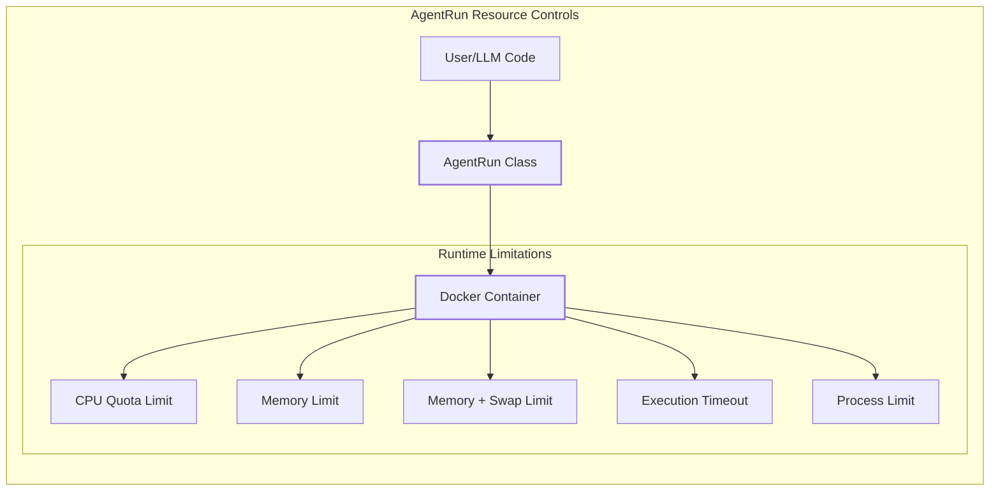
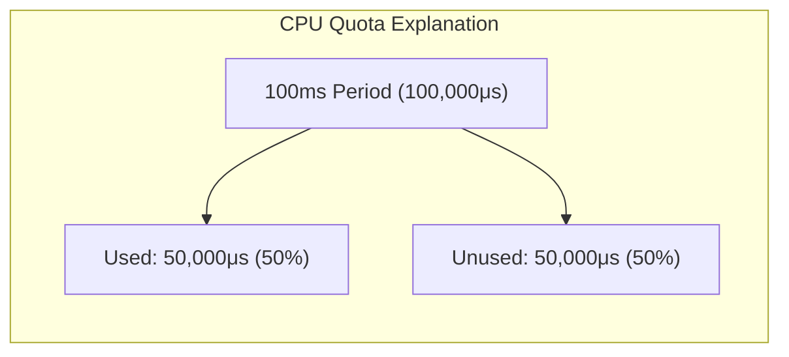
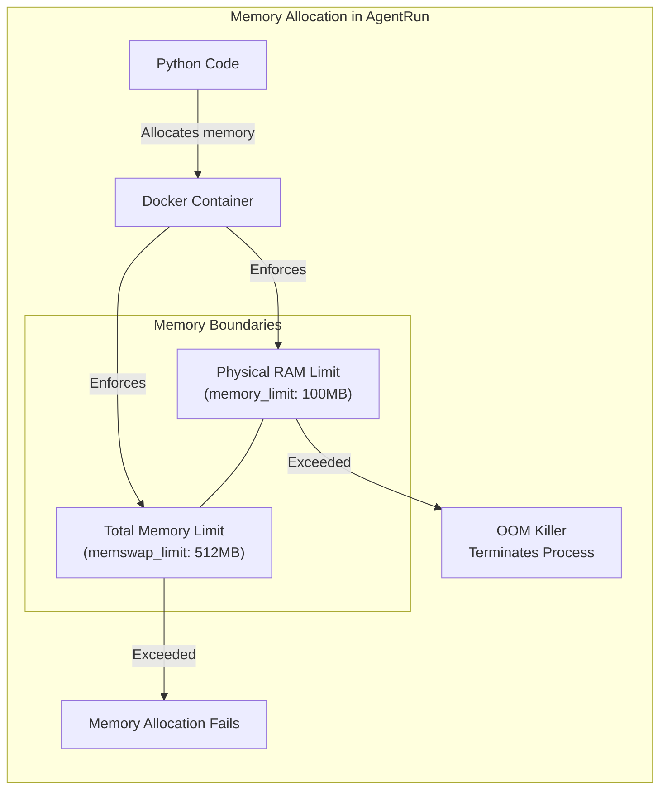
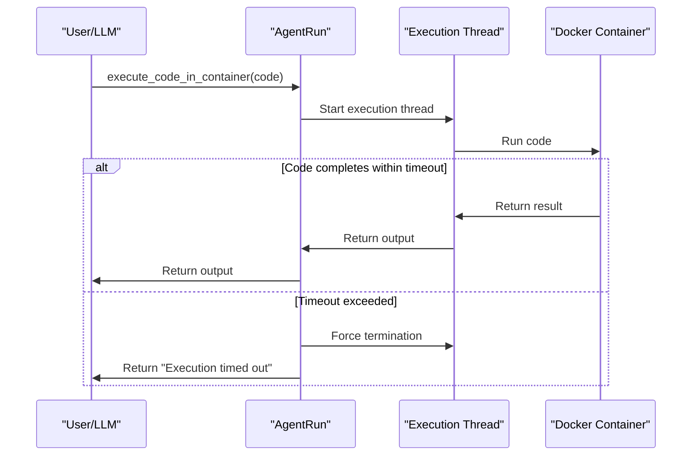
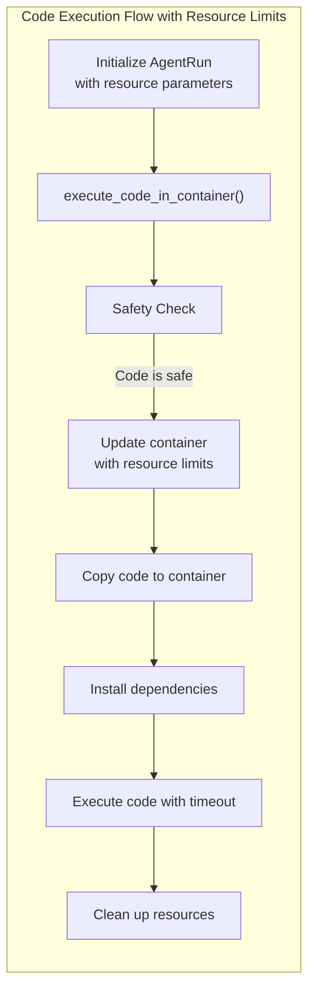
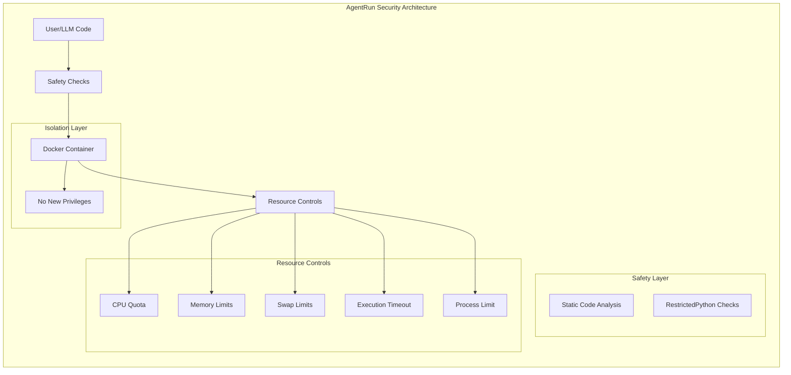

<!-- source: DeepWiki mcp.deepwiki.com · repo tjmlabs/AgentRun · page 4.1 Resource Limitations · fetched 2026-10-26 -->

# Resource Limitations

<details>
<summary>Relevant source files</summary>

The following files were used as context for generating this wiki page:

- [README.md](README.md)
- [agentrun-api/docker-compose.yml](agentrun-api/docker-compose.yml)
- [agentrun/__init__.py](agentrun/__init__.py)
- [docs/index.md](docs/index.md)
- [pyproject.toml](pyproject.toml)

</details>


This page documents the resource limitation features in AgentRun, which are critical for ensuring safe code execution in Docker containers. Resource limitations prevent executed code from consuming excessive system resources, which is essential when running untrusted code from LLMs or external sources. For information about dependency management, see [Dependency Management](#3.3).

## Overview of Resource Limitations

AgentRun provides multiple configurable resource controls to limit how much computing power the executed code can utilize. These limitations are critical security measures that work alongside Docker isolation to prevent potential denial-of-service attacks, resource exhaustion, and performance degradation of the host system.



Sources: [agentrun/__init__.py:37-53](), [README.md:40-45]()

## Configurable Resource Parameters

AgentRun provides the following resource limitation parameters which can be configured during initialization:

| Parameter | Default Value | Description |
|-----------|---------------|-------------|
| `cpu_quota` | 50000 | CPU time in microseconds per 100ms period (50% of a single CPU core) |
| `memory_limit` | "100m" | Maximum RAM the container can use (100 MB) |
| `memswap_limit` | "512m" | Maximum total memory (RAM + swap) the container can use (512 MB) |
| `default_timeout` | 20 | Maximum execution time in seconds before termination |
| `pids_limit` | 10 | Maximum number of processes within the container (docker-compose.yml) |

Sources: [agentrun/__init__.py:37-52](), [agentrun-api/docker-compose.yml:22-24]()

## CPU Limitations

AgentRun uses Docker's CPU quota mechanism to limit how much CPU time can be consumed by the executed code.

### How CPU Quota Works

The `cpu_quota` parameter (default: 50000) represents microseconds of CPU time allowed per scheduling period. Docker's default scheduling period is 100,000 microseconds (100ms).



With the default value of 50000, a container can use up to 50% of a single CPU core's processing time during each 100ms period. This allows the code to run efficiently while preventing it from consuming excessive CPU resources.

Sources: [agentrun/__init__.py:42](), [README.md:279-287]()

## Memory Limitations

AgentRun uses two parameters to control memory usage:

### RAM Limitation (`memory_limit`)

The `memory_limit` parameter (default: "100m") restricts how much physical RAM the container can use. When a process attempts to allocate memory beyond this limit, it will either fail or the container's OOM (Out Of Memory) killer will terminate processes.

### Total Memory Limitation (`memswap_limit`)

The `memswap_limit` parameter (default: "512m") sets the maximum amount of combined memory and swap space that the container can utilize. This acts as a secondary boundary for memory usage.



Sources: [agentrun/__init__.py:44-45](), [README.md:294-301]()

## Execution Timeout

The `default_timeout` parameter (default: 20 seconds) limits how long a code execution can run before being forcibly terminated. This prevents infinite loops or extremely time-consuming operations from hanging the system.

When code execution exceeds the timeout, AgentRun returns an "Execution timed out" message to the caller and terminates the execution.

### Timeout Implementation

The timeout is implemented using Python's threading mechanism. The execution runs in a separate thread, and the main thread waits for the specified timeout period. If the execution thread is still running after the timeout, it is forcibly terminated.



Sources: [agentrun/__init__.py:43](), [agentrun/__init__.py:128-157](), [agentrun/__init__.py:435-441]()

## Process Limitation

AgentRun uses Docker's `pids_limit` parameter to restrict the number of processes that can run within the container. This is configured in the docker-compose.yml file with a default value of 10.

This limitation helps prevent fork bombs or other process-spawning attacks that could exhaust the host system's resources.

Sources: [agentrun-api/docker-compose.yml:22-24]()

## Security Enhancements

In addition to resource limitations, AgentRun applies security options such as `no-new-privileges:true` to prevent privilege escalation within the container, further enhancing the security of code execution.

Sources: [agentrun-api/docker-compose.yml:22-24]()

## Configuration Examples

Here's how to configure resource limitations when initializing the AgentRun class:

```python
from agentrun import AgentRun

# Default initialization with standard resource limits
runner = AgentRun(container_name="my_container")

# Customized resource limits
runner_custom = AgentRun(
    container_name="my_container",
    cpu_quota=75000,            # 75% of a single CPU core
    memory_limit="512m",        # 512 MB RAM limit
    memswap_limit="1g",         # 1 GB total memory limit
    default_timeout=60          # 60 seconds timeout
)
```

Sources: [agentrun/__init__.py:37-52](), [README.md:305-325]()

## Resource Limits Implementation

The following diagram illustrates how resource limitations are applied within the code execution flow:



When `execute_code_in_container()` is called, the container is updated with the configured resource limits before the code is executed:

```python
# update the container with the new limits
container.update(
    cpu_quota=self.cpu_quota,
    mem_limit=self.memory_limit,
    memswap_limit=self.memswap_limit,
)
```

Sources: [agentrun/__init__.py:415-420]()

## Best Practices for Resource Limitation

When configuring resource limitations, consider the following best practices:

1. **CPU Quota**: Set based on your host system's capabilities and the expected workload. For most data processing tasks, 50% of a CPU core (50000) is sufficient.

2. **Memory Limits**: Start with conservative limits (100MB RAM) and increase if needed for memory-intensive operations. Monitor memory usage patterns of typical workloads.

3. **Timeout Values**: Set based on expected execution time. For simple calculations, 20 seconds is typically sufficient, but data processing might require longer timeouts.

4. **Process Limits**: The default of 10 processes is suitable for most Python code. Increase only if you have specific multi-processing needs.

5. **Testing**: Test your configuration with representative workloads to ensure resources are adequate without being excessive.

Sources: [README.md:305-325]()

## Relationship to Overall System Security

Resource limitations are just one component of AgentRun's security architecture. They work alongside other security mechanisms like code safety checks, Docker isolation, and dependency management to create a comprehensive security system.



Resource limitations complement other security features by preventing resource exhaustion attacks, while code safety checks and container isolation provide protection against malicious code execution and system access.

Sources: [agentrun/__init__.py:159-252](), [agentrun/__init__.py:384-454](), [README.md:40-45]()

## Conclusion

Resource limitations in AgentRun provide an essential security layer for safely executing untrusted code. By controlling CPU usage, memory allocation, execution time, and process creation, AgentRun prevents malicious or poorly written code from negatively impacting system performance or stability.

These limitations are fully configurable to meet different performance and security requirements, allowing users to balance execution capabilities with security concerns based on their specific use cases.

For additional information about optimizing performance while maintaining security, see [Performance Optimization](#4.2).

---

