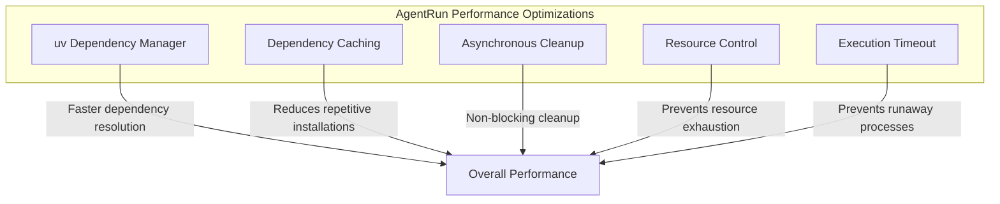
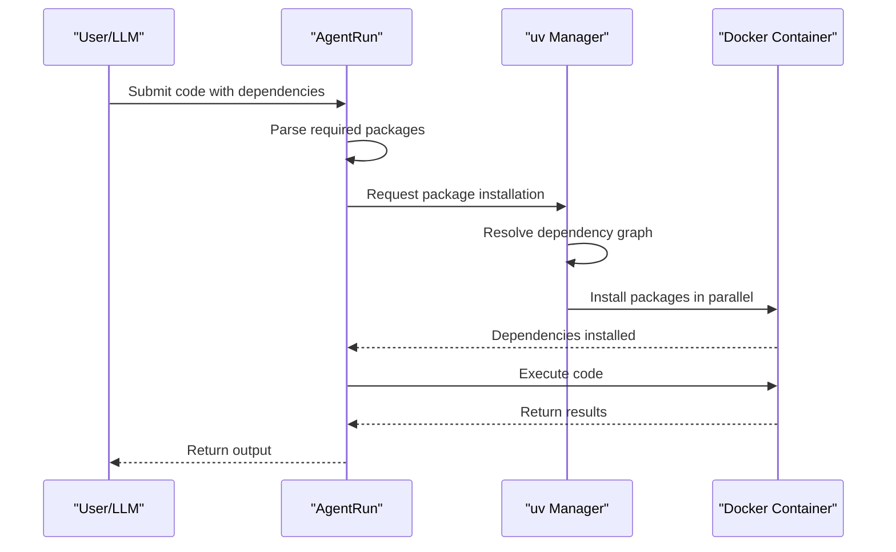
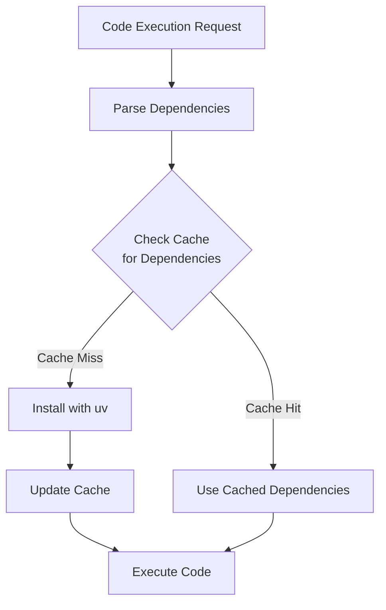
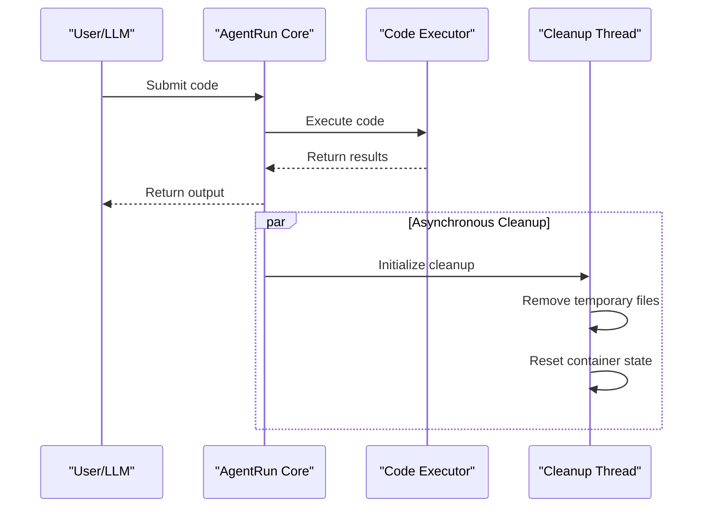
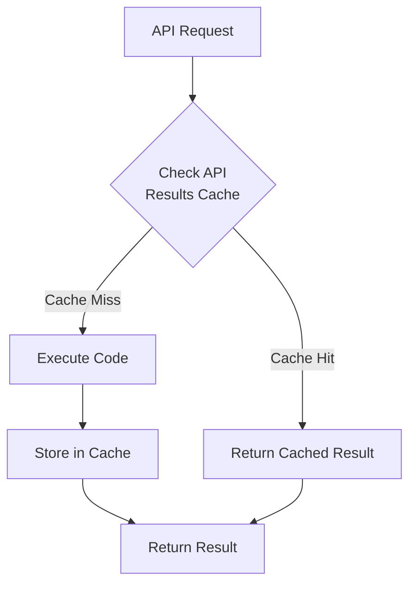
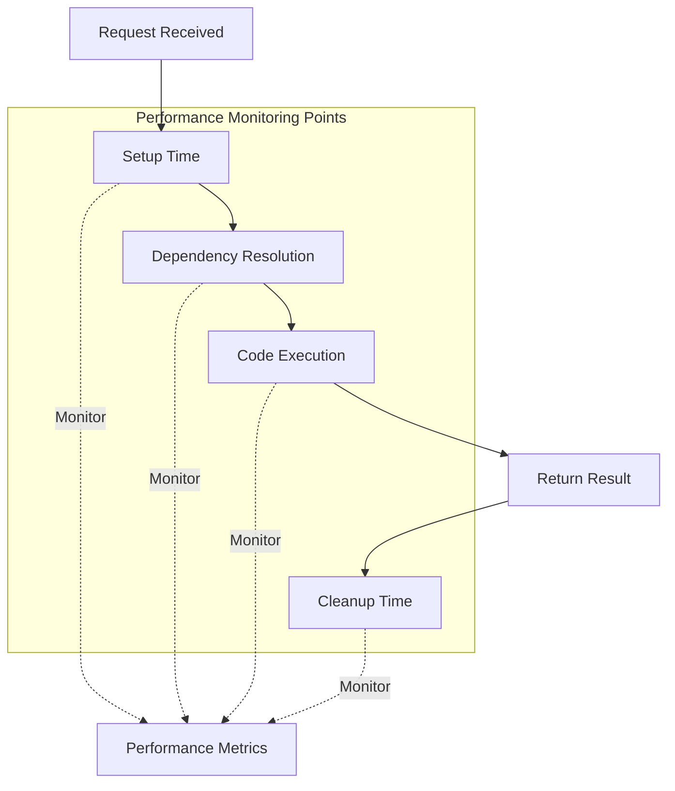

<!-- source: DeepWiki mcp.deepwiki.com · repo tjmlabs/AgentRun · page 4.2 Performance Optimization · fetched 2026-10-26 -->

# Performance Optimization

<details>
<summary>Relevant source files</summary>

The following files were used as context for generating this wiki page:

- [docs/assets/benchmarkv2.1.png](docs/assets/benchmarkv2.1.png)
- [docs/assets/benchmarkv2.5.png](docs/assets/benchmarkv2.5.png)
- [docs/release_notes.md](docs/release_notes.md)

</details>


This page documents strategies and best practices for optimizing the performance of AgentRun, focusing on techniques to reduce execution time and improve resource utilization. For information about configuring resource limitations specifically, see [Resource Limitations](#4.1).

## Overview

AgentRun employs several performance optimization strategies to ensure efficient code execution while maintaining security. These optimizations focus on reducing latency, minimizing resource usage, and improving throughput for both single and multiple execution requests.



Sources: docs/release_notes.md

## Dependency Management with uv

AgentRun uses `uv` as its dependency manager, which significantly improves performance compared to traditional pip installations. The uv manager is specifically designed for speed and efficient dependency resolution.

### Benefits of uv

- Faster package resolution and installation
- Parallel downloads and installations
- More efficient dependency graph resolution
- Reduced installation time for packages with complex dependencies



Sources: docs/release_notes.md

## Dependency Caching

AgentRun implements a dependency caching mechanism to avoid reinstalling the same packages across multiple executions. This is particularly beneficial for commonly used data science and machine learning libraries.

### How Caching Works

When a dependency is requested, AgentRun first checks if it's already been installed in a shared cache. If present, it reuses the cached version instead of downloading and installing the package again.



Sources: docs/release_notes.md

## Asynchronous Cleanup

AgentRun performs cleanup operations asynchronously on a separate thread, which prevents blocking the main execution flow after code has been run.

### Implementation Details

After code execution completes and results are returned to the user, cleanup operations (such as removing temporary files, resetting container state, etc.) happen in the background without delaying the response.



Sources: docs/release_notes.md

## API Caching

The REST API implementation of AgentRun includes caching to improve response times for repeated or similar requests. This caching layer is separate from dependency caching and focuses on the results of code execution.

### API Cache Behavior



Sources: docs/release_notes.md

## Performance Benchmarks

AgentRun includes benchmark tests to measure and track performance across different versions. These benchmarks focus on:

1. Code execution time
2. Dependency resolution speed
3. Memory usage
4. API response latency

The benchmark results help guide optimization efforts and verify performance improvements in new releases.

| Version | Key Performance Improvements |
|---------|------------------------------|
| v0.2.5  | Added uv as dependency manager, improved execution time |
| v0.2.3  | Added API caching, increased timeout |
| v0.2.1  | Added dependency caching, improved execution time |
| v0.1.1  | Asynchronous cleanup, benchmark tests |

Sources: docs/release_notes.md, docs/assets/benchmarkv2.1.png

## Best Practices for Optimal Performance

Follow these recommendations to achieve the best performance with AgentRun:

### For Python Package Usage

1. **Reuse AgentRun Instances**: Instead of creating a new instance for each execution, reuse existing instances when possible to take advantage of initialization optimizations and caching.

2. **Pre-install Common Dependencies**: If you know your use case requires specific libraries, consider pre-installing them in your Docker environment.

```python
# Inefficient - creates new instance for each run
for code_snippet in snippets:
    agent = AgentRun()
    result = agent.run(code_snippet)

# More efficient - reuses instance
agent = AgentRun()
for code_snippet in snippets:
    result = agent.run(code_snippet)
```

### For REST API Usage

1. **Batch Requests When Possible**: Instead of making many small requests, batch related operations to reduce connection overhead.

2. **Choose Appropriate Timeouts**: Set timeouts that balance between giving complex operations enough time to complete and preventing runaway processes.

Sources: docs/release_notes.md

## Performance Monitoring

Monitor the performance of your AgentRun deployment by watching these key metrics:

1. **Execution Time**: The time taken to execute code, separate from setup time
2. **Setup Time**: The time taken to create containers and install dependencies
3. **Memory Usage**: Peak memory usage during execution
4. **Cache Hit Ratio**: The percentage of dependencies served from cache vs. newly installed



Sources: docs/release_notes.md

## Performance Tradeoffs

When optimizing AgentRun, consider these important tradeoffs:

| Optimization | Benefit | Potential Drawback |
|--------------|---------|-------------------|
| Large dependency cache | Faster repeated executions | Increased disk usage |
| Aggressive timeouts | Prevents runaway processes | May terminate valid long-running operations |
| High resource limits | Better performance for complex tasks | More resource consumption per container |
| Asynchronous operations | Better responsiveness | More complex debugging |

Sources: docs/release_notes.md

## Conclusion

Performance optimization in AgentRun involves a multi-faceted approach combining efficient dependency management, caching strategies, asynchronous operations, and careful resource control. By leveraging these features and following the recommended best practices, you can achieve optimal performance while maintaining the security guarantees that AgentRun provides.

For specific configuration of resource limits such as CPU, memory, and timeouts, see [Resource Limitations](#4.1).

---

