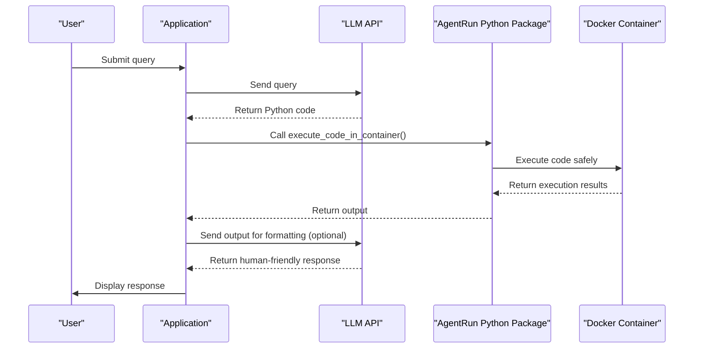
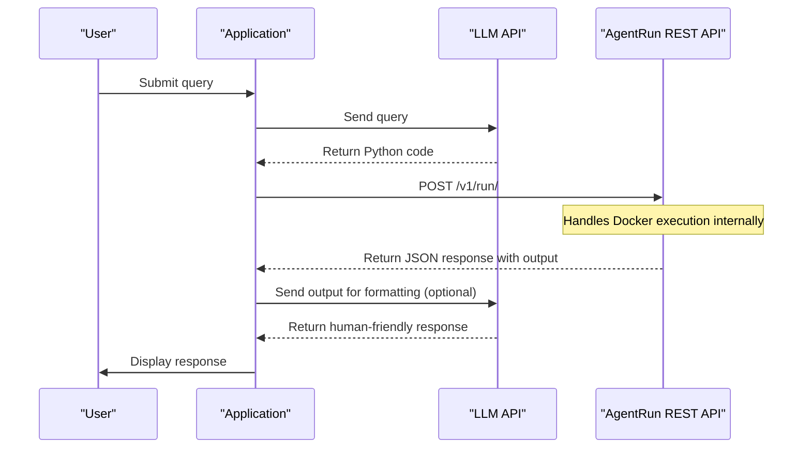
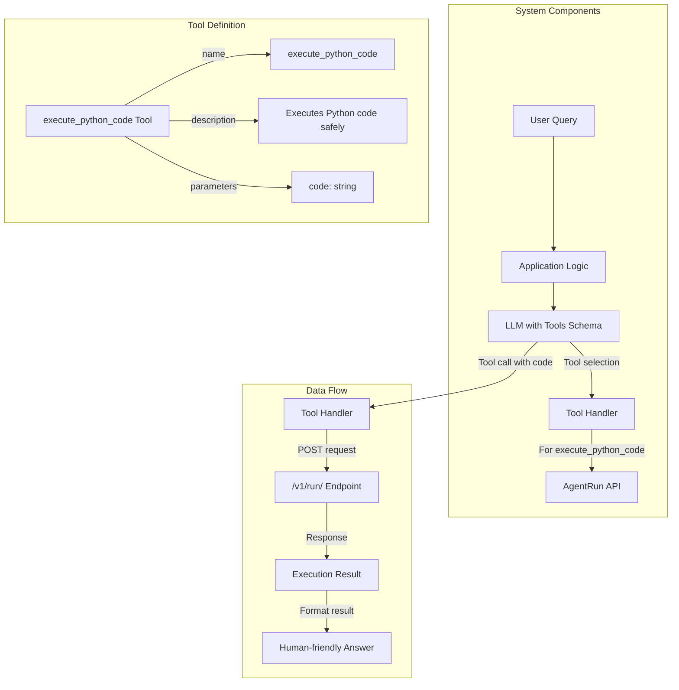
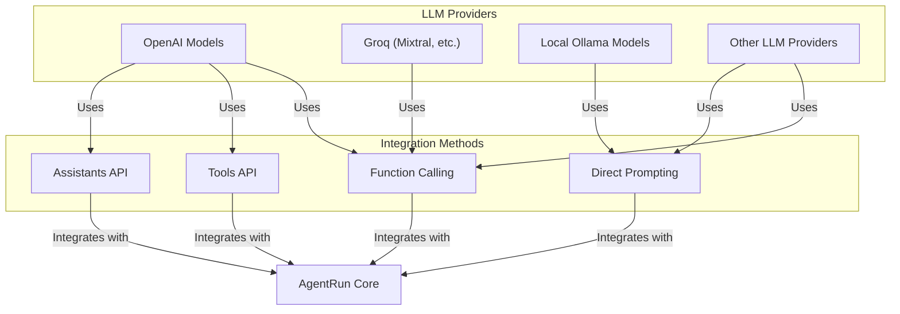

<!-- source: DeepWiki mcp.deepwiki.com · repo tjmlabs/AgentRun · page 5 Integration with LLMs · fetched 2026-10-26 -->

# Integration with LLMs

<details>
<summary>Relevant source files</summary>

The following files were used as context for generating this wiki page:

- [README.md](README.md)
- [docs/examples/ollama_llama3.py](docs/examples/ollama_llama3.py)
- [docs/index.md](docs/index.md)
- [mkdocs.yml](mkdocs.yml)

</details>


This document provides an overview of how to integrate AgentRun with Large Language Models (LLMs) to enable safe code execution capabilities. It covers the general architecture, integration patterns, and implementation considerations. For specific LLM provider implementations, see the dedicated pages for [Function Calling Pattern](#5.1), [OpenAI Integration](#5.2), [Groq Integration](#5.3), and [Ollama Integration](#5.4).

## Why Integrate AgentRun with LLMs

LLMs can generate code but lack the ability to execute it. By integrating AgentRun with LLMs, you enable a powerful workflow where:

1. Users ask questions that require computation or data analysis
2. LLMs generate appropriate Python code to solve these problems
3. AgentRun safely executes this code in an isolated environment
4. Execution results are returned to the LLM and formatted into human-friendly responses

This integration significantly enhances LLM capabilities, allowing them to perform calculations, data analysis, API calls, and more complex tasks that would be impossible with language generation alone - all while maintaining security through AgentRun's sandboxed execution environment.

Sources: [README.md:24-35]()

## High-Level Integration Architecture

The following diagram illustrates how AgentRun integrates into a typical LLM application:

```mermaid
flowchart LR
    User["User"] -->|"Query (e.g., 'What is Apple stock avg daily move?')"| App["Application"]
    
    subgraph "LLM Integration Layer"
        App -->|"Forward query"| LLM["LLM (OpenAI/Groq/Ollama)"]
        LLM -->|"Generate Python code"| CodeHandler["Code Execution Handler"]
        CodeHandler -->|"Send code to execute"| AgentRun["AgentRun"]
        AgentRun -->|"Return execution results"| CodeHandler
        CodeHandler -->|"Provide execution output"| LLM
        LLM -->|"Format result into natural language"| App
    end
    
    App -->|"Human-friendly response"| User
    
    subgraph "AgentRun System"
        AgentRun -->|"Safety checks"| Docker["Docker Container"]
        Docker -->|"Execute in sandbox"| Output["Execution Result"]
        Output -->|"Return stdout/stderr"| AgentRun
    end
```



Sources: [README.md:125-134](), [README.md:206-234]()

## Integration Approaches

There are two main approaches to integrating AgentRun with LLMs:

### 1. Direct Python Package Integration

When using the AgentRun Python package directly in your application:



### 2. REST API Integration

When using the AgentRun REST API:



Sources: [README.md:60-86](), [README.md:98-107]()

## Function Calling Pattern

The most effective way to integrate AgentRun with LLMs is through the function calling pattern. This pattern involves:

1. Defining an `execute_python_code` function/tool in the LLM's tools schema
2. Prompting the LLM to use this function when code execution is needed
3. Handling the function call by sending the code to AgentRun
4. Returning the execution results to the LLM

This creates a clear and consistent pattern for LLMs to request code execution when needed.



For a detailed explanation of implementing the function calling pattern with AgentRun, see [Function Calling Pattern](#5.1).

Sources: [README.md:165-183](), [docs/examples/ollama_llama3.py:28-48]()

## Implementation Examples

Below is a simplified example of the core components needed to implement AgentRun integration with an LLM:

### Code Execution Function

```python
def execute_python_code(code: str) -> str:
    response = requests.post("http://localhost:8000/v1/run/", json={"code": code})
    output = response.json()["output"]
    return output
```

### Tool Definition

```python
tools = [
    {
        "type": "function",
        "function": {
            "name": "execute_python_code",
            "description": "Sends a python code snippet to the code execution environment and returns the output.",
            "parameters": {
                "type": "object",
                "properties": {
                    "code": {
                        "type": "string",
                        "description": "The code snippet to execute. Must be valid Python code.",
                    },
                },
                "required": ["code"],
            },
        },
    },
]
```

### Processing Tool Calls

```python
def process_query(query):
    # Send query to LLM with tools definition
    response = llm_client.chat.completions.create(
        model=MODEL,
        messages=[
            {"role": "system", "content": "Use execute_python_code when computation is needed."},
            {"role": "user", "content": query}
        ],
        tools=tools
    )
    
    # Check if LLM wants to execute code
    if response.choices[0].message.tool_calls:
        tool_call = response.choices[0].message.tool_calls[0]
        code = json.loads(tool_call.function.arguments)["code"]
        
        # Execute code with AgentRun
        result = execute_python_code(code)
        
        # Optionally: Return result to LLM for formatting
        final_response = llm_client.chat.completions.create(
            model=MODEL,
            messages=[
                {"role": "system", "content": "Format technical output into a friendly response."},
                {"role": "user", "content": f"Query: {query}\nCode output: {result}"}
            ]
        )
        return final_response.choices[0].message.content
    else:
        return response.choices[0].message.content
```

Sources: [README.md:144-149](), [README.md:206-234]()

## LLM Provider Integrations

AgentRun can be integrated with various LLM providers. Each provider has slightly different implementation details, but the core pattern remains consistent.



For specific implementation details, see:
- [OpenAI Integration](#5.2)
- [Groq Integration](#5.3)
- [Ollama Integration](#5.4)

Sources: [mkdocs.yml:15-19](), [docs/examples/ollama_llama3.py:1-115]()

## Best Practices

When integrating AgentRun with LLMs, consider the following best practices:

### 1. Proper System Instructions

Provide clear system instructions to the LLM about when and how to use code execution:

| Instruction Type | Example |
|------------------|---------|
| When to use code | "Use code execution for calculations, data analysis, or API calls" |
| Code formatting | "Always use proper Python syntax and include print() statements for output" |
| Error handling | "Handle potential errors in your code with try/except blocks" |
| Dependencies | "You can import any required packages - they will be installed automatically" |

### 2. Resource Configuration

Configure AgentRun resource limits based on your expected workloads:

| Resource | Recommendation |
|----------|---------------|
| CPU quota | 50000 (50% of CPU) for general tasks |
| Memory | 512MB for data analysis tasks |
| Timeout | 30-60 seconds for most operations |
| Dependencies | Cache frequently used packages like `requests`, `pandas`, `numpy` |

### 3. Two-Step Response Processing

For the best user experience, use a two-step process:
1. Have the LLM generate and execute code
2. Send the raw execution output back to the LLM to format into a human-friendly response

### 4. Security Considerations

| Security Aspect | Implementation |
|-----------------|----------------|
| Dependency Whitelisting | Limit installable packages for production systems |
| Input Validation | Validate user input before passing to LLM |
| Output Sanitization | Consider sanitizing sensitive information from outputs |
| Resource Monitoring | Monitor resource usage to prevent abuse |

Sources: [README.md:268-298](), [README.md:304-321]()

## Conclusion

Integrating AgentRun with LLMs creates a powerful system that combines the natural language capabilities of LLMs with secure, sandboxed code execution. This integration allows LLMs to perform calculations, data analysis, API calls, and other computational tasks that would be impossible with text generation alone.

By following the patterns and best practices outlined in this document, you can implement a robust, secure, and efficient integration between your LLM application and AgentRun.

For specific implementation details with different LLM providers, refer to the dedicated sub-pages:
- [Function Calling Pattern](#5.1)
- [OpenAI Integration](#5.2) 
- [Groq Integration](#5.3)
- [Ollama Integration](#5.4)

---

