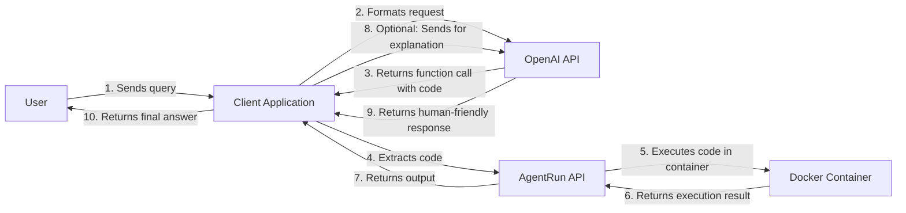
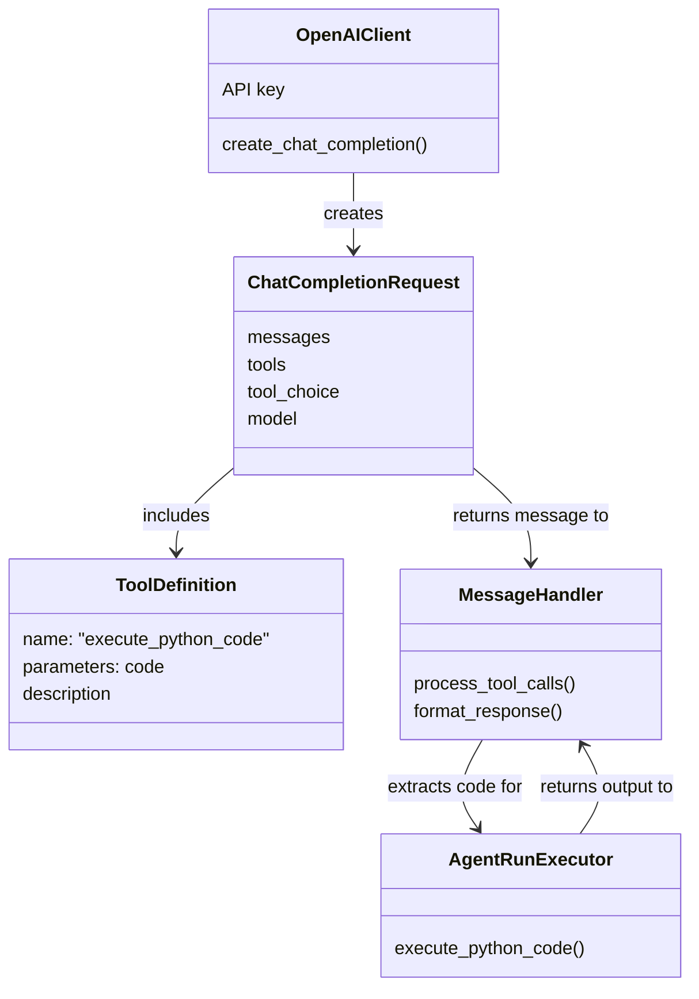
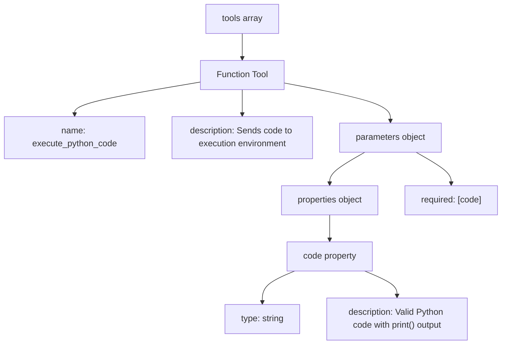
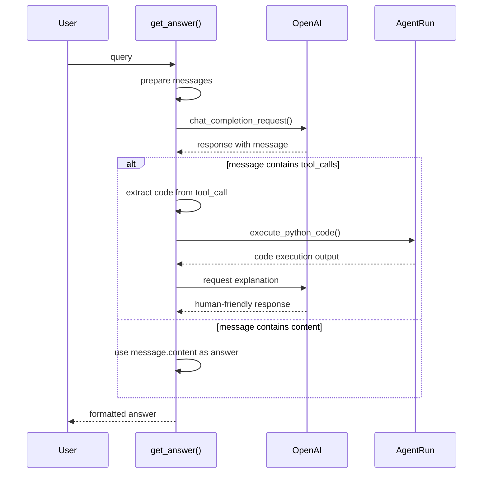

<!-- source: DeepWiki mcp.deepwiki.com · repo tjmlabs/AgentRun · page 5.2 OpenAI Integration · fetched 2026-10-26 -->

# OpenAI Integration

<details>
<summary>Relevant source files</summary>

The following files were used as context for generating this wiki page:

- [README.md](README.md)
- [docs/examples/function_calling_openai.py](docs/examples/function_calling_openai.py)

</details>


This document explains how to integrate AgentRun with OpenAI's language models to enable safe code execution capabilities. AgentRun works seamlessly with OpenAI's function calling API to create a powerful system that allows OpenAI models to write and execute Python code in response to user queries.

For information about integrating with other LLM providers such as Groq, see [Groq Integration](#5.3), or for local models, see [Ollama Integration](#5.4). For general information about function calling patterns with LLMs, see [Function Calling Pattern](#5.1).

## Integration Architecture

The OpenAI integration with AgentRun follows a function calling pattern where OpenAI models are configured to generate Python code that is executed safely within AgentRun's isolated environment.



Sources: [docs/examples/function_calling_openai.py:7-11](), [docs/examples/function_calling_openai.py:42-54](), [docs/examples/function_calling_openai.py:57-89]()

## Key Components

The OpenAI integration consists of several core components that work together to enable safe code execution:



Sources: [docs/examples/function_calling_openai.py:5-20](), [docs/examples/function_calling_openai.py:21-39]()

## Implementation Steps

### 1. Setting Up the OpenAI Client

First, initialize the OpenAI client with your API key:

```python
from openai import OpenAI

# Set your API key
client = OpenAI(api_key="your-api-key-here")
# Or use environment variable:
# import os
# os.environ["OPENAI_API_KEY"] = "your-api-key-here"
# client = OpenAI()
```

Sources: [docs/examples/function_calling_openai.py:5-6](), [docs/examples/function_calling_openai.py:16-19]()

### 2. Defining the Code Execution Function

Create a function that will send Python code to AgentRun and return the execution result:

```python
def execute_python_code(code: str) -> str:
    response = requests.post("http://localhost:8000/v1/run/", json={"code": code})
    output = response.json()["output"]
    return output
```

Sources: [docs/examples/function_calling_openai.py:8-11]()

### 3. Configuring the OpenAI Function Calling

Define the tool specification that OpenAI will use to identify when to generate code:



Sources: [docs/examples/function_calling_openai.py:21-39]()

### 4. Creating the Chat Completion Request Handler

Implement a function to handle sending requests to the OpenAI API:

```python
def chat_completion_request(messages, tools=None, tool_choice=None, model="gpt-4-turbo-preview"):
    try:
        response = client.chat.completions.create(
            model=model,
            messages=messages,
            tools=tools,
            tool_choice=tool_choice,
        )
        return response
    except Exception as e:
        print("Unable to generate ChatCompletion response")
        print(f"Exception: {e}")
        return e
```

Sources: [docs/examples/function_calling_openai.py:42-54]()

### 5. Implementing the Main Integration Function

Create a function that combines all the components to handle user queries:



The implementation includes:
- Setting up messages with system instructions
- Sending the request to OpenAI
- Processing the response to check for tool calls
- Executing code if needed
- Optionally sending the result back for explanation

Sources: [docs/examples/function_calling_openai.py:57-89]()

## Complete Example

Below is a breakdown of how to implement a complete OpenAI integration with AgentRun:

1. **System Setup**
   - Ensure AgentRun API is running (see [Installation and Setup](#2))
   - Install required Python packages: `openai`, `requests`

2. **Implementation Components**:
   - OpenAI client configuration
   - Tool definition for code execution
   - Chat completion request handler
   - Main integration function
   - Result processing logic

3. **Usage Pattern**:
   ```python
   # Example queries
   get_answer("what's 12312 * 321?")  # Mathematical calculation
   get_answer("what's the average daily move of Apple stock in the last 3 days?")  # Data analysis
   get_answer("what's the capital of France?")  # General knowledge (no code execution needed)
   ```

Sources: [docs/examples/function_calling_openai.py:92-97]()

## System Prompt Recommendations

The system prompt is critical for guiding the model to use code execution appropriately. Here's a recommended template:

```
Don't make assumptions about what values to plug into functions. Ask for clarification if a user request is ambiguous.
Use the execute_python_code tool to run code if a question is better solved with code. You can use any package in the code snippet by simply importing. Like `import requests` would work fine.
```

This prompt instructs the model to:
- Ask for clarification when needed
- Use code execution for appropriate queries
- Inform the model that it can import packages as needed

Sources: [docs/examples/function_calling_openai.py:60-65]()

## Performance Considerations

When integrating OpenAI with AgentRun, consider the following:

| Consideration | Description |
|---------------|-------------|
| Model Selection | GPT-4 models tend to generate better and safer code than GPT-3.5 models |
| Caching | Consider using cached dependencies for commonly used packages |
| Timeouts | Set appropriate timeouts based on expected computation complexity |
| Cost | Function calling with OpenAI incurs additional tokens, especially when sending results back for explanation |

Sources: [README.md:276-301]()

## Troubleshooting

Common issues when integrating OpenAI with AgentRun:

1. **OpenAI API Errors**: Ensure your API key is valid and you have sufficient quota
2. **Execution Timeouts**: If code execution times out, increase the `default_timeout` parameter
3. **Memory Limitations**: For memory-intensive operations, adjust `memory_limit` and `memswap_limit`
4. **Dependency Issues**: If you're getting errors with packages, check if they're in the `dependencies_whitelist`

For more configuration options, refer to the [Configuration Options](#4) section.

Sources: [README.md:270-325]()

---

