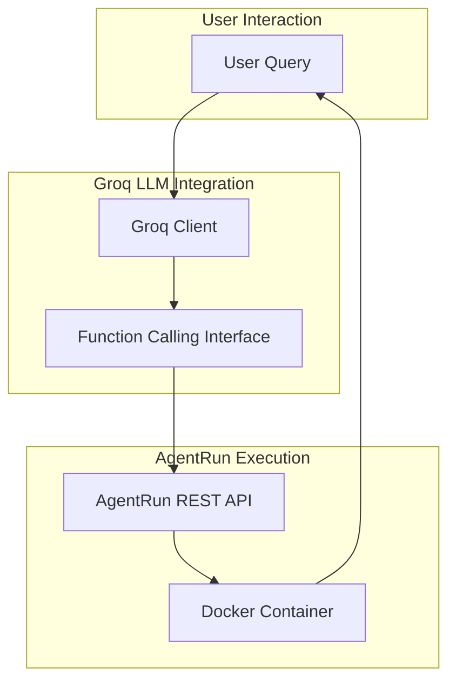
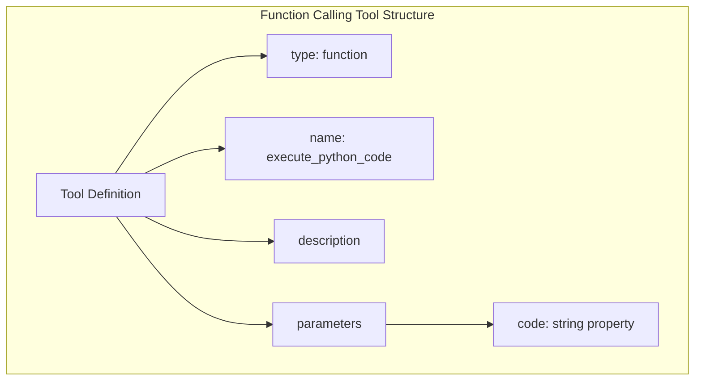
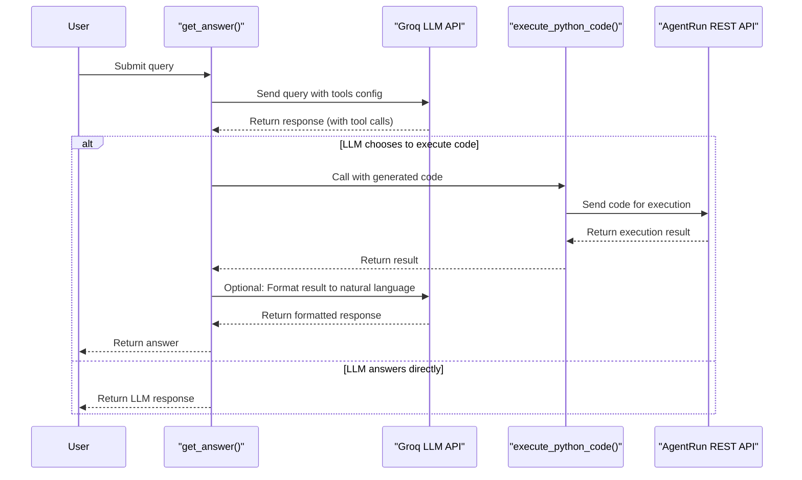
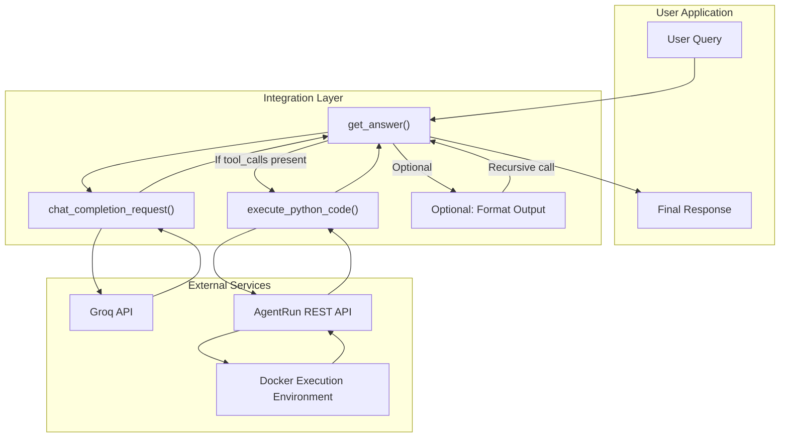

<!-- source: DeepWiki mcp.deepwiki.com · repo tjmlabs/AgentRun · page 5.3 Groq Integration · fetched 2026-10-26 -->

# Groq Integration

<details>
<summary>Relevant source files</summary>

The following files were used as context for generating this wiki page:

- [docs/examples/function_calling_groq.ipynb](docs/examples/function_calling_groq.ipynb)
- [docs/examples/llama3_groq.py](docs/examples/llama3_groq.py)

</details>


This document provides a comprehensive guide for integrating AgentRun with Groq's large language models. It covers how to configure and use Groq models to generate code that can be safely executed in AgentRun's sandboxed environment. For information about integrating with other LLM providers, see [OpenAI Integration](#5.2) or [Ollama Integration](#5.4).

## Overview

Groq integration allows you to use Groq's high-performance LLM models (such as Mixtral and Llama) with AgentRun's code execution capabilities. This enables your application to generate and execute Python code in a secure environment based on user queries or prompts.



Sources: [docs/examples/function_calling_groq.ipynb:1-306](), [docs/examples/llama3_groq.py:1-99]()

## Prerequisites

Before integrating with Groq, ensure you have:

1. A valid Groq API key
2. AgentRun installed and configured (preferably with the REST API running)
3. Python packages: `groq` and `requests`

Sources: [docs/examples/function_calling_groq.ipynb:74-76](), [docs/examples/llama3_groq.ipynb:4-5]()

## Setting Up the Groq Client

### Installation

Install the required packages:

```python
pip install groq requests
```

### Client Initialization

Initialize a Groq client with your API key:

```python
from groq import Groq

client = Groq(api_key="your_groq_api_key")
```

### Model Selection

Choose a Groq model for your integration:

| Model | Description | Use Case |
|-------|-------------|----------|
| mixtral-8x7b-32768 | Mixtral model with 32k context | General purpose, good balance of speed and capability |
| llama3-70b-8192 | Llama 3 model with 8k context | Higher capability for complex reasoning |

Sources: [docs/examples/function_calling_groq.ipynb:140-143](), [docs/examples/llama3_groq.py:15-18]()

## Function Calling Configuration

Groq's function calling capability allows the LLM to generate structured code that can be executed by AgentRun. This requires defining a tool specification:



The tool configuration tells the LLM how to structure its code output:

```python
tools = [
    {
        "type": "function",
        "function": {
            "name": "execute_python_code",
            "description": "Sends a python code snippet to the code execution environment and returns the output. The code execution environment can automatically import any library or package by importing.",
            "parameters": {
                "type": "object",
                "properties": {
                    "code": {
                        "type": "string",
                        "description": "The code snippet to execute. Must be a valid python code. Must use print() to output the result.",
                    },
                },
                "required": ["code"],
            },
        },
    },
]
```

Sources: [docs/examples/function_calling_groq.ipynb:147-165](), [docs/examples/llama3_groq.py:20-38]()

## Implementation Architecture

The Groq integration consists of three main components:

1. **Code Execution Function**: Communicates with the AgentRun API
2. **LLM Communication Function**: Handles requests to the Groq API
3. **Query Processor**: Coordinates between user queries, the LLM, and code execution



Sources: [docs/examples/function_calling_groq.ipynb:209-236](), [docs/examples/llama3_groq.py:57-90]()

## Code Execution Function

The core function responsible for sending code to the AgentRun API:

```python
def execute_python_code(code: str) -> str:
    response = requests.post("http://localhost:8000/v1/run/", json={"code": code})
    output = response.json()["output"]
    return output
```

This function:
1. Takes a Python code string as input
2. Sends it to the AgentRun REST API
3. Returns the execution output as a string

Sources: [docs/examples/function_calling_groq.ipynb:109-115](), [docs/examples/llama3_groq.py:8-12]()

## LLM Communication Function

The function that handles communication with the Groq API:

```python
def chat_completion_request(messages, tools=None, tool_choice="auto", model=MODEL):
    try:
        response = client.chat.completions.create(
            model=model,
            messages=messages,
            tools=tools,
            tool_choice=tool_choice,
        )
        return response
    except Exception as e:
        print("Unable to generate ChatCompletion response")
        print(f"Exception: {e}")
        return e
```

This function:
1. Takes messages, tools configuration, and model settings
2. Calls the Groq API
3. Returns the API response or error

Sources: [docs/examples/function_calling_groq.ipynb:181-193](), [docs/examples/llama3_groq.py:41-54]()

## Query Processor

The main function that orchestrates the entire flow:

```python
def get_answer(query):
    messages = []
    messages.append(
        {
            "role": "system",
            "content": "...", # System prompt that guides the LLM
        }
    )
    messages.append({"role": "user", "content": query})

    chat_response = chat_completion_request(messages, tools=tools)

    message = chat_response.choices[0].message
    # tool call versus content
    if message.tool_calls:
        tool_call = message.tool_calls[0]
        arg = json.loads(tool_call.function.arguments)["code"]
        answer = execute_python_code(arg)
        # Optional: call LLM again to format the answer
        query = "Help translate the code output..." + query + "..." + answer
        answer = get_answer(query)
    else:
        answer = message.content

    return answer
```

This function:
1. Creates a message with system instructions and the user query
2. Sends the message to the LLM via `chat_completion_request`
3. Processes the response, executing code if the LLM chose to use the tool
4. Optionally formats technical output into natural language
5. Returns the final answer

Sources: [docs/examples/function_calling_groq.ipynb:209-236](), [docs/examples/llama3_groq.py:57-90]()

## System Prompting

The system prompt plays a critical role in guiding the LLM's behavior. A typical system prompt includes:

```
You are a helpful assistant that helps users. Use the execute_python_code tool to run code if a question is better solved with code.
Otherwise, you can use data from your training. You can use any package in the code snippet by simply importing.
Don't make assumptions about what values to plug into functions. Ask for clarification if a user request is ambiguous.
```

This instructs the LLM to:
1. Use code execution when appropriate
2. Utilize built-in knowledge for simple questions
3. Ask for clarification when needed

Sources: [docs/examples/function_calling_groq.ipynb:214-217](), [docs/examples/llama3_groq.py:61-65]()

## Complete Integration Flow



Sources: [docs/examples/function_calling_groq.ipynb:109-236](), [docs/examples/llama3_groq.py:8-90]()

## Usage Examples

### Example 1: Mathematical Calculation

```python
get_answer("what's 12312 * 321?")
```

### Example 2: Stock Market Data Analysis

```python
get_answer("what's the average daily move of Apple stock in the last 3 days?")
```

In this example, the LLM determines that code execution is necessary, generates Python code using `yfinance` to fetch and analyze Apple stock data, and returns the calculated average daily movement.

### Example 3: General Knowledge Questions

```python
get_answer("what's the capital of France?")
```

For this type of question, the LLM typically responds directly without code execution, using its built-in knowledge.

Sources: [docs/examples/llama3_groq.py:94-98](), [docs/examples/function_calling_groq.ipynb:280-282]()

## Best Practices

1. **Error Handling**: Implement robust error handling for both API communications and code execution
2. **Rate Limiting**: Be aware of Groq API rate limits and implement appropriate throttling
3. **System Prompt**: Carefully craft the system prompt to guide the LLM's decision on when to use code
4. **Result Formatting**: Consider using a second LLM call to format technical outputs into user-friendly responses
5. **Security**: Always run the AgentRun API in a properly isolated environment as it executes potentially untrusted code

Sources: [docs/examples/function_calling_groq.ipynb:209-236](), [docs/examples/llama3_groq.py:57-90]()

## Conclusion

The Groq integration with AgentRun provides a powerful way to combine the intelligence of Groq's LLMs with the ability to safely execute generated code. This enables a wide range of applications that can respond to user queries with dynamically generated code and analysis.

---

