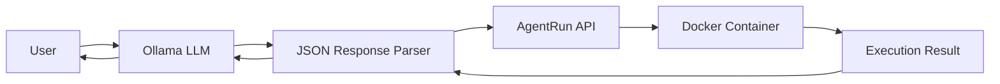
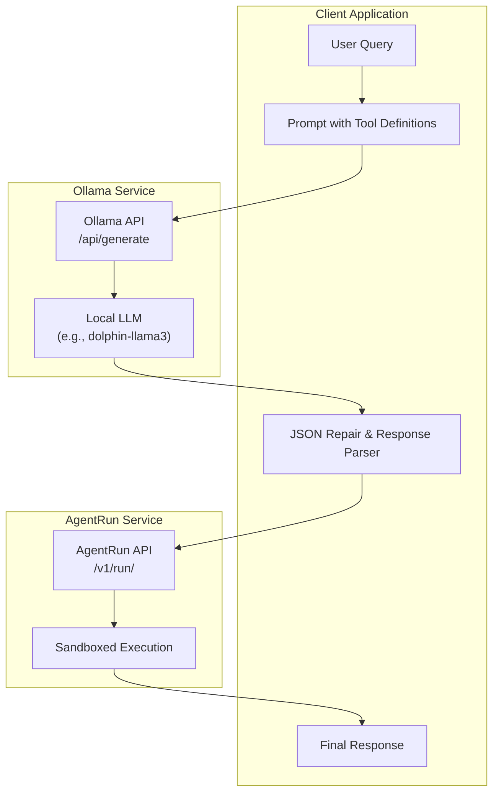
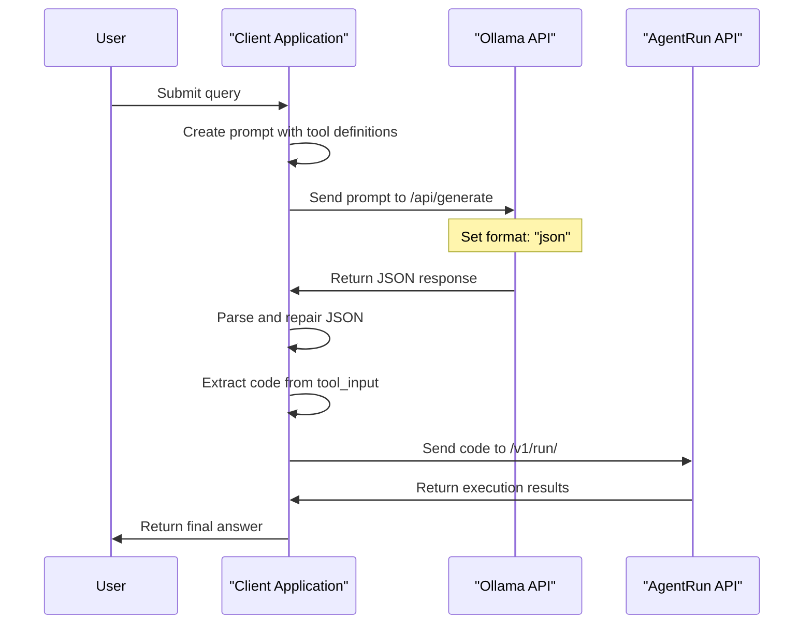

<!-- source: DeepWiki mcp.deepwiki.com · repo tjmlabs/AgentRun · page 5.4 Ollama Integration · fetched 2026-10-26 -->

# Ollama Integration

<details>
<summary>Relevant source files</summary>

The following files were used as context for generating this wiki page:

- [docs/examples/function_calling_openai.py](docs/examples/function_calling_openai.py)
- [docs/examples/ollama_llama3.py](docs/examples/ollama_llama3.py)
- [mkdocs.yml](mkdocs.yml)

</details>


This document explains how to integrate AgentRun with Ollama, an open-source framework for running large language models locally. This integration allows you to use locally hosted models with AgentRun's sandboxed code execution capabilities, creating a fully local AI coding assistant solution. For integration with cloud-based LLMs, see [OpenAI Integration](#5.2) or [Groq Integration](#5.3).

## Overview

Ollama integration enables AgentRun to work with locally hosted language models, providing a secure environment for these models to execute Python code. This allows for function calling-like interaction patterns without requiring internet connectivity or external API access.



Sources: [docs/examples/ollama_llama3.py:1-22]()

## Components and Architecture

The Ollama integration consists of several key components that work together to provide code execution capabilities to locally hosted LLMs.



Sources: [docs/examples/ollama_llama3.py:10-21](), [docs/examples/ollama_llama3.py:50-106]()

## Prerequisites

Before integrating Ollama with AgentRun, ensure you have:

1. Ollama installed and running locally
2. AgentRun API service running
3. Python libraries: `requests` and `json_repair`

The `json_repair` library is particularly important as Ollama models may not always produce perfectly formatted JSON responses.

Sources: [docs/examples/ollama_llama3.py:6-7]()

## Implementation Steps

### 1. Define the Tool Function

First, define the `execute_python_code` function that will communicate with the AgentRun service:

```python
def execute_python_code(code: str) -> str:
    code = json.dumps({"code": code})
    response = requests.post(
        "http://localhost:8000/v1/run/",
        data=code,
        headers={"Content-Type": "application/json"},
    )
    output = response.json()["output"]
    return output
```

Sources: [docs/examples/ollama_llama3.py:10-21]()

### 2. Define Tool Schema

Define the tools schema that will be included in the prompt to the Ollama model:

```python
tools = [
    {
        "type": "function",
        "function": {
            "name": "execute_python_code",
            "description": "Sends a python code snippet to the code execution environment and returns the output.",
            "parameters": {
                "type": "object",
                "properties": {
                    "code": {
                        "type": "string",
                        "description": "The code snippet to execute. Must be a valid python code.",
                    },
                },
                "required": ["code"],
            },
        },
    },
]
```

Sources: [docs/examples/ollama_llama3.py:28-48]()

### 3. Create a Function to Interact with Ollama API

```python
def generate_full_completion(prompt: str, model: str = "dolphin-llama3") -> dict[str, str]:
    params = {
        "model": model,
        "prompt": prompt,
        "stream": False,
        "temperature": 0,
        "seed": 123,
        "format": "json",
    }
    response = requests.post(
        "http://localhost:11434/api/generate",
        headers={"Content-Type": "application/json"},
        data=json.dumps(params),
        timeout=60,
    )
    return json_repair.loads(response.text)
```

Sources: [docs/examples/ollama_llama3.py:52-72]()

### 4. Implement Function Calling with Ollama

```python
def get_answer(query: str) -> str:
    functions_prompt = f"""
        You have access to the following tools:
            {tools}
        You must follow these instructions:
        If a user query requires a tool, you must select the appropriate tool.
        If a tool is found, you must respond in the JSON format matching the following schema:
        {{
        "tools": {{
            "tool": "<name of the selected tool>",
            "tool_input": <parameters for the selected tool, matching the tool's JSON schema
        }}
        }}
        
        User Query: {query}
        """

    r_dict = generate_full_completion(functions_prompt)
    r_tools = json_repair.loads(r_dict["response"])["tools"]
    code = r_tools["tool_input"]["code"]
    response = execute_python_code(code)
    return response
```

Sources: [docs/examples/ollama_llama3.py:77-106]()

## Function Calling Pattern with Ollama

Unlike OpenAI and some other APIs, Ollama doesn't natively support function calling. Instead, we implement this pattern by:

1. Including tool definitions directly in the prompt
2. Instructing the model to respond in a specific JSON format
3. Using the `format: "json"` parameter in the Ollama API request
4. Parsing and repairing the JSON response from the model
5. Extracting the code from the JSON and sending it to AgentRun

This approach creates a function calling-like experience with locally hosted models.



Sources: [docs/examples/ollama_llama3.py:77-106]()

## Working with Different Ollama Models

AgentRun can work with various Ollama models. The example uses `dolphin-llama3`, but you can substitute other models that support JSON output.

| Model | Recommended For | JSON Support Quality |
|-------|----------------|---------------------|
| dolphin-llama3 | General-purpose code generation | Good |
| llama3 | Simple coding tasks | Moderate |
| codellama | Code-focused applications | Good |
| mistral | General-purpose applications | Moderate |

When using different models, you may need to adjust the prompt and error handling to accommodate each model's specific capabilities and limitations.

Sources: [docs/examples/ollama_llama3.py:25-26]()

## Comparison with Cloud LLM Integrations

| Feature | Ollama Integration | OpenAI Integration |
|---------|-------------------|-------------------|
| Hosting | Local | Cloud-based |
| Network requirements | Local network only | Internet required |
| Native function calling | No (simulated) | Yes |
| Response format | Requires JSON repair | Native JSON |
| Model variety | Limited to Ollama-supported models | Wide range of OpenAI models |
| Cost | Free | Pay-per-token |
| Privacy | Data stays local | Data sent to OpenAI |

Sources: [docs/examples/function_calling_openai.py:1-98](), [docs/examples/ollama_llama3.py:1-115]()

## Ensuring Reliable JSON Responses

Ollama models may not always generate perfectly formatted JSON. The integration uses the `json_repair` library to fix common JSON formatting issues:

```python
import json_repair
# ...
r_tools = json_repair.loads(r_dict["response"])["tools"]
```

If you encounter JSON parsing errors, consider:
1. Using models better at JSON generation (like dolphin series models)
2. Setting temperature to 0 for more deterministic outputs
3. Making your tool schema and instructions more explicit

Sources: [docs/examples/ollama_llama3.py:6-7](), [docs/examples/ollama_llama3.py:100]()

## Complete Example

For a complete working example of Ollama integration with AgentRun, refer to the file [docs/examples/ollama_llama3.py]().

The example demonstrates how to:
1. Set up the necessary components for Ollama-AgentRun integration
2. Structure prompts for Ollama models to generate JSON responses
3. Parse and repair JSON responses from Ollama
4. Extract code from the response and execute it with AgentRun
5. Process different types of queries (calculations, data retrieval, etc.)

Sources: [docs/examples/ollama_llama3.py:1-115]()

## Limitations and Considerations

When working with Ollama models for code execution via AgentRun, consider these limitations:

1. **JSON Formatting**: Local models may struggle with generating perfectly formatted JSON responses, requiring repair steps.
   
2. **Context Window**: Most locally runnable models have smaller context windows than their cloud counterparts, which may affect complex coding tasks.

3. **Performance**: Local models are typically slower than cloud models, especially on consumer hardware.

4. **Tool Understanding**: Local models might need more explicit instructions on how to use tools compared to cloud models specifically trained for tool use.

5. **Error Handling**: More robust error handling may be necessary when working with local models.

Sources: [docs/examples/ollama_llama3.py:72](), [docs/examples/ollama_llama3.py:100]()

---

