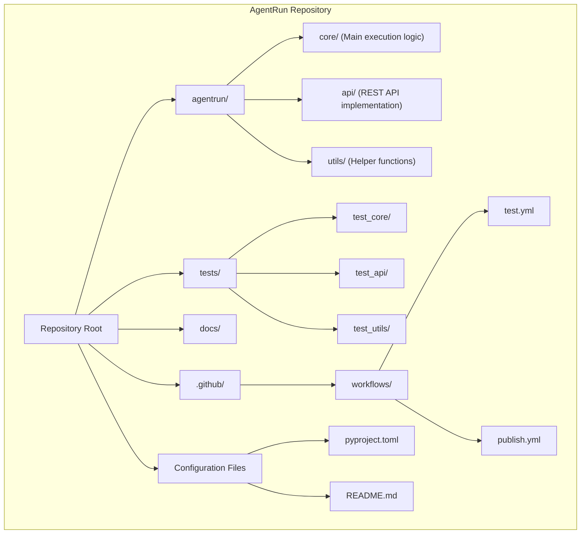
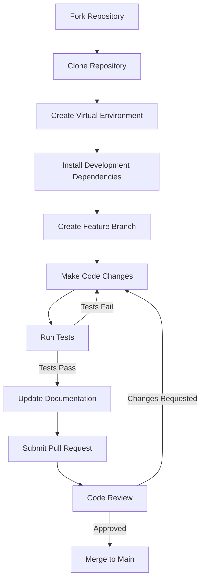
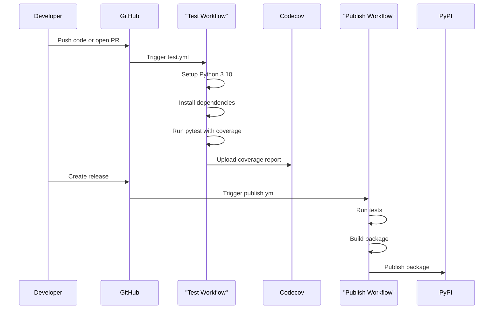
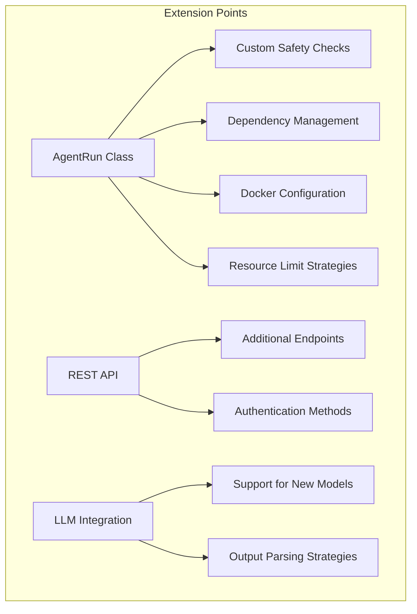

<!-- source: DeepWiki mcp.deepwiki.com · repo tjmlabs/AgentRun · page 6 Developer Guide · fetched 2026-10-26 -->

# Developer Guide

<details>
<summary>Relevant source files</summary>

The following files were used as context for generating this wiki page:

- [.github/workflows/publish.yml](.github/workflows/publish.yml)
- [.github/workflows/test.yml](.github/workflows/test.yml)
- [docs/contributing.md](docs/contributing.md)

</details>


This guide provides essential information for developers who want to contribute to or extend the AgentRun project. It covers setting up a development environment, the contribution workflow, code organization, testing practices, and details about the CI/CD pipeline. For specific information about the testing framework, see [Testing Framework](#6.1), and for detailed CI/CD pipeline information, see [CI/CD Pipeline](#6.2).

## Development Environment Setup

To start contributing to AgentRun, you'll need to set up your local development environment:

### Prerequisites

- Python 3.10 or higher
- Docker installed and running
- Git

### Setting Up Your Environment

```bash
# Clone the repository
git clone https://github.com/tjmlabs/AgentRun.git
cd AgentRun

# Create a virtual environment
python -m venv venv
source venv/bin/activate  # On Windows, use: venv\Scripts\activate

# Install dependencies with development extras
pip install -e '.[test]'
```

Sources: [docs/contributing.md:1-11]()

## Project Structure

The AgentRun codebase is organized in a modular structure that separates core execution logic, API interfaces, and utility functions:



### Key Components

- **Core Module**: Contains the `AgentRun` class that handles code execution, safety checks, and Docker container management
- **API Module**: Implements the REST API service using FastAPI
- **Utils Module**: Provides helper functions for dependency management, code safety analysis, and Docker interaction
- **Tests**: Organized by module with corresponding test files
- **Workflows**: GitHub Actions for testing and publishing

## Contribution Workflow

The following diagram illustrates the typical workflow for contributing to AgentRun:



### Step-by-Step Contribution Process

1. **Fork the repository** on GitHub
2. **Clone your fork** to your local machine
3. **Create a feature branch**:
   ```bash
   git checkout -b my-feature
   ```
4. **Make changes** to implement your feature or fix a bug
5. **Test your changes**:
   ```bash
   pytest --cov=agentrun/
   ```
6. **Update documentation** when relevant:
   ```bash
   mkdocs serve  # Preview documentation locally
   ```
7. **Submit a pull request** for review

Sources: [docs/contributing.md:1-51]()

## Testing

AgentRun uses pytest for testing. Tests are organized to mirror the project structure, with test files corresponding to the modules they test.

### Running Tests Locally

```bash
# Run all tests with coverage report
pytest --cov=agentrun/

# Run specific test file
pytest tests/test_core/test_agentrun.py

# Run tests with verbose output
pytest -v
```

### Test Organization

Tests are organized into directories that match the module structure:
- `tests/test_core/`: Tests for the core execution logic
- `tests/test_api/`: Tests for the REST API
- `tests/test_utils/`: Tests for utility functions

Sources: [docs/contributing.md:13-17](), [.github/workflows/test.yml:24-27]()

## CI/CD Pipeline

AgentRun uses GitHub Actions for continuous integration and delivery:



### Test Workflow

The test workflow runs on every push and pull request:
1. Sets up Python 3.10
2. Installs dependencies including test dependencies
3. Runs pytest with coverage
4. Uploads coverage reports to Codecov

### Publish Workflow

The publish workflow runs when a new release is created:
1. Runs tests to ensure code quality
2. Builds the Python package
3. Publishes the package to PyPI

Sources: [.github/workflows/test.yml:1-34](), [.github/workflows/publish.yml:1-56]()

## Extending AgentRun

AgentRun is designed to be extensible. Here are the main extension points:



### Common Extension Points

1. **Custom Safety Checks**: Extend code analysis to detect new patterns of potentially unsafe code
2. **Dependency Management**: Implement custom dependency resolution strategies
3. **Resource Limit Strategies**: Create adaptive resource limitation logic
4. **LLM Integration**: Add support for new LLM providers

### Extension Guidelines

When extending AgentRun:
1. Maintain backward compatibility when possible
2. Follow the existing architecture patterns
3. Add comprehensive tests for new functionality
4. Document the extension clearly in the code and documentation

## Troubleshooting

### Common Development Issues

| Issue | Solution |
|-------|----------|
| Docker connectivity problems | Ensure Docker daemon is running and you have proper permissions |
| Test failures | Check test output for specific errors, ensure dependencies are up to date |
| Installation errors | Verify Python version compatibility, check for conflicting packages |
| Documentation build issues | Ensure MkDocs is installed correctly |

### Getting Help

If you encounter issues not covered in this guide:
1. Check existing GitHub issues
2. Create a new issue with a clear description and minimal reproducible example
3. Include the full error message and environment details

Sources: [docs/contributing.md:38-43]()

## Best Practices for Contributors

- **Write clear commit messages** that explain why changes were made
- **Keep pull requests focused** on a single feature or bug fix
- **Add tests** for all new features and bug fixes
- **Update documentation** to reflect your changes
- **Follow the existing code style** and structure

By following these guidelines, you'll help maintain code quality and make the review process smoother for everyone involved.

---

