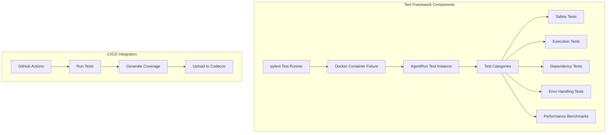
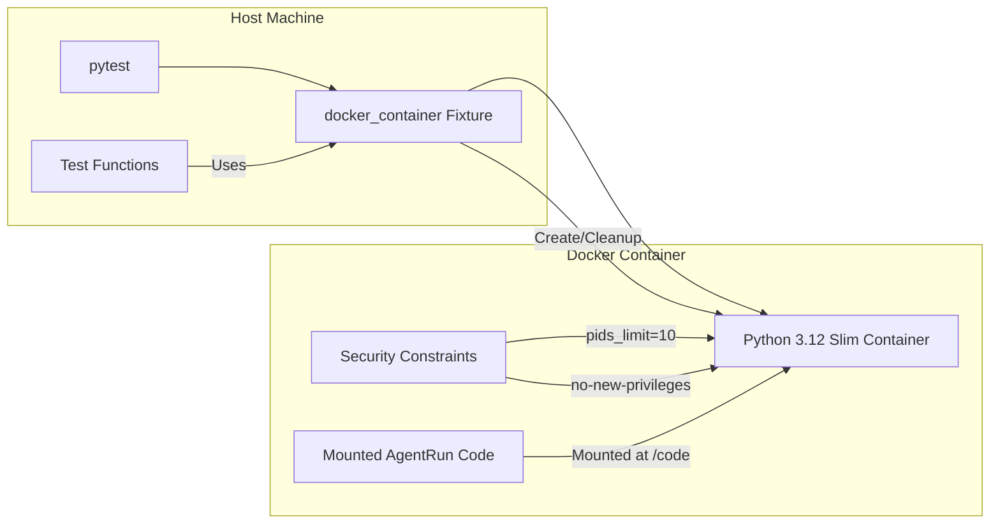
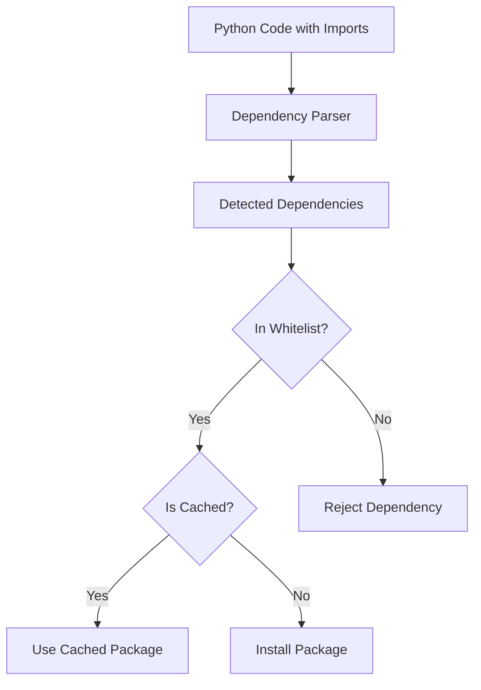
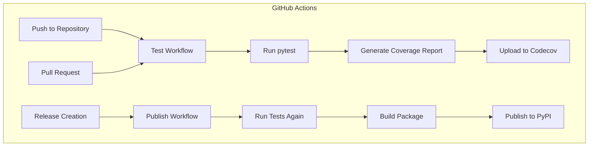

<!-- source: DeepWiki mcp.deepwiki.com · repo tjmlabs/AgentRun · page 6.1 Testing Framework · fetched 2026-10-26 -->

# Testing Framework

<details>
<summary>Relevant source files</summary>

The following files were used as context for generating this wiki page:

- [.coverage](.coverage)
- [.github/workflows/publish.yml](.github/workflows/publish.yml)
- [.github/workflows/test.yml](.github/workflows/test.yml)
- [tests/test_agentrun.py](tests/test_agentrun.py)

</details>


## Purpose and Scope

This document provides a comprehensive overview of the testing framework used in AgentRun. It covers test organization, Docker-based testing environment, test categories, and integration with CI/CD. This document focuses on the technical aspects of testing rather than how to use AgentRun itself. For information about using AgentRun, see [Overview](#1).

## Testing Architecture

The AgentRun testing framework leverages pytest to verify the functionality, safety, and performance of the code execution environment. Tests are designed to validate that AgentRun properly sandboxes Python code, enforces safety checks, manages dependencies, and handles various error conditions.



Sources: [tests/test_agentrun.py:1-328](), [.github/workflows/test.yml:1-34](), [.github/workflows/publish.yml:1-55]()

## Docker-Based Test Environment

Tests run against a controlled Docker environment that simulates the production execution environment. This approach ensures that tests accurately reflect real-world behavior.



Sources: [tests/test_agentrun.py:9-33]()

## Test Categories

### Safety Checks

The safety check tests verify AgentRun's ability to identify and reject potentially harmful code. The tests use parameterized inputs to validate detection of various unsafe patterns.

| Test Case | Purpose | Example |
|-----------|---------|---------|
| Syntax errors | Verify rejection of malformed code | `print('Hello, World!'` (unclosed parenthesis) |
| Unsafe imports | Detect dangerous module imports | `import os`, `from os import path` |
| Dangerous functions | Identify unsafe built-ins | `eval()`, `exec()`, `globals()` |
| File access | Prevent file system access | `open('secret_file.txt', 'r')` |
| Subprocess execution | Block command execution | `subprocess.Popen(['ping', '...'])` |

Sources: [tests/test_agentrun.py:36-114]()

### Code Execution

These tests verify that code is properly executed within the container and that timeouts function as expected.

| Test Case | Purpose |
|-----------|---------|
| Basic execution | Verify proper output from simple code |
| Timeout handling | Ensure long-running code is terminated |
| Output capturing | Confirm stdout is properly captured |

Sources: [tests/test_agentrun.py:117-137](), [tests/test_agentrun.py:207-222]()

### Dependency Management

These tests validate AgentRun's ability to parse, whitelist, and install required dependencies.



| Test Case | Purpose | Example |
|-----------|---------|---------|
| Dependency parsing | Extract requirements from code | `import numpy` → `["numpy"]` |
| Whitelist enforcement | Block disallowed packages | Reject if not in whitelist |
| Dependency installation | Install allowed packages | Install `arrow` when required |
| Cache utilization | Use pre-installed packages | Use cached `numpy` |

Sources: [tests/test_agentrun.py:140-157](), [tests/test_agentrun.py:160-204]()

### Error Handling

These tests verify that AgentRun properly handles error conditions and provides meaningful error messages.

| Test Case | Purpose |
|-----------|---------|
| Invalid container name | Detect non-existent container |
| Stopped container | Handle inactive containers |
| Docker daemon unavailable | Graceful handling when Docker is down |
| Dependency whitelist mismatch | Validate cache vs. whitelist consistency |

Sources: [tests/test_agentrun.py:225-269]()

### Performance Benchmarking

Benchmark tests measure execution performance across different scenarios, tracking metrics to detect performance regressions.

| Benchmark | Purpose |
|-----------|---------|
| Cached dependency execution | Measure performance with pre-installed dependencies |
| New dependency execution | Measure overhead of dependency installation |
| Exception handling | Evaluate performance with error conditions |
| Vanilla execution | Baseline performance for simple code |

Sources: [tests/test_agentrun.py:273-328]()

## Test Fixtures

The primary fixture is `docker_container`, which provides a consistent Docker environment for all tests:

```python
@pytest.fixture(scope="session")
def docker_container():
    # Set up Docker container
    client = docker.from_env()
    # ... configure and start container
    yield container  # Provide the container to the test
    # Cleanup: Stop and remove the container
    container.stop()
    container.remove()
```

This fixture has session scope, meaning it's created once for the entire test session, improving test execution speed by avoiding container creation/destruction for each test.

Sources: [tests/test_agentrun.py:9-33]()

## Test Parametrization

Many tests use pytest's parametrization to test multiple scenarios with the same test function:

```python
@pytest.mark.parametrize(
    "code, expected",
    [
        ("print('Hello, World!')", "Hello, World!\n"),
        ("import time\ntime.sleep(3)", "Execution timed out."),
    ],
)
def test_execute_code_with_timeout(code, expected, docker_container):
    # Test implementation...
```

This approach enables efficient testing of multiple input/output combinations without duplicating test code.

Sources: [tests/test_agentrun.py:36-106](), [tests/test_agentrun.py:117-129]()

## CI/CD Integration

The testing framework is integrated with GitHub Actions to ensure all code changes are properly tested.



Two GitHub workflows interact with the test framework:

1. **Test Workflow**: Runs on every push and pull request
   - Runs all pytest tests
   - Uploads coverage data to Codecov

2. **Publish Workflow**: Runs when a release is created
   - Runs all tests again to verify release stability
   - Builds and publishes package only if tests pass

Sources: [.github/workflows/test.yml:1-34](), [.github/workflows/publish.yml:1-55]()

## Running Tests Locally

To run the AgentRun tests locally:

1. Install the package with test dependencies:
   ```bash
   pip install '.[test]'
   ```

2. Run the tests with pytest:
   ```bash
   pytest
   ```

3. To run tests with coverage:
   ```bash
   pytest --cov=agentrun/
   ```

The tests require a working Docker installation, as they create real containers for testing the AgentRun functionality.

Sources: [.github/workflows/test.yml:22-27]()

## Test Coverage

Test coverage is tracked for the AgentRun codebase. Each test run generates a coverage report that is uploaded to Codecov when run in CI. The coverage report highlights which parts of the codebase are well-tested and which might need additional test coverage.

Sources: [.github/workflows/test.yml:29-33]()

---

