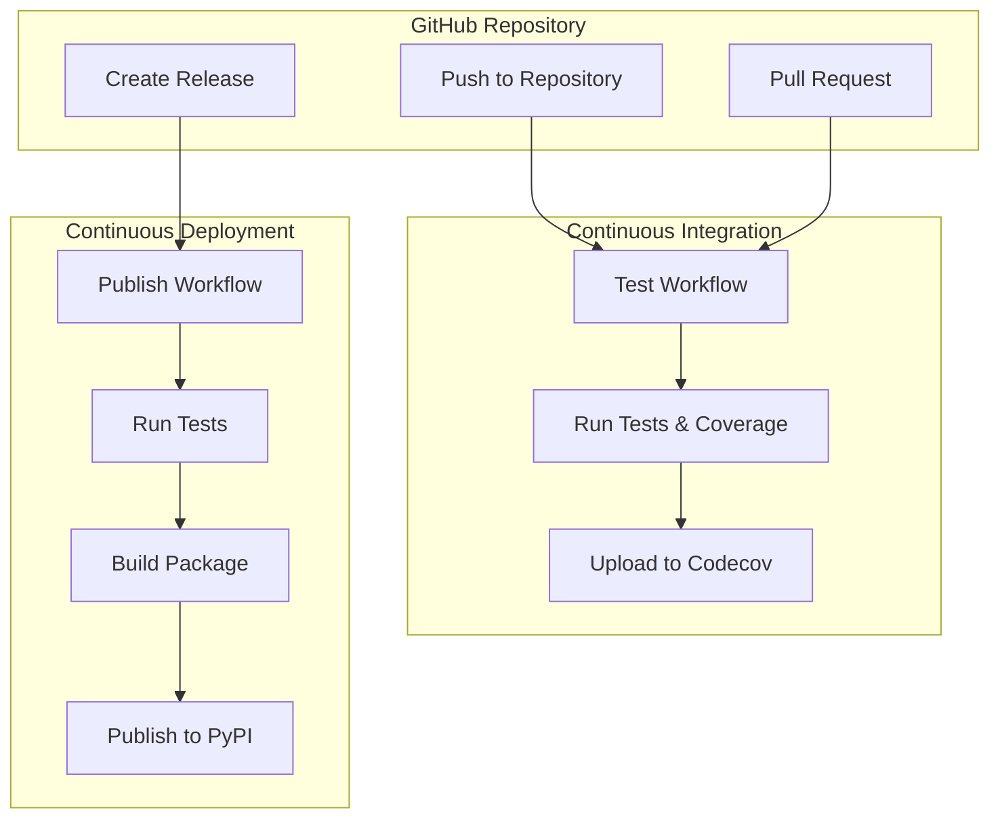
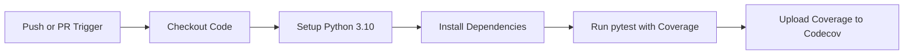
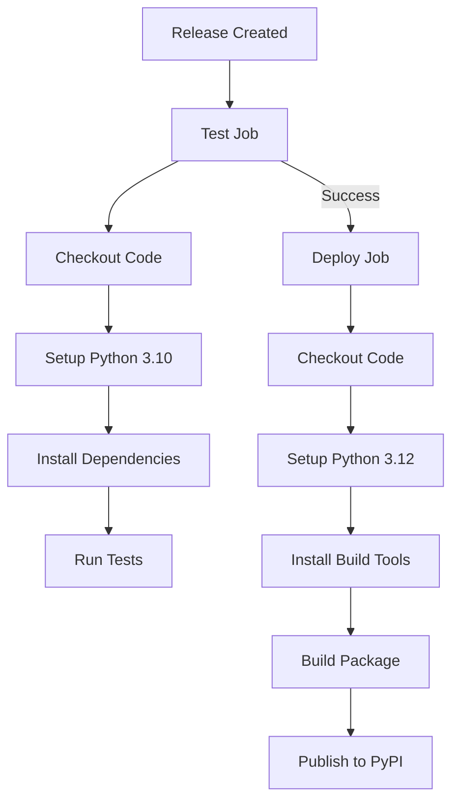
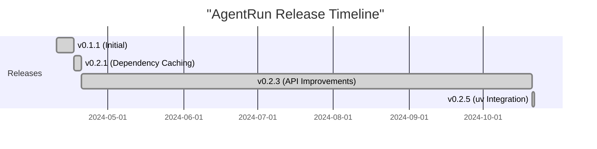
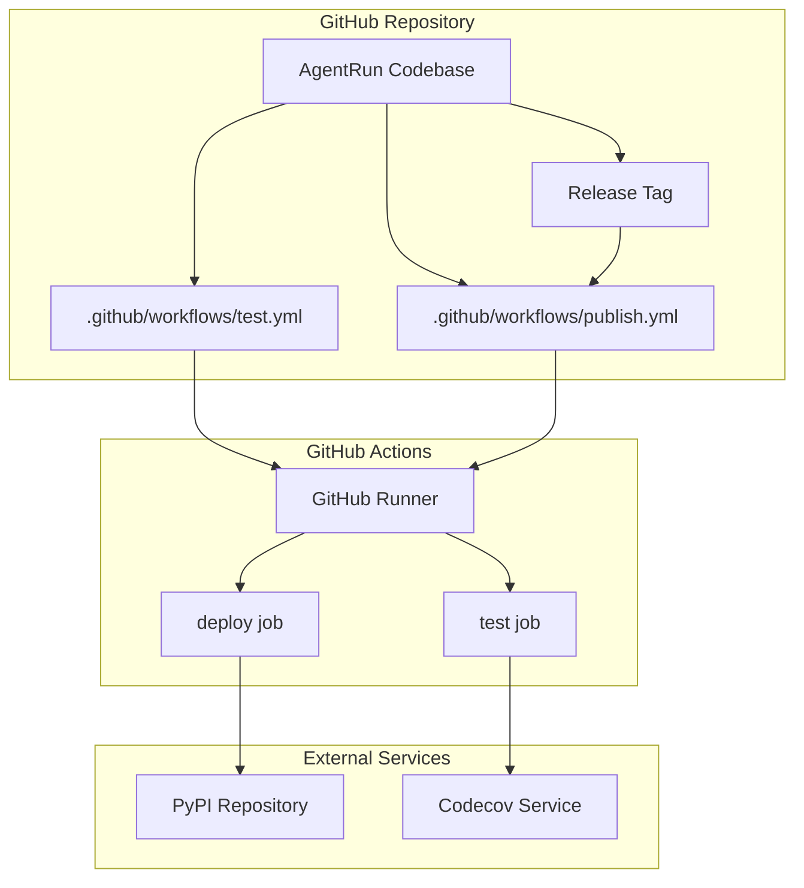

<!-- source: DeepWiki mcp.deepwiki.com · repo tjmlabs/AgentRun · page 6.2 CI/CD Pipeline · fetched 2026-10-26 -->

# CI/CD Pipeline

Relevant source files

The following files were used as context for generating this wiki page:

- [.github/workflows/publish.yml](.github/workflows/publish.yml)
- [.github/workflows/test.yml](.github/workflows/test.yml)
- [docs/release_notes.md](docs/release_notes.md)

This page documents the continuous integration and continuous deployment (CI/CD) pipeline for the AgentRun project. The pipeline automates testing, code quality checks, and the release process, ensuring consistent quality and streamlined deployment.

For information about testing framework and writing tests, see [Testing Framework](#6.1).

## Overview

AgentRun employs GitHub Actions to automate the testing and release workflow. The CI/CD pipeline consists of two main workflows:

1. **Test Workflow** - Runs on all pushes and pull requests to verify code quality
2. **Publish Workflow** - Triggered when a new release is created to publish the package to PyPI

Sources: [.github/workflows/test.yml:1-34](), [.github/workflows/publish.yml:1-56]()

## Test Workflow

The test workflow runs automatically on every push to the repository and on all pull requests. It ensures that code changes don't break existing functionality and maintains code quality.

### Workflow Configuration

Key features of the test workflow:

- **Trigger**: Activated on push events and pull requests
- **Environment**: Runs on Ubuntu with Python 3.10
- **Dependencies**: Installs project with test dependencies
- **Testing**: Runs pytest with coverage reporting
- **Reporting**: Uploads coverage reports to Codecov for tracking code quality

Sources: [.github/workflows/test.yml:1-34]()

## Publish Workflow

The publish workflow automates the release process, ensuring that packages are properly tested before being published to PyPI.

### Workflow Configuration

Key features of the publish workflow:

- **Trigger**: Activated when a new release is created in GitHub
- **Two-stage process**:
  1. **Test Stage**: Ensures all tests pass before proceeding
  2. **Deploy Stage**: Builds and publishes the package
- **Environment**: Uses a dedicated "release" environment with appropriate permissions
- **Authentication**: Uses PyPA's official action with secure token handling
- **Dependencies**: Both stages use dependency caching for faster execution

Sources: [.github/workflows/publish.yml:1-56]()

## Release Management

AgentRun follows a versioned release process. When a new version is ready for release:

1. Version number is updated in the project files
2. A new GitHub release is created with release notes
3. The CI/CD pipeline automatically publishes the package to PyPI

### Release Notes

Release notes are maintained in the `docs/release_notes.md` file, documenting changes in each version:

Recent significant improvements include:
- Addition of uv as the dependency manager
- Performance optimizations
- Dependency caching
- API enhancements

Sources: [docs/release_notes.md:1-21]()

## CI/CD Components and Relationships

The following diagram shows how the CI/CD components relate to the codebase and GitHub infrastructure:

Sources: [.github/workflows/test.yml:1-34](), [.github/workflows/publish.yml:1-56]()

## Test Workflow Details

The test workflow is defined in `.github/workflows/test.yml` and includes the following key components:

| Component | Description |
|-----------|-------------|
| Trigger | Runs on push and pull request events |
| Python Version | 3.10 |
| Dependencies | Installed via `pip install '.[test]'` |
| Test Command | `pytest --cov=agentrun/` |
| Coverage Report | Uploaded to Codecov service |

Sources: [.github/workflows/test.yml:1-34]()

## Publish Workflow Details

The publish workflow is defined in `.github/workflows/publish.yml` and includes:

| Component | Description |
|-----------|-------------|
| Trigger | Runs when a release is created |
| Test Job | Runs tests to verify build integrity |
| Deploy Job | Builds and publishes package to PyPI |
| Python Version | 3.10 for testing, 3.12 for building |
| Build Tools | setuptools, wheel, build |
| Publishing | Uses pypa/gh-action-pypi-publish |

Sources: [.github/workflows/publish.yml:1-56]()

## Best Practices

The AgentRun CI/CD pipeline follows several industry best practices:

1. **Test Before Deploy**: Ensures code is thoroughly tested before being released
2. **Automatic Versioning**: Uses GitHub releases for version management
3. **Code Coverage**: Tracks code coverage to maintain quality
4. **Dependency Caching**: Uses GitHub Actions caching to speed up builds
5. **Secure Credential Handling**: Uses GitHub's secure token storage for PyPI publishing

Sources: [.github/workflows/test.yml:1-34](), [.github/workflows/publish.yml:1-56]()

---

