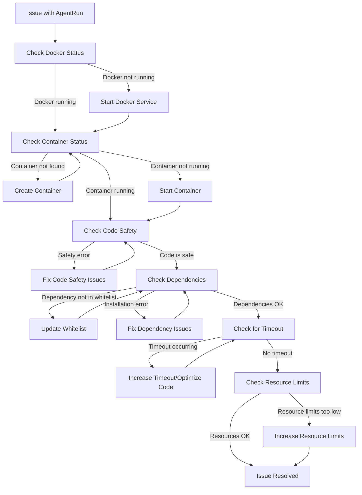
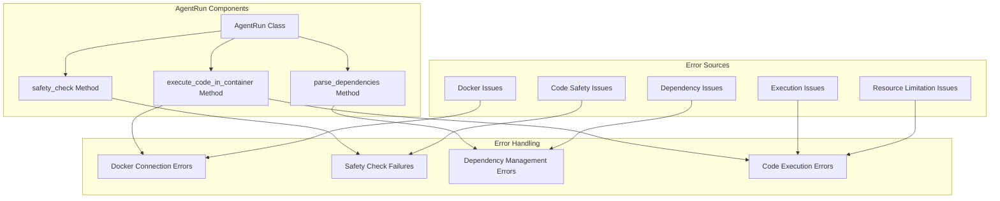
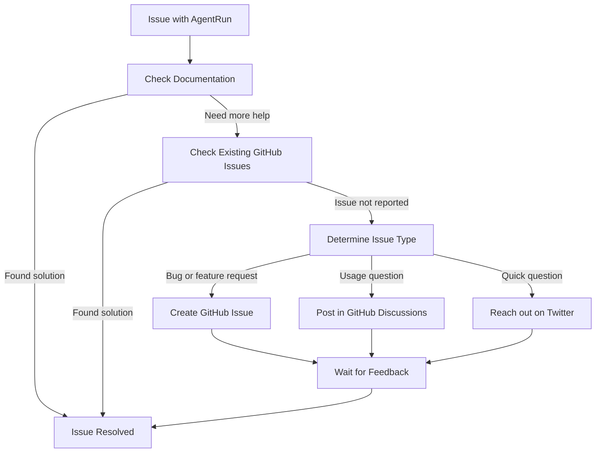

<!-- source: DeepWiki mcp.deepwiki.com · repo tjmlabs/AgentRun · page 7 Troubleshooting and Help · fetched 2026-10-26 -->

# Troubleshooting and Help

Relevant source files

The following files were used as context for generating this wiki page:

- [README.md](README.md)
- [docs/help.md](docs/help.md)
- [tests/test_agentrun.py](tests/test_agentrun.py)

This document provides guidance for resolving common issues encountered when using AgentRun, as well as resources for getting additional help. It covers troubleshooting for both the Python package and REST API deployment options.

For installation instructions, see [Installation and Setup](#2), and for configuring the system, refer to [Configuration Options](#4).

## Common Issues and Solutions

This section addresses the most frequently encountered issues when working with AgentRun and their solutions.

### Docker-related Issues

Docker configuration is essential for AgentRun's operation. Here are common Docker-related issues:

#### Docker Not Running

**Symptoms:** Error message indicating failure to connect to Docker daemon when initializing AgentRun.

**Solution:**
1. Verify Docker is installed and running on your system
2. Check Docker service status: `docker info` or `docker ps`
3. Start Docker service if needed (platform-specific)

#### Container Not Found

**Symptoms:** Error message: "Container [name] not found"

**Solution:**
1. Verify the container name is correct
2. Check if the container exists: `docker ps -a`
3. Create the container if it doesn't exist

#### Container Not Running

**Symptoms:** Error message: "Container [name] is not running"

**Solution:**
1. Start the container: `docker start [container_name]`
2. Verify the container is running: `docker ps`

Sources: [tests/test_agentrun.py:225-239]()

### Code Safety Issues

AgentRun performs safety checks on code before execution. Here are common safety-related issues:

#### Unsafe Module Imports

**Symptoms:** Error message: "Unsafe module import: [module_name]"

**Solution:**
1. Avoid using modules like `os`, `subprocess`, or others that could provide system access
2. Use alternative, safer modules or methods

#### Unsafe Function Calls

**Symptoms:** Error message: "Unsafe function call: [function_name]"

**Solution:**
1. Avoid using functions like `eval`, `exec`, `open`, `__import__`, etc.
2. Use safer alternatives provided by Python standard library

#### Syntax Errors

**Symptoms:** Error message indicating syntax error in the code

**Solution:**
1. Check that the code has proper syntax (balanced parentheses, valid indentation, etc.)
2. Fix any syntax errors before submission

Sources: [tests/test_agentrun.py:36-114]()

### Dependency Management Issues

AgentRun manages dependencies for code execution. Here are common dependency-related issues:

#### Dependency Not in Whitelist

**Symptoms:** Error message: "Dependency: [name] is not in the whitelist"

**Solution:**
1. Add the dependency to the whitelist when initializing AgentRun
2. Use only allowed dependencies in your code

#### Failed Dependency Installation

**Symptoms:** Error message: "Failed to install dependency [name]"

**Solution:**
1. Check that the dependency name is correct
2. Verify the dependency exists in PyPI
3. Review logs for specific installation errors

#### Dependency Version Conflicts

**Symptoms:** Error message related to dependency versioning

**Solution:**
1. Specify compatible versions in your code
2. Consider using cached dependencies for critical packages

Sources: [tests/test_agentrun.py:160-204](), [README.md:270-325]()

### Execution Timeout Issues

AgentRun enforces execution timeouts to prevent runaway code.

**Symptoms:** Error message: "Execution timed out."

**Solution:**
1. Check if your code has inefficient loops or long-running operations
2. Increase the timeout limit when initializing AgentRun if needed
3. Optimize your code for faster execution

Sources: [tests/test_agentrun.py:117-137]()

### REST API Issues

When using the REST API deployment option, these issues may occur:

#### API Connection Issues

**Symptoms:** Unable to connect to the API endpoint

**Solution:**
1. Verify the API service is running: `docker-compose ps`
2. Check if the API is accessible: `curl http://localhost:8000/health`
3. Review API logs: `docker-compose logs -f`

#### Invalid Request Format

**Symptoms:** Error message indicating invalid request format

**Solution:**
1. Ensure requests include the required `code` field
2. Verify the JSON format is valid
3. Review the API documentation for correct request format

Sources: [README.md:59-90]()

## Error Message Reference

This section provides a reference guide to common error messages and their meanings.

| Error Message | Meaning | Solution |
|--------------|---------|----------|
| "Container [name] not found" | The specified container doesn't exist | Create or use a correct container name |
| "Container [name] is not running" | The container exists but isn't started | Start the container before using AgentRun |
| "Failed to connect to Docker daemon" | Docker service isn't running | Start Docker service |
| "Unsafe module import: [module]" | Code tries to import a potentially dangerous module | Remove or replace the unsafe import |
| "Unsafe function call: [function]" | Code calls a potentially dangerous function | Remove or replace the unsafe function call |
| "Use of dangerous built-in function: [function]" | Code uses a built-in function considered unsafe | Replace with a safer alternative |
| "Execution timed out" | Code execution exceeded the time limit | Optimize code or increase timeout |
| "Dependency: [name] is not in the whitelist" | Trying to use a non-whitelisted dependency | Add to whitelist or use an allowed alternative |
| "Failed to install dependency [name]" | Package couldn't be installed | Check package name or PyPI availability |

Sources: [tests/test_agentrun.py:36-114](), [tests/test_agentrun.py:225-270]()

## Troubleshooting Flow

The following diagram illustrates the process for diagnosing and resolving common issues with AgentRun:

Sources: [tests/test_agentrun.py:225-270](), [README.md:270-325]()

## Error Sources and Handling

This diagram shows the relationship between different components of the AgentRun system and common error sources:

Sources: [tests/test_agentrun.py:36-204]()

## Getting Help

If you encounter issues not covered in this guide, there are several resources available for getting help:

### Community Resources

The following diagram shows the available help resources and when to use each:

### Official Resources

- **GitHub Discussions**: For usage questions and general discussions about AgentRun
  - URL: https://github.com/Jonathan-Adly/AgentRun/discussions

- **GitHub Issues**: For reporting bugs or requesting new features
  - URL: https://github.com/Jonathan-Adly/AgentRun/issues

- **Twitter**: For quick questions or updates
  - Contact: @Jonathan_Adly_

Sources: [docs/help.md:1-16]()

## Diagnostic Information to Provide

When seeking help, providing the following information will assist in resolving your issue faster:

1. **AgentRun Version**: Output of `pip show agentrun`
2. **Docker Version**: Output of `docker --version`
3. **Python Version**: Output of `python --version`
4. **Operating System**: Name and version of your OS
5. **Deployment Method**: Python package or REST API
6. **Error Messages**: Complete error output
7. **Steps to Reproduce**: Minimal code example that demonstrates the issue

Sources: [README.md:334-356]()

---

