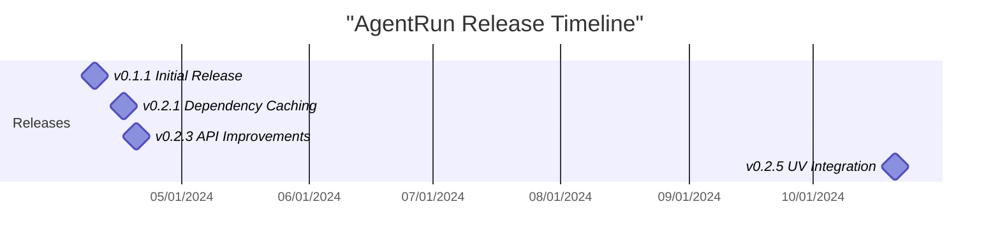
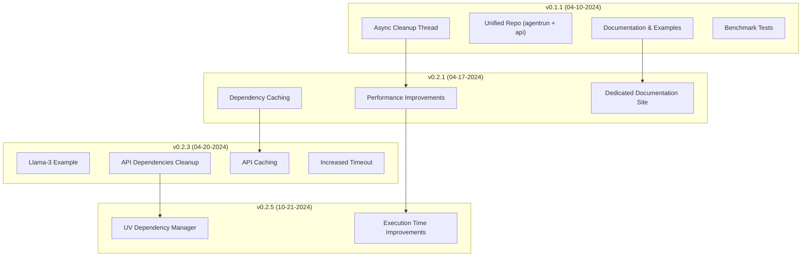
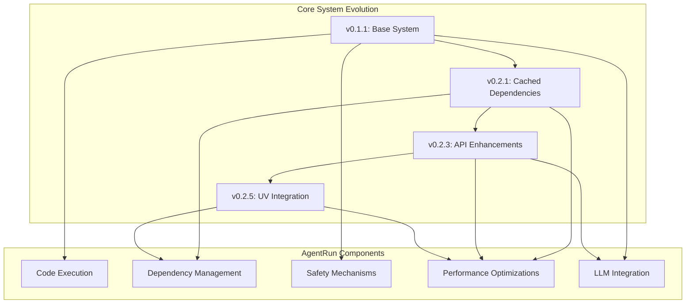

<!-- source: DeepWiki mcp.deepwiki.com · repo tjmlabs/AgentRun · page 8 Release History · fetched 2026-10-26 -->

# Release History

Relevant source files

The following files were used as context for generating this wiki page:

- [docs/release_notes.md](docs/release_notes.md)

This page documents the version history of AgentRun, tracking all releases and their key features, improvements, and changes. It provides a chronological record of the project's evolution from its initial release to the current version. For information about installation and setup of the current version, see [Installation and Setup](#2).

## Release Timeline

The following diagram shows the chronological timeline of AgentRun releases:

Sources: [docs/release_notes.md:1-21]()

## Feature Evolution

The following diagram illustrates how key features have evolved across different releases:

Sources: [docs/release_notes.md:1-21]()

## Detailed Release Notes

### V0.2.5 (October 21, 2024)

**Key Features:**
- Added UV as the dependency manager
- Improved performance and execution time through UV integration

**Impact:**
This release focused on enhancing dependency management by integrating UV, a modern Python package installer and resolver written in Rust. This change significantly improved performance and execution time for code running in the AgentRun environment.

Sources: [docs/release_notes.md:1-4]()

### V0.2.3 (April 20, 2024)

**Key Features:**
- Added Llama-3 integration example
- Cleaned up API dependencies
- Added caching to the API
- Increased timeout limits

**Impact:**
This release expanded the LLM integration capabilities by adding support for Llama-3 models. It also improved the API's performance through caching and increased timeout settings, while cleaning up dependencies to create a more streamlined system.

Sources: [docs/release_notes.md:5-9]()

### V0.2.1 (April 17, 2024)

**Key Features:**
- Introduced dependency caching management
- Improved overall performance and execution time
- Launched a dedicated documentation site

**Impact:**
This release marked a significant improvement in system performance through dependency caching. By caching frequently used dependencies, execution time was reduced for subsequent runs requiring the same packages. The launch of a dedicated documentation site also improved the project's accessibility for users and developers.

Sources: [docs/release_notes.md:10-14]()

### V0.1.1 (April 10, 2024)

**Key Features:**
- Expanded documentation and examples
- Merged agentrun-api and agentrun repositories
- Implemented asynchronous cleanup processes
- Added benchmark tests

**Impact:**
This initial release established the foundation of the AgentRun system. Key improvements included moving cleanup operations to a separate thread, which enhanced performance by allowing the main execution thread to complete without waiting for cleanup. The merger of the API and core packages into a single repository simplified development and maintenance.

Sources: [docs/release_notes.md:16-21]()

## Feature Development Across Releases

The table below summarizes the evolution of key features across releases:

| Feature Category | v0.1.1 (04-10-2024) | v0.2.1 (04-17-2024) | v0.2.3 (04-20-2024) | v0.2.5 (10-21-2024) |
|------------------|---------------------|---------------------|---------------------|---------------------|
| Documentation    | Basic docs & examples | Dedicated documentation site | No major changes | No major changes |
| Performance      | Async cleanup thread | General performance improvements | API caching, increased timeout | Improved execution time via UV |
| Dependencies     | Initial implementation | Dependency caching | API dependencies cleanup | UV dependency manager |
| Integration      | Initial API | Enhanced functionality | Llama-3 example | No major changes |
| Repository       | Unified repo structure | No major changes | No major changes | No major changes |
| Testing          | Benchmark tests | No major changes | No major changes | No major changes |

Sources: [docs/release_notes.md:1-21]()

## System Component Evolution

Sources: [docs/release_notes.md:1-21]()

## Summary of Progress

Since its initial release in April 2024, AgentRun has evolved through four versions, with each release addressing specific areas of improvement:

1. **Initial Foundation (v0.1.1)**: Established the core system architecture, documentation, and testing framework.

2. **Performance Enhancement (v0.2.1)**: Focused on improving execution speed and resource utilization through dependency caching.

3. **API and Integration Improvements (v0.2.3)**: Enhanced the API component with caching and expanded LLM integration options.

4. **Dependency Management Upgrade (v0.2.5)**: Integrated UV for more efficient dependency resolution and installation.

This progression demonstrates AgentRun's commitment to continuous improvement in performance, usability, and integration capabilities, making it increasingly valuable for safely executing LLM-generated code.

Sources: [docs/release_notes.md:1-21]()