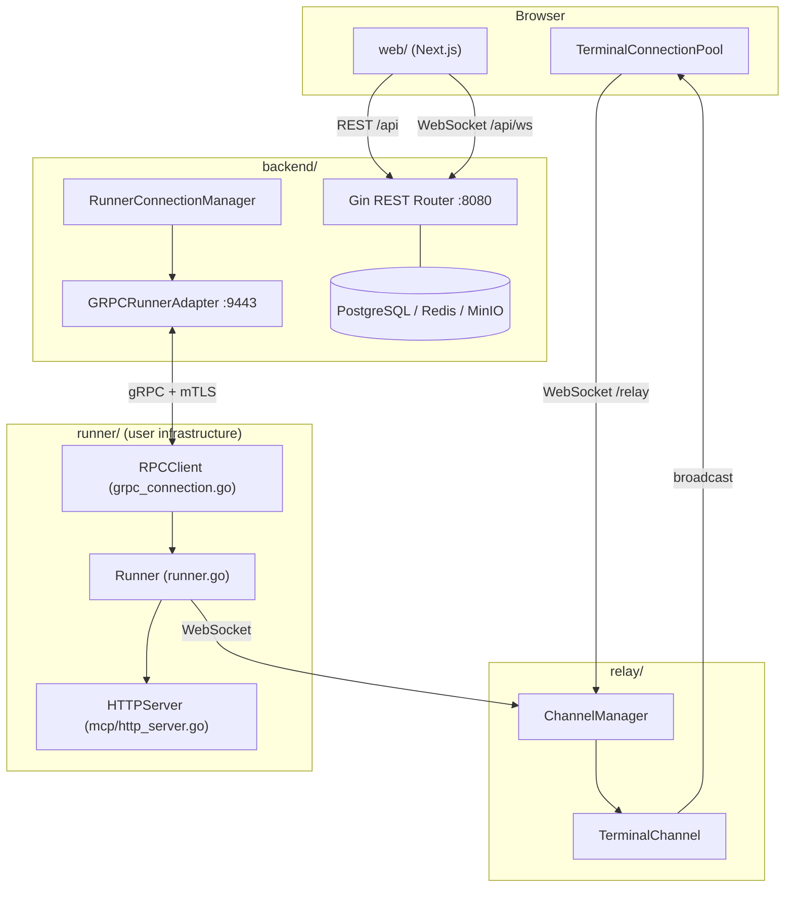
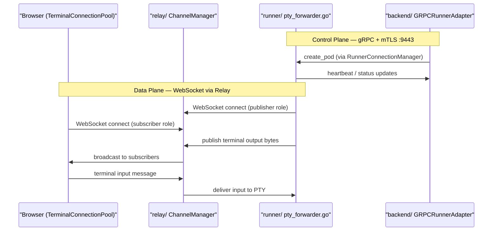

<!-- source: DeepWiki mcp.deepwiki.com · repo AgentsMesh/AgentsMesh · page 1 Overview · fetched 2026-10-26 -->

# Overview

<details>
<summary>Relevant source files</summary>

The following files were used as context for generating this wiki page:

- [.claude/skills/worktree/SKILL.md](.claude/skills/worktree/SKILL.md)
- [CLAUDE.md](CLAUDE.md)
- [README.md](README.md)
- [backend/internal/api/grpc/runner_adapter_mcp.go](backend/internal/api/grpc/runner_adapter_mcp.go)
- [backend/internal/api/grpc/runner_adapter_mcp_ticket.go](backend/internal/api/grpc/runner_adapter_mcp_ticket.go)
- [backend/internal/service/ticket/ticket_query.go](backend/internal/service/ticket/ticket_query.go)
- [backend/internal/service/ticket/ticket_query_test.go](backend/internal/service/ticket/ticket_query_test.go)
- [deploy/dev/.gitignore](deploy/dev/.gitignore)
- [deploy/dev/backend.Dockerfile](deploy/dev/backend.Dockerfile)
- [deploy/dev/docker-compose.yml](deploy/dev/docker-compose.yml)
- [deploy/dev/init-seed.sh](deploy/dev/init-seed.sh)
- [deploy/dev/nginx/conf.d/default.conf](deploy/dev/nginx/conf.d/default.conf)
- [deploy/dev/nginx/nginx.conf](deploy/dev/nginx/nginx.conf)
- [deploy/dev/runner-entrypoint.sh](deploy/dev/runner-entrypoint.sh)
- [deploy/dev/runner.Dockerfile](deploy/dev/runner.Dockerfile)
- [deploy/dev/seed/seed.sql](deploy/dev/seed/seed.sql)
- [deploy/dev/traefik/dynamic/grpc.yml](deploy/dev/traefik/dynamic/grpc.yml)
- [deploy/dev/web.Dockerfile](deploy/dev/web.Dockerfile)
- [docs/images/architecture.svg](docs/images/architecture.svg)
- [runner/internal/mcp/grpc_client.go](runner/internal/mcp/grpc_client.go)
- [runner/internal/mcp/http_server.go](runner/internal/mcp/http_server.go)
- [runner/internal/mcp/http_tools_format_integration_test.go](runner/internal/mcp/http_tools_format_integration_test.go)
- [runner/internal/mcp/http_tools_ticket.go](runner/internal/mcp/http_tools_ticket.go)
- [runner/internal/mcp/tools/types_client.go](runner/internal/mcp/tools/types_client.go)
- [runner/internal/mcp/tools/types_entity.go](runner/internal/mcp/tools/types_entity.go)
- [web/src/components/landing/PricingSection.tsx](web/src/components/landing/PricingSection.tsx)
- [web/src/components/ui/block-editor.tsx](web/src/components/ui/block-editor.tsx)
- [web/src/lib/api/base.ts](web/src/lib/api/base.ts)
- [web/src/messages/de/landing.json](web/src/messages/de/landing.json)
- [web/src/messages/en/landing.json](web/src/messages/en/landing.json)
- [web/src/messages/es/landing.json](web/src/messages/es/landing.json)
- [web/src/messages/fr/landing.json](web/src/messages/fr/landing.json)
- [web/src/messages/ja/landing.json](web/src/messages/ja/landing.json)
- [web/src/messages/ko/landing.json](web/src/messages/ko/landing.json)
- [web/src/messages/pt/landing.json](web/src/messages/pt/landing.json)
- [web/src/messages/zh/landing.json](web/src/messages/zh/landing.json)

</details>


This page introduces AgentsMesh: what the platform does, its five main components, the BYOK model, and the self-hosted execution model. For how the components communicate at the protocol level, see [Architecture](#1.1). For definitions of domain terms such as Pod, Channel, Binding, and Sandbox, see [Core Concepts](#1.2).

---

## What is AgentsMesh?

AgentsMesh is a platform for running and coordinating terminal-based AI coding agents (Claude Code, Codex CLI, Gemini CLI, Aider, and others) at team scale. Rather than running agents one at a time on a developer's local machine, it provides:

- **AgentPods** — Isolated execution environments each with a PTY terminal, a Git worktree sandbox, and a browser-accessible terminal view
- **Multi-agent collaboration** — Agents communicate via Channels, observe and control peer terminals via Bindings, and can spawn new Pods autonomously using MCP tools
- **Ticket management** — Kanban board with agent-to-ticket binding and MR/PR webhook integration
- **Self-hosted Runners** — All code execution stays on user infrastructure; the platform only orchestrates lifecycle commands

---

## BYOK (Bring Your Own Key)

AgentsMesh does not proxy AI API calls. Users supply their own provider API keys — `ANTHROPIC_API_KEY`, `OPENAI_API_KEY`, `GEMINI_API_KEY`, etc. — directly to the Runner process environment. The platform orchestrates agents but never handles AI inference traffic. There are no per-token usage caps imposed by the platform; AI costs appear on the user's own provider account.

Keys are passed to Pods through the runner's sandbox environment. The full set of supported key variables is in [deploy/dev/docker-compose.yml:279-288]().

---

## Self-Hosted Execution Model

The Runner (`runner/`) is a Go daemon deployed on user-controlled infrastructure — a laptop, VM, or Kubernetes cluster. It connects **outbound** to the Backend over gRPC with mTLS. The Backend never receives file contents or raw agent output; it only issues lifecycle commands (`create_pod`, `terminate_pod`, `terminal_input`) and receives heartbeats and status updates over the bidirectional gRPC stream.

Terminal I/O is handled by a separate **Relay** (`relay/`) component that provides WebSocket pub/sub between browsers and runners. This separation keeps the Backend stateless with respect to terminal data and allows the Relay to scale independently. This is explicit in the docker-compose comment: *"Separates control flow (Backend) from data flow (Relay) for scalability"* ([deploy/dev/docker-compose.yml:321-323]()).

---

## Key Components

| Component | Directory | Language / Framework | Primary Role |
|-----------|-----------|---------------------|-------------|
| **Backend** | `backend/` | Go, Gin, GORM | REST API, gRPC server, auth, pod lifecycle, billing, event bus |
| **Web** | `web/` | Next.js (App Router), TypeScript | Browser UI: terminal workspace, kanban, mesh topology, channels |
| **Web-Admin** | `web-admin/` | Next.js, TypeScript | Internal admin console: users, orgs, runners, audit logs |
| **Runner** | `runner/` | Go | Self-hosted daemon; connects to Backend (gRPC+mTLS) and Relay (WebSocket), manages Pod PTY lifecycle |
| **Relay** | `relay/` | Go | WebSocket pub/sub relay for terminal I/O between browser and runner |
| **Proto** | `proto/` | Protocol Buffers | Shared gRPC message definitions for Backend ↔ Runner stream |

Sources: [README.md:108-114](), [CLAUDE.md:7-12]()

---

**Component and Key Code Entity Map**



Sources: [README.md:100-114](), [CLAUDE.md:137-171](), [deploy/dev/docker-compose.yml:110-383]()

---

**Control Plane vs Data Plane Flow**



Sources: [README.md:102-103](), [CLAUDE.md:159-170](), [deploy/dev/docker-compose.yml:321-382]()

---

## Supported Agents

Any terminal-based process can run as an agent. The platform provides first-class configuration support for:

| Agent | Provider |
|-------|---------|
| Claude Code | Anthropic |
| Codex CLI | OpenAI |
| Gemini CLI | Google |
| Aider | Open Source |
| OpenCode | Open Source |
| Custom | Any terminal-based process |

The Runner injects API keys from its own environment into each Pod's sandbox. Agents authenticate with provider APIs directly; the platform only controls the PTY lifecycle.

Sources: [README.md:186-195]()

---

## Tech Stack

| Layer | Technology |
|-------|-----------|
| Backend API | Go 1.24+, Gin, GORM |
| Database | PostgreSQL 16, Redis 7 |
| Object Storage | MinIO (S3-compatible) |
| Frontend | Next.js (App Router), TypeScript, Tailwind CSS |
| Runner ↔ Backend | gRPC bidirectional streaming, Protocol Buffers, mTLS certificates |
| Runner ↔ Relay | WebSocket |
| Browser ↔ Relay | WebSocket |
| Browser ↔ Backend | REST (Gin), WebSocket (real-time entity events) |
| Runner Authentication | mTLS client certificates issued by Backend PKI |
| Web Authentication | JWT |
| Reverse Proxy | Traefik |

Sources: [README.md:196-208](), [CLAUDE.md:1-15]()

---

## Project Layout

```
AgentsMesh/
├── backend/
│   ├── cmd/server/            # Entry point
│   ├── internal/
│   │   ├── api/rest/          # Gin REST handlers
│   │   ├── api/grpc/          # GRPCRunnerAdapter, GRPCServer
│   │   ├── domain/            # Domain models (agentpod, ticket, channel, runner, ...)
│   │   ├── service/           # Business logic layer
│   │   └── infra/             # DB and cache connections
│   └── migrations/            # golang-migrate SQL files
├── web/src/
│   ├── app/                   # Next.js App Router pages
│   ├── components/            # React components (terminal, kanban, mesh)
│   ├── stores/                # Zustand stores (pod, runner, channel, workspace)
│   └── lib/                   # API clients, URL resolution
├── web-admin/src/             # Admin console (Next.js, basePath: /admin)
├── runner/internal/
│   ├── runner/                # Runner, Pod, PodBuilder, pty_forwarder.go
│   ├── client/                # RPCClient (grpc_connection.go, grpc_registration.go)
│   ├── mcp/                   # HTTPServer, GRPCCollaborationClient
│   ├── terminal/              # PTY management (creack/pty on Unix, ConPTY on Windows)
│   └── workspace/             # Git worktree management
├── relay/                     # ChannelManager, TerminalChannel
├── proto/                     # .proto definitions (runner/v1)
└── deploy/
    ├── dev/                   # Docker Compose dev stack (dev.sh)
    └── selfhost/              # On-premise deployment files
```

Sources: [README.md:210-224](), [CLAUDE.md:174-271]()

---

## Quick Start

```bash
git clone https://github.com/AgentsMesh/AgentsMesh.git
cd AgentsMesh/deploy/dev
./dev.sh
```

`dev.sh` generates a port-isolated `.env` (supporting multiple Git worktrees simultaneously), starts PostgreSQL, Redis, MinIO, Gitea, Backend, Runner, Relay, and Traefik via Docker Compose, runs database migrations, seeds test data, and starts the Next.js frontend locally with Turbopack. See [Development Environment](#7) and [Docker Compose Services](#7.1) for a complete walkthrough.

| Service | Default URL |
|---------|------------|
| Web Console | http://localhost:3000 |
| API (via Traefik) | http://localhost:80/api |
| Traefik Dashboard | http://localhost:8080 |
| Adminer (DB UI) | http://localhost:8081 |
| MinIO Console | http://localhost:9001 |

| Account | Email | Password |
|---------|-------|---------|
| User | `dev@agentsmesh.local` | `devpass123` |
| Admin | `admin@agentsmesh.local` | `adminpass123` |

Sources: [README.md:118-143](), [deploy/dev/docker-compose.yml:1-50](), [deploy/dev/seed/seed.sql:30-65]()

---

