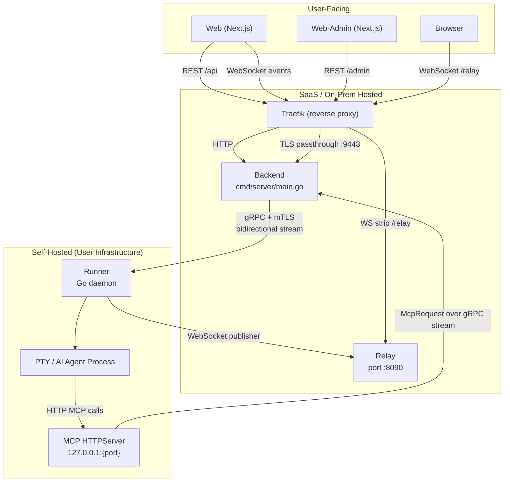
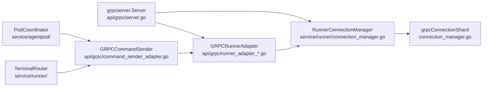
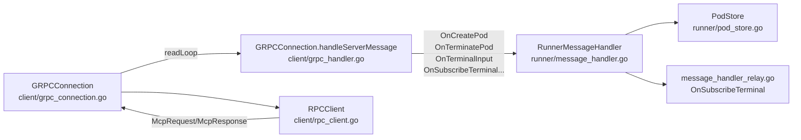
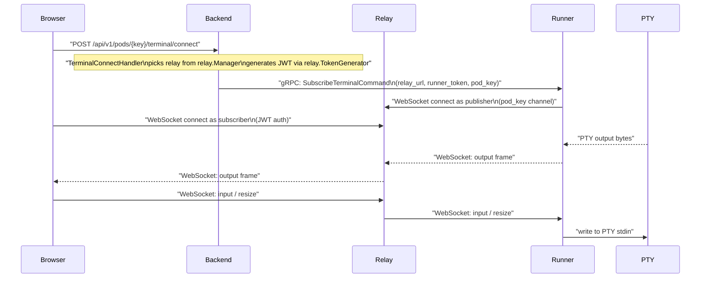
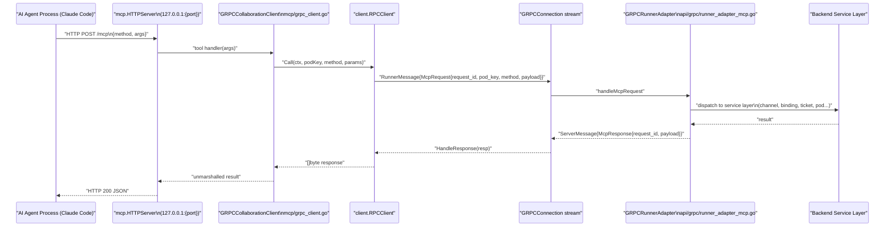
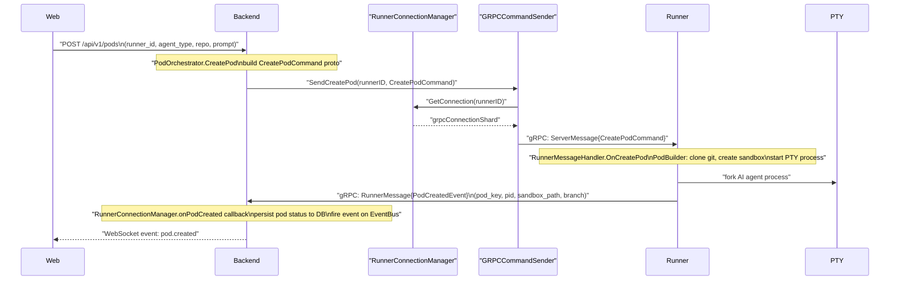

<!-- source: DeepWiki mcp.deepwiki.com · repo AgentsMesh/AgentsMesh · page 1.1 Architecture · fetched 2026-10-26 -->

# Architecture

<details>
<summary>Relevant source files</summary>

The following files were used as context for generating this wiki page:

- [.claude/skills/gh-merge/SKILL.md](.claude/skills/gh-merge/SKILL.md)
- [.claude/skills/worktree/SKILL.md](.claude/skills/worktree/SKILL.md)
- [CLAUDE.md](CLAUDE.md)
- [README.md](README.md)
- [backend/cmd/server/eventbus_relay.go](backend/cmd/server/eventbus_relay.go)
- [backend/cmd/server/main.go](backend/cmd/server/main.go)
- [backend/internal/api/grpc/command_sender_adapter.go](backend/internal/api/grpc/command_sender_adapter.go)
- [backend/internal/api/grpc/runner_adapter_mcp.go](backend/internal/api/grpc/runner_adapter_mcp.go)
- [backend/internal/api/grpc/runner_adapter_mcp_ticket.go](backend/internal/api/grpc/runner_adapter_mcp_ticket.go)
- [backend/internal/api/grpc/runner_adapter_send.go](backend/internal/api/grpc/runner_adapter_send.go)
- [backend/internal/api/grpc/runner_adapter_send_extra_test.go](backend/internal/api/grpc/runner_adapter_send_extra_test.go)
- [backend/internal/api/grpc/runner_adapter_test.go](backend/internal/api/grpc/runner_adapter_test.go)
- [backend/internal/api/rest/v1/pod_terminal_connect.go](backend/internal/api/rest/v1/pod_terminal_connect.go)
- [backend/internal/service/runner/command_sender.go](backend/internal/service/runner/command_sender.go)
- [backend/internal/service/runner/command_sender_test.go](backend/internal/service/runner/command_sender_test.go)
- [backend/internal/service/runner/connection_manager.go](backend/internal/service/runner/connection_manager.go)
- [backend/internal/service/runner/test_helper_test.go](backend/internal/service/runner/test_helper_test.go)
- [backend/internal/service/ticket/ticket_query.go](backend/internal/service/ticket/ticket_query.go)
- [backend/internal/service/ticket/ticket_query_test.go](backend/internal/service/ticket/ticket_query_test.go)
- [deploy/dev/.gitignore](deploy/dev/.gitignore)
- [deploy/dev/backend.Dockerfile](deploy/dev/backend.Dockerfile)
- [deploy/dev/docker-compose.yml](deploy/dev/docker-compose.yml)
- [deploy/dev/init-seed.sh](deploy/dev/init-seed.sh)
- [deploy/dev/nginx/conf.d/default.conf](deploy/dev/nginx/conf.d/default.conf)
- [deploy/dev/nginx/nginx.conf](deploy/dev/nginx/nginx.conf)
- [deploy/dev/runner-entrypoint.sh](deploy/dev/runner-entrypoint.sh)
- [deploy/dev/runner.Dockerfile](deploy/dev/runner.Dockerfile)
- [deploy/dev/seed/seed.sql](deploy/dev/seed/seed.sql)
- [deploy/dev/traefik/dynamic/grpc.yml](deploy/dev/traefik/dynamic/grpc.yml)
- [deploy/dev/web.Dockerfile](deploy/dev/web.Dockerfile)
- [docs/images/architecture.svg](docs/images/architecture.svg)
- [proto/gen/go/runner/v1/runner.pb.go](proto/gen/go/runner/v1/runner.pb.go)
- [proto/runner/v1/runner.proto](proto/runner/v1/runner.proto)
- [runner/internal/client/grpc_handler.go](runner/internal/client/grpc_handler.go)
- [runner/internal/client/interface.go](runner/internal/client/interface.go)
- [runner/internal/client/protocol.go](runner/internal/client/protocol.go)
- [runner/internal/mcp/grpc_client.go](runner/internal/mcp/grpc_client.go)
- [runner/internal/mcp/http_server.go](runner/internal/mcp/http_server.go)
- [runner/internal/mcp/http_tools_format_integration_test.go](runner/internal/mcp/http_tools_format_integration_test.go)
- [runner/internal/mcp/http_tools_ticket.go](runner/internal/mcp/http_tools_ticket.go)
- [runner/internal/mcp/tools/types_client.go](runner/internal/mcp/tools/types_client.go)
- [runner/internal/mcp/tools/types_entity.go](runner/internal/mcp/tools/types_entity.go)
- [runner/internal/relay/client_token_test.go](runner/internal/relay/client_token_test.go)
- [runner/internal/runner/message_handler.go](runner/internal/runner/message_handler.go)
- [runner/internal/runner/message_handler_pod_create_test.go](runner/internal/runner/message_handler_pod_create_test.go)
- [runner/internal/runner/message_handler_relay.go](runner/internal/runner/message_handler_relay.go)
- [web/src/components/ui/block-editor.tsx](web/src/components/ui/block-editor.tsx)
- [web/src/lib/api/base.ts](web/src/lib/api/base.ts)

</details>


This page describes the system-level architecture of AgentsMesh: how the four main services (Backend, Runner, Relay, Web) are decomposed, which protocols connect them, and how data flows through the system at runtime. For definitions of domain concepts (Pod, Channel, Ticket, Binding), see [Core Concepts](#1.2). For deployment-specific topology, see [Deployment](#8).

---

## Control Plane vs. Data Plane

AgentsMesh separates two distinct communication concerns:

| Plane | Purpose | Protocol | Transport |
|---|---|---|---|
| **Control Plane** | Orchestration commands, lifecycle events, MCP RPC | gRPC bidirectional stream | mTLS (port 9443) |
| **Data Plane** | Terminal I/O (PTY bytes) | WebSocket pub/sub | Relay cluster (port 80/path `/relay`) |
| **API Plane** | User-facing REST, real-time entity events | HTTP + WebSocket | HTTP (port 80/path `/api`) |

This split ensures that raw terminal output—which is high-frequency binary data—never passes through the Backend, keeping Backend stateless with respect to terminal content.

> Terminal output is **exclusively** streamed via Relay. The comment in [runner/internal/client/protocol.go:16-17]() states: `MsgTypeTerminalOutput removed - terminal output is exclusively streamed via Relay`.

---

## Component Topology

**Component overview and their relationships:**



Sources: [README.md:100-114](), [CLAUDE.md:138-171](), [deploy/dev/docker-compose.yml:384-400]()

---

## Control Plane: gRPC + mTLS

### Protocol Definition

The control channel is defined in [proto/runner/v1/runner.proto]() as a single bidirectional streaming RPC:

```
service RunnerService {
  rpc Connect(stream RunnerMessage) returns (stream ServerMessage);
}
```

All backend-to-runner commands and runner-to-backend events travel over this one persistent stream.

**Runner → Backend (`RunnerMessage` payload types):**

| Message | Purpose |
|---|---|
| `InitializeRequest` | Runner identification on connect |
| `InitializedConfirm` | Reports detected agent types/versions |
| `HeartbeatData` | Pod statuses, relay connection states |
| `PodCreatedEvent` | Pod is live; reports PID and sandbox path |
| `PodTerminatedEvent` | Pod process exited |
| `AgentStatusEvent` | Agent state change: `executing`, `waiting`, `idle` |
| `PodInitProgressEvent` | Progress during clone/prepare phases |
| `RequestRelayTokenEvent` | Runner requests a new relay JWT |
| `SandboxesStatusEvent` | Response to `QuerySandboxesCommand` |
| `McpRequest` | MCP tool call forwarded to backend services |
| `PongEvent` | Downstream heartbeat reply |
| `OSCNotificationEvent` | Desktop notification from terminal (OSC 777/9) |
| `OSCTitleEvent` | Terminal tab title change (OSC 0/2) |

**Backend → Runner (`ServerMessage` payload types):**

| Message | Purpose |
|---|---|
| `CreatePodCommand` | Create isolated PTY sandbox with config |
| `TerminatePodCommand` | Stop a pod |
| `TerminalInputCommand` | Keyboard input for programmatic use |
| `TerminalResizeCommand` | Resize PTY dimensions |
| `TerminalRedrawCommand` | Force terminal state refresh |
| `SubscribeTerminalCommand` | Instruct runner to connect to Relay |
| `UnsubscribeTerminalCommand` | Instruct runner to disconnect from Relay |
| `QuerySandboxesCommand` | Query sandbox filesystem state |
| `McpResponse` | Response to a `McpRequest` |
| `PingCommand` | Downstream liveness probe |
| `CreateAutopilotCommand` | Start an Autopilot controller |
| `AutopilotControlCommand` | Pause/resume/stop Autopilot |

Sources: [proto/runner/v1/runner.proto:1-586]()

### Backend-Side Control Plane Components

**Control plane component relationships on the backend:**



- **`RunnerConnectionManager`** ([backend/internal/service/runner/connection_manager.go]()): Stores live gRPC stream handles in 256 shards to reduce lock contention. Fires event callbacks (`onHeartbeat`, `onPodCreated`, etc.) when runner messages arrive.
- **`GRPCRunnerAdapter`** ([backend/internal/api/grpc/runner_adapter_send.go]()): Knows how to wrap commands into `ServerMessage` protos and deliver them via `RunnerConnectionManager.GetConnection(runnerID)`.
- **`GRPCCommandSender`** ([backend/internal/api/grpc/command_sender_adapter.go]()): Thin adapter that implements the `runner.RunnerCommandSender` interface so `PodCoordinator` and `TerminalRouter` can call gRPC without depending on the `grpc` package directly.

### Runner-Side Control Plane Components

**Control plane components on the runner side:**



- **`GRPCConnection`** (`runner/internal/client/`): Manages the bidirectional stream, reconnection with backoff, heartbeat ticker, and a write queue. Dispatches incoming messages in `handleServerMessage`.
- **`RunnerMessageHandler`** ([runner/internal/runner/message_handler.go]()): Implements `client.MessageHandler`. Routes each incoming command to pod lifecycle operations (build, start, stop terminal, relay subscribe/unsubscribe).
- **`RPCClient`**: Handles `McpRequest`/`McpResponse` correlation over the gRPC stream using UUID request IDs.

The `client.MessageHandler` interface ([runner/internal/client/protocol.go:107-138]()) defines the contract between the stream layer and the pod operations layer.

---

## Data Plane: WebSocket Terminal Streaming

### Relay Architecture

The Relay is a lightweight WebSocket pub/sub server. Each pod maps to a **channel** identified by its `pod_key`. The Runner is the **publisher** and browsers are **subscribers**.

**Terminal streaming sequence:**



Sources: [backend/internal/api/rest/v1/pod_terminal_connect.go](), [runner/internal/runner/message_handler_relay.go:19-100](), [deploy/dev/docker-compose.yml:321-382]()

### Runner Relay Client

When `OnSubscribeTerminal` fires ([runner/internal/runner/message_handler_relay.go:19-99]()), the runner:

1. Creates `relay.NewClient` with the provided relay URL and JWT token.
2. Sets a **fallback public relay URL** for local runners that cannot resolve Docker-internal hostnames (e.g. `ws://relay:8090` vs `ws://host:port/relay`).
3. Registers handlers:
   - `SetInputHandler` → writes to `pod.Terminal`
   - `SetResizeHandler` → resizes PTY
   - `SetImagePasteHandler` → writes image to clipboard backend, injects Ctrl+V
   - `SetTokenExpiredHandler` → sends `RequestRelayTokenEvent` over gRPC to get a fresh JWT
   - `SetReconnectHandler` → re-attaches relay output and sends terminal snapshot
4. Calls `pod.Aggregator.SetRelayOutput` to route PTY bytes to the relay connection.

On reconnect, the runner sends a **terminal snapshot** (full virtual terminal screen state) so late subscribers immediately see current output.

### Relay Token Refresh

When the runner's relay JWT expires mid-session, the flow uses `RequestRelayTokenEvent` over the gRPC control stream ([backend/cmd/server/eventbus_relay.go]()). The backend generates a new token and re-sends `SubscribeTerminalCommand` with it.

---

## MCP over gRPC

AI agents (Claude Code, etc.) communicate with AgentsMesh collaboration features via the **Model Context Protocol (MCP)**. Rather than opening a separate HTTP connection from the runner to the backend, MCP calls are multiplexed over the existing gRPC bidirectional stream.

**MCP call path:**



Sources: [runner/internal/mcp/http_server.go](), [runner/internal/mcp/grpc_client.go](), [backend/internal/api/grpc/runner_adapter_mcp.go]()

The MCP tool categories exposed by `mcp.HTTPServer.registerTools()` ([runner/internal/mcp/http_server.go:222-262]()):

| Category | Tools |
|---|---|
| Terminal | `observe_terminal`, `send_terminal_text`, `send_terminal_key`, `get_pod_status` |
| Discovery | `list_available_pods`, `list_runners`, `list_repositories` |
| Binding | `request_binding`, `accept_binding`, `reject_binding`, `unbind_pod`, `get_bindings`, `get_bound_pods` |
| Channel | `search_channels`, `create_channel`, `get_channel`, `send_message`, `get_messages`, `get_channel_document`, `update_channel_document` |
| Ticket | `search_tickets`, `get_ticket`, `create_ticket`, `update_ticket`, `post_comment` |
| Pod | `create_pod` |

Each pod registers with the MCP server via `HTTPServer.RegisterPod`, which creates a `GRPCCollaborationClient` for that pod's `pod_key`, scoping all tool calls to the correct organization context.

---

## Real-Time Events: EventBus → WebSocket Hub

Backend entity changes (pod state, tickets, channels) are broadcast to connected web clients via a WebSocket hub. The flow is:

```
Service layer → EventBus → Hub → WebSocket → Web (RealtimeProvider)
```

- Services call `SetEventBus` / `SetEventPublisher` during startup ([backend/cmd/server/main.go:63-67]()).
- `EventBus.StartRedisSubscriber` enables fan-out across multiple backend instances ([backend/cmd/server/main.go:70-73]()).
- The `Hub` converts events to JSON frames and sends them to subscribed WebSocket connections.
- On the frontend, `RealtimeProvider` dispatches events to Zustand stores (see [Real-time State Management](#5.5)).

---

## PKI and mTLS

Runners authenticate to the backend using **mutual TLS**. The backend operates a Certificate Authority (CA). During runner registration:

1. Runner generates a key pair and sends a CSR.
2. Backend issues a signed certificate (configurable validity, default 365 days via `PKI_VALIDITY_DAYS`).
3. Runner stores the certificate locally and presents it on every gRPC connect.
4. The gRPC server enforces client certificate validation on port 9443.

If `PKI_CA_CERT_FILE` and `PKI_CA_KEY_FILE` are not set, the gRPC server does not start and a `NoOpCommandSender` is used instead ([backend/cmd/server/main.go:134-158]()). For full PKI details, see [PKI and mTLS](#2.8).

---

## Network Ports and Endpoints

| Service | Internal Address | External (via Traefik) | Protocol |
|---|---|---|---|
| Backend REST | `:8080` | `{domain}/api`, `{domain}/health` | HTTP |
| Backend gRPC | `:9090` | `{domain}:9443` (TLS passthrough) | gRPC+mTLS |
| Relay | `:8090` | `{domain}/relay` (prefix stripped) | WebSocket |
| Runner MCP | `127.0.0.1:{dynamic}` | Not exposed externally | HTTP (loopback) |
| PostgreSQL | `:5432` | Not exposed | TCP |
| Redis | `:6379` | Not exposed | TCP |
| MinIO | `:9000` | Not exposed (presigned URLs) | HTTP |

Sources: [deploy/dev/docker-compose.yml:109-400](), [CLAUDE.md:34-48]()

The `PRIMARY_DOMAIN` and `USE_HTTPS` environment variables are the single source of truth for URL construction. All components (Backend, Relay, Web, Web-Admin) derive their public URLs from these two values. For the full configuration model, see [Configuration](#2.7).

---

## Pod Creation Data Flow

**End-to-end pod creation sequence:**



Sources: [backend/cmd/server/main.go:98-110](), [runner/internal/runner/message_handler.go:32-157](), [backend/internal/api/grpc/command_sender_adapter.go]()

---

