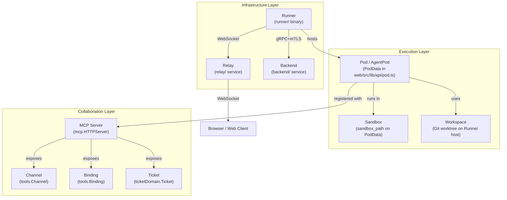
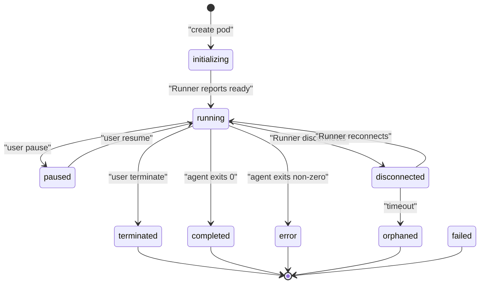
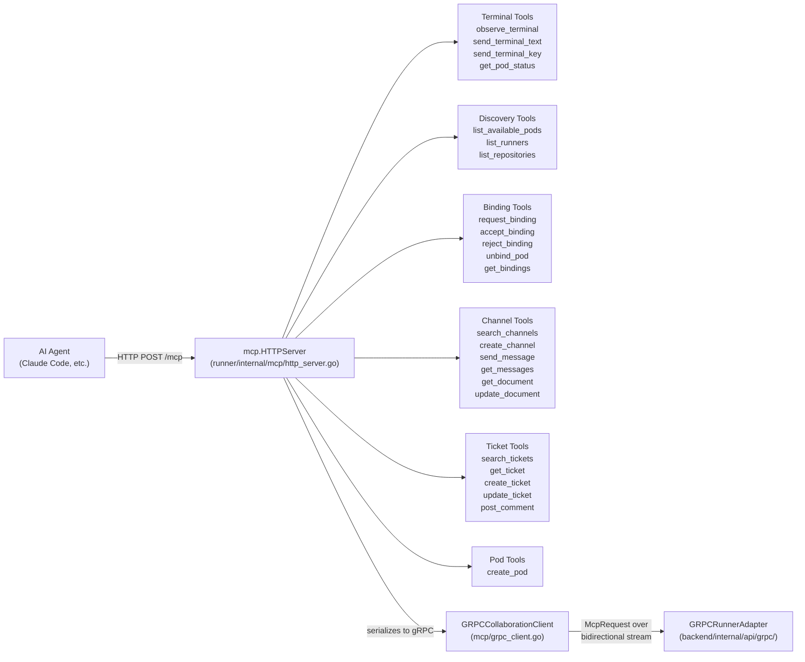
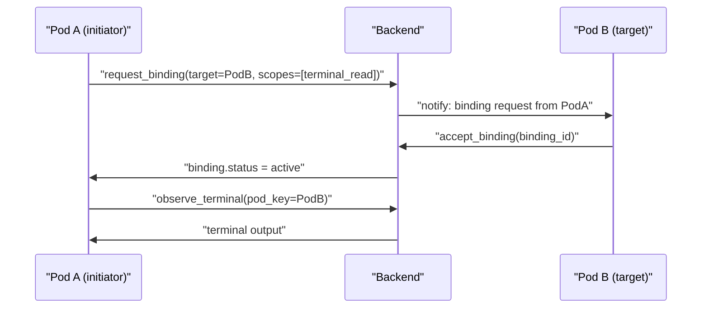
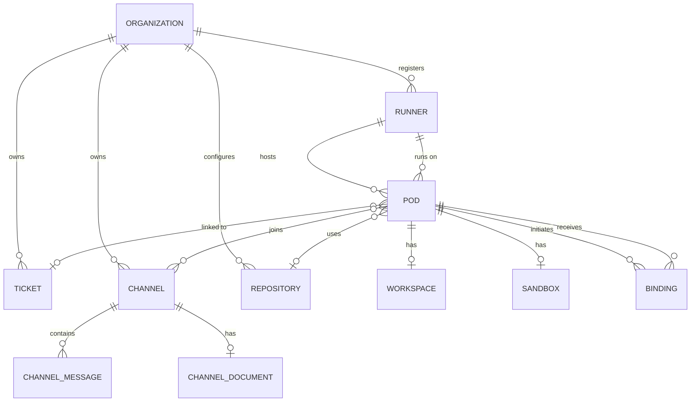

<!-- source: DeepWiki mcp.deepwiki.com · repo AgentsMesh/AgentsMesh · page 1.2 Core Concepts · fetched 2026-10-26 -->

# Core Concepts

Relevant source files

The following files were used as context for generating this wiki page:

- [README.md](README.md)
- [backend/internal/api/grpc/runner_adapter_mcp.go](backend/internal/api/grpc/runner_adapter_mcp.go)
- [backend/internal/api/grpc/runner_adapter_mcp_ticket.go](backend/internal/api/grpc/runner_adapter_mcp_ticket.go)
- [backend/internal/service/mesh/service.go](backend/internal/service/mesh/service.go)
- [backend/internal/service/ticket/ticket_query.go](backend/internal/service/ticket/ticket_query.go)
- [backend/internal/service/ticket/ticket_query_test.go](backend/internal/service/ticket/ticket_query_test.go)
- [docs/images/architecture.svg](docs/images/architecture.svg)
- [runner/internal/mcp/grpc_client.go](runner/internal/mcp/grpc_client.go)
- [runner/internal/mcp/http_server.go](runner/internal/mcp/http_server.go)
- [runner/internal/mcp/http_tools_format_integration_test.go](runner/internal/mcp/http_tools_format_integration_test.go)
- [runner/internal/mcp/http_tools_ticket.go](runner/internal/mcp/http_tools_ticket.go)
- [runner/internal/mcp/tools/types_client.go](runner/internal/mcp/tools/types_client.go)
- [runner/internal/mcp/tools/types_entity.go](runner/internal/mcp/tools/types_entity.go)
- [web/src/components/landing/PricingSection.tsx](web/src/components/landing/PricingSection.tsx)
- [web/src/lib/api/pod.ts](web/src/lib/api/pod.ts)
- [web/src/messages/de/app.json](web/src/messages/de/app.json)
- [web/src/messages/de/landing.json](web/src/messages/de/landing.json)
- [web/src/messages/en/app.json](web/src/messages/en/app.json)
- [web/src/messages/en/landing.json](web/src/messages/en/landing.json)
- [web/src/messages/es/app.json](web/src/messages/es/app.json)
- [web/src/messages/es/landing.json](web/src/messages/es/landing.json)
- [web/src/messages/fr/app.json](web/src/messages/fr/app.json)
- [web/src/messages/fr/landing.json](web/src/messages/fr/landing.json)
- [web/src/messages/ja/app.json](web/src/messages/ja/app.json)
- [web/src/messages/ja/landing.json](web/src/messages/ja/landing.json)
- [web/src/messages/ko/app.json](web/src/messages/ko/app.json)
- [web/src/messages/ko/landing.json](web/src/messages/ko/landing.json)
- [web/src/messages/pt/app.json](web/src/messages/pt/app.json)
- [web/src/messages/pt/landing.json](web/src/messages/pt/landing.json)
- [web/src/messages/zh/app.json](web/src/messages/zh/app.json)
- [web/src/messages/zh/landing.json](web/src/messages/zh/landing.json)

This page defines the primary terminology used throughout the AgentsMesh codebase and documentation. Understanding these concepts is necessary before reading any of the component-specific pages. For system architecture and how components communicate, see [Architecture](#1.1). For deployment-specific configuration, see [Configuration](#2.7).

---

## Concept Overview

AgentsMesh organizes work around three layers: **infrastructure** (Runners, Relay), **execution** (Pods, Sandboxes, Workspaces), and **collaboration** (Channels, Bindings, MCP, Tickets).

**Concept map: terms to code entities**

Sources: [runner/internal/mcp/http_server.go:36-57](), [web/src/lib/api/pod.ts:4-45](), [README.md:108-114]()

---

## Infrastructure Concepts

### Runner

The Runner is a self-hosted Go daemon (binary: `agentsmesh-runner`) installed on user-controlled infrastructure. It is the **only component that directly executes AI agents**. Code never passes through AgentsMesh cloud servers.

Key responsibilities:
- Maintains a persistent bidirectional gRPC stream to the Backend (authenticated with mTLS client certificates).
- Connects to the Relay cluster over WebSocket to stream terminal I/O.
- Manages Pod lifecycle: spawning PTY processes, streaming output, handling resize.
- Hosts a local MCP HTTP server (`mcp.HTTPServer`) that AI agents call to use collaboration tools.

For installation and registration details, see [Installation and Registration](#3.1). For the gRPC client internals, see [gRPC Client](#3.3).

### Relay

The Relay is a stateless WebSocket intermediary. It decouples terminal I/O from the Backend control plane. The Runner publishes terminal output to the Relay; browser clients subscribe.

The Relay manages **TerminalChannels** identified by `pod_key`. Multiple browser tabs can subscribe to the same channel. For channel/session management details, see [Channel and Session Management](#4.1).

### Backend

The Backend is the central Go API server. It holds authoritative state in PostgreSQL and Redis. It does not run AI agents itself; instead, it dispatches commands to Runners via gRPC and forwards MCP method calls back through the open stream.

---

## Execution Concepts

### Pod (AgentPod)

A **Pod** (also called **AgentPod**) is the primary unit of work in AgentsMesh. It represents a single running AI agent session on a specific Runner.

Each Pod has:
- A unique `pod_key` (string identifier used across all services).
- A `status` field tracking its lifecycle state.
- An associated `agent_type` (e.g., Claude Code, Codex CLI).
- An optional `repository` and `branch_name` for Git worktree isolation.
- An optional `ticket` association.
- An optional `sandbox_path` pointing to the working directory on the Runner host.

**Pod status lifecycle**

Sources: [web/src/lib/api/pod.ts:7-7](), [web/src/messages/en/app.json:20-31]()

The `PodData` interface in `web/src/lib/api/pod.ts` is the canonical frontend representation. The equivalent backend domain object lives in `backend/internal/domain/`.

| Field | Type | Description |
|---|---|---|
| `pod_key` | string | Unique identifier, used as routing key in Relay and MCP |
| `status` | enum | Lifecycle state (see diagram above) |
| `agent_status` | string | Fine-grained agent state (`idle`, `executing`, `waiting`) |
| `sandbox_path` | string | Absolute path to working directory on Runner host |
| `branch_name` | string | Git branch for this pod's worktree |
| `runner` | object | The Runner hosting this pod |
| `agent_type` | object | The AI agent type (slug, name) |
| `ticket` | object | Optional linked ticket |

### Sandbox

The **Sandbox** is the isolated filesystem directory on the Runner host where a Pod operates. Its path is stored as `sandbox_path` on `PodData`. Each Pod gets its own directory, preventing filesystem collisions between concurrent agents.

The sandbox contains the Git worktree checked out for the Pod's branch. When a Pod terminates, the sandbox may be retained for session resumption (see `source_pod_key` and `resume_agent_session` in [web/src/lib/api/pod.ts:62-83]()).

### Workspace

A **Workspace** refers to the Git worktree created for a Pod inside its sandbox. When a Pod is created with a `repository_id` or `repository_url`, the Runner clones a bare repository and creates a named worktree on the Pod's branch. This gives each Pod an independent view of the codebase with no shared index files.

For implementation details on worktree creation and Git authentication, see [Workspace and Git Management](#3.7).

---

## Collaboration Concepts

### AgentsMesh (the feature)

**AgentsMesh** (lowercase "mesh" in code) refers specifically to the multi-agent collaboration feature set, as distinct from the product name. It encompasses the topology of running pods, their bindings, and the channels they communicate through. The web frontend exposes this as the **Mesh** page (`mesh` namespace in i18n files).

### MCP (Model Context Protocol)

**MCP** in this codebase refers to the HTTP server (`mcp.HTTPServer`) that runs locally on each Runner. AI agents (e.g., Claude Code) call this server to use collaboration tools. The server listens on `localhost:<port>/mcp` and implements a JSON-RPC style protocol.

**MCP tool categories and their implementations**

Sources: [runner/internal/mcp/http_server.go:222-262](), [runner/internal/mcp/grpc_client.go:16-27](), [backend/internal/api/grpc/runner_adapter_mcp.go]()

Each MCP tool call from the AI agent travels from the local HTTP server → `GRPCCollaborationClient.call()` → `RPCClient.Call()` → gRPC stream → Backend's `GRPCRunnerAdapter` → the relevant backend service. The result returns the same path. This design avoids the Runner needing direct HTTP access to the Backend for MCP operations.

For full MCP server documentation, see [MCP Server](#3.6). For the backend MCP handler, see [MCP and Mesh Service](#2.4).

### Binding

A **Binding** is a directional relationship between two Pods that grants one Pod permission to observe or control another's terminal. Bindings are negotiated: the initiating pod requests a binding, and the target pod (or its agent) accepts or rejects it.

The `tools.Binding` struct ([runner/internal/mcp/tools/types_entity.go]()) has these key fields:

| Field | Description |
|---|---|
| `ID` | Numeric binding ID |
| `InitiatorPod` | `pod_key` of the requesting pod |
| `TargetPod` | `pod_key` of the target pod |
| `Status` | `pending`, `active`, `rejected`, `terminated` |
| `GrantedScopes` | List of `BindingScope` values (e.g., `terminal_read`, `terminal_write`) |

**Binding scopes** control what the initiator may do: read-only observation (`terminal_read`) vs. full control (`terminal_write`).

### Channel

A **Channel** is a named, persistent messaging space that multiple Pods can join. Channels support:
- **Messages**: Text messages with `@mentions` of pods or users.
- **Document**: A single shared markdown/text document per channel that any pod can read or update (`get_document`, `update_document`).
- **Members**: Tracked list of pods currently in the channel.

`tools.Channel` has fields: `ID`, `Name`, `Description`, `MemberCount`, optional `RepositoryID`, optional `TicketSlug` (for channels scoped to a specific ticket).

Channels serve as the coordination space in multi-agent workflows: one agent broadcasts a result to a channel; other agents poll `get_messages` to act on it.

For the web UI of channels, see [Channels and Chat](#5.4).

---

## Project Management Concepts

### Ticket

A **Ticket** is a task or issue in the integrated project management system. Tickets use a `slug` format of `<ORG_PREFIX>-<NUMBER>` (e.g., `AM-123`) as their primary human-readable identifier throughout the API and MCP tools.

**Ticket fields:**

| Field | Values / Type | Description |
|---|---|---|
| `slug` | `AM-123` | Human-readable unique ID |
| `status` | `backlog`, `todo`, `in_progress`, `in_review`, `done` | Kanban column |
| `priority` | `urgent`, `high`, `medium`, `low`, `none` | |
| `parent_ticket_slug` | string (optional) | Parent for sub-ticket hierarchies |
| `content` | string (BlockNote JSON) | Rich text description; converted to plain text for MCP |

Agents interact with tickets through MCP tools (`search_tickets`, `get_ticket`, `create_ticket`, `update_ticket`, `post_comment`). The backend converts BlockNote JSON content to plain text before sending it to agents, with line-range pagination controlled by `content_offset` and `content_limit` parameters. See `enrichTicketForMCP` in [backend/internal/api/grpc/runner_adapter_mcp_ticket.go:35-87]().

Tickets can be linked to Pods: when a Pod is created with a `ticket_slug`, the ticket's content becomes the agent's initial context. For the ticket service, see [Ticket Service](#2.5). For the web UI, see [Ticket Management](#5.2).

---

## Organizational Concepts

### Organization and Tenant

All resources (Runners, Pods, Tickets, Channels, Repositories) belong to an **Organization**. The organization is identified by its `slug` (e.g., `my-org`). REST API routes are prefixed with `/api/orgs/:org_slug/` to enforce row-level isolation.

The tenant context (`middleware.TenantContext`) is attached to every authenticated request and carries `OrganizationID`, `UserID`, and `UserRole`.

---

## Concept Relationships

The following diagram shows how the primary runtime entities relate to each other during normal operation.

**Runtime entity relationships**

Sources: [web/src/lib/api/pod.ts:4-45](), [runner/internal/mcp/tools/types_entity.go](), [runner/internal/mcp/grpc_client.go:134-212]()

---

## Quick Reference

| Term | Code Symbol | Where Defined |
|---|---|---|
| Pod / AgentPod | `PodData`, `pod_key` | `web/src/lib/api/pod.ts` |
| Runner | `agentsmesh-runner` binary | `runner/` |
| Relay | Relay service | `relay/` |
| Sandbox | `sandbox_path` on `PodData` | `web/src/lib/api/pod.ts:13` |
| Workspace | Git worktree | `runner/internal/workspace/` |
| MCP Server | `mcp.HTTPServer` | `runner/internal/mcp/http_server.go` |
| MCP Collaboration Client | `GRPCCollaborationClient` | `runner/internal/mcp/grpc_client.go` |
| Binding | `tools.Binding` | `runner/internal/mcp/tools/types_entity.go` |
| Channel | `tools.Channel` | `runner/internal/mcp/tools/types_entity.go` |
| Ticket | `ticketDomain.Ticket` | `backend/internal/domain/ticket/` |
| Ticket slug | `AM-123` format | `backend/internal/api/grpc/runner_adapter_mcp_ticket.go` |
| Tenant context | `middleware.TenantContext` | `backend/internal/middleware/` |

---

