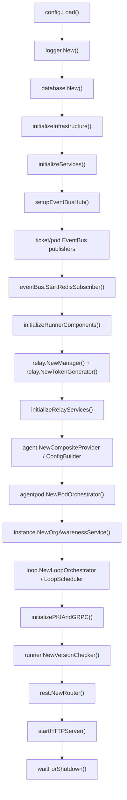
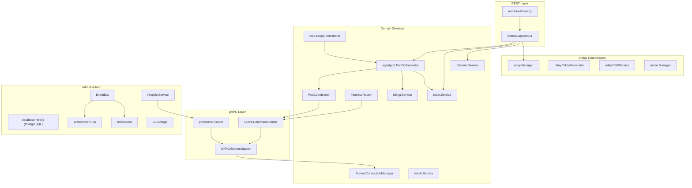
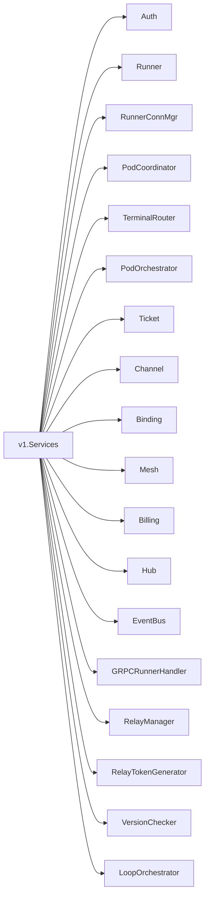
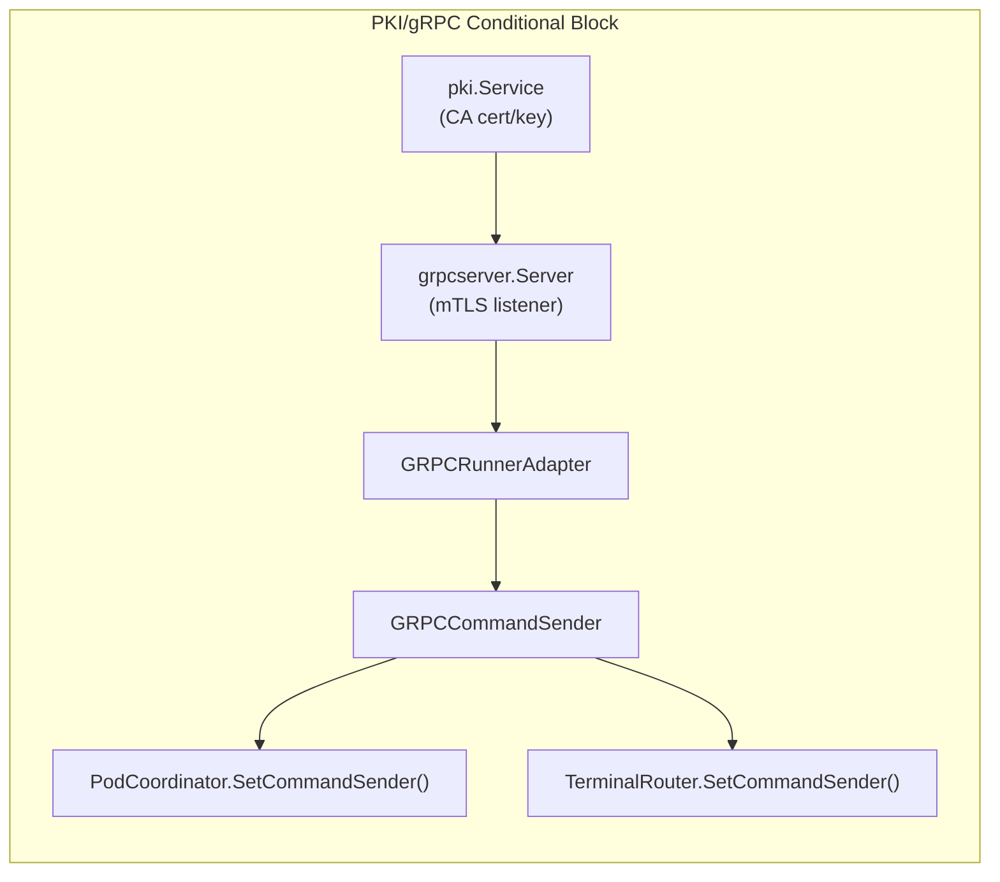

<!-- source: DeepWiki mcp.deepwiki.com · repo AgentsMesh/AgentsMesh · page 2 Backend · fetched 2026-10-26 -->

# Backend

Relevant source files

The following files were used as context for generating this wiki page:

- [.claude/skills/worktree/SKILL.md](.claude/skills/worktree/SKILL.md)
- [CLAUDE.md](CLAUDE.md)
- [backend/cmd/server/eventbus_relay.go](backend/cmd/server/eventbus_relay.go)
- [backend/cmd/server/main.go](backend/cmd/server/main.go)
- [backend/internal/api/grpc/command_sender_adapter.go](backend/internal/api/grpc/command_sender_adapter.go)
- [backend/internal/api/grpc/runner_adapter_send.go](backend/internal/api/grpc/runner_adapter_send.go)
- [backend/internal/api/grpc/runner_adapter_send_extra_test.go](backend/internal/api/grpc/runner_adapter_send_extra_test.go)
- [backend/internal/api/rest/internal/relay_registration.go](backend/internal/api/rest/internal/relay_registration.go)
- [backend/internal/api/rest/internal/relay_registration_test.go](backend/internal/api/rest/internal/relay_registration_test.go)
- [backend/internal/api/rest/v1/pod_terminal_connect.go](backend/internal/api/rest/v1/pod_terminal_connect.go)
- [backend/internal/config/config.go](backend/internal/config/config.go)
- [backend/internal/config/config_relay.go](backend/internal/config/config_relay.go)
- [backend/internal/service/relay/dns_service.go](backend/internal/service/relay/dns_service.go)
- [backend/internal/service/relay/dns_service_mock_test.go](backend/internal/service/relay/dns_service_mock_test.go)
- [backend/internal/service/relay/dns_service_sanitize_test.go](backend/internal/service/relay/dns_service_sanitize_test.go)
- [backend/internal/service/runner/command_sender.go](backend/internal/service/runner/command_sender.go)
- [backend/internal/service/runner/command_sender_test.go](backend/internal/service/runner/command_sender_test.go)
- [backend/internal/service/runner/test_helper_test.go](backend/internal/service/runner/test_helper_test.go)
- [backend/migrations/000033_move_preparation_script_to_repository.down.sql](backend/migrations/000033_move_preparation_script_to_repository.down.sql)
- [backend/migrations/000033_move_preparation_script_to_repository.up.sql](backend/migrations/000033_move_preparation_script_to_repository.up.sql)
- [deploy/dev/.gitignore](deploy/dev/.gitignore)
- [deploy/dev/backend.Dockerfile](deploy/dev/backend.Dockerfile)
- [deploy/dev/docker-compose.yml](deploy/dev/docker-compose.yml)
- [deploy/dev/init-seed.sh](deploy/dev/init-seed.sh)
- [deploy/dev/nginx/conf.d/default.conf](deploy/dev/nginx/conf.d/default.conf)
- [deploy/dev/nginx/nginx.conf](deploy/dev/nginx/nginx.conf)
- [deploy/dev/runner-entrypoint.sh](deploy/dev/runner-entrypoint.sh)
- [deploy/dev/runner.Dockerfile](deploy/dev/runner.Dockerfile)
- [deploy/dev/seed/seed.sql](deploy/dev/seed/seed.sql)
- [deploy/dev/traefik/dynamic/grpc.yml](deploy/dev/traefik/dynamic/grpc.yml)
- [deploy/dev/web.Dockerfile](deploy/dev/web.Dockerfile)
- [docs/images/logo.svg](docs/images/logo.svg)
- [proto/gen/go/runner/v1/runner.pb.go](proto/gen/go/runner/v1/runner.pb.go)
- [proto/runner/v1/runner.proto](proto/runner/v1/runner.proto)
- [relay/.env.example](relay/.env.example)
- [relay/internal/config/config.go](relay/internal/config/config.go)
- [relay/internal/config/config_test.go](relay/internal/config/config_test.go)
- [runner/internal/client/grpc_handler.go](runner/internal/client/grpc_handler.go)
- [runner/internal/client/protocol.go](runner/internal/client/protocol.go)
- [runner/internal/runner/message_handler_relay.go](runner/internal/runner/message_handler_relay.go)
- [web-admin/.env.example](web-admin/.env.example)
- [web/src/components/ui/block-editor.tsx](web/src/components/ui/block-editor.tsx)
- [web/src/lib/api/base.ts](web/src/lib/api/base.ts)

This page covers the Go backend server: its role in the overall platform, how it initializes, and the major subsystems it coordinates. For detailed coverage of individual subsystems, see the child pages: [REST API Routes](#2.1), [gRPC API and Runner Communication](#2.2), [Runner Connection Manager](#2.3), [MCP and Mesh Service](#2.4), [Ticket Service](#2.5), [Billing and Subscriptions](#2.6), [Configuration](#2.7), [PKI and mTLS](#2.8), [Object Storage](#2.9), and [Real-time Events and WebSocket](#2.10).

---

## Role

The backend is the **control plane** of AgentsMesh. It is a Go server (Gin + GORM) that:

- Authenticates users and organizations (JWT, OAuth)
- Manages all domain entities: Users, Orgs, Repos, Pods, Tickets, Channels, Runners, Bindings, Loops, etc.
- Issues mTLS certificates to Runners via a built-in PKI
- Maintains persistent bidirectional gRPC streams with each connected Runner
- Dispatches pod lifecycle commands (`create_pod`, `terminate_pod`) and terminal control commands to Runners over gRPC
- Coordinates terminal streaming by instructing Runners to connect to Relay (WebSocket intermediary)
- Broadcasts real-time entity change events to browsers via WebSocket (`Hub` + `EventBus`)
- Manages billing subscriptions and marketplace extensions

The backend does **not** execute agent code directly; that is the responsibility of the [Runner](#3).

Sources: [backend/cmd/server/main.go:1-50](), [CLAUDE.md:135-170]()

---

## Process Entry Point

The server entry point is `backend/cmd/server/main.go`. The `main()` function orchestrates the full initialization sequence in a fixed order.

**Initialization Sequence**

Sources: [backend/cmd/server/main.go:26-240]()

---

## Subsystem Map

The following diagram maps the major subsystems to their Go packages and the `Services` struct fields that wire them together.

**Backend subsystem to code entity map**

Sources: [backend/cmd/server/main.go:95-215](), [backend/internal/api/grpc/command_sender_adapter.go:1-87](), [backend/internal/service/runner/command_sender.go:1-53]()

---

## Key Structs and Packages

| Struct / Type | Package | Role |
|---|---|---|
| `Config` | `internal/config` | All environment-based config; loaded once at startup |
| `GRPCRunnerAdapter` | `internal/api/grpc` | Sends commands to Runners over gRPC streams |
| `GRPCCommandSender` | `internal/api/grpc` | Adapts `GRPCRunnerAdapter` to `RunnerCommandSender` interface |
| `RunnerConnectionManager` | `internal/service/runner` | Sharded storage of active Runner gRPC streams |
| `PodOrchestrator` | `internal/service/agentpod` | Unified pod creation for REST and MCP paths |
| `PodCoordinator` | `internal/service/agentpod` | Sends pod/terminal commands; routes through `GRPCCommandSender` |
| `TerminalRouter` | `internal/service/runner` | Routes terminal I/O commands to the correct Runner |
| `relay.Manager` | `internal/service/relay` | Tracks registered Relay instances; selects one per pod |
| `relay.TokenGenerator` | `internal/service/relay` | Issues JWT tokens for Runner↔Relay authentication |
| `OrgAwarenessService` | `internal/service/instance` | Tracks which orgs each backend instance serves |
| `LoopOrchestrator` | `internal/service/loop` | Drives automated agent loop scheduling |
| `EventBus` | `internal/infra` | In-process pub/sub; synced across instances via Redis |
| `Hub` | (WebSocket) | Pushes events to connected browser clients |
| `pki.Service` | `internal/infra/pki` | Issues/renews mTLS certificates for Runners |

Sources: [backend/cmd/server/main.go:166-215](), [backend/internal/api/grpc/command_sender_adapter.go:1-87](), [backend/internal/service/runner/command_sender.go:1-53]()

---

## Infrastructure Dependencies

The backend requires three external dependencies at startup:

| Dependency | Default Address | Used For |
|---|---|---|
| PostgreSQL | `DB_HOST:5432` | All persistent domain data (GORM) |
| Redis | `REDIS_HOST:6379` | EventBus cross-instance sync, heartbeat batching, version check cache |
| MinIO (S3) | `STORAGE_ENDPOINT` | File uploads, presigned URLs, skill packages |

Redis is optional: if `REDIS_URL` and `REDIS_HOST` are not set, the EventBus operates in single-instance mode and the `VersionChecker` is disabled. The backend will still start.

Sources: [backend/cmd/server/main.go:48-72](), [backend/internal/config/config.go:62-82]()

---

## Network Ports

| Port | Protocol | Purpose |
|---|---|---|
| `:8080` | HTTP | REST API and WebSocket (Hub) |
| `:9090` | gRPC + mTLS | Runner bidirectional stream (configurable via `GRPC_ADDRESS`) |
| `9443` | TCP (TLS passthrough) | Traefik passthrough to gRPC port in dev |

In development, Traefik exposes port `9443` externally, passing TLS connections through to the backend's gRPC listener on `:9090`. The backend terminates TLS using server certs derived from the PKI CA.

Sources: [backend/internal/config/config.go:194-199](), [deploy/dev/docker-compose.yml:392-397]()

---

## `Services` Container

All initialized services are collected into `v1.Services` and passed to `rest.NewRouter()`. This struct is the single wiring point — handlers reach any service through it.

**Services struct wiring (abridged)**

Sources: [backend/cmd/server/main.go:167-215]()

---

## gRPC and mTLS Conditional Initialization

gRPC is only enabled when `PKI_CA_CERT_FILE` and `PKI_CA_KEY_FILE` are both set. If they are absent, the backend logs a warning and skips gRPC setup; no Runners can connect, but the REST API still serves.

When enabled, `initializePKIAndGRPC()` sets up:
1. `pki.Service` — CA-backed certificate issuance for Runners
2. `grpcserver.Server` — listens on `GRPC_ADDRESS`, requires client mTLS certs
3. `GRPCRunnerAdapter` — routes inbound Runner messages and exposes outbound send methods
4. `GRPCCommandSender` — adapts the adapter to the `RunnerCommandSender` interface used by `PodCoordinator` and `TerminalRouter`

Sources: [backend/cmd/server/main.go:130-158](), [backend/internal/api/grpc/command_sender_adapter.go:1-87]()

---

## Relay Token Refresh Flow

When a Runner's relay JWT expires mid-session, the Runner sends a `RequestRelayTokenEvent` over the gRPC stream. The backend handles this via `setupRelayTokenRefreshCallback()`:

1. Look up the pod by `pod_key` in the database
2. Verify the requesting Runner owns the pod
3. Generate a new JWT using `relay.TokenGenerator`
4. Send a fresh `SubscribeTerminalCommand` back to the Runner over gRPC

This is wired at startup via `runnerConnMgr.SetRequestRelayTokenCallback(...)` in `backend/cmd/server/eventbus_relay.go`.

Sources: [backend/cmd/server/eventbus_relay.go:1-104](), [backend/internal/api/rest/v1/pod_terminal_connect.go:100-128]()

---

## Graceful Shutdown

`waitForShutdown()` (called at the end of `main()`) listens for OS signals and then stops in order:

1. HTTP server
2. gRPC server
3. EventBus (Redis subscriber)
4. HeartbeatBatcher
5. SubscriptionScheduler
6. LoopScheduler
7. OrgAwarenessService
8. Database connection
9. Redis client

Sources: [backend/cmd/server/main.go:238-239]()

---

## Configuration Overview

All URLs in the backend are derived from two environment variables:

| Variable | Default | Purpose |
|---|---|---|
| `PRIMARY_DOMAIN` | `localhost:10000` | Base domain for all derived URLs (OAuth callbacks, webhook endpoints, relay public URL) |
| `USE_HTTPS` | `false` | Switches all derived URLs between `http`/`https` and `ws`/`wss` |

This pattern is shared across Backend, Relay, Web, and Web-Admin. Individual per-URL overrides are also supported for backward compatibility. For full details see [Configuration](#2.7).

Sources: [backend/internal/config/config.go:29-53]()

---

