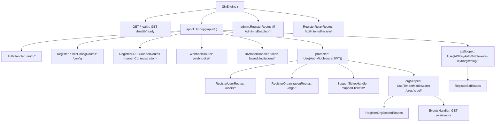

<!-- source: DeepWiki mcp.deepwiki.com · repo AgentsMesh/AgentsMesh · page 2.1 REST API Routes · fetched 2026-10-26 -->

# REST API Routes

Relevant source files

The following files were used as context for generating this wiki page:

- [backend/cmd/server/eventbus_relay.go](backend/cmd/server/eventbus_relay.go)
- [backend/cmd/server/main.go](backend/cmd/server/main.go)
- [backend/internal/api/grpc/command_sender_adapter.go](backend/internal/api/grpc/command_sender_adapter.go)
- [backend/internal/api/grpc/runner_adapter_send.go](backend/internal/api/grpc/runner_adapter_send.go)
- [backend/internal/api/grpc/runner_adapter_send_extra_test.go](backend/internal/api/grpc/runner_adapter_send_extra_test.go)
- [backend/internal/api/rest/router.go](backend/internal/api/rest/router.go)
- [backend/internal/api/rest/v1/pod_terminal_connect.go](backend/internal/api/rest/v1/pod_terminal_connect.go)
- [backend/internal/api/rest/v1/routes.go](backend/internal/api/rest/v1/routes.go)
- [backend/internal/service/runner/command_sender.go](backend/internal/service/runner/command_sender.go)
- [backend/internal/service/runner/command_sender_test.go](backend/internal/service/runner/command_sender_test.go)
- [backend/internal/service/runner/test_helper_test.go](backend/internal/service/runner/test_helper_test.go)
- [proto/gen/go/runner/v1/runner.pb.go](proto/gen/go/runner/v1/runner.pb.go)
- [proto/runner/v1/runner.proto](proto/runner/v1/runner.proto)
- [runner/internal/client/grpc_handler.go](runner/internal/client/grpc_handler.go)
- [runner/internal/client/protocol.go](runner/internal/client/protocol.go)
- [runner/internal/runner/message_handler_relay.go](runner/internal/runner/message_handler_relay.go)
- [web/src/app/(dashboard)/[org]/settings/page.tsx](web/src/app/(dashboard)/[org]/settings/page.tsx)
- [web/src/components/ide/sidebar/SettingsSidebarContent.tsx](web/src/components/ide/sidebar/SettingsSidebarContent.tsx)
- [web/src/components/settings/ThemeSettings.tsx](web/src/components/settings/ThemeSettings.tsx)
- [web/src/components/settings/index.ts](web/src/components/settings/index.ts)
- [web/src/components/tickets/shared/CommentInput.tsx](web/src/components/tickets/shared/CommentInput.tsx)
- [web/src/components/tickets/shared/CommentsList.tsx](web/src/components/tickets/shared/CommentsList.tsx)
- [web/src/lib/api/index.ts](web/src/lib/api/index.ts)

This page documents the structure of the AgentsMesh backend HTTP API: how the Gin router is constructed, how route groups are organized, what middleware each group applies, and the specific endpoints within each resource category.

For the gRPC API used for bidirectional backend-to-runner communication, see [gRPC API and Runner Communication](#2.2). For the WebSocket event stream, see [Real-time Events and WebSocket](#2.10). For the Admin Console's own API client, see [Web Admin](#6).

---

## Router Construction

The entry point is `NewRouter` in [backend/internal/api/rest/router.go:23-197](). It receives the application configuration (`*config.Config`), a fully populated `*v1.Services` container, the database handle, and a logger. It returns a configured `*gin.Engine`.

The function performs the following in order:
1. Sets Gin to release mode unless `cfg.Server.Debug` is true.
2. Installs a logger and panic-recovery middleware with structured logging.
3. Configures CORS using `cfg.Server.CORSAllowedOrigins`. Allowed headers include `Authorization`, `X-Organization-Slug`, and `X-API-Key`.
4. Registers health check routes at the root.
5. Builds the `/api/v1` route group and registers all sub-groups.
6. Conditionally registers the Admin Console and Internal Relay API at the root-level router.

The `v1.Services` struct (assembled in [backend/cmd/server/main.go:167-215]()) is the single dependency container passed to all route registration functions.

Sources: [backend/internal/api/rest/router.go:23-197](), [backend/cmd/server/main.go:167-215]()

---

## Route Group Overview

**Route Group and Middleware Hierarchy**

Sources: [backend/internal/api/rest/router.go:52-196]()

---

## Route Group Details

### Health Endpoints

These require no authentication and are used for load balancer and readiness checks.

| Method | Path | Response |
|--------|------|----------|
| `GET` | `/health` | `{"status":"ok","service":"agentsmesh-api"}` |
| `GET` | `/health/ready` | `{"status":"ready"}` |

Sources: [backend/internal/api/rest/router.go:53-64]()

---

### Public Routes (`/api/v1`, no auth)

| Prefix | Handler | Auth Mechanism | Purpose |
|--------|---------|---------------|---------|
| `/api/v1/auth/*` | `AuthHandler` | None | Login, register, password reset, token refresh |
| `/api/v1/config` | `RegisterPublicConfigRoutes` | None | Deployment info for frontend (billing features, plan type) |
| `/api/v1/runners/*` | `RegisterGRPCRunnerRoutes` | mTLS (runner cert) | Runner CLI registration and certificate issuance |
| `/api/v1/webhooks/*` | `WebhookRouter` | Token in payload | Incoming webhooks from Git providers, billing providers |
| `/api/v1/invitations/*` | `InvitationHandler` | Invite token in URL | Token-based invitation acceptance |

The `RegisterGRPCRunnerRoutes` function is also called again inside the org-scoped runner group via `RegisterOrgGRPCRunnerRoutes` for certificate management operations scoped to an organization.

Sources: [backend/internal/api/rest/router.go:79-116]()

---

### Protected Routes (JWT required)

`AuthMiddleware(cfg.JWT.Secret)` is applied to the `protected` group. Routes in this group require a valid Bearer JWT in the `Authorization` header.

| Prefix | Handler | Purpose |
|--------|---------|---------|
| `/api/v1/users/*` | `RegisterUserRoutes` | Current user profile, preferences, credential profiles, agent config |
| `/api/v1/orgs/*` | `RegisterOrganizationRoutes` | List orgs, create org, get org by slug |
| `/api/v1/support-tickets/*` | `SupportTicketHandler` | User-level support ticket submission |

Sources: [backend/internal/api/rest/router.go:118-155]()

---

### Org-Scoped Routes (`/api/v1/orgs/:slug/*`)

These routes additionally require `TenantMiddleware`, which resolves the `:slug` path parameter to an organization record and injects it into the Gin context. All handlers within this group operate on resources belonging to that organization.

**Org-Scoped Route Dispatcher**

```mermaid
graph TD
    ROSR["RegisterOrgScopedRoutes()"] --> RA["registerAgentRoutes: AgentHandler /agents/*"]
    ROSR --> RR["registerRepositoryRoutes: RepositoryHandler /repositories/*"]
    ROSR --> RRU["registerRunnerRoutes: RunnerHandler /runners/*"]
    ROSR --> RP["registerPodRoutes: PodHandler /pods/* + TerminalConnectHandler + AutopilotControllerHandler"]
    ROSR --> RC["registerChannelRoutes: ChannelHandler /channels/*"]
    ROSR --> RT["registerTicketRoutes: TicketHandler + MeshHandler /tickets/* /labels/* /mesh/*"]
    ROSR --> RB["registerBillingRoutes: RegisterBillingHandlers /billing/*"]
    ROSR --> RBI["registerBindingRoutes: BindingHandler /bindings/*"]
    ROSR --> RM["registerMessageRoutes: MessageHandler /messages/*"]
    ROSR --> RI["registerInvitationRoutes: InvitationHandler.RegisterOrgRoutes"]
    ROSR --> RF["registerFileRoutes: FileHandler /files/*"]
    ROSR --> RAK["registerAPIKeyManagementRoutes"]
    ROSR --> RE["registerExtensionRoutes: ExtensionHandler /skill-registries/* /market/*"]
    ROSR --> RL["registerLoopRoutes: LoopHandler /loops/*"]
```

All paths below are relative to `/api/v1/orgs/:slug`.

Sources: [backend/internal/api/rest/v1/routes.go:44-89]()

#### Agents

| Method | Path | Handler Method |
|--------|------|----------------|
| `GET` | `/agents/types` | `AgentHandler.ListAgentTypes` |
| `GET` | `/agents/types/:agent_type_id` | `AgentHandler.GetAgentType` |
| `POST` | `/agents/custom` | `AgentHandler.CreateCustomAgent` |
| `PUT` | `/agents/custom/:id` | `AgentHandler.UpdateCustomAgent` |
| `DELETE` | `/agents/custom/:id` | `AgentHandler.DeleteCustomAgent` |
| `GET` | `/agents/:agent_type_id/config-schema` | `AgentHandler.GetAgentTypeConfigSchema` |

Sources: [backend/internal/api/rest/v1/routes.go:91-102]()

#### Repositories

| Method | Path | Handler Method |
|--------|------|----------------|
| `GET` | `/repositories` | `ListRepositories` |
| `POST` | `/repositories` | `CreateRepository` |
| `GET` | `/repositories/:id` | `GetRepository` |
| `PUT` | `/repositories/:id` | `UpdateRepository` |
| `DELETE` | `/repositories/:id` | `DeleteRepository` |
| `GET` | `/repositories/:id/branches` | `ListBranches` |
| `POST` | `/repositories/:id/sync-branches` | `SyncBranches` |
| `POST` | `/repositories/:id/webhook` | `RegisterRepositoryWebhook` |
| `DELETE` | `/repositories/:id/webhook` | `DeleteRepositoryWebhook` |
| `GET` | `/repositories/:id/webhook/status` | `GetRepositoryWebhookStatus` |
| `GET` | `/repositories/:id/webhook/secret` | `GetRepositoryWebhookSecret` |
| `POST` | `/repositories/:id/webhook/configured` | `MarkRepositoryWebhookConfigured` |
| `GET` | `/repositories/:id/merge-requests` | `ListRepositoryMergeRequests` |

Sources: [backend/internal/api/rest/v1/routes.go:104-126]()

#### Runners

| Method | Path | Handler Method |
|--------|------|----------------|
| `GET` | `/runners` | `RunnerHandler.ListRunners` |
| `GET` | `/runners/available` | `RunnerHandler.ListAvailableRunners` |
| `GET` | `/runners/:id` | `RunnerHandler.GetRunner` |
| `PUT` | `/runners/:id` | `RunnerHandler.UpdateRunner` |
| `DELETE` | `/runners/:id` | `RunnerHandler.DeleteRunner` |
| `GET` | `/runners/:id/pods` | `RunnerHandler.ListRunnerPods` |
| `POST` | `/runners/:id/sandboxes/query` | `RunnerHandler.QuerySandboxes` |

Additionally, `RegisterOrgGRPCRunnerRoutes` is called on the `/runners` group to attach certificate management endpoints used during runner registration and renewal.

Sources: [backend/internal/api/rest/v1/routes.go:128-160]()

#### Pods

The pod group includes CRUD, terminal relay connection, and autopilot controller sub-routes.

| Method | Path | Handler Method | Notes |
|--------|------|----------------|-------|
| `GET` | `/pods` | `PodHandler.ListPods` | |
| `POST` | `/pods` | `PodHandler.CreatePod` | |
| `GET` | `/pods/:key` | `PodHandler.GetPod` | |
| `POST` | `/pods/:key/terminate` | `PodHandler.TerminatePod` | |
| `GET` | `/pods/:key/connect` | `PodHandler.GetConnectionInfo` | |
| `POST` | `/pods/:key/send-prompt` | `PodHandler.SendPrompt` | |
| `GET` | `/pods/:key/terminal/observe` | `PodHandler.ObserveTerminal` | Legacy observe |
| `POST` | `/pods/:key/terminal/input` | `PodHandler.SendTerminalInput` | |
| `POST` | `/pods/:key/terminal/resize` | `PodHandler.ResizeTerminal` | |
| `GET` | `/pods/:key/terminal/connect` | `TerminalConnectHandler.GetTerminalConnection` | Returns Relay URL + JWT |

The `GET /pods/:key/terminal/connect` endpoint is the entry point for the Relay-based terminal architecture. It selects a healthy relay, issues a JWT for both the browser and the runner, sends a `SubscribeTerminal` gRPC command to the runner, and returns the relay URL and browser token. The client then opens a WebSocket directly to the relay service. See [Relay](#4) for details.

Autopilot controller routes are registered by `RegisterAutopilotControllerRoutes` on the same parent group.

Sources: [backend/internal/api/rest/v1/routes.go:162-205](), [backend/internal/api/rest/v1/pod_terminal_connect.go:53-150]()

#### Channels

| Method | Path | Handler Method |
|--------|------|----------------|
| `GET` | `/channels` | `ListChannels` |
| `POST` | `/channels` | `CreateChannel` |
| `GET` | `/channels/:id` | `GetChannel` |
| `PUT` | `/channels/:id` | `UpdateChannel` |
| `POST` | `/channels/:id/archive` | `ArchiveChannel` |
| `POST` | `/channels/:id/unarchive` | `UnarchiveChannel` |
| `GET` | `/channels/:id/messages` | `ListMessages` |
| `POST` | `/channels/:id/messages` | `SendMessage` |
| `GET` | `/channels/:id/document` | `GetDocument` |
| `PUT` | `/channels/:id/document` | `UpdateDocument` |
| `GET` | `/channels/:id/pods` | `ListChannelPods` |
| `POST` | `/channels/:id/pods` | `JoinPod` |
| `DELETE` | `/channels/:id/pods/:pod_key` | `LeavePod` |

Sources: [backend/internal/api/rest/v1/routes.go:208-226]()

#### Tickets, Labels, and Mesh

Tickets are managed by `TicketHandler`; pod-related ticket operations use `MeshHandler`.

| Method | Path | Handler Method |
|--------|------|----------------|
| `GET` | `/tickets` | `TicketHandler.ListTickets` |
| `POST` | `/tickets` | `TicketHandler.CreateTicket` |
| `GET` | `/tickets/active` | `TicketHandler.GetActiveTickets` |
| `GET` | `/tickets/board` | `TicketHandler.GetBoard` |
| `POST` | `/tickets/batch-pods` | `MeshHandler.BatchGetTicketPods` |
| `GET` | `/tickets/:ticket_slug` | `TicketHandler.GetTicket` |
| `PUT` | `/tickets/:ticket_slug` | `TicketHandler.UpdateTicket` |
| `DELETE` | `/tickets/:ticket_slug` | `TicketHandler.DeleteTicket` |
| `PATCH` | `/tickets/:ticket_slug/status` | `TicketHandler.UpdateTicketStatus` |
| `POST` | `/tickets/:ticket_slug/assignees` | `TicketHandler.AddAssignee` |
| `DELETE` | `/tickets/:ticket_slug/assignees/:user_id` | `TicketHandler.RemoveAssignee` |
| `POST` | `/tickets/:ticket_slug/labels` | `TicketHandler.AddLabel` |
| `DELETE` | `/tickets/:ticket_slug/labels/:label_id` | `TicketHandler.RemoveLabel` |
| `GET` | `/tickets/:ticket_slug/merge-requests` | `TicketHandler.ListMergeRequests` |
| `GET` | `/tickets/:ticket_slug/sub-tickets` | `TicketHandler.GetSubTickets` |
| `GET` | `/tickets/:ticket_slug/relations` | `TicketHandler.ListRelations` |
| `POST` | `/tickets/:ticket_slug/relations` | `TicketHandler.CreateRelation` |
| `DELETE` | `/tickets/:ticket_slug/relations/:relation_id` | `TicketHandler.DeleteRelation` |
| `GET` | `/tickets/:ticket_slug/commits` | `TicketHandler.ListCommits` |
| `POST` | `/tickets/:ticket_slug/commits` | `TicketHandler.LinkCommit` |
| `DELETE` | `/tickets/:ticket_slug/commits/:commit_id` | `TicketHandler.UnlinkCommit` |
| `GET` | `/tickets/:ticket_slug/comments` | `TicketHandler.ListComments` |
| `POST` | `/tickets/:ticket_slug/comments` | `TicketHandler.CreateComment` |
| `PUT` | `/tickets/:ticket_slug/comments/:id` | `TicketHandler.UpdateComment` |
| `DELETE` | `/tickets/:ticket_slug/comments/:id` | `TicketHandler.DeleteComment` |
| `GET` | `/tickets/:ticket_slug/pods` | `MeshHandler.GetTicketPods` |
| `POST` | `/tickets/:ticket_slug/pods` | `MeshHandler.CreatePodForTicket` |
| `GET` | `/labels` | `TicketHandler.ListLabels` |
| `POST` | `/labels` | `TicketHandler.CreateLabel` |
| `PUT` | `/labels/:id` | `TicketHandler.UpdateLabel` |
| `DELETE` | `/labels/:id` | `TicketHandler.DeleteLabel` |
| `GET` | `/mesh/topology` | `MeshHandler.GetTopology` |

Sources: [backend/internal/api/rest/v1/routes.go:228-274]()

#### Bindings

| Method | Path | Handler Method |
|--------|------|----------------|
| `POST` | `/bindings` | `BindingHandler.RequestBinding` |
| `GET` | `/bindings` | `BindingHandler.ListBindings` |
| `POST` | `/bindings/accept` | `BindingHandler.AcceptBinding` |
| `POST` | `/bindings/reject` | `BindingHandler.RejectBinding` |
| `POST` | `/bindings/unbind` | `BindingHandler.Unbind` |
| `GET` | `/bindings/pending` | `BindingHandler.GetPendingBindings` |
| `GET` | `/bindings/pods` | `BindingHandler.GetBoundPods` |
| `GET` | `/bindings/check/:target_pod` | `BindingHandler.CheckBinding` |
| `POST` | `/bindings/:id/scopes` | `BindingHandler.RequestScopes` |
| `POST` | `/bindings/:id/scopes/approve` | `BindingHandler.ApproveScopes` |

Sources: [backend/internal/api/rest/v1/routes.go:284-299]()

#### Messages

| Method | Path | Handler Method |
|--------|------|----------------|
| `POST` | `/messages` | `MessageHandler.SendMessage` |
| `GET` | `/messages` | `MessageHandler.GetMessages` |
| `GET` | `/messages/unread-count` | `MessageHandler.GetUnreadCount` |
| `GET` | `/messages/sent` | `MessageHandler.GetSentMessages` |
| `POST` | `/messages/mark-read` | `MessageHandler.MarkRead` |
| `POST` | `/messages/mark-all-read` | `MessageHandler.MarkAllRead` |
| `GET` | `/messages/conversation/:correlation_id` | `MessageHandler.GetConversation` |
| `GET` | `/messages/dlq` | `MessageHandler.GetDeadLetters` |
| `POST` | `/messages/dlq/:id/replay` | `MessageHandler.ReplayDeadLetter` |
| `GET` | `/messages/:id` | `MessageHandler.GetMessage` |

Sources: [backend/internal/api/rest/v1/routes.go:301-318]()

#### Files

| Method | Path | Handler Method |
|--------|------|----------------|
| `POST` | `/files/upload` | `FileHandler.UploadFile` |
| `DELETE` | `/files/:id` | `FileHandler.DeleteFile` |

Sources: [backend/internal/api/rest/v1/routes.go:327-338]()

#### Extensions (Skills and MCP Servers)

| Method | Path | Handler Method |
|--------|------|----------------|
| `GET` | `/skill-registries` | `ExtensionHandler.ListSkillRegistries` |
| `POST` | `/skill-registries` | `ExtensionHandler.CreateSkillRegistry` |
| `POST` | `/skill-registries/:id/sync` | `ExtensionHandler.SyncSkillRegistry` |
| `DELETE` | `/skill-registries/:id` | `ExtensionHandler.DeleteSkillRegistry` |
| `PUT` | `/skill-registries/:id/toggle` | `ExtensionHandler.TogglePlatformRegistry` |
| `GET` | `/skill-registry-overrides` | `ExtensionHandler.ListSkillRegistryOverrides` |
| `GET` | `/market/skills` | `ExtensionHandler.ListMarketSkills` |
| `GET` | `/market/mcp-servers` | `ExtensionHandler.ListMarketMcpServers` |
| `GET` | `/repositories/:id/skills` | `ExtensionHandler.ListRepoSkills` |
| `POST` | `/repositories/:id/skills/install-from-market` | `ExtensionHandler.InstallSkillFromMarket` |
| `POST` | `/repositories/:id/skills/install-from-github` | `ExtensionHandler.InstallSkillFromGitHub` |
| `POST` | `/repositories/:id/skills/install-from-upload` | `ExtensionHandler.InstallSkillFromUpload` |
| `PUT` | `/repositories/:id/skills/:installId` | `ExtensionHandler.UpdateSkill` |
| `DELETE` | `/repositories/:id/skills/:installId` | `ExtensionHandler.UninstallSkill` |
| `GET` | `/repositories/:id/mcp-servers` | `ExtensionHandler.ListRepoMcpServers` |
| `POST` | `/repositories/:id/mcp-servers/install-from-market` | `ExtensionHandler.InstallMcpFromMarket` |
| `POST` | `/repositories/:id/mcp-servers/install-custom` | `ExtensionHandler.InstallCustomMcpServer` |
| `PUT` | `/repositories/:id/mcp-servers/:installId` | `ExtensionHandler.UpdateMcpServer` |
| `DELETE` | `/repositories/:id/mcp-servers/:installId` | `ExtensionHandler.UninstallMcpServer` |

Sources: [backend/internal/api/rest/v1/routes.go:341-391]()

#### Loops

| Method | Path | Handler Method |
|--------|------|----------------|
| `GET` | `/loops` | `LoopHandler.ListLoops` |
| `POST` | `/loops` | `LoopHandler.CreateLoop` |
| `GET` | `/loops/:loop_slug` | `LoopHandler.GetLoop` |
| `PUT` | `/loops/:loop_slug` | `LoopHandler.UpdateLoop` |
| `DELETE` | `/loops/:loop_slug` | `LoopHandler.DeleteLoop` |
| `POST` | `/loops/:loop_slug/enable` | `LoopHandler.EnableLoop` |
| `POST` | `/loops/:loop_slug/disable` | `LoopHandler.DisableLoop` |
| `POST` | `/loops/:loop_slug/trigger` | `LoopHandler.TriggerLoop` |
| `GET` | `/loops/:loop_slug/runs` | `LoopHandler.ListRuns` |
| `GET` | `/loops/:loop_slug/runs/:run_id` | `LoopHandler.GetRun` |
| `POST` | `/loops/:loop_slug/runs/:run_id/cancel` | `LoopHandler.CancelRun` |

Sources: [backend/internal/api/rest/v1/routes.go:393-412]()

#### WebSocket Events

| Method | Path | Handler |
|--------|------|---------|
| `GET` | `/ws/events` | `ws.EventsHandler.HandleEvents` |

This endpoint upgrades to WebSocket and streams real-time events to the connected browser client through the `Hub`. See [Real-time Events and WebSocket](#2.10) for details.

Sources: [backend/internal/api/rest/router.go:144-152]()

---

### External API (`/api/v1/ext/orgs/:slug/*`)

Routes registered by `RegisterExtRoutes` are accessed via `X-API-Key` header authentication. `APIKeyAuthMiddleware` validates the key against the `APIKeyAdapter` service and resolves the organization from `:slug`. This path is intended for third-party service integrations. The route group is only instantiated if `svc.APIKeyAdapter != nil`.

Sources: [backend/internal/api/rest/router.go:162-169]()

---

### Admin Console Routes

`admin.RegisterRoutes` is called on the root Gin engine (not under `/api/v1`) when `cfg.Admin.IsEnabled()` returns true. It receives a minimal `admin.Services` struct containing `Auth`, `Admin`, `Billing`, `RelayManager`, `ExtensionRepo`, `MarketplaceWorker`, and `SupportTicket`. The admin console uses its own authentication mechanism separate from the user JWT flow. See [Web Admin](#6) for the frontend counterpart.

Sources: [backend/internal/api/rest/router.go:171-184]()

---

### Internal Relay API (`/api/internal/relays/*`)

`internal.RegisterRelayRoutes` is mounted at `/api/internal/relays` on the root Gin engine. It is protected by `InternalAPISecret` (a shared secret from `cfg.Server.InternalAPISecret`), not by JWT. This API is called exclusively by the Relay service to:

- Register/unregister relay instances with the backend
- Report heartbeat, CPU, and memory metrics
- Notify the backend of session close events
- Obtain ACME (Let's Encrypt) wildcard certificates for relay subdomains

This group is only registered when `svc.RelayManager != nil`.

Sources: [backend/internal/api/rest/router.go:186-194]()

---

## Middleware Summary

| Middleware | Location | Applied To |
|-----------|----------|-----------|
| `gin.Logger()` | All routes | Request logging |
| `gin.CustomRecovery` | All routes | Panic recovery with structured logging |
| `cors.New(corsConfig)` | All routes | CORS headers |
| `middleware.AuthMiddleware(JWT)` | `protected` group | JWT Bearer token validation |
| `middleware.TenantMiddleware(svc.Org)` | `orgScoped` group | Org slug resolution, injects tenant into context |
| `middleware.APIKeyAuthMiddleware(svc.APIKeyAdapter, svc.Org)` | `extScoped` group | API key validation + org resolution |
| `InternalAPISecret` (header check) | `internal` relay routes | Shared-secret validation for relay-to-backend calls |

`TenantMiddleware` reads the `:slug` URL parameter, looks up the organization, and stores it in the Gin context so all downstream handlers can call `middleware.GetTenant(c)` to retrieve the `OrganizationID` and `OrganizationSlug`.

Sources: [backend/internal/api/rest/router.go:119-155](), [backend/internal/api/rest/router.go:163-168]()

---

