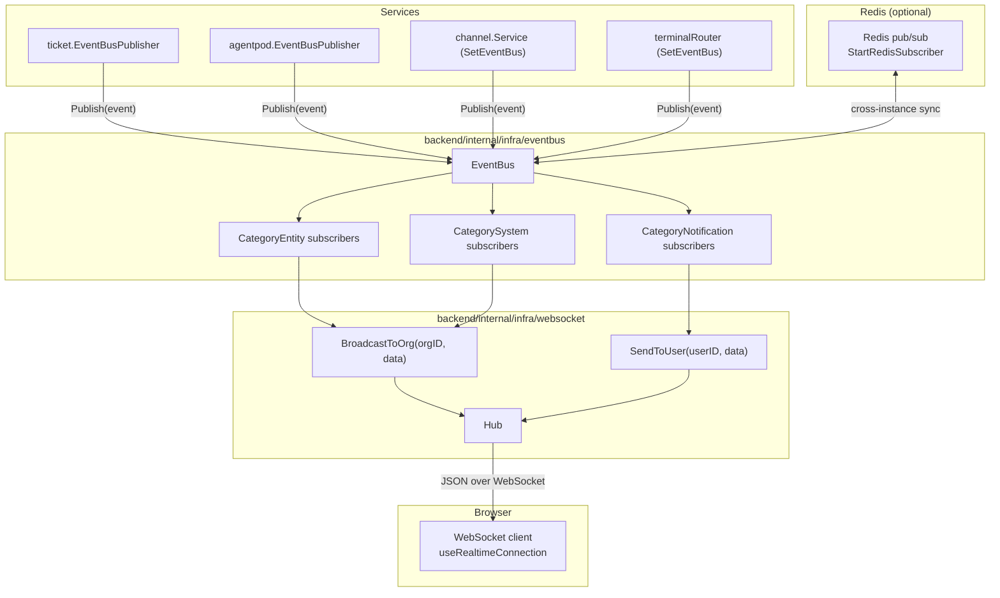
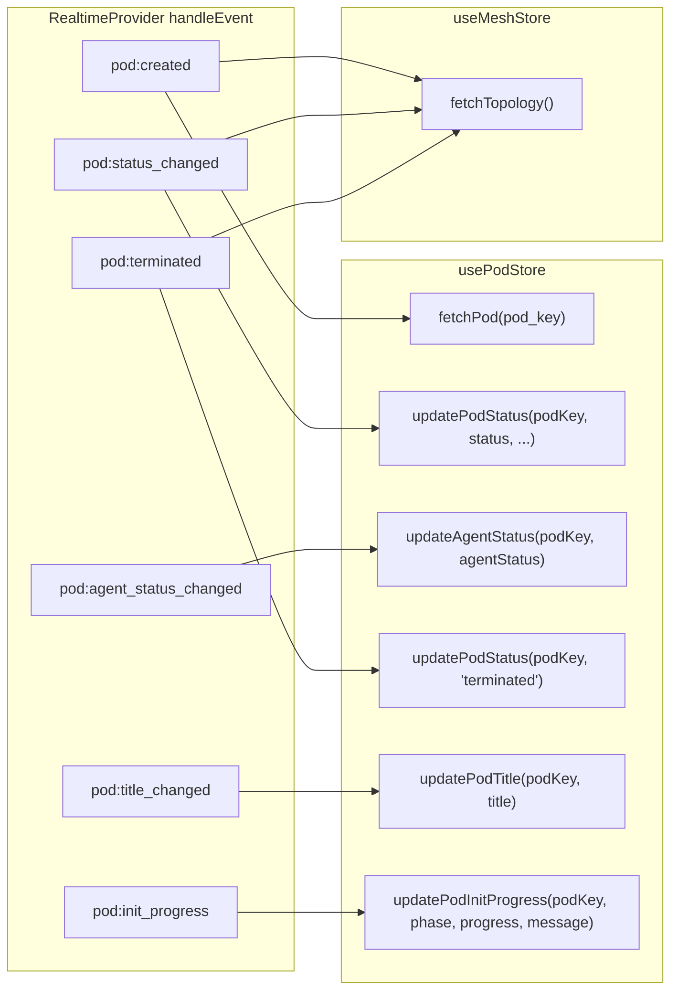
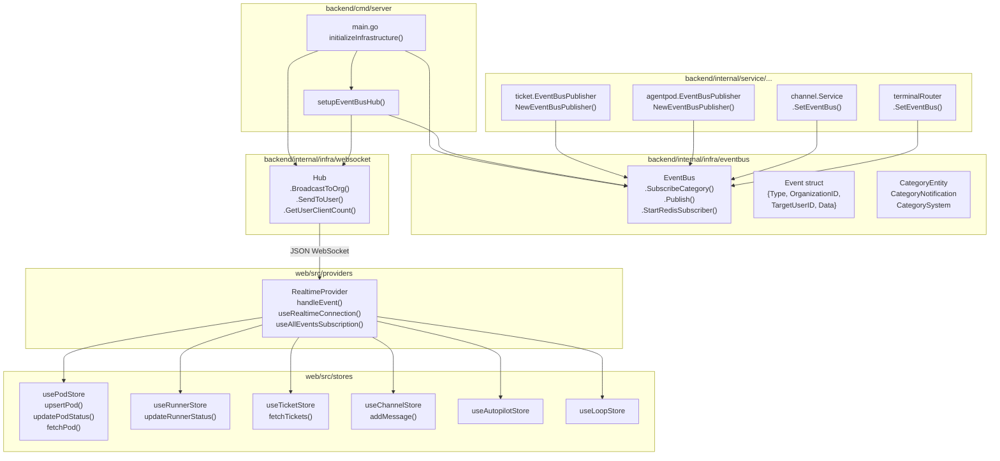

<!-- source: DeepWiki mcp.deepwiki.com · repo AgentsMesh/AgentsMesh · page 2.10 Real-time Events and WebSocket · fetched 2026-10-26 -->

# Real-time Events and WebSocket

<details>
<summary>Relevant source files</summary>

The following files were used as context for generating this wiki page:

- [backend/cmd/server/eventbus_relay.go](backend/cmd/server/eventbus_relay.go)
- [backend/cmd/server/eventbus_setup.go](backend/cmd/server/eventbus_setup.go)
- [backend/cmd/server/main.go](backend/cmd/server/main.go)
- [backend/internal/api/grpc/command_sender_adapter.go](backend/internal/api/grpc/command_sender_adapter.go)
- [backend/internal/api/grpc/runner_adapter_send.go](backend/internal/api/grpc/runner_adapter_send.go)
- [backend/internal/api/grpc/runner_adapter_send_extra_test.go](backend/internal/api/grpc/runner_adapter_send_extra_test.go)
- [backend/internal/api/rest/v1/pod_terminal_connect.go](backend/internal/api/rest/v1/pod_terminal_connect.go)
- [backend/internal/service/runner/command_sender.go](backend/internal/service/runner/command_sender.go)
- [backend/internal/service/runner/command_sender_test.go](backend/internal/service/runner/command_sender_test.go)
- [backend/internal/service/runner/test_helper_test.go](backend/internal/service/runner/test_helper_test.go)
- [proto/gen/go/runner/v1/runner.pb.go](proto/gen/go/runner/v1/runner.pb.go)
- [proto/runner/v1/runner.proto](proto/runner/v1/runner.proto)
- [runner/internal/client/grpc_handler.go](runner/internal/client/grpc_handler.go)
- [runner/internal/client/protocol.go](runner/internal/client/protocol.go)
- [runner/internal/runner/message_handler_relay.go](runner/internal/runner/message_handler_relay.go)
- [web/src/components/ide/sidebar/WorkspaceSidebarContent.tsx](web/src/components/ide/sidebar/WorkspaceSidebarContent.tsx)
- [web/src/components/pwa/PushNotificationManager.tsx](web/src/components/pwa/PushNotificationManager.tsx)
- [web/src/hooks/usePodStatus.ts](web/src/hooks/usePodStatus.ts)
- [web/src/providers/RealtimeProvider.tsx](web/src/providers/RealtimeProvider.tsx)
- [web/src/stores/__tests__/pod.test.ts](web/src/stores/__tests__/pod.test.ts)
- [web/src/stores/__tests__/terminalConnection.test.ts](web/src/stores/__tests__/terminalConnection.test.ts)
- [web/src/stores/__tests__/workspace.test.ts](web/src/stores/__tests__/workspace.test.ts)
- [web/src/stores/channel.ts](web/src/stores/channel.ts)
- [web/src/stores/pod.ts](web/src/stores/pod.ts)
- [web/src/stores/runner.ts](web/src/stores/runner.ts)

</details>


This page covers the backend event bus, the WebSocket hub that delivers events to browser clients, and the frontend infrastructure that receives and dispatches those events to Zustand stores. It does **not** cover terminal streaming via the Relay service (see [4. Relay]()); that is a separate WebSocket channel dedicated to binary PTY data. For the Zustand stores themselves and how they expose state to React components, see [5.5 Real-time State Management]().

---

## Overview

AgentsMesh uses a two-layer real-time system:

1. **Backend `EventBus`** – an internal publish/subscribe bus where services emit typed events (`pod:created`, `runner:online`, `ticket:updated`, etc.).
2. **WebSocket `Hub`** – consumes EventBus events and delivers them over persistent WebSocket connections to authenticated browser sessions, scoped to an organization or individual user.

The frontend `RealtimeProvider` receives those messages, parses them into typed events, and calls the appropriate Zustand store actions to keep UI state current without full page refreshes.

---

## Backend Event Pipeline

### Initialization Sequence

The relevant wiring in `backend/cmd/server/main.go` happens in this order:

1. Infrastructure is initialized, returning a `Hub`, `EventBus`, and optional Redis client.
2. `setupEventBusHub(eventBus, hub)` connects the two — EventBus subscribers route messages into Hub broadcasts.
3. Service-level publishers are created and injected:
   - `ticket.NewEventBusPublisher(eventBus, ...)` → attached via `services.ticket.SetEventPublisher(...)`
   - `agentpod.NewEventBusPublisher(eventBus, ...)` → attached via `services.pod.SetEventPublisher(...)`
   - `services.channel.SetEventBus(eventBus)`
   - `terminalRouter.SetEventBus(eventBus)`
4. If Redis is configured, `eventBus.StartRedisSubscriber(context.Background())` starts cross-instance synchronization.

[backend/cmd/server/main.go:56-88]()

---

### EventBus

The `EventBus` (`backend/internal/infra/eventbus`) is an in-process pub/sub that supports category-based subscriptions. Each event carries:

| Field | Description |
|---|---|
| `Type` | String event type, e.g. `"pod:created"` |
| `OrganizationID` | Determines which org's clients receive the event |
| `TargetUserID` | Optional; set for user-targeted notifications |
| `TargetUserIDs` | Optional slice for multi-user delivery |
| Data payload | Type-specific struct serialized to JSON |

Event categories:

| Category constant | Routing | Example types |
|---|---|---|
| `CategoryEntity` | Broadcast to entire organization | `pod:*`, `runner:*`, `ticket:*`, `channel:*`, `autopilot:*`, `loop_run:*` |
| `CategoryNotification` | Sent to specific user(s) | `terminal:notification`, `task:completed` |
| `CategorySystem` | Broadcast to entire organization | System-level state changes |

---

### WebSocket Hub

The `Hub` (`backend/internal/infra/websocket`) maintains client connections indexed by organization and user. The `setupEventBusHub` function wires all three categories:

[backend/cmd/server/eventbus_setup.go:59-111]()

**Routing logic:**

- `CategoryEntity` → `hub.BroadcastToOrg(event.OrganizationID, data)`
- `CategoryNotification` → `hub.SendToUser(*event.TargetUserID, data)` (also iterates `event.TargetUserIDs`)
- `CategorySystem` → `hub.BroadcastToOrg(event.OrganizationID, data)`

All data is first marshaled to JSON before being handed to the hub.

---

**Event pipeline diagram**



Sources: [backend/cmd/server/eventbus_setup.go:59-111](), [backend/cmd/server/main.go:56-88]()

---

### Redis Multi-Instance Sync

When `redisClient != nil`, `eventBus.StartRedisSubscriber(context.Background())` is called. This allows multiple backend instances (e.g., in a horizontally scaled deployment) to relay events to one another via Redis pub/sub. A backend instance that receives a gRPC event from a runner publishes it to both its local EventBus and Redis; other instances consume from Redis and inject the event into their own EventBus, which then delivers it to their connected WebSocket clients.

[backend/cmd/server/main.go:69-72]()

---

### Event Publishers by Service

| Publisher / Setter | Service | Event types emitted |
|---|---|---|
| `ticket.NewEventBusPublisher` | Ticket service | `ticket:created`, `ticket:updated`, `ticket:status_changed`, `ticket:moved`, `ticket:deleted` |
| `agentpod.NewEventBusPublisher` | Pod service | `pod:created`, `pod:status_changed`, `pod:terminated`, `pod:title_changed`, `pod:init_progress`, `pod:agent_status_changed` |
| `channel.Service.SetEventBus` | Channel service | `channel:message` |
| `terminalRouter.SetEventBus` | Terminal router | `terminal:notification`, `task:completed`, `runner:online`, `runner:offline`, `runner:updated`, `autopilot:*`, `loop_run:*`, MR/pipeline events |

Sources: [backend/cmd/server/main.go:63-68](), [backend/cmd/server/eventbus_setup.go:59-111]()

---

## Frontend Real-time Infrastructure

### Connection Layer

The frontend uses two hooks from `web/src/hooks/useRealtimeEvents`:

- `useRealtimeConnection()` – establishes and maintains the WebSocket connection, returns `{ connectionState, reconnect }`.
- `useAllEventsSubscription(handler, deps)` – registers a callback for all incoming events.

`ConnectionState` is one of `"connecting"`, `"connected"`, `"disconnected"`, `"reconnecting"`.

---

### RealtimeProvider

`RealtimeProvider` (`web/src/providers/RealtimeProvider.tsx`) is the single component responsible for:

1. Holding the WebSocket connection state.
2. Receiving all events and routing them to the correct Zustand store action.
3. Triggering full store refreshes on reconnection.

It is placed at the dashboard layout level, after authentication is established, and exposes `connectionState` and `reconnect` via `RealtimeContext`.

Key design decision: all Zustand stores are accessed via `getState()` (not reactive hooks) inside `handleEvent`. This prevents `RealtimeProvider` itself from re-rendering on every store change, which would cause cascading UI re-renders (e.g., native `<select>` elements closing unexpectedly).

[web/src/providers/RealtimeProvider.tsx:59-63]()

---

### Event Routing in handleEvent

The `handleEvent` callback in `RealtimeProvider` dispatches by `event.type`:

**Pod events diagram**



[web/src/providers/RealtimeProvider.tsx:70-138]()

---

**Full event-to-store routing table**

| Event type(s) | Store action called |
|---|---|
| `pod:created` | `usePodStore.fetchPod(pod_key)`, `useMeshStore.fetchTopology()` |
| `pod:status_changed` | `usePodStore.updatePodStatus(...)` or `fetchPod` if not in store; `fetchTopology()` |
| `pod:agent_status_changed` | `usePodStore.updateAgentStatus(pod_key, agent_status)` |
| `pod:terminated` | `usePodStore.updatePodStatus(pod_key, "terminated")`; `fetchTopology()` |
| `pod:title_changed` | `usePodStore.updatePodTitle(pod_key, title)` |
| `pod:init_progress` | `usePodStore.updatePodInitProgress(pod_key, phase, progress, message)` |
| `runner:online`, `runner:offline`, `runner:updated` | `useRunnerStore.updateRunnerStatus(runner_id, status)` |
| `ticket:created`, `ticket:updated`, `ticket:status_changed`, `ticket:moved`, `ticket:deleted` | `useTicketStore.fetchTickets()` |
| `channel:message` | `useChannelStore.addMessage(message)` (only if `currentChannel.id` matches) |
| `terminal:notification` | `onTerminalNotification(data)` callback prop |
| `task:completed` | `onTaskCompleted(data)` callback prop |
| `autopilot:status_changed` | `useAutopilotStore.updateAutopilotControllerStatus(...)` |
| `autopilot:iteration` | `useAutopilotStore.addIteration(key, {...})` |
| `autopilot:created` | `useAutopilotStore.fetchAutopilotControllers()` |
| `autopilot:terminated` | `useAutopilotStore.removeAutopilotController(key)` |
| `autopilot:thinking` | `useAutopilotStore.updateThinking(key, data)` |
| `mr:created`, `mr:updated`, `mr:merged`, `mr:closed` | `useTicketStore.fetchTickets()` and/or `usePodStore.fetchPods()` |
| `pipeline:updated` | `useTicketStore.fetchTickets()` and/or `usePodStore.fetchPods()` |
| `loop_run:started`, `loop_run:completed`, `loop_run:failed` | Debounced (500 ms): `useLoopStore.fetchLoops()` + `fetchLoop()` + `fetchRuns()` |
| `loop_run:warning` | `toast.warning(...)` via sonner |

[web/src/providers/RealtimeProvider.tsx:66-330]()

---

### Reconnection Behavior

When `connectionState` transitions to `"connected"`, `RealtimeProvider` triggers a full refresh of all affected stores:

```
usePodStore.fetchSidebarPods(currentSidebarFilter)
useRunnerStore.fetchRunners()
useTicketStore.fetchTickets()
useMeshStore.fetchTopology()
useAutopilotStore.fetchAutopilotControllers()
useLoopStore.fetchLoops()
```

This ensures any events missed during a disconnection are recovered via REST.

[web/src/providers/RealtimeProvider.tsx:344-356]()

---

### Loop Event Debouncing

`loop_run:started/completed/failed` events are debounced with a 500 ms coalescing window via a `loopDebounceRef` (`useRef`). This prevents multiple rapid loop completions from triggering redundant API calls. The timer is cleared on component unmount.

[web/src/providers/RealtimeProvider.tsx:55-57](), [web/src/providers/RealtimeProvider.tsx:290-310]()

---

### Staleness Protection in usePodStore

`usePodStore` implements timestamp-based staleness guards to prevent stale REST API responses from overwriting newer WebSocket-applied state:

- `podTimestamps: Record<string, number>` tracks the last-known update time per pod key.
- `shouldUpdate(podTimestamps, podKey, timestamp)` — returns `false` if the incoming timestamp is older than the recorded one.
- `upsertPod(state, podKey, merger, timestamp)` — the single write path; all mutations go through this to enforce the guard and deduplicate.
- In-flight deduplication: `fetchPodInflight: Map<string, Promise<void>>` prevents multiple concurrent `fetchPod` calls for the same key (e.g., rapid WebSocket events).

[web/src/stores/pod.ts:73-142]()

---

### Code Entity Map



Sources: [backend/cmd/server/eventbus_setup.go:59-111](), [backend/cmd/server/main.go:56-88](), [web/src/providers/RealtimeProvider.tsx:47-368](), [web/src/stores/pod.ts:73-142]()

---

