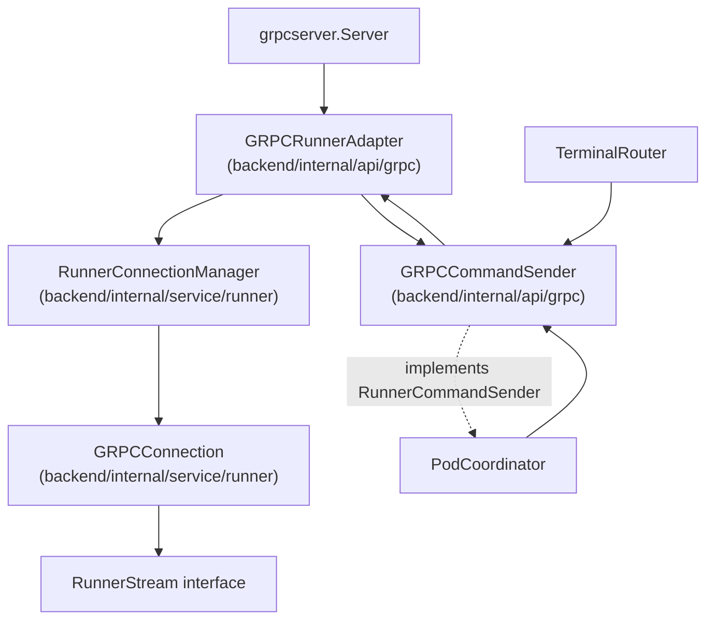
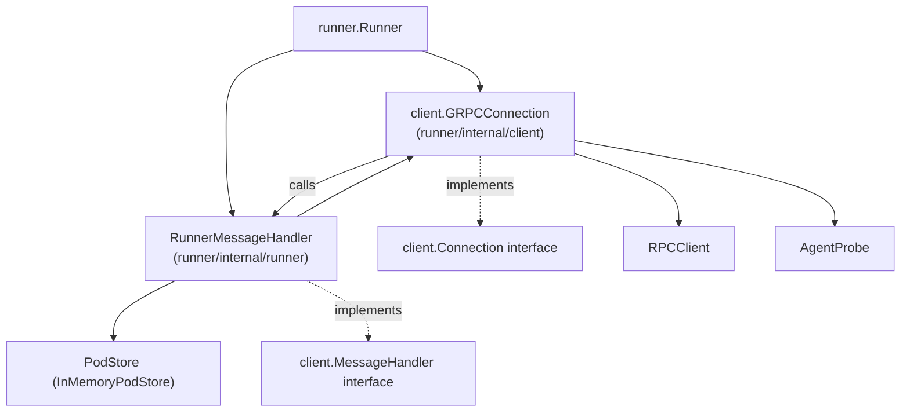
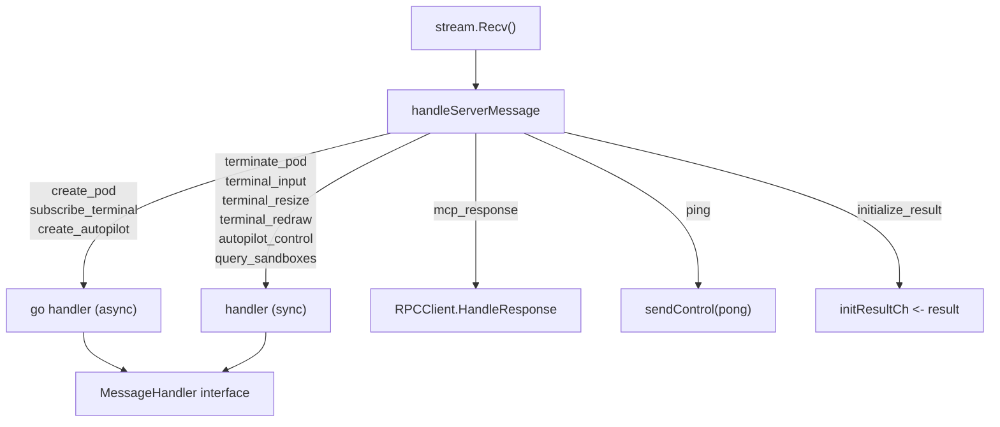
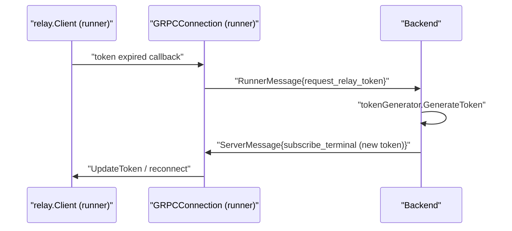

<!-- source: DeepWiki mcp.deepwiki.com · repo AgentsMesh/AgentsMesh · page 2.2 gRPC API and Runner Communication · fetched 2026-10-26 -->

# gRPC API and Runner Communication

<details>
<summary>Relevant source files</summary>

The following files were used as context for generating this wiki page:

- [.claude/skills/gh-merge/SKILL.md](.claude/skills/gh-merge/SKILL.md)
- [backend/cmd/server/eventbus_relay.go](backend/cmd/server/eventbus_relay.go)
- [backend/cmd/server/main.go](backend/cmd/server/main.go)
- [backend/internal/api/grpc/command_sender_adapter.go](backend/internal/api/grpc/command_sender_adapter.go)
- [backend/internal/api/grpc/runner_adapter_send.go](backend/internal/api/grpc/runner_adapter_send.go)
- [backend/internal/api/grpc/runner_adapter_send_extra_test.go](backend/internal/api/grpc/runner_adapter_send_extra_test.go)
- [backend/internal/api/grpc/runner_adapter_test.go](backend/internal/api/grpc/runner_adapter_test.go)
- [backend/internal/api/rest/v1/pod_terminal_connect.go](backend/internal/api/rest/v1/pod_terminal_connect.go)
- [backend/internal/service/runner/command_sender.go](backend/internal/service/runner/command_sender.go)
- [backend/internal/service/runner/command_sender_test.go](backend/internal/service/runner/command_sender_test.go)
- [backend/internal/service/runner/connection_manager.go](backend/internal/service/runner/connection_manager.go)
- [backend/internal/service/runner/test_helper_test.go](backend/internal/service/runner/test_helper_test.go)
- [proto/gen/go/runner/v1/runner.pb.go](proto/gen/go/runner/v1/runner.pb.go)
- [proto/runner/v1/runner.proto](proto/runner/v1/runner.proto)
- [runner/cmd/runner/cmd_reactivate.go](runner/cmd/runner/cmd_reactivate.go)
- [runner/cmd/runner/cmd_register.go](runner/cmd/runner/cmd_register.go)
- [runner/cmd/runner/cmd_run.go](runner/cmd/runner/cmd_run.go)
- [runner/cmd/runner/main.go](runner/cmd/runner/main.go)
- [runner/cmd/runner/register.go](runner/cmd/runner/register.go)
- [runner/cmd/runner/service.go](runner/cmd/runner/service.go)
- [runner/cmd/runner/update.go](runner/cmd/runner/update.go)
- [runner/cmd/runner/webconsole.go](runner/cmd/runner/webconsole.go)
- [runner/internal/client/grpc_connection.go](runner/internal/client/grpc_connection.go)
- [runner/internal/client/grpc_handler.go](runner/internal/client/grpc_handler.go)
- [runner/internal/client/interface.go](runner/internal/client/interface.go)
- [runner/internal/client/protocol.go](runner/internal/client/protocol.go)
- [runner/internal/relay/client_token_test.go](runner/internal/relay/client_token_test.go)
- [runner/internal/runner/message_handler.go](runner/internal/runner/message_handler.go)
- [runner/internal/runner/message_handler_pod_create_test.go](runner/internal/runner/message_handler_pod_create_test.go)
- [runner/internal/runner/message_handler_relay.go](runner/internal/runner/message_handler_relay.go)
- [runner/internal/runner/runner.go](runner/internal/runner/runner.go)

</details>


This page covers the bidirectional gRPC stream that connects runners to the backend, the Protobuf message definitions that define the protocol, and the code components on both sides that produce and consume those messages.

For the backend data structures that store runner connection state, see [Runner Connection Manager](#2.3). For the MCP handler that uses this channel to dispatch agent commands, see [MCP and Mesh Service](#2.4). For the runner-side daemon that hosts the `GRPCConnection`, see [Runner - gRPC Client](#3.3).

---

## Protocol Overview

All runner-to-backend communication uses a single long-lived bidirectional gRPC stream defined in `RunnerService.Connect`. Both sides multiplex many logical message types over this one stream. There is no REST or WebSocket fallback — mTLS gRPC is mandatory.

**Service definition** ([proto/runner/v1/runner.proto:8-13]()):

```
service RunnerService {
  rpc Connect(stream RunnerMessage) returns (stream ServerMessage);
}
```

The runner passes `x-org-slug` as gRPC metadata. The backend's nginx/proxy injects `x-client-cert-cn` (node ID) and `x-client-cert-serial` from the mTLS client certificate. See [PKI and mTLS](#2.8) for how certificates are issued and validated.

Sources: [proto/runner/v1/runner.proto:1-13](), [runner/internal/client/grpc_connection.go:24-26]()

---

## Protobuf Message Types

Each direction uses a single envelope message with a `oneof payload` field.

### Runner → Backend (`RunnerMessage`)

| Field name | Proto field # | Purpose |
|---|---|---|
| `initialize` | 1 | Sent first; carries `RunnerInfo` (version, node_id, mcp_port, OS/arch) |
| `initialized` | 2 | Confirms handshake; lists available agent slugs and versions |
| `heartbeat` | 3 | Periodic pod list + relay connection status |
| `pod_created` | 4 | Pod started successfully; carries PID, sandbox path, branch |
| `pod_terminated` | 5 | Pod exited; carries exit code and error message |
| `terminal_output` | 6 | Raw PTY bytes (no Base64 encoding) |
| `agent_status` | 7 | Agent state change: `executing`, `waiting`, or `idle` |
| `pty_resized` | 8 | Acknowledges a resize after it is applied |
| `error` | 9 | Structured error with `code`, `message`, and detail map |
| `pod_init_progress` | 10 | Phase/progress updates during pod startup (cloning, etc.) |
| `request_relay_token` | 11 | Requests a new relay JWT when existing token has expired |
| `sandboxes_status` | 12 | Response to `QuerySandboxesCommand` |
| `osc_notification` | 13 | Desktop notification from OSC 777/9 terminal sequences |
| `osc_title` | 14 | Window title change from OSC 0/2 sequences |
| `autopilot_status` | 16 | Autopilot phase/circuit-breaker state update |
| `autopilot_iteration` | 17 | Per-iteration summary |
| `autopilot_created` | 18 | Autopilot started |
| `autopilot_terminated` | 19 | Autopilot ended with reason |
| `autopilot_thinking` | 20 | Control agent decision details |
| `mcp_request` | 21 | MCP tool call tunnelled over the stream (see [MCP and Mesh Service](#2.4)) |
| `pong` | 22 | Response to a backend `PingCommand` |

### Backend → Runner (`ServerMessage`)

| Field name | Proto field # | Purpose |
|---|---|---|
| `initialize_result` | 1 | Response to `initialize`; carries server version and agent type list |
| `create_pod` | 2 | Instructs runner to create a pod |
| `terminate_pod` | 3 | Instructs runner to stop a pod |
| `terminal_input` | 4 | Keystroke/data bytes to write to PTY |
| `terminal_resize` | 5 | Change PTY dimensions |
| `send_prompt` | 6 | Reserved prompt injection |
| `terminal_redraw` | 7 | Trigger a SIGWINCH-style redraw without resizing |
| `subscribe_terminal` | 8 | Tells runner to connect to a Relay channel |
| `unsubscribe_terminal` | 9 | Tells runner to disconnect from Relay |
| `query_sandboxes` | 10 | Request sandbox filesystem status for given pod keys |
| `create_autopilot` | 11 | Start an Autopilot controller |
| `autopilot_control` | 12 | Pause/resume/stop/approve/takeover/handback |
| `mcp_response` | 13 | Reply to an `mcp_request` |
| `ping` | 14 | Downstream liveness probe; runner must reply with `pong` |

Sources: [proto/runner/v1/runner.proto:15-175](), [proto/gen/go/runner/v1/runner.pb.go:25-420]()

---

## Stream Lifecycle

**Diagram: Stream initialization handshake**

```mermaid
sequenceDiagram
    participant R as "Runner (GRPCConnection)"
    participant B as "Backend (GRPCRunnerAdapter)"
    R->>B: "Connect() [mTLS, x-org-slug metadata]"
    R->>B: "RunnerMessage{initialize: {protocol_version, RunnerInfo}}"
    B->>R: "ServerMessage{initialize_result: {agent_types, features}}"
    R->>B: "RunnerMessage{initialized: {available_agents, agent_versions}}"
    Note over B: "Marks runner online; starts heartbeat window"
    loop "every 30s"
        R->>B: "RunnerMessage{heartbeat: {pods, relay_connections, agent_versions}}"
    end
```

Sources: [runner/internal/client/grpc_connection.go:116-148](), [runner/internal/client/grpc_handler.go:98-107](), [backend/internal/service/runner/connection_manager.go:72-90]()

### Initialization Timeout

After `Connect()` the backend expects an `initialize` message within `DefaultInitTimeout` (30 seconds). If it does not arrive, the connection is closed and `onInitFailed` is invoked. This is tracked in `RunnerConnectionManager.StartInitTimeoutChecker`.

The current protocol version constant is `GRPCProtocolVersion = 2` ([runner/internal/client/grpc_connection.go:25]()).

---

## Backend-Side Components

**Diagram: Backend gRPC component relationships**



Sources: [backend/internal/api/grpc/command_sender_adapter.go:1-87](), [backend/internal/api/grpc/runner_adapter_send.go:1-50](), [backend/internal/service/runner/connection_manager.go:27-65](), [backend/cmd/server/main.go:131-158]()

### `GRPCRunnerAdapter`

Located in `backend/internal/api/grpc`. It is the gRPC service implementation; its `Connect` method is the stream entrypoint. It:

- Accepts the incoming stream, reads `x-client-cert-cn` from metadata to identify the runner.
- Calls `RunnerConnectionManager.AddConnection` to register the stream.
- Reads incoming `RunnerMessage`s in a loop and dispatches them to registered callbacks on `RunnerConnectionManager`.
- Provides `Send*` methods that construct `ServerMessage` values and write them to the appropriate `GRPCConnection.SendMessage`.

### `GRPCCommandSender`

`GRPCCommandSender` ([backend/internal/api/grpc/command_sender_adapter.go]()) is a thin adapter that implements `runner.RunnerCommandSender` by delegating each `Send*` call to the corresponding method on `GRPCRunnerAdapter`. This allows `PodCoordinator` and `TerminalRouter` to send commands without depending on the gRPC package.

### `RunnerCommandSender` interface

Defined in `backend/internal/service/runner/command_sender.go`. Implemented by `GRPCCommandSender` and the no-op fallback `NoOpCommandSender` (used when PKI is not configured).

| Method | Corresponding `ServerMessage` |
|---|---|
| `SendCreatePod` | `create_pod` |
| `SendTerminatePod` | `terminate_pod` |
| `SendTerminalInput` | `terminal_input` |
| `SendTerminalResize` | `terminal_resize` |
| `SendTerminalRedraw` | `terminal_redraw` |
| `SendPrompt` | `send_prompt` |
| `SendSubscribeTerminal` | `subscribe_terminal` |
| `SendUnsubscribeTerminal` | `unsubscribe_terminal` |
| `SendCreateAutopilot` | `create_autopilot` |
| `SendAutopilotControl` | `autopilot_control` |

Sources: [backend/internal/service/runner/command_sender.go:17-53](), [backend/internal/api/grpc/runner_adapter_send.go]()

---

## Runner-Side Components

**Diagram: Runner-side gRPC components**



Sources: [runner/internal/runner/runner.go:57-149](), [runner/internal/client/grpc_connection.go:29-106](), [runner/internal/client/interface.go:99-117]()

### `GRPCConnection`

The runner-side connection class. It:

- Dials the backend with mTLS using `advancedtls` credentials that support hot-reload of certificate files.
- Opens the `Connect` bidirectional stream.
- Runs `readLoop` (reads `ServerMessage`s) and `writeLoop` (drains send channels) as goroutines.
- Exposes two priority-tiered send channels:
  - `controlCh` (buffer 100): heartbeat, pod lifecycle events, OSC events. High priority.
  - `terminalCh` (buffer 1000): `agent_status` and terminal output. Low priority, rate-limited at 50 KB/s by default.
- Calls `connectionLoop` for automatic reconnection with exponential backoff (5 s to 5 min).
- Contains an `RPCClient` for the MCP request/response pattern.

Key configuration:

| Field | Default | Purpose |
|---|---|---|
| `heartbeatInterval` | 30 s | How often to send `HeartbeatData` |
| `initTimeout` | 30 s | Time to wait for `initialize_result` |
| `certRenewalDays` | 30 | Days before expiry to begin renewal |
| `certUrgentDays` | 7 | Days before expiry to force reconnect |
| `terminalRateLimit` | 50 KB/s | Bytes/s for the `terminalCh` rate limiter |

Sources: [runner/internal/client/grpc_connection.go:29-148]()

### `client.Connection` Interface

Composed of four sub-interfaces ([runner/internal/client/interface.go]()):

- `ConnectionLifecycle` — `Connect`, `Start`, `Stop`, `SetHandler`
- `ConnectionSender` — all `Send*` methods
- `ConnectionMonitor` — queue length/capacity/usage metrics
- `ConnectionConfig` — `GetOrgSlug` / `SetOrgSlug`

`GRPCConnection` is the only production implementation.

### `RunnerMessageHandler`

`RunnerMessageHandler` ([runner/internal/runner/message_handler.go]()) implements `client.MessageHandler`. It is wired to `GRPCConnection.SetHandler` and receives decoded commands. Key methods:

| Method | Triggered by | What it does |
|---|---|---|
| `OnCreatePod` | `create_pod` | Runs `PodBuilder`, starts PTY, registers with MCP server, sends `pod_created` |
| `OnTerminatePod` | `terminate_pod` | Stops PTY and relay client, sends `pod_terminated` |
| `OnTerminalInput` | `terminal_input` | Writes bytes to PTY |
| `OnTerminalResize` | `terminal_resize` | Resizes PTY and virtual terminal |
| `OnTerminalRedraw` | `terminal_redraw` | Invokes the +1/-1 resize trick |
| `OnSubscribeTerminal` | `subscribe_terminal` | Creates and connects a relay `Client` |
| `OnUnsubscribeTerminal` | `unsubscribe_terminal` | Disconnects the relay client |
| `OnQuerySandboxes` | `query_sandboxes` | Inspects sandbox directories, sends `sandboxes_status` |
| `OnCreateAutopilot` | `create_autopilot` | Starts an `AutopilotController` |
| `OnAutopilotControl` | `autopilot_control` | Routes pause/resume/stop actions to the controller |

Sources: [runner/internal/runner/message_handler.go:14-335](), [runner/internal/client/protocol.go:107-138]()

---

## Message Dispatch on the Runner

`handleServerMessage` in `grpc_handler.go` is the switch statement that decodes each incoming `ServerMessage`:

- **Heavy operations** (`create_pod`, `subscribe_terminal`, `create_autopilot`) are dispatched with `go` to avoid blocking the read loop.
- **Lightweight operations** (`terminate_pod`, `terminal_input`, `terminal_resize`, `terminal_redraw`, `query_sandboxes`, `autopilot_control`, `mcp_response`, `ping`) are handled synchronously to preserve ordering.

**Diagram: Incoming message dispatch**



Sources: [runner/internal/client/grpc_handler.go:43-96]()

---

## MCP over gRPC

Rather than an extra HTTP channel, the runner tunnels MCP tool calls through the existing gRPC stream using `McpRequest` (runner→backend) and `McpResponse` (backend→runner) messages.

- `McpRequest` carries a `request_id`, `pod_key`, `method` name, and a JSON `payload`.
- `McpResponse` carries the matching `request_id`, `success` flag, JSON `payload`, and optional `McpError`.
- The `RPCClient` inside `GRPCConnection` maps pending requests by `request_id` and unblocks callers when `HandleResponse` is called.

See [MCP and Mesh Service](#2.4) for the full handler logic on the backend side.

Sources: [proto/runner/v1/runner.proto:547-571](), [runner/internal/client/grpc_handler.go:282-290](), [runner/internal/runner/runner.go:174-178]()

---

## Relay Token Refresh Flow

When a relay connection fails due to token expiry, the runner sends `request_relay_token`. The backend callback in `setupRelayTokenRefreshCallback` ([backend/cmd/server/eventbus_relay.go:17-]()) verifies pod ownership, generates a new JWT, and replies with a fresh `subscribe_terminal` command.



Sources: [runner/internal/runner/message_handler_relay.go:159-170](), [backend/cmd/server/eventbus_relay.go:17-100]()

---

## Fatal Error Handling

`isFatalStreamError` ([runner/internal/client/grpc_connection.go:297-321]()) inspects gRPC status codes to determine whether reconnection should stop permanently:

| gRPC Code | Condition | User message |
|---|---|---|
| `Unauthenticated` | `"runner not found"` | Runner deleted; re-register required |
| `Unauthenticated` | other | Authentication failed; re-register |
| `PermissionDenied` | `"runner is disabled"` | Admin must re-enable runner |

Any other error is considered transient and triggers the reconnect backoff loop.

Sources: [runner/internal/client/grpc_connection.go:297-321]()

---

