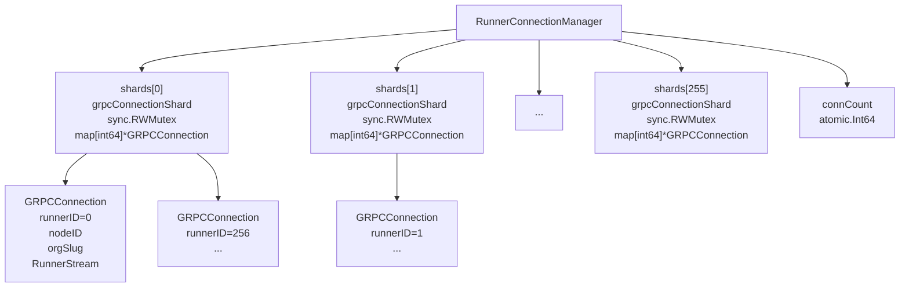
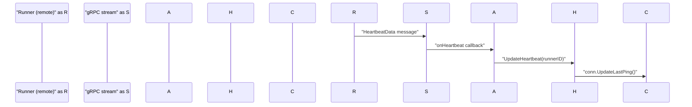
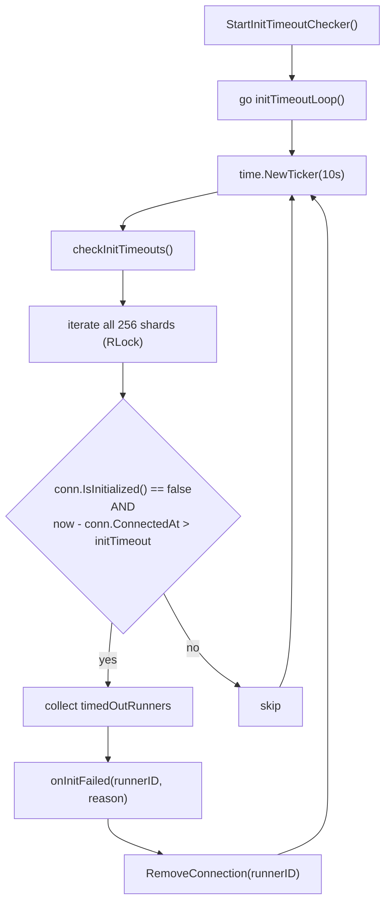
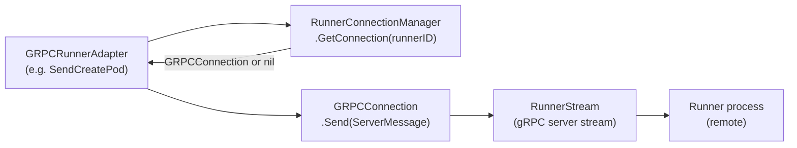
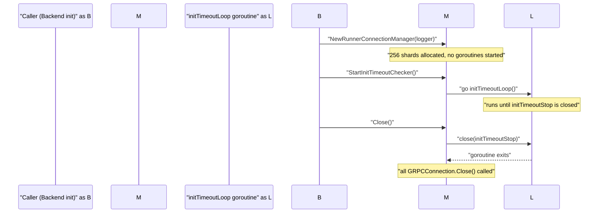

<!-- source: DeepWiki mcp.deepwiki.com · repo AgentsMesh/AgentsMesh · page 2.3 Runner Connection Manager · fetched 2026-10-26 -->

# Runner Connection Manager

<details>
<summary>Relevant source files</summary>

The following files were used as context for generating this wiki page:

- [.claude/skills/gh-merge/SKILL.md](.claude/skills/gh-merge/SKILL.md)
- [.github/workflows/release.yml](.github/workflows/release.yml)
- [backend/internal/api/grpc/runner_adapter_test.go](backend/internal/api/grpc/runner_adapter_test.go)
- [backend/internal/service/runner/connection_manager.go](backend/internal/service/runner/connection_manager.go)
- [backend/internal/service/runner/version_checker.go](backend/internal/service/runner/version_checker.go)
- [backend/internal/service/runner/version_checker_test.go](backend/internal/service/runner/version_checker_test.go)
- [docs/rfc/RFC-003-runner-release-pipeline.md](docs/rfc/RFC-003-runner-release-pipeline.md)
- [runner/build/scripts/sign-darwin.sh](runner/build/scripts/sign-darwin.sh)
- [runner/internal/client/interface.go](runner/internal/client/interface.go)
- [runner/internal/relay/client_token_test.go](runner/internal/relay/client_token_test.go)
- [runner/internal/runner/message_handler.go](runner/internal/runner/message_handler.go)
- [runner/internal/runner/message_handler_pod_create_test.go](runner/internal/runner/message_handler_pod_create_test.go)
- [runner/internal/updater/updater.go](runner/internal/updater/updater.go)
- [runner/internal/updater/updater_test.go](runner/internal/updater/updater_test.go)

</details>


This page documents the backend `RunnerConnectionManager`: how active runner gRPC connections are stored, retrieved, and tracked on the backend side. It covers the sharding architecture, the `GRPCConnection` abstraction, heartbeat tracking, and the initialization timeout mechanism.

For the gRPC protocol and message types that flow over these connections, see [gRPC API and Runner Communication](#2.2). For the runner-side gRPC client that initiates connections, see [gRPC Client](#3.3). For how the connection manager is used to dispatch pod and terminal commands, see [MCP and Mesh Service](#2.4).

---

## Overview

When a runner establishes a gRPC bidirectional stream with the backend, the backend wraps that stream in a `GRPCConnection` and stores it in the `RunnerConnectionManager`. The manager is the single source of truth for which runners are currently online. All backend subsystems that need to send commands to a runner look up the connection through this manager.

**Key design properties:**

| Property | Value |
|---|---|
| Shard count | 256 |
| Default ping interval | 30 seconds |
| Default init timeout | 30 seconds |
| Init timeout check interval | 10 seconds |
| Connection count tracking | Lock-free `atomic.Int64` |

Sources: [backend/internal/service/runner/connection_manager.go:13-89]()

---

## Sharded Storage Architecture

The manager partitions connections across 256 independent `grpcConnectionShard` structs, each with its own `sync.RWMutex`. The shard for a given runner is selected by:

```
shard index = runnerID % 256
```

This design reduces lock contention to roughly 1/256th compared to a single global lock, keeping performance predictable even at 100,000+ simultaneous runner connections.

**Sharded connection storage**



Sources: [backend/internal/service/runner/connection_manager.go:13-95]()

---

## GRPCConnection Abstraction

Each active runner is represented by a `GRPCConnection` on the backend side. It is created by `NewGRPCConnection` inside `AddConnection` and wraps the live gRPC bidirectional stream.

**Key fields and methods inferred from usage:**

| Symbol | Purpose |
|---|---|
| `ConnectedAt` | Timestamp when the connection was added; used to detect initialization timeouts |
| `IsInitialized()` | Returns whether the runner has completed its initialization handshake |
| `UpdateLastPing()` | Records the time of the latest heartbeat |
| `Close()` | Closes the underlying stream and releases resources |

The `RunnerStream` interface that `GRPCConnection` wraps is implemented by the gRPC server-side stream and exposes three methods: `Send(*runnerv1.ServerMessage)`, `Recv() (*runnerv1.RunnerMessage, error)`, and `Context() context.Context`.

Sources: [backend/internal/service/runner/connection_manager.go:100-148](), [backend/internal/api/grpc/runner_adapter_test.go:121-145]()

---

## Connection Lifecycle

**Connection lifecycle state machine**

```mermaid
stateDiagram-v2
    [*] --> "Connected (uninitialized)": "AddConnection(runnerID, nodeID, orgSlug, stream)"
    "Connected (uninitialized)" --> "Connected (initialized)": "onInitialized callback fires"
    "Connected (uninitialized)" --> "Disconnected": "init timeout (30s)\nonInitFailed callback fires"
    "Connected (initialized)" --> "Disconnected": "RemoveConnection(runnerID)\nonDisconnect callback fires"
    "Disconnected" --> [*]
```

**`AddConnection`** acquires a write lock on the appropriate shard, closes any pre-existing connection for the same runner ID, creates a new `GRPCConnection`, and increments `connCount`.

**`RemoveConnection`** acquires a write lock, deletes the entry, decrements `connCount`, calls `conn.Close()`, and then invokes the `onDisconnect` callback outside the lock.

**`GetConnection`** and **`IsConnected`** acquire a read lock and are safe for concurrent use.

Sources: [backend/internal/service/runner/connection_manager.go:99-163]()

---

## Heartbeat Tracking

The manager does not maintain its own timer per connection. Instead, callers invoke `UpdateHeartbeat(runnerID int64)` when a heartbeat message arrives from the runner over the gRPC stream. This calls `conn.UpdateLastPing()` on the corresponding `GRPCConnection`.



The `pingInterval` field (30 seconds default) is stored on the manager but the actual sending of server-side pings is handled by the gRPC adapter layer, not directly by `RunnerConnectionManager`.

Sources: [backend/internal/service/runner/connection_manager.go:165-170]()

---

## Initialization Timeout

After a runner establishes its gRPC stream, the backend expects it to complete an initialization handshake within 30 seconds (`DefaultInitTimeout`). A background goroutine checks for stalled connections every 10 seconds.

**Initialization timeout flow**



The `initTimeoutStop` channel is closed by `RunnerConnectionManager.Close()` via a `sync.Once` guard, which causes the background goroutine to exit cleanly.

Sources: [backend/internal/service/runner/connection_manager.go:210-259]()

---

## Event Callbacks

`RunnerConnectionManager` stores a set of function-typed fields that the owning `GRPCRunnerAdapter` registers to handle runner-originated events. Callbacks receive Proto types directly, avoiding JSON serialization overhead.

| Callback field | Trigger |
|---|---|
| `onHeartbeat` | Runner sent a heartbeat |
| `onPodCreated` | Runner reported a pod started |
| `onPodTerminated` | Runner reported a pod exited |
| `onAgentStatus` | Agent status changed (executing / waiting / idle) |
| `onPtyResized` | Terminal was resized |
| `onPodInitProgress` | Pod initialization phase update |
| `onRequestRelayToken` | Runner needs a fresh relay token |
| `onDisconnect` | Runner gRPC stream closed |
| `onInitialized` | Runner completed handshake |
| `onInitFailed` | Runner timed out before completing handshake |
| `onSandboxesStatus` | Response to a sandbox status query |
| `onOSCNotification` | OSC 777 / OSC 9 terminal notification |
| `onOSCTitle` | OSC 0/2 title change event |
| `onPodError` | Pod encountered an error |
| `onAutopilotStatus` | Autopilot controller status |
| `onAutopilotIteration` | Autopilot iteration event |
| `onAutopilotCreated` | Autopilot session created |
| `onAutopilotTerminated` | Autopilot session ended |
| `onAutopilotThinking` | Autopilot thinking event |

Sources: [backend/internal/service/runner/connection_manager.go:42-64]()

---

## Integration with GRPCRunnerAdapter

`GRPCRunnerAdapter` (in `backend/internal/api/grpc/`) holds a reference to `RunnerConnectionManager` as `adapter.connManager`. Sending any command to a runner follows the same pattern:

1. Call `connMgr.GetConnection(runnerID)` to look up the `GRPCConnection`.
2. If the result is `nil`, return an error containing `"not connected"`.
3. Otherwise, call the appropriate send method on the connection.

**Command dispatch path**



Sources: [backend/internal/api/grpc/runner_adapter_test.go:27-118](), [backend/internal/service/runner/connection_manager.go:99-163]()

---

## Manager Construction and Teardown

`NewRunnerConnectionManager(logger)` initializes all 256 shards and sets default intervals. It does not start any background goroutines; the caller must explicitly call `StartInitTimeoutChecker()` after construction.

`Close()` signals the timeout goroutine to stop, then iterates every shard under a write lock to close all connections and reset the maps.



Sources: [backend/internal/service/runner/connection_manager.go:72-208]()

---

