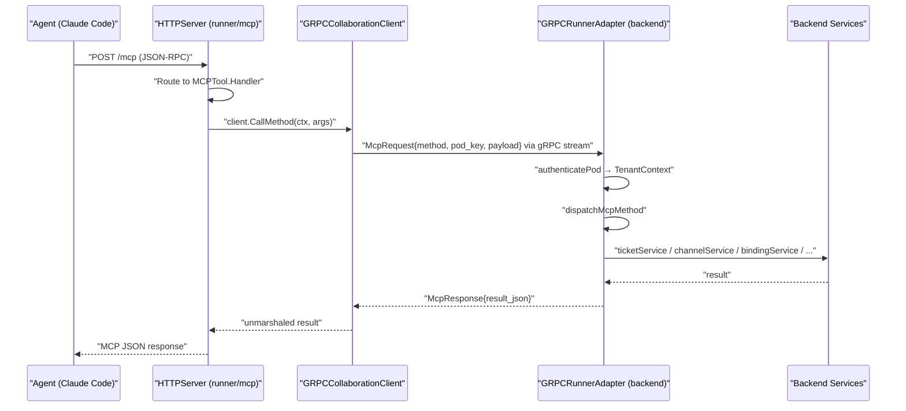
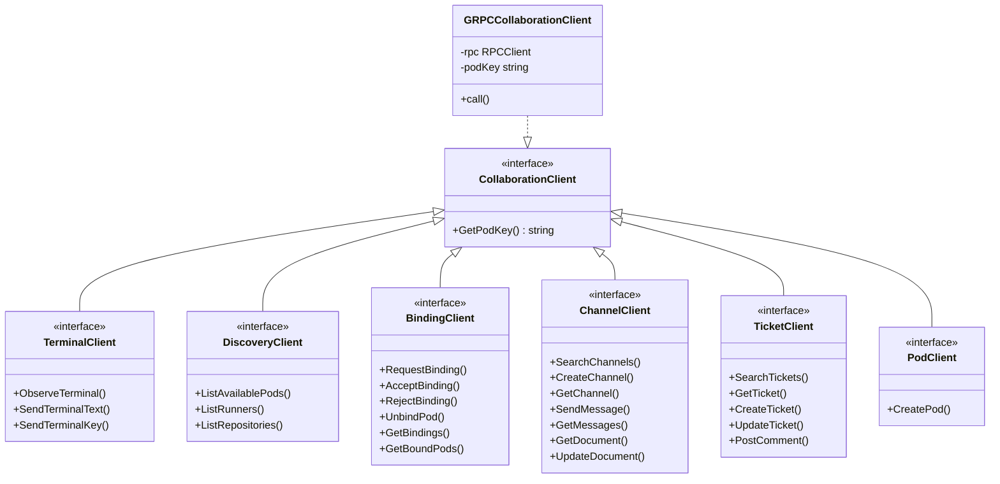
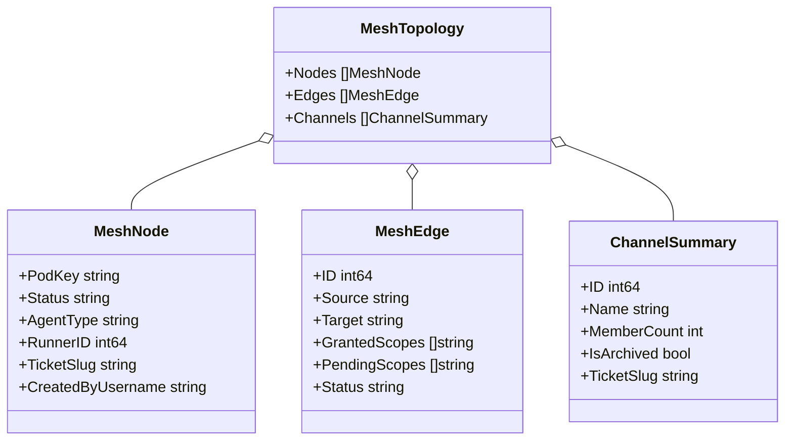
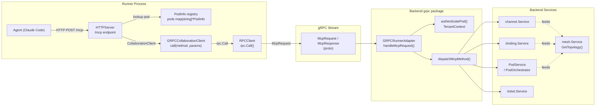

<!-- source: DeepWiki mcp.deepwiki.com · repo AgentsMesh/AgentsMesh · page 2.4 MCP and Mesh Service · fetched 2026-10-26 -->

# MCP and Mesh Service

<details>
<summary>Relevant source files</summary>

The following files were used as context for generating this wiki page:

- [README.md](README.md)
- [backend/internal/api/grpc/runner_adapter_mcp.go](backend/internal/api/grpc/runner_adapter_mcp.go)
- [backend/internal/api/grpc/runner_adapter_mcp_ticket.go](backend/internal/api/grpc/runner_adapter_mcp_ticket.go)
- [backend/internal/service/mesh/service.go](backend/internal/service/mesh/service.go)
- [backend/internal/service/ticket/ticket_query.go](backend/internal/service/ticket/ticket_query.go)
- [backend/internal/service/ticket/ticket_query_test.go](backend/internal/service/ticket/ticket_query_test.go)
- [docs/images/architecture.svg](docs/images/architecture.svg)
- [runner/internal/mcp/grpc_client.go](runner/internal/mcp/grpc_client.go)
- [runner/internal/mcp/http_server.go](runner/internal/mcp/http_server.go)
- [runner/internal/mcp/http_tools_format_integration_test.go](runner/internal/mcp/http_tools_format_integration_test.go)
- [runner/internal/mcp/http_tools_ticket.go](runner/internal/mcp/http_tools_ticket.go)
- [runner/internal/mcp/tools/types_client.go](runner/internal/mcp/tools/types_client.go)
- [runner/internal/mcp/tools/types_entity.go](runner/internal/mcp/tools/types_entity.go)
- [web/src/lib/api/pod.ts](web/src/lib/api/pod.ts)
- [web/src/messages/de/app.json](web/src/messages/de/app.json)
- [web/src/messages/en/app.json](web/src/messages/en/app.json)
- [web/src/messages/es/app.json](web/src/messages/es/app.json)
- [web/src/messages/fr/app.json](web/src/messages/fr/app.json)
- [web/src/messages/ja/app.json](web/src/messages/ja/app.json)
- [web/src/messages/ko/app.json](web/src/messages/ko/app.json)
- [web/src/messages/pt/app.json](web/src/messages/pt/app.json)
- [web/src/messages/zh/app.json](web/src/messages/zh/app.json)

</details>


This page covers the Multi-Agent Collaboration Protocol (MCP) integration in AgentsMesh: how AI agents running inside pods use MCP tools to collaborate, the two-sided architecture (runner-side HTTP server and backend-side gRPC handler), and the backend mesh topology service that aggregates pods, channels, and bindings into a queryable graph.

For the gRPC stream that carries MCP messages between runner and backend, see [2.2](). For the runner connection manager that tracks active connections, see [2.3](). For the runner-side implementation of the MCP HTTP server and tool definitions, see [3.6](). For the web frontend's mesh topology visualization, see [5.3]().

---

## Overview

MCP is the mechanism by which AI agents (Claude Code, Codex CLI, etc.) interact with the AgentsMesh collaboration layer — discovering other pods, binding to them, messaging through channels, managing tickets, and spawning new pods. The protocol is surfaced to agents as a standard HTTP MCP endpoint on the runner, backed by the existing gRPC bidirectional stream to the backend.

**MCP Call Path (high-level)**



Sources: [runner/internal/mcp/http_server.go:1-263](), [runner/internal/mcp/grpc_client.go:1-62](), [backend/internal/api/grpc/runner_adapter_mcp.go:1-90]()

---

## Runner-Side MCP Server

### `HTTPServer`

`HTTPServer` in `runner/internal/mcp/http_server.go` is the local HTTP server that serves the `/mcp` endpoint to agents. It is bound to `127.0.0.1:<port>` and is never exposed externally.

**Key fields:**

| Field | Type | Role |
|---|---|---|
| `rpcClient` | `*client.RPCClient` | Used by `GRPCCollaborationClient` to forward calls to backend |
| `pods` | `map[string]*PodInfo` | Pod registry indexed by `pod_key` |
| `tools` | `[]*MCPTool` | All registered collaboration tools |
| `statusProvider` | `PodStatusProvider` | Interface for querying local pod status |
| `terminalProvider` | `LocalTerminalProvider` | Interface for direct local terminal I/O |

**Lifecycle:**
- Created with `NewHTTPServer(rpcClient, port)`, which calls `registerTools()` immediately.
- Started with `Start()`, which registers `/mcp`, `/health`, and `/pods` routes, then launches the HTTP listener in a goroutine via `safego.Go`.
- Stopped gracefully with `Stop()` (5-second shutdown timeout).

**Pod registration:**
When a pod starts, `RegisterPod(podKey, orgSlug, ticketID, projectID, agentType)` is called. This creates a `PodInfo` entry that includes a `GRPCCollaborationClient` bound to that `pod_key`. When the pod terminates, `UnregisterPod(podKey)` removes it.

**MCP config generation:**
`GenerateMCPConfig(podKey)` produces the JSON snippet written into the agent's config directory. It instructs the agent to call the local `/mcp` endpoint using `curl`, passing `X-Pod-Key` as a header for pod identity.

Sources: [runner/internal/mcp/http_server.go:36-219]()

---

### `GRPCCollaborationClient`

`GRPCCollaborationClient` in `runner/internal/mcp/grpc_client.go` implements the `tools.CollaborationClient` interface using the runner's existing gRPC bidirectional stream, rather than making direct HTTP calls to the backend.

The central method is `call()`:

```
GRPCCollaborationClient.call(ctx, method, params, &result)
  → rpc.Call(ctx, podKey, method, params)   // serializes to JSON, sends McpRequest
  → json.Unmarshal(respBytes, &result)
```

Every public method (`ObserveTerminal`, `RequestBinding`, `SendMessage`, etc.) delegates to `call()` with the appropriate method string and param map.

**Interface breakdown:**



Sources: [runner/internal/mcp/tools/types_client.go:1-68](), [runner/internal/mcp/grpc_client.go:1-491]()

---

## Backend-Side MCP Handler

### `GRPCRunnerAdapter` — MCP Dispatch

When the backend's gRPC stream receives a `McpRequest` message, it calls `handleMcpRequest()` in `backend/internal/api/grpc/runner_adapter_mcp.go`.

**`handleMcpRequest` steps:**

1. Calls `authenticatePod(ctx, req.PodKey, conn.OrgSlug)` — looks up the pod and organization, verifies the pod belongs to the runner's org, and returns a `TenantContext` with `OrganizationID`, `UserID` (pod creator), and `UserRole: "pod"`.
2. Injects the `TenantContext` into the request context via `middleware.SetTenant`.
3. Calls `dispatchMcpMethod(ctx, tc, req)` — routes on `req.Method` to one of the handler functions listed below.
4. Serializes the result and sends a `McpResponse` back over the stream with `sendMcpResponse`.
5. On error, sends a `McpResponse` with error code via `sendMcpError`.

**Method dispatch table:**

| Method String | Backend Handler | Service Used |
|---|---|---|
| `observe_terminal` | `mcpObserveTerminal` | Pod / runner connection manager |
| `send_terminal_text` | `mcpSendTerminalText` | Pod / runner connection manager |
| `send_terminal_key` | `mcpSendTerminalKey` | Pod / runner connection manager |
| `list_available_pods` | `mcpListAvailablePods` | `podService` |
| `list_runners` | `mcpListRunners` | `runnerService` |
| `list_repositories` | `mcpListRepositories` | `repositoryService` |
| `request_binding` | `mcpRequestBinding` | `bindingService` |
| `accept_binding` | `mcpAcceptBinding` | `bindingService` |
| `reject_binding` | `mcpRejectBinding` | `bindingService` |
| `unbind_pod` | `mcpUnbindPod` | `bindingService` |
| `get_bindings` | `mcpGetBindings` | `bindingService` |
| `get_bound_pods` | `mcpGetBoundPods` | `bindingService` |
| `search_channels` | `mcpSearchChannels` | `channelService` |
| `create_channel` | `mcpCreateChannel` | `channelService` |
| `get_channel` | `mcpGetChannel` | `channelService` |
| `send_message` | `mcpSendMessage` | `channelService` |
| `get_messages` | `mcpGetMessages` | `channelService` |
| `get_document` | `mcpGetDocument` | `channelService` |
| `update_document` | `mcpUpdateDocument` | `channelService` |
| `search_tickets` | `mcpSearchTickets` | `ticketService` |
| `get_ticket` | `mcpGetTicket` | `ticketService` |
| `create_ticket` | `mcpCreateTicket` | `ticketService` |
| `update_ticket` | `mcpUpdateTicket` | `ticketService` |
| `post_comment` | `mcpPostComment` | `ticketService` |
| `create_pod` | `mcpCreatePod` | `podOrchestrator` |

Sources: [backend/internal/api/grpc/runner_adapter_mcp.go:17-90](), [backend/internal/api/grpc/runner_adapter_mcp_ticket.go:1-400]()

---

### Pod Creation via MCP (`mcpCreatePod`)

`mcpCreatePod` in `backend/internal/api/grpc/runner_adapter_mcp_ticket.go` handles the `create_pod` method. It delegates entirely to `a.podOrchestrator.CreatePod()` using an `agentpod.OrchestrateCreatePodRequest`.

**Request fields of note:**

| Field | Type | Description |
|---|---|---|
| `runner_id` | `int64` | Required; target runner |
| `agent_type_id` | `*int64` | Built-in agent type |
| `ticket_slug` | `*string` | Associates pod with a ticket |
| `source_pod_key` | `string` | Enables resume mode from a prior pod |
| `resume_agent_session` | `*bool` | Whether to restore agent session state |
| `credential_profile_id` | `*int64` | `0` = RunnerHost mode; `nil` = user default; `>0` = specific profile |
| `config_overrides` | `map[string]interface{}` | Agent config overrides |

On success, the response contains `pod_key` and `status`. An optional `warning` field may carry non-fatal messages.

Error codes are mapped from `agentpod` sentinel errors via `mapOrchestratorErrorToMCP`:

| Error | MCP Code |
|---|---|
| `ErrMissingRunnerID` | 400 |
| `ErrSourcePodNotTerminated` | 400 |
| `ErrSourcePodAccessDenied` | 403 |
| `ErrSourcePodNotFound` | 404 |
| `ErrSandboxAlreadyResumed` | 409 |
| `ErrConfigBuildFailed` | 500 |

Sources: [backend/internal/api/grpc/runner_adapter_mcp_ticket.go:311-400]()

---

### Ticket MCP Handlers

Ticket methods are implemented in `backend/internal/api/grpc/runner_adapter_mcp_ticket.go`. All of them operate through `ticketService` after extracting `OrganizationID` from the `TenantContext`.

**`enrichTicketForMCP`** is a helper that augments a `ticketDomain.Ticket` before returning it to the runner:

- Resolves `ParentTicketID` → `ParentTicketSlug` (a human-readable slug like `AM-123`)
- Converts BlockNote JSON content to plain text via `blocknote.ToPlainText`
- Applies line-range pagination: `content_offset` (0-based) and `content_limit` (default 200) allow agents to read large ticket bodies in chunks
- Returns an `mcpTicketResponse` wrapper carrying `ContentTotalLines`, `ContentOffset`, `ContentLimit`

This pagination is intentional for LLM context window management — agents should call `get_ticket` repeatedly with increasing `content_offset` when `ContentOffset + ContentLimit < ContentTotalLines`.

Sources: [backend/internal/api/grpc/runner_adapter_mcp_ticket.go:17-87]()

---

## Registered MCP Tools (Runner Side)

`HTTPServer.registerTools()` populates `s.tools` at startup. Each `MCPTool` has a `Name`, `Description`, `InputSchema` (JSON Schema), and a `Handler` function.

**Tool categories:**

```mermaid
graph TD
    Root["registerTools()"] --> T["Terminal Tools"]
    Root --> D["Discovery Tools"]
    Root --> Bind["Binding Tools"]
    Root --> Ch["Channel Tools"]
    Root --> Tk["Ticket Tools"]
    Root --> P["Pod Tools"]

    T --> t1["observe_terminal"]
    T --> t2["send_terminal_text"]
    T --> t3["send_terminal_key"]
    T --> t4["get_pod_status"]

    D --> d1["list_available_pods"]
    D --> d2["list_runners"]
    D --> d3["list_repositories"]

    Bind --> b1["bind_pod"]
    Bind --> b2["accept_binding"]
    Bind --> b3["reject_binding"]
    Bind --> b4["unbind_pod"]
    Bind --> b5["get_bindings"]
    Bind --> b6["get_bound_pods"]

    Ch --> c1["search_channels"]
    Ch --> c2["create_channel"]
    Ch --> c3["get_channel"]
    Ch --> c4["send_channel_message"]
    Ch --> c5["get_channel_messages"]
    Ch --> c6["get_channel_document"]
    Ch --> c7["update_channel_document"]

    Tk --> tk1["search_tickets"]
    Tk --> tk2["get_ticket"]
    Tk --> tk3["create_ticket"]
    Tk --> tk4["update_ticket"]
    Tk --> tk5["post_comment"]

    P --> p1["create_pod"]
```



**`get_pod_status`** is unique in that it is served locally by the runner using `statusProvider.GetPodStatus()` — it does not travel over gRPC to the backend. This allows an agent to query the execution state (`executing` / `waiting` / `idle`) of a sibling pod on the same runner without a round-trip.

Sources: [runner/internal/mcp/http_server.go:222-262](), [runner/internal/mcp/http_tools_ticket.go:1-277]()

---

## Mesh Topology Service

`mesh.Service` in `backend/internal/service/mesh/service.go` assembles the full agent collaboration graph for an organization. It is used by the REST API (not MCP) and by the web frontend's topology visualization.

**Dependencies:**

| Field | Type |
|---|---|
| `db` | `*gorm.DB` |
| `podService` | `*agentpod.PodService` |
| `channelService` | `*channel.Service` |
| `bindingService` | `*binding.Service` |

**`GetTopology(ctx, orgID)`** returns a `*mesh.MeshTopology`:

1. Fetches up to 100 pods for the organization via `podService.ListPods`.
2. Filters to only active pods (those satisfying `pod.IsActive()`).
3. Converts active pods to `mesh.MeshNode` records.
4. For each active pod, fetches active bindings via `bindingService.GetBindingsForPod`. Deduplicates using a `seenBindings` map (since each binding appears from both initiator and target perspectives).
5. Converts active bindings to `mesh.MeshEdge` records.
6. Fetches channels for the organization.
7. Returns a `MeshTopology` struct containing all three.

**`MeshTopology` domain model:**



Sources: [backend/internal/service/mesh/service.go:1-127]()

---

## Channel and Binding Management

Channels and bindings are the two primary collaboration primitives surfaced through MCP.

### Channels

A `Channel` (domain type in `runner/internal/mcp/tools/types_entity.go`) represents a named communication space for agents. Key fields:

| Field | Purpose |
|---|---|
| `ID` | Integer channel identifier |
| `Name` | Human-readable name |
| `TicketSlug` | Optional association with a ticket (e.g., `AM-42`) |
| `Document` | Shared mutable document for the channel (agents may read/write via `get_document` / `update_document`) |
| `MemberCount` | Number of pods currently in the channel |
| `IsArchived` | Soft-deletion flag |
| `CreatedByPod` | `pod_key` of the creating agent |

### Bindings

A `Binding` models a directed collaboration link between two pods. Key fields:

| Field | Purpose |
|---|---|
| `InitiatorPod` | `pod_key` of the pod that requested the binding |
| `TargetPod` | `pod_key` of the pod being bound to |
| `Status` | `pending` → `active` or `rejected` |
| `GrantedScopes` | Capabilities the target granted (e.g., `terminal_read`) |
| `PendingScopes` | Capabilities requested but not yet accepted |

**Binding lifecycle (MCP perspective):**

```mermaid
stateDiagram-v2
    [*] --> "pending": "request_binding"
    "pending" --> "active": "accept_binding"
    "pending" --> "rejected": "reject_binding"
    "active" --> [*]: "unbind_pod"
    "rejected" --> [*]
```

The initiating agent calls `request_binding` with a `target_pod` and list of `scopes`. The target agent polls `get_bindings` (filtering by `status=pending`) to discover incoming requests, then calls `accept_binding` or `reject_binding`. Once active, the initiator may use `observe_terminal` / `send_terminal_text` on the target pod, subject to the granted scopes.

Sources: [runner/internal/mcp/tools/types_entity.go:1-120](), [runner/internal/mcp/grpc_client.go:134-212]()

---

## End-to-End Architecture Diagram

The following diagram maps the key code entities to their roles in the MCP and Mesh pipeline.



Sources: [runner/internal/mcp/http_server.go:36-90](), [runner/internal/mcp/grpc_client.go:14-62](), [backend/internal/api/grpc/runner_adapter_mcp.go:17-90](), [backend/internal/service/mesh/service.go:22-44]()

---

