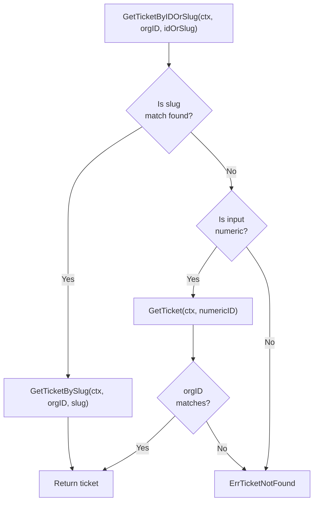
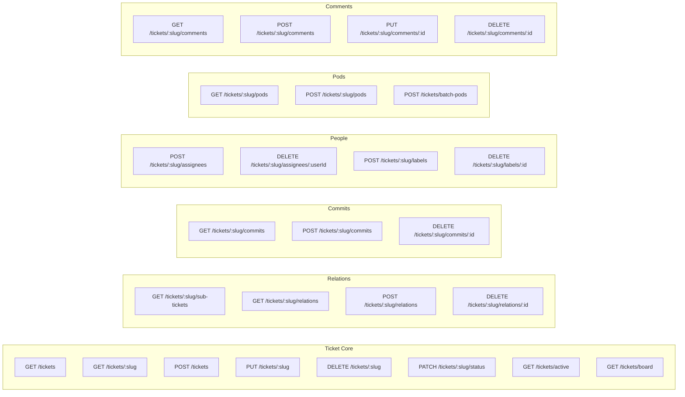
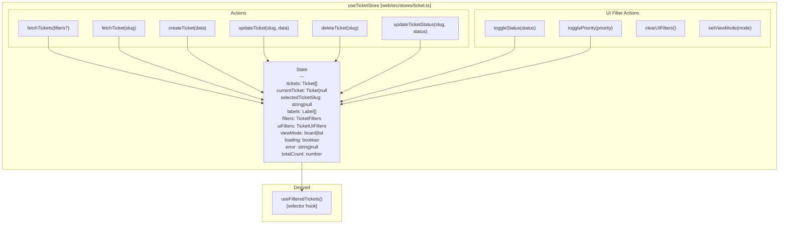
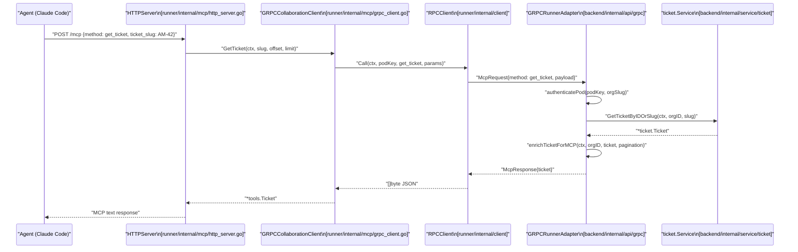

<!-- source: DeepWiki mcp.deepwiki.com · repo AgentsMesh/AgentsMesh · page 2.5 Ticket Service · fetched 2026-10-26 -->

# Ticket Service

<details>
<summary>Relevant source files</summary>

The following files were used as context for generating this wiki page:

- [README.md](README.md)
- [backend/internal/api/grpc/runner_adapter_mcp.go](backend/internal/api/grpc/runner_adapter_mcp.go)
- [backend/internal/api/grpc/runner_adapter_mcp_ticket.go](backend/internal/api/grpc/runner_adapter_mcp_ticket.go)
- [backend/internal/service/ticket/ticket_query.go](backend/internal/service/ticket/ticket_query.go)
- [backend/internal/service/ticket/ticket_query_test.go](backend/internal/service/ticket/ticket_query_test.go)
- [docs/images/architecture.svg](docs/images/architecture.svg)
- [runner/internal/mcp/grpc_client.go](runner/internal/mcp/grpc_client.go)
- [runner/internal/mcp/http_server.go](runner/internal/mcp/http_server.go)
- [runner/internal/mcp/http_tools_format_integration_test.go](runner/internal/mcp/http_tools_format_integration_test.go)
- [runner/internal/mcp/http_tools_ticket.go](runner/internal/mcp/http_tools_ticket.go)
- [runner/internal/mcp/tools/types_client.go](runner/internal/mcp/tools/types_client.go)
- [runner/internal/mcp/tools/types_entity.go](runner/internal/mcp/tools/types_entity.go)
- [web/src/app/(dashboard)/[org]/tickets/components/BoardViewLayout.tsx](web/src/app/(dashboard)/[org]/tickets/components/BoardViewLayout.tsx)
- [web/src/app/(dashboard)/[org]/tickets/components/ListViewLayout.tsx](web/src/app/(dashboard)/[org]/tickets/components/ListViewLayout.tsx)
- [web/src/app/(dashboard)/[org]/tickets/page.tsx](web/src/app/(dashboard)/[org]/tickets/page.tsx)
- [web/src/components/tickets/KanbanBoard.tsx](web/src/components/tickets/KanbanBoard.tsx)
- [web/src/components/tickets/TicketDetail.tsx](web/src/components/tickets/TicketDetail.tsx)
- [web/src/components/tickets/TicketDetailPane.tsx](web/src/components/tickets/TicketDetailPane.tsx)
- [web/src/components/tickets/TicketDetailSidebar.tsx](web/src/components/tickets/TicketDetailSidebar.tsx)
- [web/src/components/tickets/__tests__/TicketDetail.test.tsx](web/src/components/tickets/__tests__/TicketDetail.test.tsx)
- [web/src/lib/api/ticket.ts](web/src/lib/api/ticket.ts)
- [web/src/stores/ticket.ts](web/src/stores/ticket.ts)

</details>


This page documents the backend ticket service, the REST API it exposes, the MCP interface for AI agents, and the frontend state management layer. The ticket system is the project management subsystem of AgentsMesh — it tracks work items and integrates with pods so that agents can be launched against specific tasks.

For the **frontend UI components** (Kanban board, ticket list, ticket detail page), see [5.2](#5.2). For how tickets relate to the broader MCP and mesh system, see [2.4](#2.4).

---

## Data Model

A ticket belongs to a single organization and carries a human-readable `slug` (e.g. `AM-42`). Slug uniqueness is enforced per-organization, not globally — two organizations may each have a ticket with slug `TICKET-1`.

**Ticket fields** ([web/src/lib/api/ticket.ts:7-32]()):

| Field | Type | Notes |
|---|---|---|
| `id` | `number` | Primary key |
| `number` | `number` | Sequential counter per org |
| `slug` | `string` | Human-readable ID, e.g. `AM-42` |
| `title` | `string` | |
| `content` | `string?` | BlockNote JSON (rich text) |
| `status` | `TicketStatus` | See below |
| `priority` | `TicketPriority` | See below |
| `severity` | `string?` | Optional severity label |
| `estimate` | `number?` | Story point estimate |
| `due_date` | `string?` | ISO date |
| `reporter` | `User?` | Populated on fetch |
| `assignees` | `TicketAssignee[]?` | Join table with user |
| `labels` | `Label[]?` | Color-tagged labels |
| `repository_id` | `number?` | Associated git repository |
| `parent_ticket` | `{ id, slug, title }?` | Parent for sub-tickets |

**Status values** (`TicketStatus`): `backlog`, `todo`, `in_progress`, `in_review`, `done`

**Priority values** (`TicketPriority`): `none`, `low`, `medium`, `high`, `urgent`

Sources: [web/src/lib/api/ticket.ts:4-32](), [runner/internal/mcp/tools/types_entity.go:98-114]()

---

## Backend Service Layer

The core service lives in `backend/internal/service/ticket/`. The `Service` struct wraps a GORM database handle and exposes query and mutation functions.

**Ticket query diagram:**



**`GetTicket`** ([backend/internal/service/ticket/ticket_query.go:11-22]())
Fetches by primary key. Eager-loads `Assignees.User`, `Labels`, `MergeRequests`, `SubTickets`.

**`GetTicketBySlug`** ([backend/internal/service/ticket/ticket_query.go:25-38]())
Looks up by `(organization_id, slug)`. Returns `ErrTicketNotFound` if not found.

**`GetTicketByIDOrSlug`** ([backend/internal/service/ticket/ticket_query.go:43-64]())
Tries slug first; falls back to numeric primary-key lookup only if the input string is a pure integer. The numeric path validates org ownership before returning. This is the primary lookup path used by MCP handlers.

**`ListTickets`** ([backend/internal/service/ticket/ticket_query.go:67-112]())
Accepts a `ListTicketsFilter` struct with the following optional fields:

| Filter field | SQL clause |
|---|---|
| `RepositoryID` | `repository_id = ?` |
| `Status` | `status = ?` |
| `Priority` | `priority = ?` |
| `ReporterID` | `reporter_id = ?` |
| `ParentTicketID` | `parent_ticket_id = ?` |
| `Query` | `title ILIKE %q%` or `slug ILIKE %q%` |
| `AssigneeID` | JOIN `ticket_assignees` |
| `LabelIDs` | JOIN `ticket_labels` |

Results are ordered by `created_at DESC`. Returns `([]*ticket.Ticket, totalCount int64, error)`.

Sources: [backend/internal/service/ticket/ticket_query.go:1-112](), [backend/internal/service/ticket/ticket_query_test.go:1-137]()

---

## REST API Endpoints

All ticket routes are scoped to an organization. The `orgPath()` helper in the frontend ([web/src/lib/api/ticket.ts:1]()) prefixes requests with `/api/orgs/{orgSlug}`.

**Ticket resource diagram:**



Sources: [web/src/lib/api/ticket.ts:76-400]()

### Key endpoint notes

- **`GET /tickets`** accepts query params: `status`, `priority`, `assignee_id`, `repository_id`, `query`, `limit`, `offset`. Returns `{ tickets: TicketData[], total: number }`.
- **`PATCH /tickets/:slug/status`** is a lightweight status-only update. The frontend `updateTicketStatus` store action calls this with an optimistic local update and rolls back on failure ([web/src/stores/ticket.ts:181-202]()).
- **`GET /tickets/board`** returns `{ board: { columns: BoardColumn[] } }` grouped by status.
- **`GET /tickets/active`** returns tickets with `in_progress` or `in_review` status.
- **`POST /tickets/batch-pods`** accepts `{ ticket_ids: number[] }` and returns a map of ticket IDs to pod summaries — used to populate pod indicators on the Kanban board efficiently.
- **`POST /tickets/:slug/pods`** creates a new AgentPod bound to that ticket. The body mirrors the pod creation params (runner_id, initial_prompt, model, permission_mode).
- Comment `content` supports `parent_id` for threaded replies and `mentions` for user references.

Sources: [web/src/lib/api/ticket.ts:76-400]()

---

## Frontend State: `useTicketStore`

The Zustand store at `web/src/stores/ticket.ts` is the single source of state for all ticket data on the frontend.

**Store architecture diagram:**



**`useFilteredTickets`** ([web/src/stores/ticket.ts:303-322]()) is a selector hook that derives a filtered ticket list from `tickets`, `filters.search`, `uiFilters.selectedStatuses`, and `uiFilters.selectedPriorities` using `useMemo`. It is the single source used by both the list view and board view to avoid duplication.

**Optimistic updates**: `updateTicketStatus` applies the status change locally before calling the API, and rolls back `tickets` and `currentTicket` if the request fails ([web/src/stores/ticket.ts:181-202]()).

**`currentTicket` vs `tickets`**: `currentTicket` is set by `fetchTicket(slug)` and used by `TicketDetail`. The `tickets` array is populated by `fetchTickets()` and used by list/board views. `updateTicket` and `updateTicketStatus` update both simultaneously.

Sources: [web/src/stores/ticket.ts:1-355]()

---

## MCP Integration (AI Agent Access)

AI agents running inside pods can read and modify tickets through the MCP protocol. The backend `GRPCRunnerAdapter` handles these requests.

**MCP ticket flow:**



### MCP Ticket Methods

Defined in `backend/internal/api/grpc/runner_adapter_mcp_ticket.go` and dispatched from `dispatchMcpMethod` ([backend/internal/api/grpc/runner_adapter_mcp.go:125-136]()):

| MCP method | Handler | Description |
|---|---|---|
| `search_tickets` | `mcpSearchTickets` | Filter by status, priority, assignee, parent, query, with pagination |
| `get_ticket` | `mcpGetTicket` | Fetch single ticket by slug, with content line-range pagination |
| `create_ticket` | `mcpCreateTicket` | Create ticket with title, content, priority, optional parent slug |
| `update_ticket` | `mcpUpdateTicket` | Update title, content, status, or priority |
| `post_comment` | `mcpPostComment` | Post a comment, optionally replying to a parent comment |

### Content Pagination

Ticket content is stored as BlockNote JSON. The `enrichTicketForMCP` function ([backend/internal/api/grpc/runner_adapter_mcp_ticket.go:35-87]()) converts it to plain text and supports line-range slicing:

- Converts `BlockNote JSON → plain text` via `blocknote.ToPlainText()`
- Splits on `\n` to get individual lines
- Applies `content_offset` (0-based start line, default 0) and `content_limit` (line count, default 200)
- Returns `ContentTotalLines`, `ContentOffset`, `ContentLimit` alongside the sliced text

This allows agents to read large ticket descriptions incrementally.

### Runner-side MCP Tools

The runner's MCP HTTP server registers these tools in `runner/internal/mcp/http_tools_ticket.go`. The tool definitions are returned to agents in the MCP `tools/list` response:

| Tool | Required params | Optional params |
|---|---|---|
| `search_tickets` | — | `repository_id`, `status`, `priority`, `assignee_id`, `parent_ticket_slug`, `query`, `limit`, `page` |
| `get_ticket` | `ticket_slug` | `content_offset`, `content_limit` |
| `create_ticket` | `title` | `repository_id`, `content`, `priority`, `parent_ticket_slug` |
| `update_ticket` | `ticket_slug` | `title`, `content`, `status`, `priority` |
| `post_comment` | `ticket_slug`, `content` | `parent_id` |

The runner-side handler calls through `GRPCCollaborationClient` which serializes to JSON and sends a `McpRequest` gRPC message to the backend ([runner/internal/mcp/grpc_client.go:350-468]()).

Sources: [backend/internal/api/grpc/runner_adapter_mcp_ticket.go:1-307](), [runner/internal/mcp/http_tools_ticket.go:1-277](), [runner/internal/mcp/grpc_client.go:347-468](), [runner/internal/mcp/tools/types_client.go:43-50]()

---

## Pod Integration

Tickets connect to pods in two ways:

1. **From the sidebar**: `TicketDetailSidebar` fetches pods via `ticketApi.getPods(slug)` ([web/src/components/tickets/TicketDetailSidebar.tsx:218-228]()). The `SidebarPodSection` component separates pods into active (`running`, `initializing`) and inactive. Clicking "Execute" opens `CreatePodModal` with the ticket pre-populated as context.

2. **From the Kanban board**: When a ticket is dragged from `backlog` or `todo` to `in_progress`, `KanbanBoard` fires `onCreatePodRequest` ([web/src/components/tickets/KanbanBoard.tsx:305-311]()), which causes the parent `TicketsPage` to open `CreatePodModal` ([web/src/app/(dashboard)/[org]/tickets/page.tsx:52-54]()).

3. **Via MCP**: The `create_pod` MCP tool (handled by `mcpCreatePod` in `runner_adapter_mcp_ticket.go`) accepts an optional `ticket_slug` parameter. When provided, the created pod is bound to that ticket in the database.

**Pod status indicators** on sidebar entries are color-coded by `pod.status`:
- `running` — green animated pulse
- `initializing` — yellow animated pulse  
- `failed` — red
- other — muted gray

Sources: [web/src/components/tickets/TicketDetailSidebar.tsx:202-334](), [web/src/components/tickets/KanbanBoard.tsx:282-315](), [web/src/app/(dashboard)/[org]/tickets/page.tsx:39-120](), [backend/internal/api/grpc/runner_adapter_mcp_ticket.go:312-374]()

---

## Ticket Comments

Comments support threading via `parent_id` and user `@mentions`.

**Data shape** ([web/src/lib/api/ticket.ts:56-67]()):

```
TicketComment {
  id, ticket_id, user_id
  content: string
  parent_id?: number       // for threaded replies
  mentions?: [{ user_id, username }]
  created_at, updated_at
  user?: User
  replies?: TicketComment[]
}
```

The frontend `useTicketExtraData` hook (referenced in `TicketDetail`) loads comments, sub-tickets, relations, and commits as a group once the ticket is available. Comments are paginated with `limit`/`offset`.

Sources: [web/src/lib/api/ticket.ts:56-67](), [web/src/components/tickets/TicketDetail.tsx:41]()

---

## Labels

Labels are organization-scoped and optionally tied to a repository. They are managed via `/api/orgs/{slug}/labels` endpoints. Each label has a `name` and a CSS hex `color` string.

**Ticket ↔ label association** uses a join table: `POST /tickets/:slug/labels` with `{ label_id }` and `DELETE /tickets/:slug/labels/:id` to add/remove.

The `ticketApi.listLabels(repositoryId?)` endpoint returns all labels for the organization, optionally filtered by repository ([web/src/lib/api/ticket.ts:256-261]()).

Sources: [web/src/lib/api/ticket.ts:255-302]()

---

