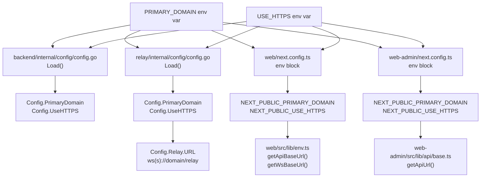
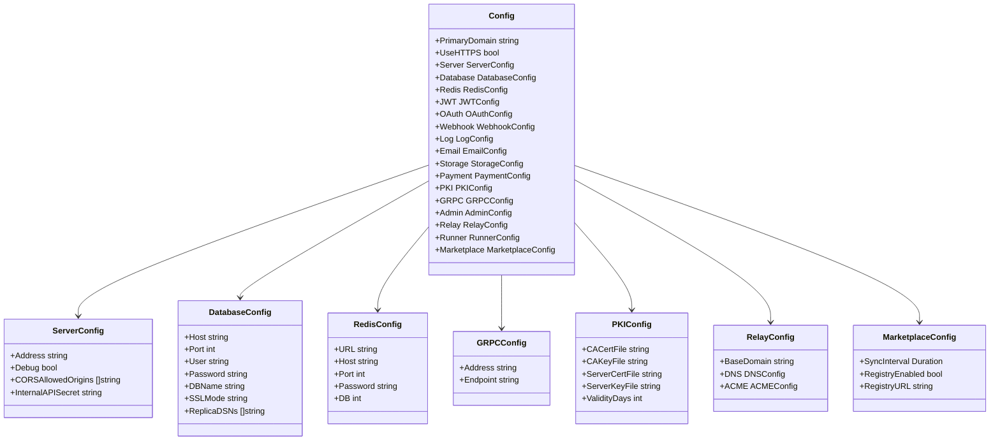
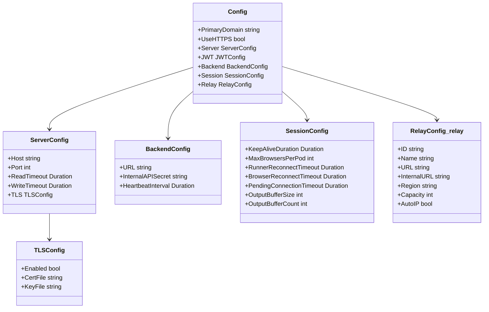
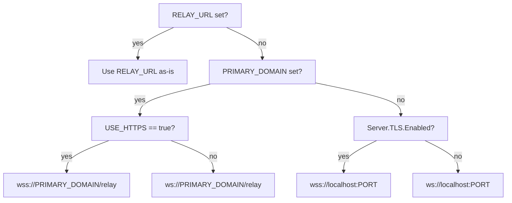
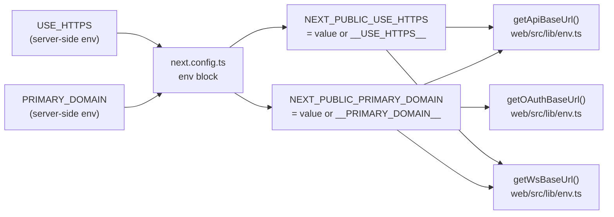

<!-- source: DeepWiki mcp.deepwiki.com · repo AgentsMesh/AgentsMesh · page 2.7 Configuration · fetched 2026-10-26 -->

# Configuration

Relevant source files

The following files were used as context for generating this wiki page:

- [backend/internal/api/rest/internal/relay_registration.go](backend/internal/api/rest/internal/relay_registration.go)
- [backend/internal/api/rest/internal/relay_registration_test.go](backend/internal/api/rest/internal/relay_registration_test.go)
- [backend/internal/config/config.go](backend/internal/config/config.go)
- [backend/internal/config/config_relay.go](backend/internal/config/config_relay.go)
- [backend/internal/service/relay/dns_service.go](backend/internal/service/relay/dns_service.go)
- [backend/internal/service/relay/dns_service_mock_test.go](backend/internal/service/relay/dns_service_mock_test.go)
- [backend/internal/service/relay/dns_service_sanitize_test.go](backend/internal/service/relay/dns_service_sanitize_test.go)
- [backend/migrations/000033_move_preparation_script_to_repository.down.sql](backend/migrations/000033_move_preparation_script_to_repository.down.sql)
- [backend/migrations/000033_move_preparation_script_to_repository.up.sql](backend/migrations/000033_move_preparation_script_to_repository.up.sql)
- [docs/images/logo.svg](docs/images/logo.svg)
- [relay/.env.example](relay/.env.example)
- [relay/internal/config/config.go](relay/internal/config/config.go)
- [relay/internal/config/config_test.go](relay/internal/config/config_test.go)
- [web-admin/.env.example](web-admin/.env.example)
- [web-admin/next.config.ts](web-admin/next.config.ts)
- [web-admin/src/lib/api/base.ts](web-admin/src/lib/api/base.ts)
- [web/next.config.ts](web/next.config.ts)
- [web/src/lib/env.ts](web/src/lib/env.ts)

This page covers the backend configuration system: how the backend and relay services load their settings from environment variables, and how the web frontends derive service URLs. The central design principle is a **unified domain pattern** — all services share `PRIMARY_DOMAIN` and `USE_HTTPS` as a single source of truth for URL derivation.

For frontend URL resolution logic in detail, see [Environment and API Configuration](#5.6). For relay session and heartbeat settings that affect runtime behavior, see [Backend Registration and Heartbeat](#4.2).

---

## The Unified Domain Pattern

All four services (Backend, Relay, Web, Web-Admin) share the same two root variables:

| Variable | Type | Example |
|---|---|---|
| `PRIMARY_DOMAIN` | string | `agentsmesh.ai`, `localhost:10000` |
| `USE_HTTPS` | bool | `true` / `false` |

Every service-specific URL (API base URL, WebSocket URL, relay public URL) is derived from these two values. Explicit per-URL environment variables take priority when set, allowing overrides for non-standard deployments.

**Unified Domain Derivation**

Sources: [backend/internal/config/config.go:29-32](), [relay/internal/config/config.go:30-36](), [web/next.config.ts:27-33](), [web-admin/next.config.ts:11-17]()

---

## Backend Configuration

### `Config` Struct

The top-level `Config` struct is defined in [backend/internal/config/config.go:11-32]() and contains named sub-structs for each subsystem, plus the two unified domain fields at the root level.

Sources: [backend/internal/config/config.go:11-32](), [backend/internal/config/config_relay.go:4-41]()

### `Load()` Function

`Load()` [backend/internal/config/config.go:49-234]() constructs the full `Config` by calling environment-variable helper functions. There is no config file; all values come from the process environment.

**Helper functions:**

| Function | Signature | Purpose |
|---|---|---|
| `getEnv` | `(key, default string) string` | Returns env var or default |
| `getEnvInt` | `(key string, default int) int` | Parses integer env var |
| `getEnvBool` | `(key string, default bool) bool` | Parses bool env var (`ParseBool`) |
| `getEnvDuration` | `(key string, default Duration) Duration` | Parses Go duration string |
| `getEnvList` | `(key string, default []string) []string` | Parses comma-separated list |

Sources: [backend/internal/config/config.go:240-296]()

### Backend Environment Variables Reference

| Environment Variable | Config Field | Default | Notes |
|---|---|---|---|
| `PRIMARY_DOMAIN` | `Config.PrimaryDomain` | `localhost:10000` | Shared with all services |
| `USE_HTTPS` | `Config.UseHTTPS` | `false` | Shared with all services |
| `SERVER_ADDRESS` | `Server.Address` | `:8080` | HTTP listen address |
| `DEBUG` | `Server.Debug` | `false` | |
| `CORS_ALLOWED_ORIGINS` | `Server.CORSAllowedOrigins` | `["*"]` | Comma-separated |
| `INTERNAL_API_SECRET` | `Server.InternalAPISecret` | `change-me-internal-secret` | Must change in production |
| `DB_HOST` | `Database.Host` | `localhost` | |
| `DB_PORT` | `Database.Port` | `5432` | |
| `DB_USER` | `Database.User` | `agentsmesh` | |
| `DB_PASSWORD` | `Database.Password` | _(empty)_ | |
| `DB_NAME` | `Database.DBName` | `agentsmesh` | |
| `DB_SSLMODE` | `Database.SSLMode` | `disable` | |
| `DB_REPLICA_DSNS` | `Database.ReplicaDSNs` | _(nil)_ | Comma-separated DSNs |
| `REDIS_URL` | `Redis.URL` | _(empty)_ | Full Redis URL |
| `REDIS_HOST` | `Redis.Host` | `localhost` | |
| `REDIS_PORT` | `Redis.Port` | `6379` | |
| `REDIS_PASSWORD` | `Redis.Password` | _(empty)_ | |
| `JWT_SECRET` | `JWT.Secret` | `change-me-in-production` | Must change in production |
| `JWT_EXPIRATION_HOURS` | `JWT.ExpirationHours` | `24` | |
| `GRPC_ADDRESS` | `GRPC.Address` | `:9090` | gRPC listen address |
| `GRPC_PUBLIC_ENDPOINT` | `GRPC.Endpoint` | _(empty)_ | Endpoint advertised to runners |
| `PKI_CA_CERT_FILE` | `PKI.CACertFile` | _(empty)_ | See [PKI and mTLS](#2.8) |
| `PKI_CA_KEY_FILE` | `PKI.CAKeyFile` | _(empty)_ | |
| `PKI_SERVER_CERT_FILE` | `PKI.ServerCertFile` | _(empty)_ | |
| `PKI_SERVER_KEY_FILE` | `PKI.ServerKeyFile` | _(empty)_ | |
| `PKI_VALIDITY_DAYS` | `PKI.ValidityDays` | `365` | |
| `ADMIN_ENABLED` | `Admin.Enabled` | `true` | |
| `DEPLOYMENT_TYPE` | `Payment.DeploymentType` | `global` | `"global"` or `"cn"` |
| `PAYMENT_MOCK` | `Payment.MockEnabled` | `false` | |
| `STRIPE_SECRET_KEY` | `Payment.Stripe.SecretKey` | _(empty)_ | |
| `LEMONSQUEEZY_API_KEY` | `Payment.LemonSqueezy.APIKey` | _(empty)_ | |
| `STORAGE_ENDPOINT` | `Storage.Endpoint` | _(empty)_ | S3-compatible endpoint |
| `STORAGE_BUCKET` | `Storage.Bucket` | `agentsmesh` | |
| `STORAGE_ACCESS_KEY` | `Storage.AccessKey` | _(empty)_ | |
| `STORAGE_SECRET_KEY` | `Storage.SecretKey` | _(empty)_ | |
| `EMAIL_PROVIDER` | `Email.Provider` | `console` | `"console"` or `"resend"` |
| `RESEND_API_KEY` | `Email.ResendKey` | _(empty)_ | |
| `LOG_LEVEL` | `Log.Level` | `info` | |
| `LOG_FORMAT` | `Log.Format` | `text` | |
| `MARKETPLACE_SYNC_INTERVAL` | `Marketplace.SyncInterval` | `1h` | Go duration string |
| `MCP_REGISTRY_ENABLED` | `Marketplace.RegistryEnabled` | `true` | |
| `MCP_REGISTRY_URL` | `Marketplace.RegistryURL` | `https://registry.modelcontextprotocol.io` | |

Sources: [backend/internal/config/config.go:49-234]()

### Relay Management Configuration (Backend-side)

The backend's `RelayConfig` [backend/internal/config/config_relay.go:4-41]() configures how the backend manages relay DNS records and TLS certificates — distinct from the relay service's own configuration.

`RelayConfig.IsEnabled()` returns `true` only when both `BaseDomain` and `DNS.Provider` are non-empty.

| Environment Variable | Config Field | Purpose |
|---|---|---|
| `RELAY_BASE_DOMAIN` | `Relay.BaseDomain` | Base for relay subdomains (e.g., `relay.agentsmesh.cn`) |
| `DNS_PROVIDER` | `Relay.DNS.Provider` | `"cloudflare"` or `"aliyun"` |
| `CLOUDFLARE_API_TOKEN` | `Relay.DNS.CloudflareAPIToken` | Cloudflare DNS token |
| `CLOUDFLARE_ZONE_ID` | `Relay.DNS.CloudflareZoneID` | Cloudflare zone ID |
| `ALIYUN_ACCESS_KEY_ID` | `Relay.DNS.AliyunAccessKeyID` | Aliyun DNS access key |
| `ALIYUN_ACCESS_KEY_SECRET` | `Relay.DNS.AliyunAccessKeySecret` | Aliyun DNS secret |
| `ACME_ENABLED` | `Relay.ACME.Enabled` | Enable Let's Encrypt management |
| `ACME_EMAIL` | `Relay.ACME.Email` | Let's Encrypt registration email |
| `ACME_DIRECTORY_URL` | `Relay.ACME.DirectoryURL` | ACME directory (empty = production LE) |
| `ACME_STORAGE_DIR` | `Relay.ACME.StorageDir` | Certificate storage path |
| `ACME_STAGING` | `Relay.ACME.Staging` | Use LE staging environment |

Sources: [backend/internal/config/config_relay.go:1-50](), [backend/internal/config/config.go:215-233]()

---

## Relay Service Configuration

The relay service uses [Viper](https://github.com/spf13/viper) for configuration, defined in [relay/internal/config/config.go:14-36]().

### `Config` Struct (Relay)

Sources: [relay/internal/config/config.go:14-87]()

### Relay URL Derivation

The relay's `Load()` function [relay/internal/config/config.go:90-221]() derives `Relay.URL` automatically when `RELAY_URL` is not explicitly set:

**Relay URL derivation logic**

Sources: [relay/internal/config/config.go:198-215]()

### Relay Environment Variables Reference

The relay uses Viper with `RELAY_` prefix auto-mapping, plus explicit mappings for unprefixed variable names. Both `FOO` and `RELAY_FOO` are accepted for most settings.

| Environment Variable | Config Field | Default | Notes |
|---|---|---|---|
| `PRIMARY_DOMAIN` | `PrimaryDomain` | _(empty)_ | Shared unified domain |
| `USE_HTTPS` | `UseHTTPS` | `false` | Shared unified domain |
| `JWT_SECRET` | `JWT.Secret` | _(required)_ | Must match backend |
| `JWT_ISSUER` | `JWT.Issuer` | `agentsmesh-relay` | |
| `INTERNAL_API_SECRET` | `Backend.InternalAPISecret` | _(required)_ | Must match backend |
| `SERVER_HOST` | `Server.Host` | `0.0.0.0` | |
| `SERVER_PORT` | `Server.Port` | `8090` | |
| `TLS_ENABLED` | `Server.TLS.Enabled` | `false` | |
| `TLS_CERT_FILE` | `Server.TLS.CertFile` | _(empty)_ | |
| `TLS_KEY_FILE` | `Server.TLS.KeyFile` | _(empty)_ | |
| `BACKEND_URL` | `Backend.URL` | `http://backend:8080` | |
| `HEARTBEAT_INTERVAL` | `Backend.HeartbeatInterval` | `10s` | |
| `KEEP_ALIVE_DURATION` | `Session.KeepAliveDuration` | `30s` | |
| `MAX_BROWSERS_PER_POD` | `Session.MaxBrowsersPerPod` | `10` | |
| `RUNNER_RECONNECT_TIMEOUT` | `Session.RunnerReconnectTimeout` | `30s` | |
| `BROWSER_RECONNECT_TIMEOUT` | `Session.BrowserReconnectTimeout` | `30s` | |
| `PENDING_CONNECTION_TIMEOUT` | `Session.PendingConnectionTimeout` | `60s` | |
| `OUTPUT_BUFFER_SIZE` | `Session.OutputBufferSize` | `262144` (256 KB) | Bytes |
| `OUTPUT_BUFFER_COUNT` | `Session.OutputBufferCount` | `200` | Messages |
| `RELAY_ID` | `Relay.ID` | `relay-<hostname>` | Auto-generated if empty |
| `RELAY_NAME` | `Relay.Name` | _(empty)_ | Used for DNS sub-domain |
| `RELAY_URL` | `Relay.URL` | _derived_ | Derived from `PRIMARY_DOMAIN` |
| `RELAY_INTERNAL_URL` | `Relay.InternalURL` | _(empty)_ | Docker-internal URL for runners |
| `RELAY_REGION` | `Relay.Region` | `default` | |
| `RELAY_CAPACITY` | `Relay.Capacity` | `1000` | Max concurrent sessions |
| `RELAY_AUTO_IP` | `Relay.AutoIP` | `false` | Auto-detect public IP |

Sources: [relay/internal/config/config.go:90-165](), [relay/.env.example:1-58]()

The relay config also supports a YAML file at `./config.yaml` or `/etc/relay/config.yaml`, read via Viper's `ReadInConfig` [relay/internal/config/config.go:167-176]().

---

## Frontend Configuration

Both `web` and `web-admin` follow the same pattern. `PRIMARY_DOMAIN` and `USE_HTTPS` are mapped at build time to `NEXT_PUBLIC_` variables, but using placeholder strings (`__PRIMARY_DOMAIN__`, `__USE_HTTPS__`) so the Docker entrypoint can perform runtime string substitution in the built output.

**Next.js build-time env injection**

Sources: [web/next.config.ts:27-33](), [web-admin/next.config.ts:11-17](), [web/src/lib/env.ts:46-80]()

The `getPrimaryDomain()` helper [web/src/lib/env.ts:46-50]() filters out unreplaced placeholders by checking if the value starts with `__`, treating them as absent.

### Frontend URL Resolution Priority

Each exported function in `web/src/lib/env.ts` applies the same resolution order:

| Priority | Condition | Result |
|---|---|---|
| 1 | `NEXT_PUBLIC_API_URL=""` | Returns `""` (relative path; proxied by Next.js rewrites in dev) |
| 2 | `NEXT_PUBLIC_API_URL` is set | Returns that value |
| 3 | Running in browser (`window` defined) | Returns `window.location.origin` |
| 4 | `PRIMARY_DOMAIN` set (SSR) | Derives `http(s)://PRIMARY_DOMAIN` |
| 5 | Fallback | `http://localhost:10000` |

For WebSocket URLs (`getWsBaseUrl()`), the same order applies with `ws`/`wss` protocols. Note: when `NEXT_PUBLIC_API_URL=""` (local dev mode), `getWsBaseUrl()` cannot use `window.location` (which points at the Next.js dev server) and instead falls back to `PRIMARY_DOMAIN` derivation.

Sources: [web/src/lib/env.ts:92-177]()

### Frontend Environment Variables

| Variable | Used by | Purpose |
|---|---|---|
| `PRIMARY_DOMAIN` | `web`, `web-admin` | Mapped to `NEXT_PUBLIC_PRIMARY_DOMAIN` at build time |
| `USE_HTTPS` | `web`, `web-admin` | Mapped to `NEXT_PUBLIC_USE_HTTPS` at build time |
| `NEXT_PUBLIC_API_URL` | `web` | Explicit API base URL override |
| `NEXT_PUBLIC_WS_URL` | `web` | Explicit WebSocket URL override |
| `NEXT_PUBLIC_OAUTH_URL` | `web` | Explicit OAuth redirect URL override |
| `API_PROXY_TARGET` | `web` (dev only) | Backend URL for Next.js rewrite proxy |
| `ALLOWED_DEV_ORIGINS` | `web` | Comma-separated allowed dev origins |

Sources: [web/src/lib/env.ts:1-36](), [web/next.config.ts:8-58](), [web-admin/.env.example:1-28]()

---

## Deployment Scenarios

| Scenario | `PRIMARY_DOMAIN` | `USE_HTTPS` | Notes |
|---|---|---|---|
| Local dev (`dev.sh`) | not set | `false` | `NEXT_PUBLIC_API_URL=""` enables Next.js proxy |
| On-premise (IP-based) | not set | `false` | Frontend uses `window.location.origin` automatically |
| SaaS production | `agentsmesh.ai` | `true` | All services derive HTTPS/WSS URLs |
| Self-hosted with domain | `example.com` | `true` | Same as SaaS pattern |
| Self-hosted local port | `192.168.1.10:10000` | `false` | Port included in domain string |

Sources: [web/src/lib/env.ts:1-36](), [relay/.env.example:1-15](), [web-admin/.env.example:1-15]()

---

