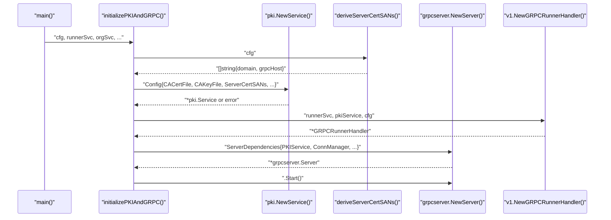
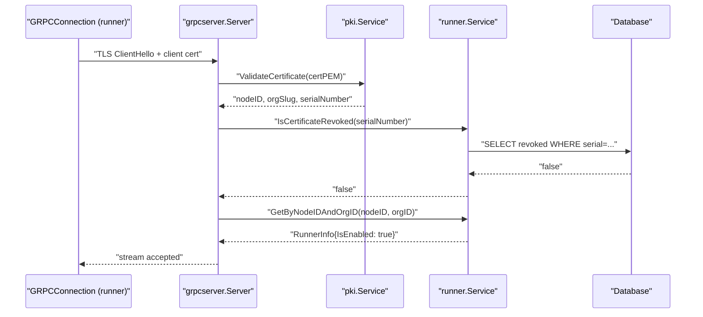
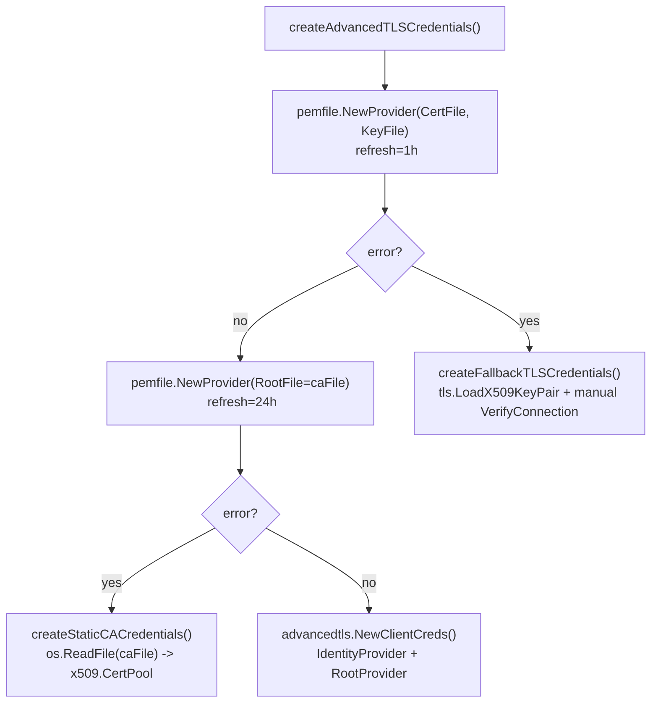
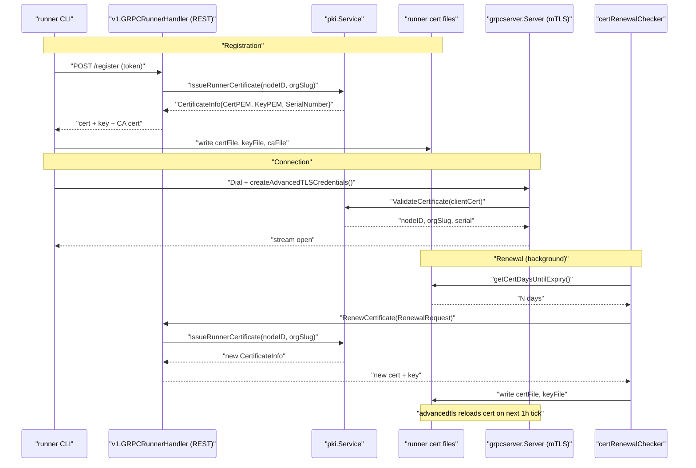

<!-- source: DeepWiki mcp.deepwiki.com · repo AgentsMesh/AgentsMesh · page 2.8 PKI and mTLS · fetched 2026-10-26 -->

# PKI and mTLS

<details>
<summary>Relevant source files</summary>

The following files were used as context for generating this wiki page:

- [backend/cmd/server/grpc_init.go](backend/cmd/server/grpc_init.go)
- [backend/cmd/server/grpc_init_test.go](backend/cmd/server/grpc_init_test.go)
- [backend/internal/infra/pki/service.go](backend/internal/infra/pki/service.go)
- [backend/internal/infra/pki/service_server.go](backend/internal/infra/pki/service_server.go)
- [backend/internal/infra/pki/service_test.go](backend/internal/infra/pki/service_test.go)
- [runner/internal/client/grpc_connection_options.go](runner/internal/client/grpc_connection_options.go)
- [runner/internal/client/grpc_tls.go](runner/internal/client/grpc_tls.go)

</details>


This page covers the public key infrastructure (PKI) used to authenticate runners to the backend, and how mutual TLS (mTLS) is enforced on the gRPC control-plane connection. For how the gRPC connection itself is managed on the runner side, see [3.3](#3.3). For how the gRPC server handles incoming runner streams, see [2.2](#2.2) and [2.3](#2.3). For the REST API endpoints that expose certificate issuance and renewal, see [2.1](#2.1).

---

## Overview

AgentsMesh uses a private CA (Certificate Authority) to issue certificates exclusively to registered runners. Every runner authenticates to the gRPC server by presenting its client certificate during the TLS handshake. The server validates the certificate chain and cross-checks the serial number against the database before accepting the connection. This replaces bearer-token auth for the long-lived gRPC stream.

**Key responsibilities of the PKI subsystem:**

| Responsibility | Component |
|---|---|
| CA loading and certificate issuance | `pki.Service` (backend) |
| Server TLS certificate provisioning | `pki.Service.generateServerCert` |
| gRPC server mTLS enforcement | `grpcserver.Server` |
| Runner client TLS with hot-reload | `GRPCConnection.createAdvancedTLSCredentials` |
| Certificate renewal (REST-triggered) | `GRPCRunnerHandler` + `RenewCertificate` |
| Revocation checking | `runner.Service.IsCertificateRevoked` |

---

## PKI Service (`pki.Service`)

The `pki.Service` struct in [backend/internal/infra/pki/service.go]() is the central authority on the backend. It is constructed once at startup by `initializePKIAndGRPC` in [backend/cmd/server/grpc_init.go]().

### Data model

```
pki.Service
├── caCert       *x509.Certificate
├── caKey        crypto.PrivateKey
├── caCertPEM    []byte            ← sent to runners on registration
├── serverCert   tls.Certificate   ← used by gRPC server
├── certPool     *x509.CertPool    ← validates runner client certs
└── validityDays int               ← default 365
```

Sources: [backend/internal/infra/pki/service.go:16-23]()

### Configuration (`pki.Config`)

| Field | Type | Purpose |
|---|---|---|
| `CACertFile` | `string` | Path to PEM-encoded CA certificate |
| `CAKeyFile` | `string` | Path to PEM-encoded CA private key |
| `ServerCertFile` | `string` | Optional: path to pre-existing server cert |
| `ServerKeyFile` | `string` | Optional: path to pre-existing server key |
| `ValidityDays` | `int` | Runner cert validity (default: 365) |
| `ServerCertSANs` | `[]string` | Extra DNS SANs for the auto-generated server cert |

Sources: [backend/internal/infra/pki/service.go:26-33]()

### Initialization

`NewService` in [backend/internal/infra/pki/service.go:46-95]() performs the following steps on startup:

1. Read and parse `CACertFile` + `CAKeyFile` via `parseCA`.
2. Build `certPool` from the parsed CA cert (used as the client auth root).
3. Apply default `validityDays = 365` if not set.
4. Call `loadOrGenerateServerCert` — load from `ServerCertFile`/`ServerKeyFile` if they exist, otherwise generate in-memory via `generateServerCert`.

`parseCA` in [backend/internal/infra/pki/service.go:98-133]() accepts PKCS#8, EC, and RSA private key formats for the CA key.

---

## Certificate Issuance

### Runner certificates

`IssueRunnerCertificate(nodeID, orgSlug string)` issues a short-lived client certificate for a runner. The resulting `CertificateInfo` struct is returned to the caller (the REST handler) which writes it to disk on the runner.

**Certificate attributes:**

| X.509 Field | Value |
|---|---|
| `CommonName` | `nodeID` |
| `Organization` | `[orgSlug]` |
| `OrganizationalUnit` | `["runners"]` |
| `ExtKeyUsage` | `ClientAuth` |
| `KeyUsage` | `DigitalSignature` |
| `NotAfter` | `now + validityDays` |

The `SerialNumber` from `CertificateInfo` is stored in the database on the runner record (`CertSerialNumber` column), enabling revocation checks later.

```
CertificateInfo {
    CertPEM      []byte
    KeyPEM       []byte
    SerialNumber string
    Fingerprint  string
    IssuedAt     time.Time
    ExpiresAt    time.Time
}
```

Sources: [backend/internal/infra/pki/service.go:36-43](), [backend/internal/infra/pki/service_test.go:117-152]()

### Certificate validation

`ValidateCertificate(certPEM []byte)` is called during the gRPC handshake. It:

1. Decodes the PEM block.
2. Verifies the certificate chain against `certPool` (the private CA).
3. Returns `(nodeID, orgSlug, serialNumber, error)` extracted from the cert's Subject fields.

A certificate signed by any other CA will fail step 2 with `"certificate verification failed"`.

Sources: [backend/internal/infra/pki/service_test.go:172-241]()

---

## Server Certificate

The gRPC server presents a certificate to the connecting runner. This is either loaded from disk (`ServerCertFile`/`ServerKeyFile`) or generated in-memory by `generateServerCert` in [backend/internal/infra/pki/service_server.go:34-91]().

### Default SANs

The auto-generated server certificate always includes these DNS SANs:

- `localhost`
- `backend`
- `agentmesh-backend`

### Derived SANs

`deriveServerCertSANs(cfg)` in [backend/cmd/server/grpc_init.go:234-259]() appends additional SANs derived from the runtime config:

- Hostname extracted from `cfg.PrimaryDomain` (port stripped)
- Hostname extracted from `cfg.GRPC.Endpoint` URL

Duplicates are deduplicated. Examples:

| Config | Derived SANs |
|---|---|
| `PrimaryDomain="agentsmesh.cn"`, `GRPC.Endpoint="grpcs://api.agentsmesh.cn:9443"` | `agentsmesh.cn`, `api.agentsmesh.cn` |
| `PrimaryDomain="localhost:10000"` | `localhost` (already default) |
| `GRPC.Endpoint="grpcs://grpc.example.com:9443"` | `grpc.example.com` |

> **Note:** The runner's TLS credential layer deliberately skips hostname verification (see [Runner TLS](#runner-side-tls) below), so the server cert SANs do not need to exactly match the dial target. SANs are derived anyway for environments where standard TLS verification is desired.

Sources: [backend/cmd/server/grpc_init.go:227-259](), [backend/internal/infra/pki/service_server.go:34-91](), [backend/internal/infra/pki/service_test.go:268-365]()

---

## PKI Initialization Flow

**Diagram: PKI and gRPC server initialization**



Sources: [backend/cmd/server/grpc_init.go:22-107]()

---

## mTLS Enforcement on the gRPC Server

The gRPC server is configured with `tls.RequireAndVerifyClientCert` mode. When a runner connects:

1. The runner presents its client certificate (CN=nodeID, O=orgSlug).
2. The gRPC layer verifies the chain against `pki.Service.CACertPool()`.
3. The server-side handler extracts `nodeID` and `orgSlug` from the cert via `ValidateCertificate`.
4. `runner.Service.IsCertificateRevoked(ctx, serialNumber)` is called — if revoked, the stream is rejected.
5. The runner record is fetched from the database by `nodeID` + `orgID` to confirm the runner is enabled.

**Diagram: mTLS handshake and runner identity resolution**



Sources: [backend/cmd/server/grpc_init.go:109-165](), [backend/internal/infra/pki/service.go:135-154]()

---

## Runner-Side TLS

The runner manages its own certificate files on disk. These are loaded and presented to the server on each connection. The relevant code lives in [runner/internal/client/grpc_tls.go]().

### Certificate files

The `GRPCConnection` struct references three file paths:

| Field | Content |
|---|---|
| `certFile` | Runner client certificate (PEM) |
| `keyFile` | Runner client private key (PEM) |
| `caFile` | Backend CA certificate (PEM) |

### Three-tier TLS credential fallback

`createAdvancedTLSCredentials()` is called when establishing the gRPC connection. It attempts three strategies in order:

**Diagram: TLS credential provider selection**



Sources: [runner/internal/client/grpc_tls.go:26-73](), [runner/internal/client/grpc_tls.go:77-106](), [runner/internal/client/grpc_tls.go:114-156]()

### Verification mode: chain-only, no hostname check

All three strategies set `VerificationType: advancedtls.CertVerification` (or equivalent) instead of the default `VerificationType: CertAndHostVerification`. This is intentional:

- The server certificate SANs may not include the public-facing hostname (e.g., `api.agentsmesh.cn`).
- SNI is set to the dial target hostname so Traefik can route gRPC traffic correctly.
- The private CA ensures only our own server certificates are trusted — the hostname check is redundant in this trust model.

The fallback path (`createFallbackTLSCredentials`) uses `InsecureSkipVerify: true` combined with a manual `VerifyConnection` callback that performs the chain verification without hostname matching.

Sources: [runner/internal/client/grpc_tls.go:22-73](), [runner/internal/client/grpc_tls.go:108-156]()

### Certificate hot-reloading

When the primary path succeeds, both `pemfile.Provider` instances are stored as `identityProvider` and `rootProvider` on the `GRPCConnection` struct. The `advancedtls` library polls these providers on a timer:

| Provider | File(s) | Refresh interval |
|---|---|---|
| `identityProvider` | `certFile`, `keyFile` | 1 hour |
| `rootProvider` | `caFile` | 24 hours |

When a renewed certificate is written to `certFile`, the running gRPC connection picks it up on the next provider refresh without reconnecting.

Sources: [runner/internal/client/grpc_tls.go:28-47]()

---

## Certificate Renewal

### Renewal loop

`certRenewalChecker(ctx, done)` runs as a background goroutine within the runner. It ticks on `certRenewalCheckInterval` and calls `checkCertificateExpiry()`.

`checkCertificateExpiry` computes days until expiry via `getCertDaysUntilExpiry`:

| Condition | Action |
|---|---|
| `daysUntilExpiry <= certRenewalDays` | Call `renewCertificate()` (REST API) |
| `daysUntilExpiry <= certUrgentDays` | Call `triggerReconnect()` (force reconnect) |

Sources: [runner/internal/client/grpc_tls.go:158-200]()

### Renewal via REST API

`renewCertificate()` calls `RenewCertificate(ctx, RenewalRequest{...})` which posts to the backend REST endpoint handled by `v1.GRPCRunnerHandler`. The `RenewalRequest` carries `ServerURL`, `CertFile`, `KeyFile`, `CAFile`.

On success, the new cert and key PEM are written to `certFile` and `keyFile`. Because `advancedtls` hot-reloads on a 1-hour cycle, no reconnect is required unless the cert is already in the urgent window.

```
RenewalRequest {
    ServerURL string
    CertFile  string
    KeyFile   string
    CAFile    string
}
```

Sources: [runner/internal/client/grpc_tls.go:267-298]()

### Configurable thresholds

These thresholds are set via `GRPCConnectionOption` functions at construction time:

| Option | Field | Meaning |
|---|---|---|
| `WithGRPCCertRenewalDays(n)` | `certRenewalDays` | Days before expiry to trigger REST renewal |
| `WithGRPCCertUrgentDays(n)` | `certUrgentDays` | Days before expiry to force reconnection |
| `WithGRPCServerURL(url)` | `serverURL` | Backend REST base URL for renewal calls |

Sources: [runner/internal/client/grpc_connection_options.go:53-65]()

---

## End-to-End Certificate Lifecycle

**Diagram: Full certificate lifecycle from registration to renewal**



Sources: [runner/internal/client/grpc_tls.go](), [backend/cmd/server/grpc_init.go](), [backend/internal/infra/pki/service.go]()

---

## Configuration Reference

Backend PKI config fields come from the `cfg.PKI` struct (see [2.7](#2.7) for the full config system). The relevant keys are:

| Config field | Environment variable pattern | Default |
|---|---|---|
| `PKI.CACertFile` | `PKI_CA_CERT_FILE` | Required |
| `PKI.CAKeyFile` | `PKI_CA_KEY_FILE` | Required |
| `PKI.ServerCertFile` | `PKI_SERVER_CERT_FILE` | Optional (auto-generated) |
| `PKI.ServerKeyFile` | `PKI_SERVER_KEY_FILE` | Optional (auto-generated) |
| `PKI.ValidityDays` | `PKI_VALIDITY_DAYS` | `365` |

Runner-side cert file paths are written at registration time by the installer/register command (see [3.1](#3.1)) and are referenced by the `GRPCConnection` using the `certFile`, `keyFile`, and `caFile` fields.

Sources: [backend/internal/infra/pki/service.go:26-33](), [backend/cmd/server/grpc_init.go:34-50]()

---

