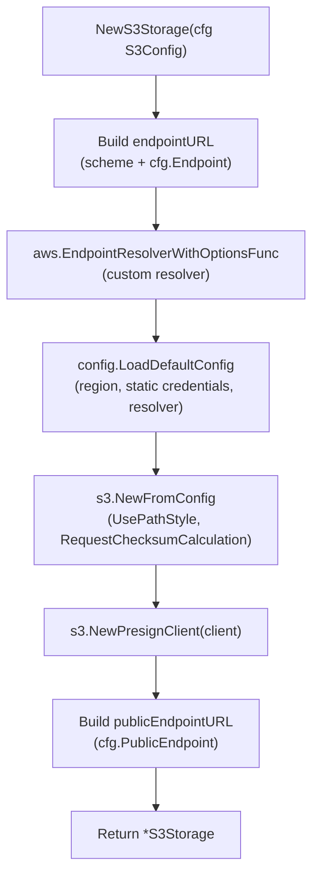
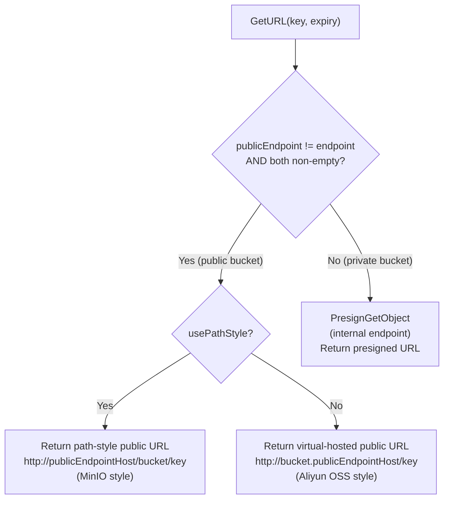
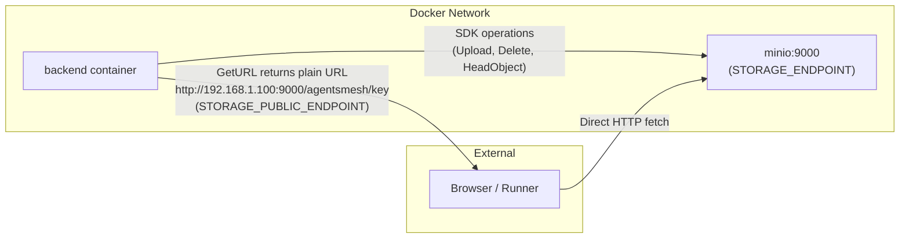
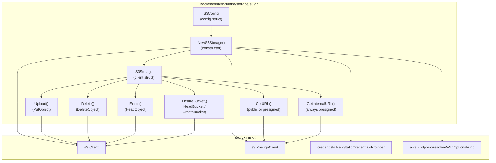

<!-- source: DeepWiki mcp.deepwiki.com · repo AgentsMesh/AgentsMesh · page 2.9 Object Storage · fetched 2026-10-26 -->

# Object Storage

Relevant source files

The following files were used as context for generating this wiki page:

- [backend/internal/infra/storage/s3.go](backend/internal/infra/storage/s3.go)
- [ci/build-onpremise.sh](ci/build-onpremise.sh)
- [ci/pack-onpremise.sh](ci/pack-onpremise.sh)
- [deploy/dev/runner-ssh/README.md](deploy/dev/runner-ssh/README.md)
- [deploy/onpremise/README.md](deploy/onpremise/README.md)
- [deploy/onpremise/docker-compose.yml](deploy/onpremise/docker-compose.yml)
- [deploy/onpremise/scripts/generate-certs.sh](deploy/onpremise/scripts/generate-certs.sh)
- [deploy/onpremise/scripts/install.sh](deploy/onpremise/scripts/install.sh)
- [deploy/onpremise/scripts/load-images.sh](deploy/onpremise/scripts/load-images.sh)
- [deploy/onpremise/seed/onpremise-seed.sql](deploy/onpremise/seed/onpremise-seed.sql)
- [e2e/README.md](e2e/README.md)

This page documents the S3-compatible object storage layer used by the AgentsMesh backend. It covers the `S3Storage` implementation, configuration fields, upload/download operations, URL generation strategy, and MinIO integration for on-premise and local development deployments.

For deployment-level MinIO setup in the on-premise Docker Compose stack, see [On-Premise Deployment](#8.3). For the backend configuration system that loads the storage environment variables, see [Configuration](#2.7).

---

## Overview

The backend uses a single `S3Storage` type in `backend/internal/infra/storage/s3.go` to interact with any S3-compatible object store. The implementation uses the AWS SDK v2 (`aws-sdk-go-v2`) and is compatible with:

- **AWS S3** — standard use, no endpoint override
- **MinIO** — path-style URLs, used in local dev and on-premise
- **Aliyun OSS** — virtual-hosted-style URLs; checksum calculation is disabled for OSS compatibility

**Sources:** [backend/internal/infra/storage/s3.go:1-14]()

---

## Data Structures

### `S3Config`

Holds all parameters needed to construct an `S3Storage` instance.

| Field | Type | Description |
|---|---|---|
| `Endpoint` | `string` | Internal S3 endpoint host (e.g. `minio:9000`). Empty for AWS. |
| `PublicEndpoint` | `string` | Browser-accessible endpoint host, if different from `Endpoint` (e.g. `192.168.1.100:9000`). |
| `Region` | `string` | AWS region or equivalent (e.g. `us-east-1`). |
| `Bucket` | `string` | Bucket name for all object operations. |
| `AccessKey` | `string` | Access key ID for authentication. |
| `SecretKey` | `string` | Secret access key for authentication. |
| `UseSSL` | `bool` | Whether to use HTTPS for the endpoint URL. |
| `UsePathStyle` | `bool` | Use path-style URLs (`http://host/bucket/key`) instead of virtual-hosted style (`http://bucket.host/key`). Required for MinIO. |

**Sources:** [backend/internal/infra/storage/s3.go:17-26]()

### `S3Storage`

The runtime storage client. Constructed by `NewS3Storage`.

| Field | Description |
|---|---|
| `client` | `*s3.Client` — the AWS SDK S3 client for all object operations. |
| `presign` | `*s3.PresignClient` — dedicated client for generating presigned URLs. |
| `bucket` | The configured bucket name. |
| `endpoint` | Full internal endpoint URL (scheme + host). |
| `publicEndpoint` | Full public endpoint URL (scheme + host). |
| `publicEndpointHost` | Public endpoint host only (no scheme), used for URL construction. |
| `useSSL` | Whether HTTPS is used. |
| `usePathStyle` | Whether path-style URLs are used. |

**Sources:** [backend/internal/infra/storage/s3.go:28-38]()

---

## Construction

**`NewS3Storage(cfg S3Config) (*S3Storage, error)`**

[backend/internal/infra/storage/s3.go:41-108]()

The constructor performs the following steps:

1. **Builds the endpoint URL** by prepending the appropriate scheme (`http` or `https`) to `cfg.Endpoint` if set.
2. **Registers a custom endpoint resolver** via `aws.EndpointResolverWithOptionsFunc`. When `cfg.Endpoint` is non-empty, it routes all S3 SDK calls to the custom endpoint.
3. **Loads AWS SDK config** with static credentials (`credentials.NewStaticCredentialsProvider`) and the custom resolver.
4. **Creates the `s3.Client`** with `UsePathStyle` and `RequestChecksumCalculationWhenRequired`. The checksum option is set to `aws.RequestChecksumCalculationWhenRequired` to disable the `aws-chunked` transfer encoding that Aliyun OSS does not support.
5. **Constructs public endpoint fields** from `cfg.PublicEndpoint` if it differs from the internal endpoint.

**Initialization flow diagram:**

**Sources:** [backend/internal/infra/storage/s3.go:41-108]()

---

## Operations

### Upload

**`(s *S3Storage) Upload(ctx, key, reader, size, contentType) (*FileInfo, error)`**

[backend/internal/infra/storage/s3.go:111-143]()

Reads the entire body into memory via `io.ReadAll` before calling `s3.PutObject`. This bypasses chunked encoding, which is required for Aliyun OSS compatibility. Returns a `FileInfo` struct containing the object key, size, content type, and ETag from the response.

> **Note:** The full body is buffered in memory before upload. This limits practical single-file size. The `STORAGE_MAX_FILE_SIZE` environment variable is enforced at the API layer, not in this function.

### Delete

**`(s *S3Storage) Delete(ctx, key) error`**

[backend/internal/infra/storage/s3.go:146-155]()

Calls `s3.DeleteObject` on the configured bucket with the given key.

### Exists

**`(s *S3Storage) Exists(ctx, key) (bool, error)`**

[backend/internal/infra/storage/s3.go:204-215]()

Uses `s3.HeadObject` to check for object presence. Returns `false` (without error) if the object is absent — the AWS SDK v2 does not expose a typed not-found error, so the error is checked implicitly.

### EnsureBucket

**`(s *S3Storage) EnsureBucket(ctx) error`**

[backend/internal/infra/storage/s3.go:218-236]()

Issues a `HeadBucket` call. If the bucket does not exist, it calls `CreateBucket`. Used during backend initialization to ensure the configured bucket is ready.

---

## URL Generation

URL generation is the most complex part of `S3Storage` because the internal endpoint (used for SDK operations) may differ from the public endpoint (used to serve browsers or runners).

### `GetURL` — Public URL

**`(s *S3Storage) GetURL(ctx, key, expiry) (string, error)`**

[backend/internal/infra/storage/s3.go:160-186]()

**Decision logic:**

When `publicEndpoint` is set and differs from `endpoint`, the file is assumed to be on a publicly accessible bucket and a plain URL is returned (no signing). When the endpoints are the same (or `publicEndpoint` is empty), a presigned URL is generated using `s3.PresignClient.PresignGetObject`.

**Sources:** [backend/internal/infra/storage/s3.go:157-186]()

### `GetInternalURL` — Service-to-Service URL

**`(s *S3Storage) GetInternalURL(ctx, key, expiry) (string, error)`**

[backend/internal/infra/storage/s3.go:191-201]()

Always generates a presigned URL using the internal endpoint, bypassing `publicEndpoint`. This is intended for service-to-service downloads — for example, a Runner downloading a skill package from within the Docker network where the public endpoint is not routable.

**Comparison of URL methods:**

| Method | Uses Public Endpoint? | Presigned? | Intended Consumer |
|---|---|---|---|
| `GetURL` | Yes (if set and different) | Conditionally | Browser clients |
| `GetInternalURL` | Never | Always | Runner / backend-to-backend |

**Sources:** [backend/internal/infra/storage/s3.go:191-201]()

---

## Configuration via Environment Variables

The backend reads storage configuration from environment variables and maps them to `S3Config`. From the on-premise Docker Compose definition:

[deploy/onpremise/docker-compose.yml:131-141]()

| Environment Variable | Maps to `S3Config` field | Example Value |
|---|---|---|
| `STORAGE_ENDPOINT` | `Endpoint` | `minio:9000` |
| `STORAGE_PUBLIC_ENDPOINT` | `PublicEndpoint` | `192.168.1.100:9000` |
| `STORAGE_REGION` | `Region` | `us-east-1` |
| `STORAGE_BUCKET` | `Bucket` | `agentsmesh` |
| `STORAGE_ACCESS_KEY` | `AccessKey` | `minioadmin` |
| `STORAGE_SECRET_KEY` | `SecretKey` | `<generated>` |
| `STORAGE_USE_SSL` | `UseSSL` | `false` |
| `STORAGE_USE_PATH_STYLE` | `UsePathStyle` | `true` |
| `STORAGE_MAX_FILE_SIZE` | _(API layer only)_ | `10` (MB) |
| `STORAGE_ALLOWED_TYPES` | _(API layer only)_ | `image/jpeg,image/png,...` |

**Sources:** [deploy/onpremise/docker-compose.yml:129-141]()

---

## MinIO Integration

MinIO is the default object store for both the local development environment and on-premise deployments. It exposes an S3-compatible API and requires two specific settings:

- `UsePathStyle = true` — MinIO does not support virtual-hosted-style bucket URLs.
- `PublicEndpoint` set to a browser-accessible address — the internal Docker hostname (e.g. `minio:9000`) is not reachable from browsers or runners outside the Docker network.

**Endpoint split example (on-premise):**

The MinIO management console is available at port `9001` in the on-premise stack and at `http://{SERVER_IP}:9001` after installation.

**Sources:** [deploy/onpremise/docker-compose.yml:57-73](), [backend/internal/infra/storage/s3.go:160-186]()

---

## Code Entity Map

**Sources:** [backend/internal/infra/storage/s3.go:1-236]()

---

