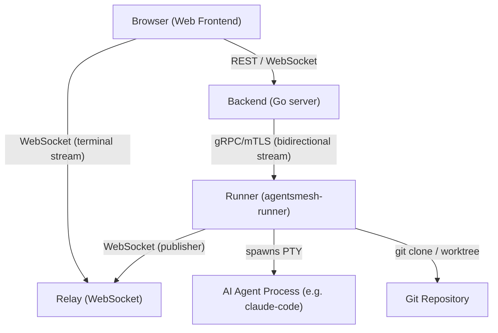
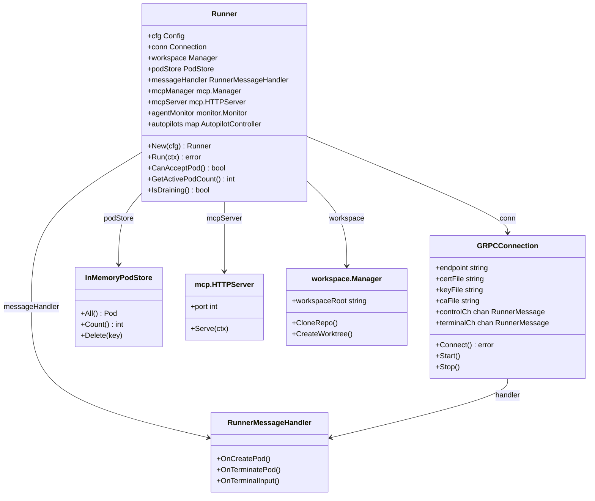
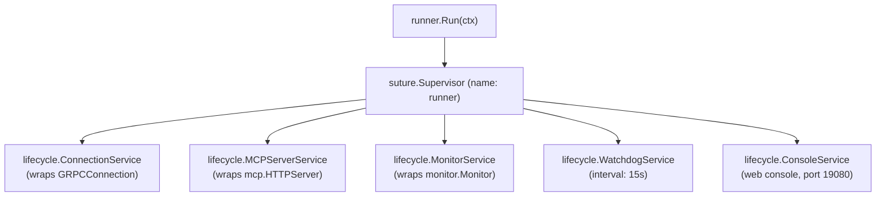
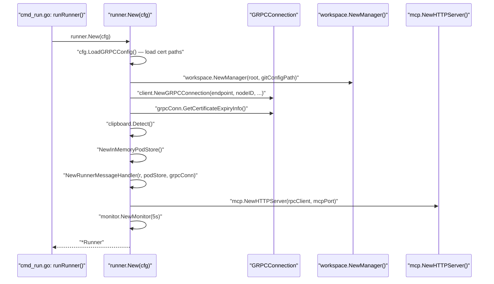

<!-- source: DeepWiki mcp.deepwiki.com · repo AgentsMesh/AgentsMesh · page 3 Runner · fetched 2026-10-26 -->

# Runner

<details>
<summary>Relevant source files</summary>

The following files were used as context for generating this wiki page:

- [runner/.goreleaser.yml](runner/.goreleaser.yml)
- [runner/README.md](runner/README.md)
- [runner/cmd/runner/cmd_reactivate.go](runner/cmd/runner/cmd_reactivate.go)
- [runner/cmd/runner/cmd_register.go](runner/cmd/runner/cmd_register.go)
- [runner/cmd/runner/cmd_run.go](runner/cmd/runner/cmd_run.go)
- [runner/cmd/runner/main.go](runner/cmd/runner/main.go)
- [runner/cmd/runner/register.go](runner/cmd/runner/register.go)
- [runner/cmd/runner/service.go](runner/cmd/runner/service.go)
- [runner/cmd/runner/update.go](runner/cmd/runner/update.go)
- [runner/cmd/runner/webconsole.go](runner/cmd/runner/webconsole.go)
- [runner/internal/client/grpc_connection.go](runner/internal/client/grpc_connection.go)
- [runner/internal/config/config.go](runner/internal/config/config.go)
- [runner/internal/config/config_defaults_test.go](runner/internal/config/config_defaults_test.go)
- [runner/internal/runner/runner.go](runner/internal/runner/runner.go)
- [web/public/install.ps1](web/public/install.ps1)
- [web/public/install.sh](web/public/install.sh)
- [web/src/app/docs/runners/setup/page.tsx](web/src/app/docs/runners/setup/page.tsx)

</details>


This page covers the Runner daemon: its role, internal structure, configuration, distribution, and startup lifecycle. The Runner is the component users install on their own machines to execute AI agent tasks.

For gRPC communication protocol details, see the [gRPC Client](#3.3) page. For Pod and terminal management, see [Pod and Terminal Management](#3.4). For installation steps and the registration flow, see [Installation and Registration](#3.1). For the full CLI reference, see [CLI Reference](#3.2).

---

## Purpose

The Runner (`agentsmesh-runner`) is a long-running daemon process that:

- Registers with the AgentsMesh backend using mTLS certificates
- Maintains a persistent bidirectional gRPC stream to the backend
- Receives commands to create and manage **Pods** (isolated terminal sessions)
- Streams terminal I/O back to the browser via the Relay WebSocket service
- Exposes a local MCP HTTP server for AI agent tool integration
- Manages Git workspaces for ticket-based development workflows

The Runner embodies the BYOK (Bring Your Own Keys) and self-hosted execution model: AI agent tasks execute on infrastructure the user controls, not on AgentsMesh servers.

Sources: [runner/README.md:1-10](), [runner/internal/runner/runner.go:1-55]()

---

## System Context

**Runner in the AgentsMesh Architecture**



Sources: [runner/internal/runner/runner.go:57-149](), [runner/internal/client/grpc_connection.go:1-50]()

---

## Repository Layout

The Runner lives entirely under `runner/` within the monorepo.

| Path | Description |
|------|-------------|
| `runner/cmd/runner/` | CLI entry point and command handlers |
| `runner/internal/runner/` | Core `Runner` struct and lifecycle |
| `runner/internal/client/` | gRPC connection (`GRPCConnection`) |
| `runner/internal/config/` | `Config` struct and loading logic |
| `runner/internal/mcp/` | MCP HTTP server and manager |
| `runner/internal/workspace/` | Git workspace and worktree management |
| `runner/internal/lifecycle/` | Supervisor-compatible service wrappers |
| `runner/internal/autopilot/` | `AutopilotController` for automated pod runs |
| `runner/internal/updater/` | Self-update logic |
| `runner/internal/monitor/` | Agent process monitor |
| `runner/.goreleaser.yml` | Release build configuration |

Sources: [runner/cmd/runner/main.go:1-78](), [runner/internal/runner/runner.go:1-20]()

---

## CLI Commands

The binary entry point is `runner/cmd/runner/main.go`. Command dispatch is a simple `switch` over `os.Args[1]`.

[runner/cmd/runner/main.go:14-44]()

| Invocation | Handler Function | Source File |
|---|---|---|
| `login` / `register` | `runRegister()` | `cmd_register.go` |
| `run` / `start` | `runRunner()` | `cmd_run.go` |
| `service` | `runService()` | `service.go` |
| `webconsole` / `console` | `runWebConsole()` | `webconsole.go` |
| `reactivate` | `runReactivate()` | `cmd_reactivate.go` |
| `update-endpoint` | `runUpdateEndpoint()` | _(in repo)_ |
| `update` | `runUpdate()` | `update.go` |
| `version` | inline `fmt.Printf` | `main.go` |

Sources: [runner/cmd/runner/main.go:20-44]()

---

## Configuration

Configuration is stored at `~/.agentsmesh/config.yaml` (created during registration) and loaded by `config.Load()` using [Viper](https://github.com/spf13/viper). Environment variables with the `AGENTSMESH_` prefix override file values.

[runner/internal/config/config.go:12-79]()

**`Config` struct — key fields**

| Field | `mapstructure` key | Default | Description |
|---|---|---|---|
| `ServerURL` | `server_url` | `https://agentsmesh.ai` | Backend HTTP URL for REST calls |
| `NodeID` | `node_id` | hostname | Runner's unique identifier |
| `OrgSlug` | `org_slug` | _(set at registration)_ | Organization scope |
| `GRPCEndpoint` | `grpc_endpoint` | _(set at registration)_ | gRPC server address (`host:port`) |
| `CertFile` | `cert_file` | _(set at registration)_ | Path to mTLS client certificate |
| `KeyFile` | `key_file` | _(set at registration)_ | Path to private key |
| `CAFile` | `ca_file` | _(set at registration)_ | Path to CA certificate |
| `MaxConcurrentPods` | `max_concurrent_pods` | `5` | Pod capacity limit |
| `WorkspaceRoot` | `workspace_root` | `/workspace` | Root directory for git worktrees |
| `MCPPort` | `mcp_port` | `19000` | Local MCP HTTP server port |
| `LogLevel` | `log_level` | `info` | Logging verbosity |
| `AutoUpdate` | `auto_update` | enabled, 24h, stable | Self-update settings |

Sources: [runner/internal/config/config.go:12-100](), [runner/cmd/runner/register.go:219-234]()

---

## Core `Runner` Struct

`runner.Runner` (in `runner/internal/runner/runner.go`) is the central coordinator. It is created by `runner.New()` and started by `runner.Run()`.

**`Runner` struct and its dependencies**



Sources: [runner/internal/runner/runner.go:23-54](), [runner/internal/client/grpc_connection.go:29-106]()

---

## Startup Sequence

`runner.New()` validates configuration and constructs all components. `runner.Run()` builds the suture Supervisor tree and blocks until the context is cancelled.

**`runner.Run()` — Supervisor tree**



[runner/internal/runner/runner.go:197-249]()

On shutdown (`ctx` cancelled), `Run()` calls `stopAllPods()`, which stops all `AutopilotController` instances and then all active Pods.

**`runner.New()` initialization steps**



Sources: [runner/internal/runner/runner.go:57-149](), [runner/cmd/runner/cmd_run.go:136-201]()

---

## Registration Flow

Registration runs once (or when re-registering). It contacts the backend REST API, receives mTLS certificates, and writes them to `~/.agentsmesh/certs/`. Configuration is written to `~/.agentsmesh/config.yaml`.

Two modes are supported:

| Mode | Function | Notes |
|---|---|---|
| Token-based | `registerWithGRPCToken()` | Suitable for CI/CD and headless servers |
| Interactive | `registerInteractive()` | Opens browser for OAuth-style login |

[runner/cmd/runner/register.go:29-81]()

After registration, `saveGRPCConfig()` writes the `savedGRPCConfig` YAML struct to disk, including `cert_file`, `key_file`, `ca_file`, and `grpc_endpoint`.

[runner/cmd/runner/register.go:151-207]()

If a previous registration exists for a different organization, `backupExistingConfig()` renames the old config and certs directory before overwriting.

Sources: [runner/cmd/runner/register.go:1-235](), [runner/cmd/runner/cmd_register.go:14-95]()

---

## gRPC Connection

`GRPCConnection` (in `runner/internal/client/grpc_connection.go`) manages the mTLS connection to the backend gRPC server. It uses `advancedtls` credentials for certificate hot-reloading without reconnection.

Key fields:

| Field | Type | Purpose |
|---|---|---|
| `controlCh` | `chan *RunnerMessage` (buf 100) | High-priority: heartbeats, pod events |
| `terminalCh` | `chan *RunnerMessage` (buf 1000) | Low-priority: terminal output |
| `terminalRateLimiter` | `rate.Limiter` | Default 50 KB/s cap on terminal output |
| `reconnectStrategy` | `*ReconnectStrategy` | Exponential backoff (5s–5min) |
| `initTimeout` | `time.Duration` | 30s timeout for initialization handshake |
| `certRenewalDays` | `int` | Renew cert 30 days before expiry |

Fatal, non-retryable errors (e.g., `codes.Unauthenticated` with "runner not found", `codes.PermissionDenied` with "runner is disabled") are detected by `isFatalStreamError()` and stop reconnection attempts.

[runner/internal/client/grpc_connection.go:29-106](), [runner/internal/client/grpc_connection.go:297-321]()

For full gRPC client behavior including reconnection loops, heartbeat, and message routing, see [gRPC Client](#3.3).

---

## Web Console

When running via `agentsmesh-runner run`, a local HTTP status console starts automatically on port `19080` (constant `DefaultConsolePort`).

The `webconsole` CLI command (`webconsole.go`) checks whether the console is reachable at `http://127.0.0.1:19080/api/status` and then opens the URL in the system browser using `open` (macOS), `xdg-open` (Linux), or `rundll32` (Windows).

[runner/cmd/runner/webconsole.go:15-62]()

---

## System Service

The `service` subcommand wraps the runner as a platform-native daemon using `github.com/kardianos/service`.

```
agentsmesh-runner service install   # registers with OS init system
agentsmesh-runner service start
agentsmesh-runner service stop
agentsmesh-runner service restart
agentsmesh-runner service status
agentsmesh-runner service uninstall
```

The `install` sub-action reads a config file path (`--config`, defaults to `~/.agentsmesh/config.yaml`) and delegates to `svc.Install()` in `runner/internal/service/`.

[runner/cmd/runner/service.go:14-149]()

---

## Certificate Lifecycle

| Event | Behavior |
|---|---|
| Registration | Backend issues cert, stored at `~/.agentsmesh/certs/` |
| Startup | `GetCertificateExpiryInfo()` checks cert validity; exits if expired |
| Near expiry (≤30 days) | Warning logged; background renewal triggered |
| Near expiry (≤7 days) | `certUrgentDays`: forces reconnection after renewal |
| Expired | `runner.New()` returns error; user must run `agentsmesh-runner reactivate` |
| Reactivation | `reactivateRunner()` exchanges a token for new certs via REST API |

[runner/internal/runner/runner.go:107-122](), [runner/internal/client/grpc_connection.go:87-92](), [runner/cmd/runner/cmd_reactivate.go:14-71]()

For the backend PKI side, see [PKI and mTLS](#2.8).

---

## Self-Update

The `update` command uses `runner/internal/updater/`. On invocation it:

1. Calls `u.CheckForUpdate(ctx)` — queries GitHub Releases API
2. Calls `u.CreateBackup()` — copies current binary
3. Calls `u.Download(ctx, version, progress)` — downloads new binary
4. Calls `u.Apply(tmpPath)` — atomically replaces binary
5. On failure, calls `u.Rollback()` — restores backup

[runner/cmd/runner/update.go:137-173]()

For the backend-side version polling, see [Auto-Update](#3.8).

---

## Distribution

Releases are produced by GoReleaser ([runner/.goreleaser.yml]()). The release targets are:

| OS | Architectures | Formats |
|---|---|---|
| Linux | amd64, arm64 | tar.gz, `.deb`, `.rpm`, `.apk` |
| macOS | amd64, arm64, universal | tar.gz |
| Windows | amd64, arm64 | `.zip` |

The Homebrew formula in `AgentsMesh/BrewCask` is updated automatically on each release.

**Install methods**

```
# macOS / Linux
curl -fsSL https://agentsmesh.ai/install.sh | sh

# Windows PowerShell
irm https://agentsmesh.ai/install.ps1 | iex

# Homebrew
brew tap agentsmesh/tap https://github.com/AgentsMesh/BrewCask
brew install agentsmesh/tap/agentsmesh-runner
```

`install.sh` detects the platform, fetches the latest GitHub release tag, downloads the matching archive, extracts it to `~/.local/bin`, and prints PATH configuration hints if needed.

[web/public/install.sh:123-210](), [runner/.goreleaser.yml:15-68]()

For the CI/CD pipeline that produces these artifacts, see [Release Process](#8.2).

---

