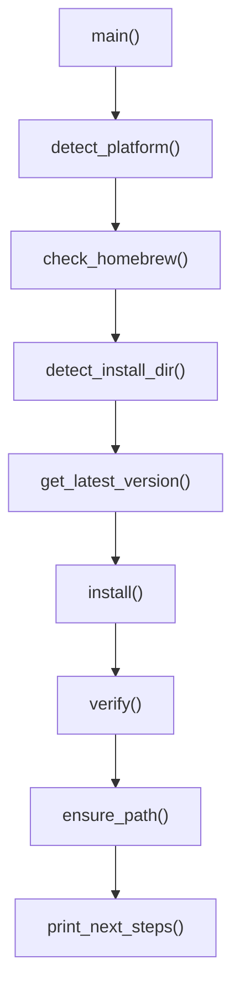
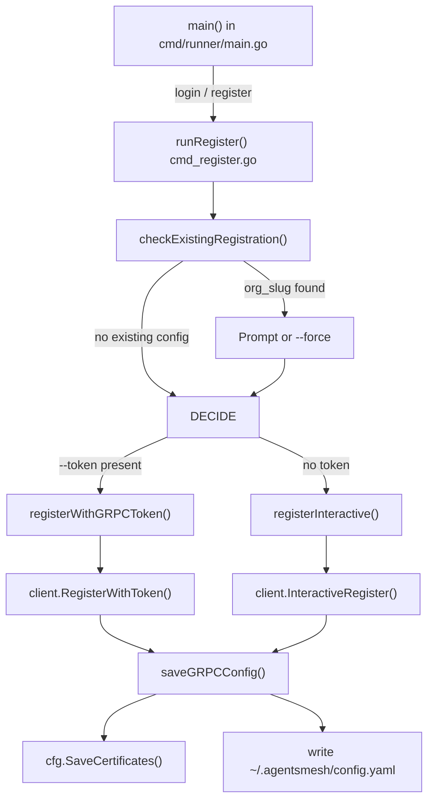
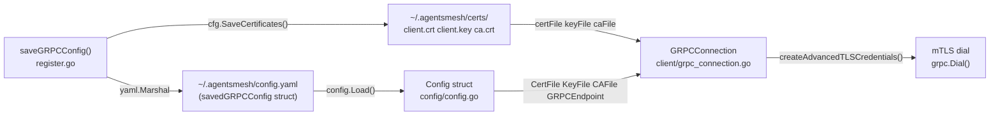
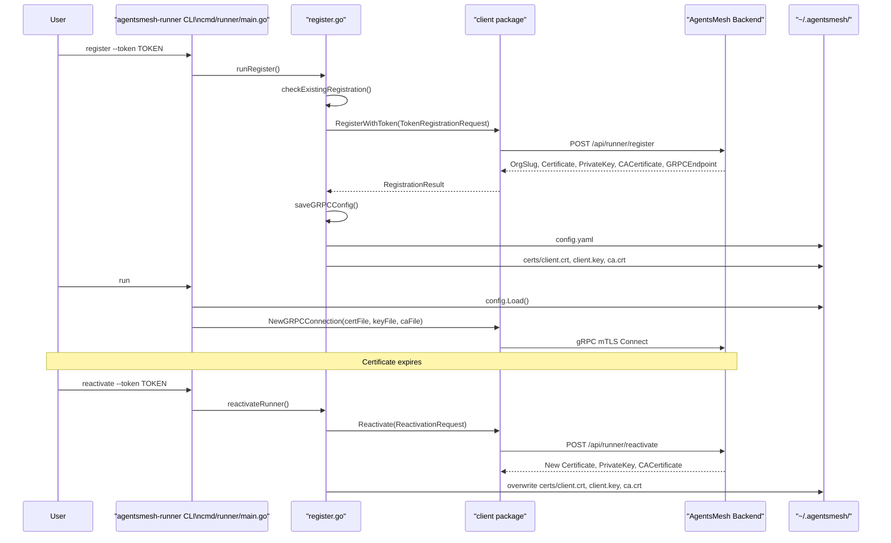

<!-- source: DeepWiki mcp.deepwiki.com · repo AgentsMesh/AgentsMesh · page 3.1 Installation and Registration · fetched 2026-10-26 -->

# Installation and Registration

<details>
<summary>Relevant source files</summary>

The following files were used as context for generating this wiki page:

- [runner/.goreleaser.yml](runner/.goreleaser.yml)
- [runner/README.md](runner/README.md)
- [runner/cmd/runner/cmd_reactivate.go](runner/cmd/runner/cmd_reactivate.go)
- [runner/cmd/runner/cmd_register.go](runner/cmd/runner/cmd_register.go)
- [runner/cmd/runner/cmd_run.go](runner/cmd/runner/cmd_run.go)
- [runner/cmd/runner/main.go](runner/cmd/runner/main.go)
- [runner/cmd/runner/register.go](runner/cmd/runner/register.go)
- [runner/cmd/runner/service.go](runner/cmd/runner/service.go)
- [runner/cmd/runner/update.go](runner/cmd/runner/update.go)
- [runner/cmd/runner/webconsole.go](runner/cmd/runner/webconsole.go)
- [runner/internal/client/grpc_connection.go](runner/internal/client/grpc_connection.go)
- [runner/internal/config/config.go](runner/internal/config/config.go)
- [runner/internal/config/config_defaults_test.go](runner/internal/config/config_defaults_test.go)
- [runner/internal/runner/runner.go](runner/internal/runner/runner.go)
- [web/public/install.ps1](web/public/install.ps1)
- [web/public/install.sh](web/public/install.sh)
- [web/src/app/docs/runners/setup/page.tsx](web/src/app/docs/runners/setup/page.tsx)

</details>


This page covers how to install the `agentsmesh-runner` binary and register it with an AgentsMesh server. It documents the installation scripts, the `register` command, both token-based and interactive registration flows, the configuration and certificate files written to disk, and the `reactivate` command for certificate renewal.

For details on what the runner does once it is running, see the Runner overview (page [3]()). For the full CLI command reference, see [3.2](). For the gRPC connection lifecycle that begins after registration, see [3.3]().

---

## Installation

The runner binary is released as `agentsmesh-runner` via GitHub Releases under `AgentsMesh/AgentsMesh`. GoReleaser produces archives for Linux, macOS (universal), and Windows, plus `.deb`, `.rpm`, and `.apk` packages for Linux. See [runner/.goreleaser.yml]() for the full build matrix.

### Installation methods

| Method | Command |
|---|---|
| macOS / Linux (one-line) | `curl -fsSL https://agentsmesh.ai/install.sh \| sh` |
| Windows (PowerShell) | `irm https://agentsmesh.ai/install.ps1 \| iex` |
| macOS (Homebrew) | `brew tap agentsmesh/tap https://github.com/AgentsMesh/BrewCask` then `brew install agentsmesh/tap/agentsmesh-runner` |
| Linux packages | `.deb`, `.rpm`, `.apk` from GitHub Releases |
| Direct download | Tarball / zip from GitHub Releases |

### install.sh (macOS and Linux)

The script at [web/public/install.sh]() performs the following steps:

1. **Platform detection** — calls `uname -s` and `uname -m`; maps to `darwin_all`, `linux_amd64`, or `linux_arm64`.
2. **Homebrew suggestion** — on macOS with Homebrew present, offers the tap alternative before continuing.
3. **Install directory selection** — uses `$INSTALL_DIR` env var if set; otherwise defaults to `~/.local/bin`.
4. **Version fetch** — queries `https://api.github.com/repos/AgentsMesh/AgentsMesh/releases/latest` for the tag name.
5. **Download and extract** — fetches the `.tar.gz` archive to a temp directory and extracts it.
6. **Binary install** — moves `agentsmesh-runner` to `$INSTALL_DIR` and sets `chmod +x`.
7. **PATH hint** — if `$INSTALL_DIR` is not in `$PATH`, prints shell-specific instructions for `zsh`, `bash`, or `fish`.

The function sequence is:

**Diagram: install.sh execution flow**



Sources: [web/public/install.sh:270-292]()

### install.ps1 (Windows)

The script at [web/public/install.ps1]() mirrors the shell script logic. Key functions:

| Function | Purpose |
|---|---|
| `Get-Platform` | Returns `windows_amd64` or `windows_arm64` |
| `Get-LatestVersion` | Calls GitHub API with `Invoke-RestMethod` |
| `Get-InstallDir` | Prefers `%USERPROFILE%\.local\bin`; falls back to `%LOCALAPPDATA%\Programs\agentsmesh` |
| `Install-Runner` | Downloads `.zip`, extracts, moves `agentsmesh-runner.exe` |
| `Add-ToPath` | Adds the install directory to the user-scope `PATH` environment variable |
| `Test-Scoop` | Detects Scoop and offers it as an alternative |

Sources: [web/public/install.ps1:1-227]()

### Homebrew

GoReleaser is configured to push formula updates to the `AgentsMesh/BrewCask` repository after each release. The formula installs the macOS universal binary (`darwin_all`). See [runner/.goreleaser.yml:221-252]() for the `brews` block.

---

## Registration

Registration must be completed before running `agentsmesh-runner run`. It exchanges credentials with the server and writes a config file plus mTLS certificates to `~/.agentsmesh/`.

There are two registration modes:

| Mode | Trigger | Use case |
|---|---|---|
| Token-based | `--token <token>` flag | Automated / CI / headless deployment |
| Interactive (login) | No `--token` flag | Developer workstations (opens browser) |

**Diagram: Registration command routing and key functions**



Sources: [runner/cmd/runner/cmd_register.go](), [runner/cmd/runner/register.go]()

### Token-based registration

```
agentsmesh-runner register --server https://agentsmesh.ai --token <YOUR_TOKEN>
```

The `runRegister` function in [runner/cmd/runner/cmd_register.go:14-95]() parses flags and, when `--token` is set, calls `registerWithGRPCToken` in [runner/cmd/runner/register.go:59-81](). This calls `client.RegisterWithToken` with a `TokenRegistrationRequest` containing the `ServerURL`, `Token`, and `NodeID`.

### Interactive (login) registration

```
agentsmesh-runner register
agentsmesh-runner register --headless        # SSH / remote: print URL, don't open browser
agentsmesh-runner register --server https://self-hosted.example.com
```

When no `--token` is given, `registerInteractive` in [runner/cmd/runner/register.go:31-56]() is called. It generates a random 32-byte hex `machineKey` (via `generateMachineKey`) and calls `client.InteractiveRegister` with an `InteractiveRegistrationRequest`. This flow is Tailscale-style: the server returns a URL for the user to authorize in a browser.

### Overwriting an existing registration

`checkExistingRegistration` in [runner/cmd/runner/cmd_register.go:99-120]() reads `~/.agentsmesh/config.yaml` and returns the existing `org_slug`. If a registration already exists and neither `--force` nor `--token` is set, the user is prompted for confirmation (`[y/N]`). When overwriting, `backupExistingConfig` in [runner/cmd/runner/register.go:112-149]() backs up the current config and certs directory:

- Config backed up to `~/.agentsmesh/config.<org-slug>.yaml.bak`
- Certs backed up to `~/.agentsmesh/certs.<org-slug>.bak/`

---

## Files Written by Registration

After a successful registration, `saveGRPCConfig` in [runner/cmd/runner/register.go:152-207]() writes the following:

### `~/.agentsmesh/config.yaml`

The `savedGRPCConfig` struct ([runner/cmd/runner/register.go:220-234]()) defines all fields written:

| Field | Type | Example / Default |
|---|---|---|
| `server_url` | string | `https://agentsmesh.ai` |
| `node_id` | string | hostname |
| `org_slug` | string | Set by server |
| `grpc_endpoint` | string | `grpc.agentsmesh.ai:9443` |
| `cert_file` | string | `~/.agentsmesh/certs/client.crt` |
| `key_file` | string | `~/.agentsmesh/certs/client.key` |
| `ca_file` | string | `~/.agentsmesh/certs/ca.crt` |
| `max_concurrent_pods` | int | `5` |
| `workspace_root` | string | `/tmp/agentsmesh-workspace` |
| `default_agent` | string | `claude-code` |
| `default_shell` | string | `$SHELL` or `/bin/sh` |
| `health_check_port` | int | `9090` |
| `log_level` | string | `info` |

### `~/.agentsmesh/certs/`

Three PEM files are saved by `cfg.SaveCertificates`:

| File | Content |
|---|---|
| `client.crt` | Client certificate issued by the server CA |
| `client.key` | Client private key |
| `ca.crt` | Server CA certificate (used to verify the gRPC server) |

These three paths are referenced at runtime by `GRPCConnection` in [runner/internal/client/grpc_connection.go:37-39]() to establish mTLS.

**Diagram: Files written to disk and their runtime consumers**



Sources: [runner/cmd/runner/register.go:152-207](), [runner/internal/client/grpc_connection.go:29-106](), [runner/internal/config/config.go:12-79]()

---

## Configuration Loading

`config.Load(configFile)` in [runner/internal/config/config.go:103-165]() uses Viper to merge values from three sources, in ascending priority order:

1. Hard-coded defaults (e.g., `max_concurrent_pods=5`, `mcp_port=19000`)
2. The config file at `~/.agentsmesh/config.yaml`
3. Environment variables with prefix `AGENTSMESH_` (e.g., `AGENTSMESH_SERVER_URL`)

The `Config` struct in [runner/internal/config/config.go:12-79]() is the canonical in-memory representation used throughout the runner.

### Environment variable overrides

| Env var | Config field |
|---|---|
| `AGENTSMESH_SERVER_URL` | `server_url` |
| `AGENTSMESH_NODE_ID` | `node_id` |
| `AGENTSMESH_MAX_CONCURRENT_PODS` | `max_concurrent_pods` |
| `AGENTSMESH_WORKSPACE_ROOT` | `workspace_root` |
| `AGENTSMESH_MCP_PORT` | `mcp_port` |
| `AGENTSMESH_LOG_LEVEL` | `log_level` |

Sources: [runner/internal/config/config.go:103-165]()

---

## Starting the Runner

After registration:

```
agentsmesh-runner run
```

`runRunner` in [runner/cmd/runner/cmd_run.go:26-131]() loads `~/.agentsmesh/config.yaml`, calls `cfg.LoadGRPCConfig()` to verify the certificates are present and parseable, validates the config, and calls `startRunner`. `startRunner` creates a `runner.New(cfg)` instance, which internally creates a `GRPCConnection` from the cert paths. See [3.3]() for the connection lifecycle.

If the config file does not exist, the runner prints:

```
Error: Runner not registered. Please run 'agentsmesh-runner register' first.
```

### System service

The runner can be installed as a system service using the `service` subcommand ([runner/cmd/runner/service.go]()):

```
sudo agentsmesh-runner service install
sudo agentsmesh-runner service start
agentsmesh-runner service status
```

`runService` delegates to `svc.Install`, `svc.Start`, `svc.Stop`, etc. from the `internal/service` package using the `github.com/kardianos/service` library. The Linux package installs a systemd unit at `/etc/systemd/system/agentsmesh-runner.service`.

---

## Certificate Reactivation

Certificates have a finite lifetime. If a certificate expires, the runner will refuse to start with:

```
certificate has expired on <date>. Please reactivate the runner using:
  agentsmesh-runner reactivate --token <token>
```

This check is performed in `runner.New()` via `grpcConn.GetCertificateExpiryInfo()` in [runner/internal/runner/runner.go:108-121]().

The `reactivate` command in [runner/cmd/runner/cmd_reactivate.go]() accepts a `--token` flag (required) and an optional `--server` override. It calls `reactivateRunner` in [runner/cmd/runner/register.go:84-110](), which:

1. Calls `client.Reactivate` with a `ReactivationRequest`.
2. Loads the existing `Config` to get the certificate file paths.
3. Calls `cfg.SaveCertificates` to overwrite the three PEM files with the new ones.

The reactivation token is generated from the web UI under the runner management page.

**Diagram: Registration and reactivation flows end-to-end**



Sources: [runner/cmd/runner/cmd_register.go](), [runner/cmd/runner/register.go](), [runner/cmd/runner/cmd_reactivate.go](), [runner/internal/runner/runner.go:108-121]()

---

