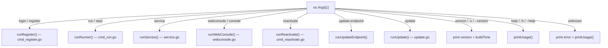
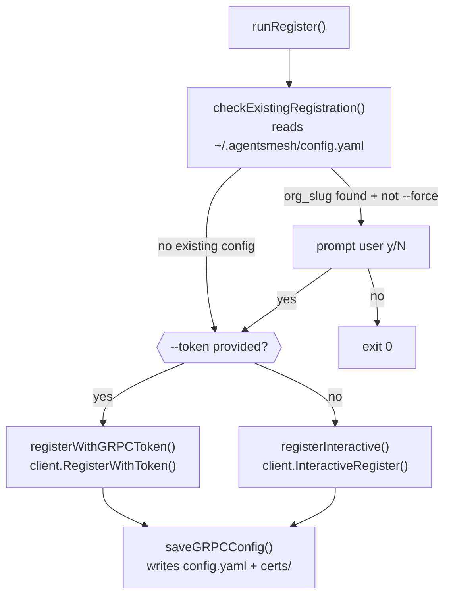
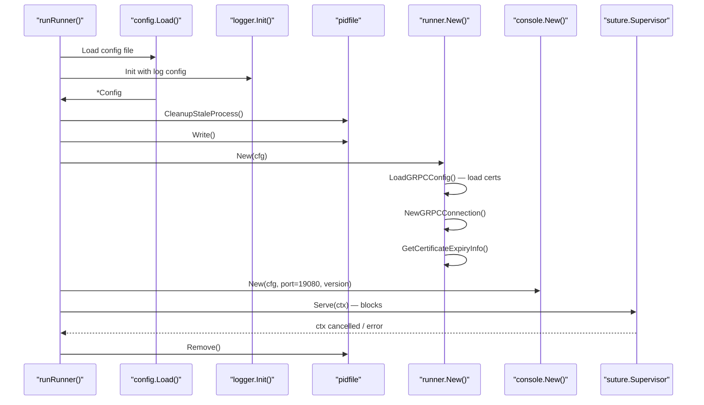
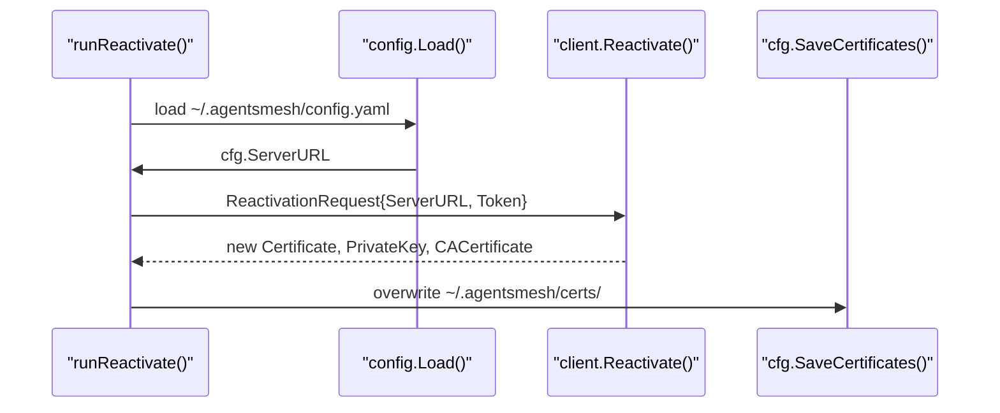
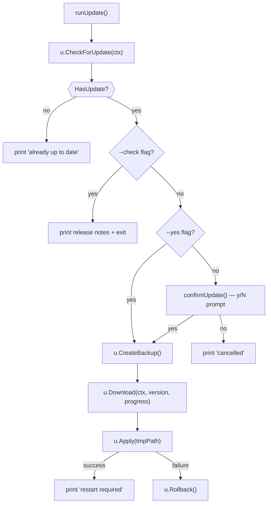
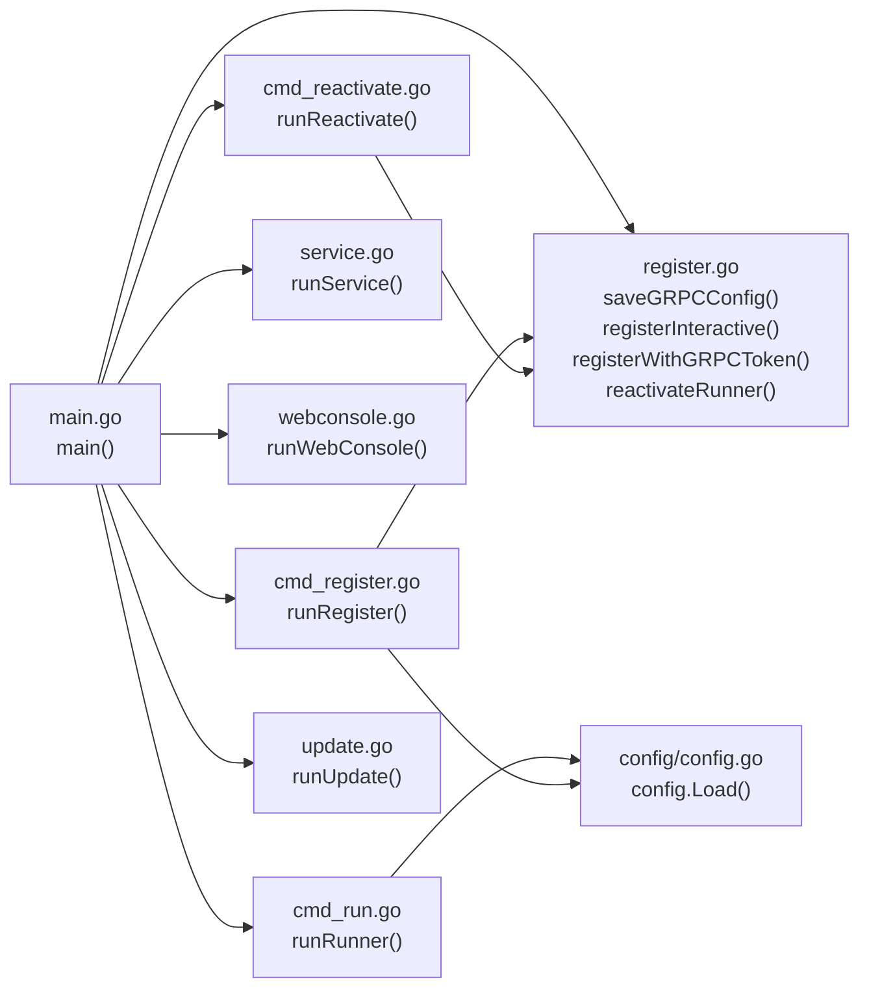

<!-- source: DeepWiki mcp.deepwiki.com · repo AgentsMesh/AgentsMesh · page 3.2 CLI Reference · fetched 2026-10-26 -->

# CLI Reference

<details>
<summary>Relevant source files</summary>

The following files were used as context for generating this wiki page:

- [runner/.goreleaser.yml](runner/.goreleaser.yml)
- [runner/README.md](runner/README.md)
- [runner/cmd/runner/cmd_reactivate.go](runner/cmd/runner/cmd_reactivate.go)
- [runner/cmd/runner/cmd_register.go](runner/cmd/runner/cmd_register.go)
- [runner/cmd/runner/cmd_run.go](runner/cmd/runner/cmd_run.go)
- [runner/cmd/runner/main.go](runner/cmd/runner/main.go)
- [runner/cmd/runner/register.go](runner/cmd/runner/register.go)
- [runner/cmd/runner/service.go](runner/cmd/runner/service.go)
- [runner/cmd/runner/update.go](runner/cmd/runner/update.go)
- [runner/cmd/runner/webconsole.go](runner/cmd/runner/webconsole.go)
- [runner/internal/client/grpc_connection.go](runner/internal/client/grpc_connection.go)
- [runner/internal/config/config.go](runner/internal/config/config.go)
- [runner/internal/config/config_defaults_test.go](runner/internal/config/config_defaults_test.go)
- [runner/internal/runner/runner.go](runner/internal/runner/runner.go)
- [web/public/install.ps1](web/public/install.ps1)
- [web/public/install.sh](web/public/install.sh)
- [web/src/app/docs/runners/setup/page.tsx](web/src/app/docs/runners/setup/page.tsx)

</details>


This page documents every subcommand and flag exposed by the `agentsmesh-runner` binary. It covers the command dispatcher in `runner/cmd/runner/main.go`, and the implementation files for each subcommand.

For background on how the runner connects to the backend after registration, see [gRPC Client](#3.3). For the installation steps that precede most commands, see [Installation and Registration](#3.1). For auto-update internals, see [Auto-Update](#3.8).

---

## Binary Overview

The binary is named `agentsmesh-runner`. Its entry point is `main()` in [runner/cmd/runner/main.go:14-44](). Two build-time variables are injected by GoReleaser via `-ldflags`:

| Variable | Purpose |
|---|---|
| `version` | Semantic version string (e.g. `v1.2.3`) |
| `buildTime` | RFC3339 build timestamp |

**Command Dispatch Diagram**



Sources: [runner/cmd/runner/main.go:14-44]()

---

## `register` (alias: `login`)

Registers the runner with an AgentsMesh server. On success it writes `~/.agentsmesh/config.yaml` and stores mTLS certificates under `~/.agentsmesh/certs/`.

### Flags

| Flag | Type | Default | Description |
|---|---|---|---|
| `--server` | string | `https://agentsmesh.ai` | AgentsMesh server URL |
| `--token` | string | _(empty)_ | Registration token; if omitted, interactive browser flow is used |
| `--node-id` | string | hostname | Identifier for this runner instance |
| `--headless` | bool | `false` | Skip opening the browser; print the auth URL only (SSH-friendly) |
| `--force` | bool | `false` | Overwrite an existing registration without prompting |

### Registration Flows



### Files Written After Registration

`saveGRPCConfig()` in [runner/cmd/runner/register.go:152-207]() writes the following YAML structure to `~/.agentsmesh/config.yaml`:

```yaml
server_url: <SERVER_URL>
node_id: <NODE_ID>
org_slug: <ORG_SLUG>
grpc_endpoint: <GRPC_ENDPOINT>
cert_file: ~/.agentsmesh/certs/client.crt
key_file:  ~/.agentsmesh/certs/client.key
ca_file:   ~/.agentsmesh/certs/ca.crt
max_concurrent_pods: 5
workspace_root: /tmp/agentsmesh-workspace
default_agent: claude-code
default_shell: /bin/bash    # or $SHELL
health_check_port: 9090
log_level: info
```

If an existing `config.yaml` is found, `backupExistingConfig()` renames it to `config.<org-slug>.yaml.bak` and moves the `certs/` directory to `certs.<org-slug>.bak/`.

Sources: [runner/cmd/runner/cmd_register.go:14-95](), [runner/cmd/runner/register.go:29-207]()

---

## `run` (alias: `start`)

Starts the runner process in the foreground. The runner must be registered first.

### Flags

| Flag | Type | Default | Description |
|---|---|---|---|
| `--config` | string | `~/.agentsmesh/config.yaml` | Path to config file |
| `--log-level` | string | _(from config)_ | Override log level: `debug`, `info`, `warn`, `error` |
| `--logpty` | bool | `false` | Write raw PTY output to log files (debugging) |
| `--logpty-dir` | string | `$TMPDIR/agentsmesh/pty-logs` | Directory for PTY logs |

### Startup Sequence



The runner exits with code `1` on fatal errors. Graceful shutdown is triggered by `SIGINT` or `SIGTERM`.

Sources: [runner/cmd/runner/cmd_run.go:26-202](), [runner/internal/runner/runner.go:57-149]()

### Config File Resolution

The `Config` struct in [runner/internal/config/config.go:12-79]() is populated by [Viper](https://github.com/spf13/viper). The environment variable prefix is `AGENTSMESH_`, so `AGENTSMESH_SERVER_URL` overrides `server_url`.

| Config Key | Default | Env Variable |
|---|---|---|
| `server_url` | `https://agentsmesh.ai` | `AGENTSMESH_SERVER_URL` |
| `max_concurrent_pods` | `5` | `AGENTSMESH_MAX_CONCURRENT_PODS` |
| `workspace_root` | `/workspace` | `AGENTSMESH_WORKSPACE_ROOT` |
| `mcp_port` | `19000` | `AGENTSMESH_MCP_PORT` |
| `health_check_port` | `9090` | `AGENTSMESH_HEALTH_CHECK_PORT` |
| `log_level` | `info` | `AGENTSMESH_LOG_LEVEL` |
| `default_agent` | `claude-code` | `AGENTSMESH_DEFAULT_AGENT` |
| `auto_update.enabled` | `true` | — |
| `auto_update.channel` | `stable` | — |
| `auto_update.check_interval` | `24h` | — |

Sources: [runner/internal/config/config.go:102-165]()

---

## `service`

Installs and manages the runner as an OS system service. Uses [kardianos/service](https://github.com/kardianos/service) under the hood.

### Usage

```
agentsmesh-runner service <action> [options]
```

### Actions

| Action | Description |
|---|---|
| `install` | Register and enable the runner as a system service |
| `uninstall` | Remove the system service registration |
| `start` | Start the service |
| `stop` | Stop the service |
| `restart` | Restart the service |
| `status` | Print `Running`, `Stopped`, or `Unknown` |

### `service install` Flags

| Flag | Type | Default | Description |
|---|---|---|---|
| `--config` | string | `~/.agentsmesh/config.yaml` | Path to config file used by the service |

The config file must exist before running `service install`. The Linux package (`.deb`/`.rpm`) ships a pre-built systemd unit file at `/etc/systemd/system/agentsmesh-runner.service` (see [runner/.goreleaser.yml:82-116]()).

Sources: [runner/cmd/runner/service.go:14-149]()

---

## `webconsole` (alias: `console`)

Opens the local web console in the default browser. The console is hosted by the runner process itself when `run` is active.

### Flags

| Flag | Type | Default | Description |
|---|---|---|---|
| `--port` | int | `19080` | Port the console is listening on |

The command performs an HTTP `GET /api/status` check before opening the browser. If the runner is not running, it exits with an error.

### Browser Launch

`openBrowser()` in [runner/cmd/runner/webconsole.go:65-80]() uses platform-specific commands:

| Platform | Command |
|---|---|
| macOS | `open <url>` |
| Linux | `xdg-open <url>` |
| Windows | `rundll32 url.dll,FileProtocolHandler <url>` |

The console URL is always `http://127.0.0.1:<port>`.

Sources: [runner/cmd/runner/webconsole.go:14-80]()

---

## `reactivate`

Refreshes mTLS certificates for a runner whose certificate has expired. This is needed when a runner has been offline for an extended period.

### Flags

| Flag | Type | Default | Description |
|---|---|---|---|
| `--token` | string | _(required)_ | Reactivation token from the web UI |
| `--server` | string | _(from config)_ | Server URL; falls back to `server_url` in `config.yaml` |

### Flow



The reactivation token is generated from the web UI's Runner management page. Timeout is 30 seconds.

Sources: [runner/cmd/runner/cmd_reactivate.go:14-71](), [runner/cmd/runner/register.go:83-110]()

---

## `update`

Checks for and installs a new version of `agentsmesh-runner` from GitHub Releases. Internally uses the `updater` package (see [Auto-Update](#3.8)).

### Flags

| Flag | Shorthand | Type | Default | Description |
|---|---|---|---|---|
| `--check` | `-c` | bool | `false` | Only check; do not download or install |
| `--yes` | `-y` | bool | `false` | Skip the confirmation prompt |
| `--version` | `-v` | string | _(latest)_ | Install a specific version (e.g. `v1.2.3`) |
| `--force` | `-f` | bool | `false` | Skip waiting for active pods to finish |
| `--pre` | — | bool | `false` | Include prerelease versions in the update check |

### Update Flow



Sources: [runner/cmd/runner/update.go:14-228]()

---

## `update-endpoint`

Updates the stored gRPC endpoint in `~/.agentsmesh/config.yaml` without performing a full re-registration. This is used when the server's gRPC address changes. The implementation delegates to `runUpdateEndpoint()` in the main package.

---

## `version`

Prints the version string and build time then exits.

```
AgentsMesh Runner v1.2.3 (built 2024-01-15T10:00:00Z)
```

Aliases: `-v`, `--version`.

Sources: [runner/cmd/runner/main.go:35-37]()

---

## Command-to-File Map



Sources: [runner/cmd/runner/main.go:1-78](), [runner/cmd/runner/cmd_register.go:1-120](), [runner/cmd/runner/cmd_run.go:1-202](), [runner/cmd/runner/service.go:1-149](), [runner/cmd/runner/webconsole.go:1-80](), [runner/cmd/runner/cmd_reactivate.go:1-71](), [runner/cmd/runner/update.go:1-228](), [runner/cmd/runner/register.go:1-234]()

---

