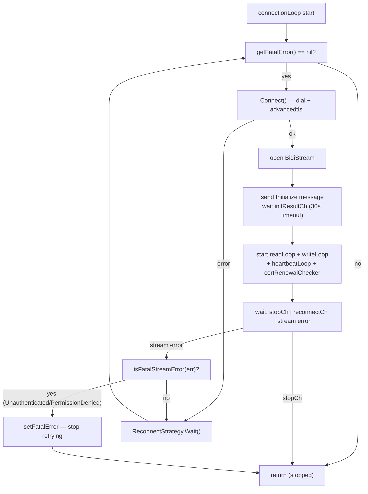

<!-- source: DeepWiki mcp.deepwiki.com · repo AgentsMesh/AgentsMesh · page 3.3 gRPC Client · fetched 2026-10-26 -->

# gRPC Client

<details>
<summary>Relevant source files</summary>

The following files were used as context for generating this wiki page:

- [backend/cmd/server/grpc_init.go](backend/cmd/server/grpc_init.go)
- [backend/cmd/server/grpc_init_test.go](backend/cmd/server/grpc_init_test.go)
- [backend/internal/infra/pki/service.go](backend/internal/infra/pki/service.go)
- [backend/internal/infra/pki/service_server.go](backend/internal/infra/pki/service_server.go)
- [backend/internal/infra/pki/service_test.go](backend/internal/infra/pki/service_test.go)
- [runner/cmd/runner/cmd_reactivate.go](runner/cmd/runner/cmd_reactivate.go)
- [runner/cmd/runner/cmd_register.go](runner/cmd/runner/cmd_register.go)
- [runner/cmd/runner/cmd_run.go](runner/cmd/runner/cmd_run.go)
- [runner/cmd/runner/main.go](runner/cmd/runner/main.go)
- [runner/cmd/runner/register.go](runner/cmd/runner/register.go)
- [runner/cmd/runner/service.go](runner/cmd/runner/service.go)
- [runner/cmd/runner/update.go](runner/cmd/runner/update.go)
- [runner/cmd/runner/webconsole.go](runner/cmd/runner/webconsole.go)
- [runner/internal/client/grpc_connection.go](runner/internal/client/grpc_connection.go)
- [runner/internal/client/grpc_connection_options.go](runner/internal/client/grpc_connection_options.go)
- [runner/internal/client/grpc_tls.go](runner/internal/client/grpc_tls.go)
- [runner/internal/runner/runner.go](runner/internal/runner/runner.go)

</details>


This page documents the runner-side gRPC client: how it establishes an mTLS connection to the backend, manages the bidirectional streaming protocol, routes messages, handles reconnection, and integrates with the suture supervisor tree.

For the backend counterpart that receives connections from runners, see [Runner Connection Manager](#2.3). For the gRPC proto definitions and message types, see [gRPC API and Runner Communication](#2.2). For PKI and certificate issuance, see [PKI and mTLS](#2.8).

---

## Overview

The runner communicates with the backend exclusively over a long-lived gRPC bidirectional stream secured with mutual TLS (mTLS). The central implementation lives in `runner/internal/client/`, with the top-level struct being `GRPCConnection` ([runner/internal/client/grpc_connection.go:29-106]()).

`GRPCConnection` is responsible for:

- Dialing the backend with mTLS credentials
- Opening and maintaining a bidirectional stream (`RunnerService.Connect`)
- Priority-based message sending (control vs. terminal output)
- Reconnection with exponential backoff
- Periodic heartbeat
- Background certificate renewal

---

## Component Map

**Supervisor tree and key types involved in the gRPC client:**

```mermaid
graph TD
  sutureTop["suture.Supervisor (\"runner\")"]
  connSvc["lifecycle.ConnectionService"]
  grpcConn["client.GRPCConnection"]
  handler["runner.RunnerMessageHandler"]
  rpcClient["client.RPCClient"]
  agentProbe["client.AgentProbe"]
  reconnect["client.ReconnectStrategy"]
  tlsCreds["advancedtls credentials"]
  identProvider["pemfile.Provider (identity)"]
  rootProvider["pemfile.Provider (root CA)"]

  sutureTop --> connSvc
  connSvc --> grpcConn
  grpcConn --> handler
  grpcConn --> rpcClient
  grpcConn --> agentProbe
  grpcConn --> reconnect
  grpcConn --> tlsCreds
  tlsCreds --> identProvider
  tlsCreds --> rootProvider
```

Sources: [runner/internal/client/grpc_connection.go:29-106](), [runner/internal/runner/runner.go:197-250]()

---

## GRPCConnection Struct

`GRPCConnection` ([runner/internal/client/grpc_connection.go:29-106]()) aggregates all connection state. The most important fields by role:

| Field group | Fields | Purpose |
|---|---|---|
| Identity | `endpoint`, `nodeID`, `orgSlug` | Target server address and runner identity |
| mTLS cert paths | `certFile`, `keyFile`, `caFile` | File paths for hot-reload cert providers |
| gRPC components | `conn`, `client`, `stream` | Raw connection, service client, active stream |
| Cert providers | `identityProvider`, `rootProvider` | `pemfile.Provider` instances; closed on reconnect to prevent goroutine leaks |
| Messaging | `handler` | `MessageHandler` interface; set to `RunnerMessageHandler` at startup |
| Priority channels | `controlCh` (buf 100), `terminalCh` (buf 1000) | Separate send queues; control messages always win |
| Lifecycle | `stopCh`, `stopOnce`, `reconnectCh` | Shutdown and reconnect signalling |
| Rate limiter | `terminalRateLimiter`, `terminalRateLimit` | Token-bucket limiting terminal output (default 50 KB/s) |
| Cert renewal | `certRenewalCheckInterval`, `certRenewalDays`, `certUrgentDays` | Background cert expiry checker |
| Reconnection | `reconnectStrategy` | `ReconnectStrategy` with configurable base/max delays |
| Stuck detection | `lastSendTime` (atomic) | Watchdog reads this to detect a frozen write loop |
| MCP RPC | `rpcClient` | `RPCClient` for request-response multiplexing over the stream |
| Agent probe | `agentProbe` | `AgentProbe` for detecting available agent binaries |
| Fatal error | `fatalErr`, `fatalErrMu` | Stops reconnection on unrecoverable errors |

Sources: [runner/internal/client/grpc_connection.go:29-106]()

---

## Connection Lifecycle

### Initialization

`GRPCConnection` is constructed in `runner.New()` ([runner/internal/runner/runner.go:97-105]()) using `NewGRPCConnection`, then started by the suture supervisor via `lifecycle.ConnectionService`.

Defaults set by `NewGRPCConnection` ([runner/internal/client/grpc_connection.go:109-148]()):

| Parameter | Default |
|---|---|
| `heartbeatInterval` | 30 s |
| `initTimeout` | 30 s |
| `reconnectStrategy` | base 5 s, max 5 min |
| `certRenewalCheckInterval` | 24 h |
| `certRenewalDays` | 30 days |
| `certUrgentDays` | 7 days |
| `terminalRateLimit` | 50 KB/s |

### Start / Stop

```
GRPCConnection.Start()  →  safego.Go("grpc-connection-loop", c.connectionLoop)
GRPCConnection.Stop()   →  closes stopCh, closes conn, closes cert providers
```

`Start` ([runner/internal/client/grpc_connection.go:248-251]()) spawns `connectionLoop` in a managed goroutine. `Stop` ([runner/internal/client/grpc_connection.go:254-275]()) is idempotent via `sync.Once`.

### Connection loop (connectionLoop / runConnection)

The logic is in `grpc_connection_loop.go` (referenced at [runner/internal/client/grpc_connection.go:277]()):



Sources: [runner/internal/client/grpc_connection.go:248-277](), [runner/internal/client/grpc_connection.go:282-321]()

---

## mTLS and Certificate Hot-Reload

`Connect()` calls `createAdvancedTLSCredentials()` ([runner/internal/client/grpc_tls.go:26-73]()) which uses `google.golang.org/grpc/security/advancedtls` with `pemfile.Provider` instances:

| Provider | Watches | Refresh interval |
|---|---|---|
| `identityProvider` | `certFile`, `keyFile` | 1 hour |
| `rootProvider` | `caFile` | 24 hours |

The providers automatically reload files when they change, so certificate renewal does not require a reconnect in the normal case. Providers are explicitly closed on every reconnect to prevent goroutine leaks ([runner/internal/client/grpc_connection.go:186-203]()).

**Fallback chain** when providers fail to initialize:

```
pemfile providers (advancedtls) → static CA pool (advancedtls) → standard tls.Config with VerifyConnection
```

The TLS policy uses `advancedtls.CertVerification` (chain-only, no hostname check) so that SNI remains the dial target hostname for correct Traefik/proxy routing even when the server cert SANs differ from the public hostname ([runner/internal/client/grpc_tls.go:63-66]()).

Sources: [runner/internal/client/grpc_tls.go:26-73](), [runner/internal/client/grpc_tls.go:110-156]()

---

## Message Priority and Write Loop

Two buffered channels separate message classes:

```
controlCh  (buf 100)  ← heartbeat, pod_created, pod_terminated, OSC events
terminalCh (buf 1000) ← agent_status (terminal output via Relay)
```

The write loop always drains `controlCh` first via a `select` with priority, then falls through to `terminalCh`. Terminal output is also subject to the token-bucket rate limiter (`terminalRateLimiter`) to avoid saturating slow upstream connections ([runner/internal/client/grpc_connection.go:73-85]()).

`lastSendTime` is updated atomically on each successful send. The Watchdog service reads `LastActivityTime()` ([runner/internal/client/grpc_connection.go:325-331]()) to detect a stuck write loop and trigger reconnection.

Sources: [runner/internal/client/grpc_connection.go:73-85](), [runner/internal/client/grpc_connection.go:325-331]()

---

## Heartbeat

A dedicated heartbeat goroutine sends a `RunnerMessage` of heartbeat type every `heartbeatInterval` (default 30 s) to the `controlCh`. This keeps the gRPC stream alive through NAT devices and load balancers, and also allows the backend to track runner liveness. The keepalive parameters passed to `grpc.Dial` mirror this: ping every 30 s, timeout 10 s ([runner/internal/client/grpc_connection.go:220-225]()).

---

## Certificate Renewal

`certRenewalChecker` ([runner/internal/client/grpc_tls.go:159-175]()) runs on a background goroutine alongside the active stream:

1. Every `certRenewalCheckInterval` (24 h), it calls `checkCertificateExpiry`.
2. If days until expiry ≤ `certRenewalDays` (30), it calls `renewCertificate()`.
3. `renewCertificate` POSTs to the backend REST API (`serverURL`) and overwrites `certFile`/`keyFile` on disk.
4. `advancedtls` picks up the new files at the next provider refresh (within 1 h) — no reconnect needed.
5. If days until expiry ≤ `certUrgentDays` (7), it also calls `triggerReconnect()` to force a fresh TLS handshake with the new certificate immediately.

Sources: [runner/internal/client/grpc_tls.go:158-308]()

---

## Fatal Error Handling

`isFatalStreamError` ([runner/internal/client/grpc_connection.go:297-321]()) inspects gRPC status codes returned by the stream:

| gRPC code | Condition | Action |
|---|---|---|
| `Unauthenticated` | "runner not found" | Fatal — print re-register instructions |
| `Unauthenticated` | other auth failures | Fatal — print re-register instructions |
| `PermissionDenied` | "runner is disabled" | Fatal — print admin contact instructions |
| Anything else | — | Retryable — wait and reconnect |

When an error is marked fatal, `setFatalError` stores it and `connectionLoop` exits permanently without further retries.

Sources: [runner/internal/client/grpc_connection.go:282-321]()

---

## Functional Options

`GRPCConnection` is configured through the `GRPCConnectionOption` functional option pattern ([runner/internal/client/grpc_connection_options.go]()):

| Option | Sets |
|---|---|
| `WithGRPCHeartbeatInterval(d)` | `heartbeatInterval` |
| `WithGRPCInitTimeout(d)` | `initTimeout` |
| `WithGRPCRunnerVersion(v)` | `runnerVersion` (sent on init) |
| `WithGRPCMCPPort(p)` | `mcpPort` (sent on init) |
| `WithGRPCTerminalRateLimit(n)` | `terminalRateLimit` bytes/s |
| `WithGRPCServerURL(url)` | `serverURL` for cert renewal REST calls |
| `WithGRPCCertRenewalDays(n)` | `certRenewalDays` |
| `WithGRPCCertUrgentDays(n)` | `certUrgentDays` |
| `WithGRPCEndpointChanged(fn)` | `onEndpointChanged` callback for auto-discovery |

The `onEndpointChanged` callback is wired to `config.UpdateGRPCEndpointInFile` in `runner.New()` so that when the backend advertises a new gRPC endpoint (e.g., after a migration), the runner persists it to `config.yaml` for use after restart ([runner/internal/runner/runner.go:88-95]()).

Sources: [runner/internal/client/grpc_connection_options.go](), [runner/internal/runner/runner.go:84-105]()

---

## Endpoint Parsing

`parseGRPCEndpoint` ([runner/internal/client/grpc_connection.go:343-375]()) normalises the endpoint before dialing:

| Input format | Resolved to |
|---|---|
| `grpcs://host:port` | `host:port` |
| `grpc://host:port` | `host:port` |
| `host:port` | `host:port` (passthrough) |

This lets the config file use `grpcs://` URIs for clarity while passing bare `host:port` to `grpc.Dial`.

Sources: [runner/internal/client/grpc_connection.go:338-375]()

---

## Suture Integration

The `GRPCConnection` implements the `Connection` interface ([runner/internal/client/grpc_connection.go:334]()), which in turn satisfies `suture.Service` via `lifecycle.ConnectionService`. The supervisor in `runner.Run` ([runner/internal/runner/runner.go:209-244]()) adds it as a supervised service:

```mermaid
graph LR
  sutureSpec["suture.Spec\nFailureThreshold=5\nFailureDecay=60s\nFailureBackoff=5s"]
  supervisor["suture.New(\"runner\", spec)"]
  connSvc["lifecycle.ConnectionService\n(wraps GRPCConnection)"]
  mcpSvc["lifecycle.MCPServerService"]
  monSvc["lifecycle.MonitorService"]
  watchdog["lifecycle.WatchdogService\n(reads LastActivityTime)"]
  consoleSvc["lifecycle.ConsoleService"]

  supervisor -->|"Add"| connSvc
  supervisor -->|"Add"| mcpSvc
  supervisor -->|"Add"| monSvc
  supervisor -->|"Add"| watchdog
  supervisor -->|"Add"| consoleSvc
```

If `ConnectionService` exits unexpectedly, suture restarts it subject to `FailureThreshold` (5 failures before backing off). The Watchdog polls `GRPCConnection.LastActivityTime()` on its own interval (15 s) and can signal reconnection if the write loop appears stuck.

Sources: [runner/internal/runner/runner.go:208-244]()

---

