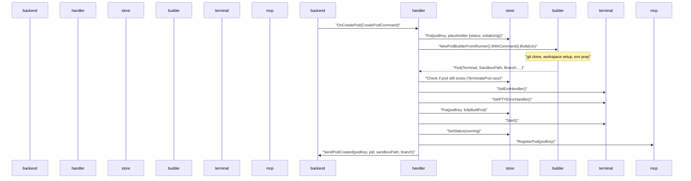
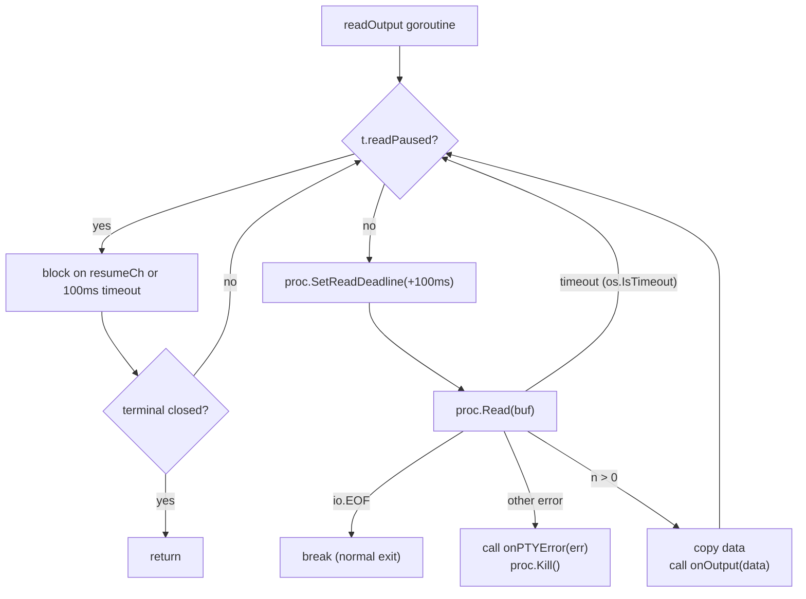
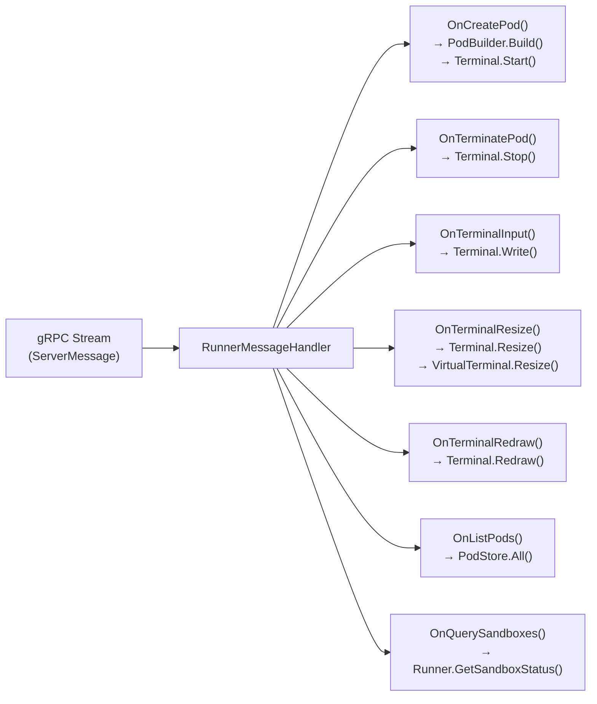
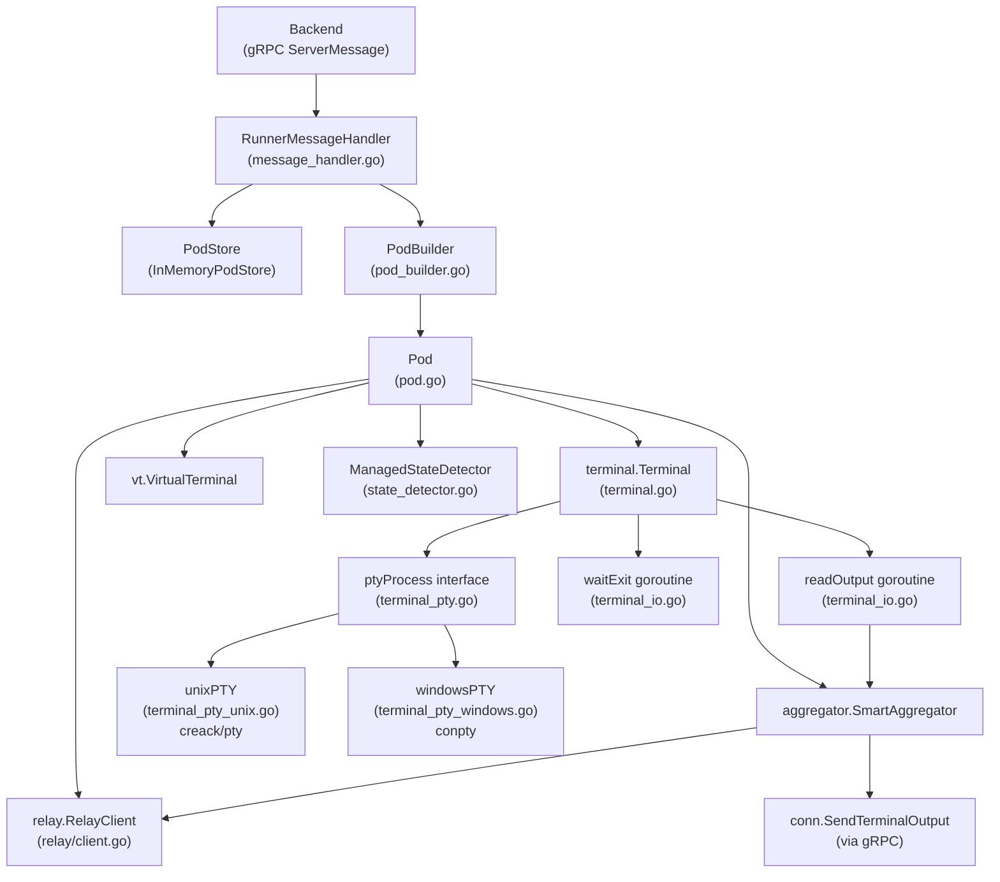

<!-- source: DeepWiki mcp.deepwiki.com · repo AgentsMesh/AgentsMesh · page 3.4 Pod and Terminal Management · fetched 2026-10-26 -->

# Pod and Terminal Management

<details>
<summary>Relevant source files</summary>

The following files were used as context for generating this wiki page:

- [.claude/skills/gh-merge/SKILL.md](.claude/skills/gh-merge/SKILL.md)
- [backend/internal/api/grpc/runner_adapter_test.go](backend/internal/api/grpc/runner_adapter_test.go)
- [backend/internal/service/runner/connection_manager.go](backend/internal/service/runner/connection_manager.go)
- [runner/go.mod](runner/go.mod)
- [runner/go.sum](runner/go.sum)
- [runner/internal/client/interface.go](runner/internal/client/interface.go)
- [runner/internal/relay/client_token_test.go](runner/internal/relay/client_token_test.go)
- [runner/internal/runner/message_handler.go](runner/internal/runner/message_handler.go)
- [runner/internal/runner/message_handler_pod_create_test.go](runner/internal/runner/message_handler_pod_create_test.go)
- [runner/internal/runner/pod.go](runner/internal/runner/pod.go)
- [runner/internal/terminal/terminal.go](runner/internal/terminal/terminal.go)
- [runner/internal/terminal/terminal_io.go](runner/internal/terminal/terminal_io.go)
- [runner/internal/terminal/terminal_pty.go](runner/internal/terminal/terminal_pty.go)
- [runner/internal/terminal/terminal_pty_unix.go](runner/internal/terminal/terminal_pty_unix.go)
- [runner/internal/terminal/terminal_pty_windows.go](runner/internal/terminal/terminal_pty_windows.go)
- [runner/internal/terminal/terminal_resize.go](runner/internal/terminal/terminal_resize.go)
- [runner/internal/terminal/terminal_struct_test.go](runner/internal/terminal/terminal_struct_test.go)

</details>


This page documents the `Pod` struct, the `Terminal` abstraction, and the platform-specific PTY implementations in the runner. It covers how a pod is created and destroyed, how the PTY process is launched and managed, and how backpressure is applied when output consumers fall behind.

For how the runner receives commands from the backend that trigger pod creation, see the gRPC client documentation at [3.3](). For how the runner connects to the Relay service to stream terminal output to the browser, see [3.5](). For workspace and git setup that happens during pod build, see [3.7]().

---

## The Pod Struct

A `Pod` is the central data object representing one active terminal session on the runner. It is defined in [runner/internal/runner/pod.go:17-49]().

| Field | Type | Purpose |
|-------|------|---------|
| `PodKey` | `string` | Unique key assigned by the backend |
| `Terminal` | `*terminal.Terminal` | The PTY process wrapper |
| `VirtualTerminal` | `*vt.VirtualTerminal` | In-memory VT100 screen for state detection |
| `Aggregator` | `*aggregator.SmartAggregator` | Adaptive frame-rate output batching |
| `RelayClient` | `relay.RelayClient` | WebSocket client for Relay connection |
| `Clipboard` | `clipboard.Backend` | Image paste support |
| `SandboxPath` | `string` | Filesystem path to the pod's workspace |
| `Branch` | `string` | Git branch for worktree-based pods |
| `Status` | `string` | One of `initializing`, `running`, `stopped`, `failed` |
| `stateDetector` | `*ManagedStateDetector` | Multi-signal agent state detector |
| `PTYLogger` | `*aggregator.PTYLogger` | Optional PTY output logger |
| `tokenRefreshCh` | `chan string` | Used for relay token refresh handoff |
| `ptyErrorMsg` | `string` | Stores fatal PTY error for the exit handler |

Status transitions are protected by `statusMu` (an `sync.RWMutex`). The `RelayClient` field is accessed via `SetRelayClient`/`GetRelayClient` which acquire `relayMu`.

**Pod status constants** [runner/internal/runner/pod.go:51-57]():

```
PodStatusInitializing → PodStatusRunning → PodStatusStopped
                                         ↘ PodStatusFailed
```

Sources: [runner/internal/runner/pod.go:17-57]()

---

## Pod Lifecycle

Pods are created and destroyed by `RunnerMessageHandler` in [runner/internal/runner/message_handler.go](). The handler itself holds a reference to a `PodStore` and a `client.Connection`.

**Pod creation lifecycle** — `OnCreatePod` [runner/internal/runner/message_handler.go:32-158]():

**Pod creation and destruction flow**



**Pod termination** — `OnTerminatePod` [runner/internal/runner/message_handler.go:161-192]():

1. Removes pod from `PodStore` with `Delete`.
2. Closes `PTYLogger` if active.
3. Calls `pod.StopStateDetector()`.
4. Calls `pod.Aggregator.Stop()`.
5. Calls `pod.Terminal.Stop()` — graceful shutdown with a 5-second SIGTERM window.
6. Unregisters from `MCPServer` and `agentMonitor`.
7. Sends `pod_terminated` event to backend.

Sources: [runner/internal/runner/message_handler.go:32-192](), [runner/internal/runner/pod.go:17-57]()

---

## PodStore

`PodStore` is the in-memory map of active pods on the runner. It is an interface defined alongside `RunnerMessageHandler` and implemented by `InMemoryPodStore`. Key operations:

| Method | Description |
|--------|-------------|
| `Put(key, pod)` | Insert or replace a pod |
| `Get(key)` | Retrieve a pod by key |
| `Delete(key)` | Remove and return a pod |
| `All()` | Return all current pods |

Sources: [runner/internal/runner/message_handler.go:1-30]()

---

## The Terminal Abstraction

`Terminal` in [runner/internal/terminal/terminal.go]() wraps a platform-specific PTY process. It is intentionally unaware of gRPC or relay details; it only knows how to start, stop, read, write, and resize a PTY.

**Key fields** [runner/internal/terminal/terminal.go:35-68]():

| Field | Purpose |
|-------|---------|
| `proc` | `ptyProcess` — platform-specific handle |
| `onOutput` | Callback fired when PTY produces output |
| `onExit` | Callback fired when the process exits |
| `onPTYError` | Callback for fatal read errors (e.g. disk full) |
| `readPaused` / `resumeCh` | Backpressure control state |
| `doneCh` | Closed by `waitExit` goroutine on process exit |
| `ptyCloseOnce` | Ensures PTY fd is closed exactly once |

**Terminal struct and its platform backend**

```mermaid
classDiagram
    class "terminal.Terminal" {
        +command string
        +proc ptyProcess
        +onOutput func([]byte)
        +onExit func(int)
        +onPTYError func(error)
        +readPaused bool
        +resumeCh chan struct
        +doneCh chan struct
        +Start() error
        +Stop()
        +Write(data) error
        +Resize(cols, rows) error
        +Redraw() error
        +PauseRead()
        +ResumeRead()
        +PID() int
    }
    class "ptyProcess" {
        <<interface>>
        +Read(p) (n, err)
        +Write(data) (n, err)
        +Close() error
        +Resize(cols, rows) error
        +GetSize() (cols, rows, err)
        +Pid() int
        +SetReadDeadline(t) error
        +Wait() (exitCode, err)
        +Kill() error
        +GracefulStop() error
    }
    class "unixPTY" {
        +cmd exec.Cmd
        +ptyFile os.File
        +GracefulStop() SIGTERM
    }
    class "windowsPTY" {
        +cpty conpty.ConPty
        +readCh chan readResult
        +closedCh chan struct
        +GracefulStop() Ctrl+C
    }
    "terminal.Terminal" --> "ptyProcess"
    "ptyProcess" <|.. "unixPTY"
    "ptyProcess" <|.. "windowsPTY"
```

Sources: [runner/internal/terminal/terminal.go:35-68](), [runner/internal/terminal/terminal_pty.go](), [runner/internal/terminal/terminal_pty_unix.go](), [runner/internal/terminal/terminal_pty_windows.go]()

---

## Platform-Specific PTY Implementations

The `ptyProcess` interface defined in [runner/internal/terminal/terminal_pty.go]() has two implementations, selected at compile time by build tags.

### Unix — `unixPTY`

File: [runner/internal/terminal/terminal_pty_unix.go]()

Uses `github.com/creack/pty`. The `startPTY` function calls `pty.StartWithSize(cmd, winSize)`, which forks the child process inside a PTY master/slave pair. The returned `*os.File` is the PTY master.

- `Resize` calls `pty.Setsize(ptyFile, &pty.Winsize{...})`.
- `GracefulStop` sends `syscall.SIGTERM` to the process.
- `Kill` calls `process.Kill()`.
- `Wait` calls `cmd.Wait()` and unwraps `*exec.ExitError` for exit code.

### Windows — `windowsPTY`

File: [runner/internal/terminal/terminal_pty_windows.go]()

Uses `github.com/UserExistsError/conpty` which wraps the Windows ConPTY API. Because ConPTY's `Read` is blocking without deadline support, `windowsPTY` spawns a `backgroundReader` goroutine that feeds a `readCh` channel. The `Read` method then selects on `readCh`, a deadline timer, and `closedCh`.

- `GracefulStop` writes byte `0x03` (Ctrl+C) to the PTY.
- `Kill` calls `Close()`, which terminates the ConPTY session.
- Read deadlines are implemented via a `deadlineMu`-protected `readDeadline` field.

| Feature | Unix (`unixPTY`) | Windows (`windowsPTY`) |
|---------|-------------------|------------------------|
| Library | `creack/pty` | `UserExistsError/conpty` |
| Graceful stop | SIGTERM | Ctrl+C byte (0x03) |
| Read deadline | Native (`os.File.SetReadDeadline`) | Emulated via goroutine + channel |
| Size query | `pty.GetsizeFull` | Stored `cols`/`rows` fields |

Sources: [runner/internal/terminal/terminal_pty_unix.go](), [runner/internal/terminal/terminal_pty_windows.go]()

---

## PTY Lifecycle: Start, Stop, Resize

### Start

`Terminal.Start()` [runner/internal/terminal/terminal.go:131-160]():

1. Calls `startPTY(command, args, workDir, env, cols, rows)` — platform dispatch.
2. Assigns the returned `ptyProcess` to `t.proc`.
3. Spawns two goroutines via `safego.Go`:
   - `"pty-read"` → `readOutput()`
   - `"pty-wait"` → `waitExit()`

### Stop

`Terminal.Stop()` [runner/internal/terminal/terminal.go:167-211]():

1. Sets `t.closed = true` under `t.mu`.
2. Calls `proc.GracefulStop()` (SIGTERM / Ctrl+C).
3. Waits on `t.doneCh` for up to `gracefulStopTimeout` (5 seconds).
4. If timeout expires, calls `proc.Kill()` and waits 1 more second.
5. Calls `closePTY()` via `sync.Once` to close the PTY file descriptor.

This two-phase shutdown ensures AI agents (Claude Code, Aider, etc.) have time to release git locks and save state before being forcibly killed.

### Resize

`Terminal.Resize(cols, rows)` [runner/internal/terminal/terminal_resize.go:13-24]() delegates directly to `t.proc.Resize(cols, rows)`.

`Terminal.Redraw()` [runner/internal/terminal/terminal_resize.go:30-58]() triggers a redraw by briefly expanding the terminal width by 1 column, waiting 50ms, then restoring. This handles programs that ignore `SIGWINCH` when idle.

Sources: [runner/internal/terminal/terminal.go:131-211](), [runner/internal/terminal/terminal_resize.go:13-58]()

---

## Output Backpressure

The `readOutput` loop in [runner/internal/terminal/terminal_io.go:14-146]() implements ttyd-style flow control. When the consumer (e.g. the relay WebSocket or gRPC send queue) cannot keep up, it calls `PauseRead()`, which sets `t.readPaused = true`. The read loop detects this flag and blocks on `resumeCh`.

**Backpressure flow**



- `PauseRead()` / `ResumeRead()` are public methods on `Terminal` [runner/internal/terminal/terminal_resize.go:64-92]().
- `ResumeRead()` sends a non-blocking signal on `resumeCh` (buffered channel of size 1).
- Reads use a 100ms deadline instead of blocking indefinitely, so the pause check runs periodically even during idle periods.

### PTY Error Handling

If `readOutput` encounters a non-timeout, non-EOF error (e.g., disk full), it:
1. Calls `onPTYError(err)` — set by `pod.Terminal.SetPTYErrorHandler(...)` in `OnCreatePod`.
2. Kills the process to trigger a clean `waitExit` path.
3. The exit handler then picks up the error message stored in `pod.ptyErrorMsg` via `SetPTYError`/`GetPTYError` [runner/internal/runner/pod.go:60-71]() and includes it in the `pod_terminated` event sent to the backend.

Sources: [runner/internal/terminal/terminal_io.go:14-146](), [runner/internal/terminal/terminal_resize.go:64-99](), [runner/internal/runner/pod.go:60-71]()

---

## Message Handler Integration

`RunnerMessageHandler` in [runner/internal/runner/message_handler.go]() bridges incoming gRPC commands to pod and terminal operations. It implements `client.MessageHandler`.

**Message handler dispatch**



Key details:

- **`OnTerminalResize`** [runner/internal/runner/message_handler.go:275-293]() also resizes `pod.VirtualTerminal` if present, and sends a `pty_resized` event back to the backend.
- **`OnListPods`** [runner/internal/runner/message_handler.go:195-212]() reads agent status from the state detector for each pod.
- **`OnListRelayConnections`** [runner/internal/runner/message_handler.go:236-253]() iterates pods and returns relay URL, connection status, and connect time for each.

### Agent State Bridging

After a pod starts, `OnCreatePod` subscribes to `pod.VirtualTerminal` state change events [runner/internal/runner/message_handler.go:125-152](). When the state detector transitions between `StateExecuting`, `StateWaiting`, and `StateNotRunning`, the handler maps these to backend strings (`"executing"`, `"waiting"`, `"idle"`) and calls `conn.SendAgentStatus`. A `sync.Mutex` deduplicates consecutive identical statuses.

Sources: [runner/internal/runner/message_handler.go:255-332](), [runner/internal/runner/message_handler.go:125-152]()

---

## Environment Setup in `New()`

When `terminal.New(opts)` is called [runner/internal/terminal/terminal.go:71-128](), it builds the process environment by:

1. Starting from `os.Environ()` of the runner process.
2. Removing `CLAUDECODE` to prevent nested-session detection.
3. Forcing `TERM=xterm-256color` and `COLORTERM=truecolor`.
4. Applying user-provided `opts.Env` entries last (highest priority).

Default terminal size is 80×24 if `opts.Cols` or `opts.Rows` are zero.

Sources: [runner/internal/terminal/terminal.go:71-128]()

---

## Relationship Between Components

**How Pod, Terminal, and the message handler fit together**



Sources: [runner/internal/runner/pod.go](), [runner/internal/terminal/terminal.go](), [runner/internal/terminal/terminal_pty.go](), [runner/internal/runner/message_handler.go]()

---

