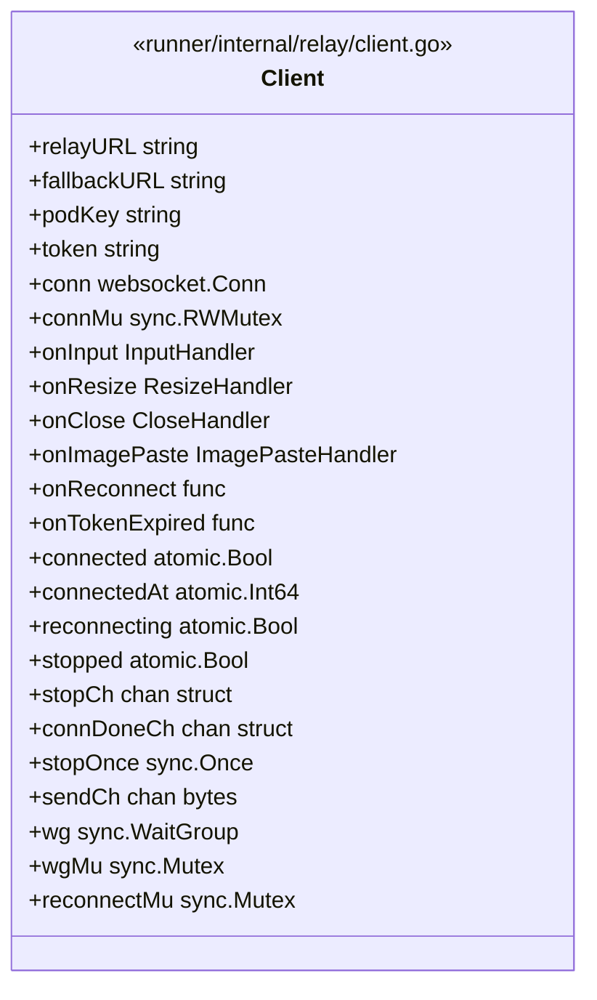
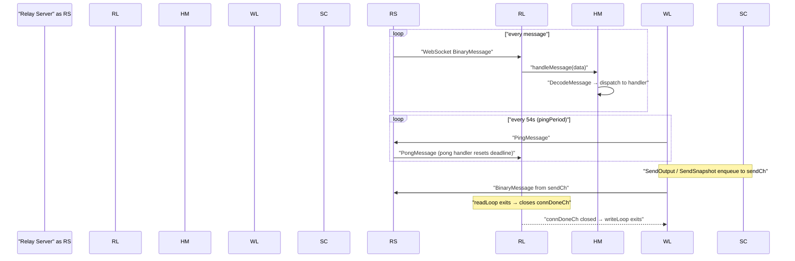
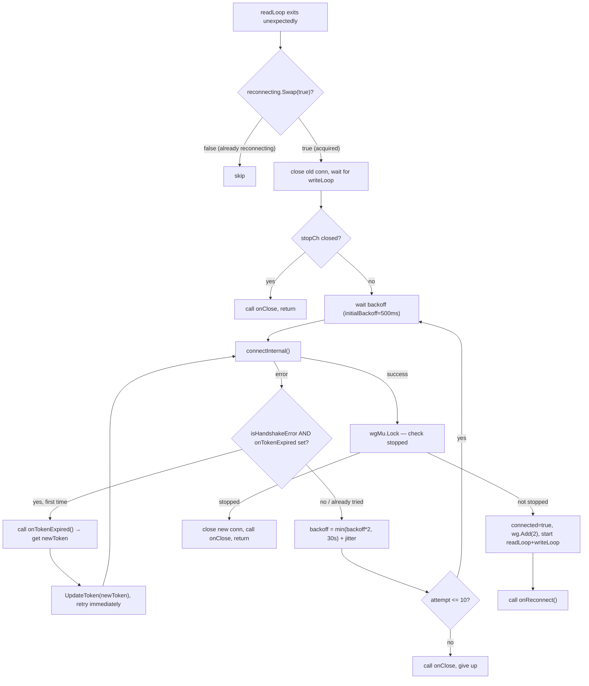
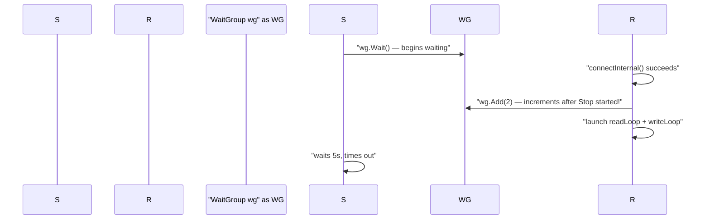

<!-- source: DeepWiki mcp.deepwiki.com · repo AgentsMesh/AgentsMesh · page 3.5 Relay Client · fetched 2026-10-26 -->

# Relay Client

<details>
<summary>Relevant source files</summary>

The following files were used as context for generating this wiki page:

- [docs/troubleshooting/relay-client-stop-timeout.md](docs/troubleshooting/relay-client-stop-timeout.md)
- [runner/internal/relay/client.go](runner/internal/relay/client.go)
- [runner/internal/relay/client_connection.go](runner/internal/relay/client_connection.go)
- [runner/internal/relay/client_loops.go](runner/internal/relay/client_loops.go)
- [runner/internal/relay/client_reconnect.go](runner/internal/relay/client_reconnect.go)
- [runner/internal/relay/client_test.go](runner/internal/relay/client_test.go)
- [runner/internal/relay/interface.go](runner/internal/relay/interface.go)
- [runner/internal/relay/mock_client.go](runner/internal/relay/mock_client.go)
- [runner/internal/runner/message_handler_relay_test.go](runner/internal/runner/message_handler_relay_test.go)

</details>


This page documents the runner-side WebSocket relay client: how it connects to the Relay service, manages message dispatch, handles reconnection, and shuts down cleanly. For the server-side counterpart that manages subscriber sessions, see [Channel and Session Management](#4.1). For how the runner receives the `SubscribeTerminal` command that triggers relay client creation, see [gRPC Client](#3.3).

---

## Purpose

When a browser user opens a terminal, the backend instructs the runner (via gRPC) to connect to the Relay service over WebSocket. The relay client (`runner/internal/relay/`) owns that WebSocket connection for the lifetime of the terminal session. It:

- Forwards terminal output from the PTY to the Relay (and thus to browsers)
- Dispatches inbound input, resize, and image-paste events from browsers to the PTY
- Automatically reconnects with exponential backoff on unexpected disconnection
- Refreshes the JWT token when the relay rejects the connection with a 401/403

---

## Package Layout

| File | Responsibility |
|---|---|
| `client.go` | `Client` struct definition, constants, constructor, handler setters |
| `client_connection.go` | `Connect`, `Start`, `Stop`, `IsConnected` |
| `client_loops.go` | `readLoop`, `writeLoop`, `handleMessage` |
| `client_reconnect.go` | `reconnectLoop` with exponential backoff and token refresh |
| `interface.go` | `RelayClient` interface definition |
| `mock_client.go` | `MockClient` for unit testing |

Sources: [runner/internal/relay/client.go:1-10](), [runner/internal/relay/interface.go:1-37]()

---

## RelayClient Interface

All consumers interact through the `RelayClient` interface defined in [runner/internal/relay/interface.go:9-33](). This allows dependency injection and makes `MockClient` a drop-in replacement in tests.

**RelayClient interface — method groups**

| Group | Methods |
|---|---|
| Lifecycle | `Connect() error`, `Start() bool`, `Stop()`, `IsConnected() bool` |
| Configuration | `GetRelayURL() string`, `GetConnectedAt() int64`, `UpdateToken(string)`, `SetFallbackURL(string)` |
| Handler registration | `SetInputHandler`, `SetResizeHandler`, `SetCloseHandler`, `SetImagePasteHandler`, `SetReconnectHandler`, `SetTokenExpiredHandler` |
| Data transmission | `SendOutput([]byte) error`, `SendSnapshot(*vt.TerminalSnapshot) error` |

Sources: [runner/internal/relay/interface.go:9-33]()

---

## Client Struct

The `Client` struct in [runner/internal/relay/client.go:39-73]() groups its fields into four logical areas:

**Client struct — field groups diagram**



Sources: [runner/internal/relay/client.go:39-73]()

### Constants

[runner/internal/relay/client.go:13-23]() defines the key tuning constants:

| Constant | Value | Purpose |
|---|---|---|
| `writeWait` | 10 s | Deadline for each WebSocket write |
| `pongWait` | 60 s | Time to wait for a pong before treating connection as dead |
| `pingPeriod` | 54 s | `(pongWait * 9) / 10` — how often to send pings |
| `maxMessageSize` | 4 MB | Read limit, accommodates image-paste payloads |
| `maxReconnectDelay` | 30 s | Cap on exponential backoff |
| `initialBackoff` | 500 ms | Starting delay before first reconnect attempt |

---

## Connection Lifecycle

**Connection lifecycle state diagram**

```mermaid
stateDiagram-v2
    [*] --> "Disconnected": "NewClient()"
    "Disconnected" --> "Connected": "Connect() succeeds"
    "Disconnected" --> "Disconnected": "Connect() fails (fallback tried)"
    "Connected" --> "Running": "Start() — readLoop + writeLoop launched"
    "Running" --> "Reconnecting": "readLoop: unexpected error"
    "Reconnecting" --> "Running": "reconnectLoop: connect OK"
    "Reconnecting" --> "Stopped": "reconnectLoop: max attempts or Stop()"
    "Running" --> "Stopped": "Stop() called"
    "Stopped" --> [*]
```

Sources: [runner/internal/relay/client_connection.go:1-172](), [runner/internal/relay/client_reconnect.go:24-179]()

### `NewClient`

[runner/internal/relay/client.go:77-100]() constructs the client with a buffered `sendCh` of 256 entries and creates a background context with cancel. The `podKey` is embedded in structured log fields for easy filtering.

### `Connect`

[runner/internal/relay/client_connection.go:16-41]() orchestrates connection:

1. Acquires `reconnectMu` to prevent concurrent dials.
2. Calls `connectInternal()` which builds the WebSocket URL, converts `http`/`https` schemes to `ws`/`wss`, appends `/runner/terminal`, sets `?token=<jwt>`, and dials using `gorilla/websocket`.
3. If the primary URL fails and `fallbackURL` is set, the primary URL is permanently replaced with the fallback URL and `connectInternal()` is retried.
4. On success, sets `connected = true` and records `connectedAt` as Unix milliseconds.

The token is passed as a query parameter, not a header, so it never appears in connection logs (the log omits the query string).

### `Start`

[runner/internal/relay/client_connection.go:102-118]() launches `readLoop` and `writeLoop` as goroutines (via `safego.Go`). The `wgMu` lock is held around the `stopped` check and `wg.Add(2)` call — this ensures the check and the increment are atomic with respect to `Stop()`.

### `Stop`

[runner/internal/relay/client_connection.go:121-166]() is idempotent via `sync.Once`:

1. Acquires `wgMu`, sets `stopped = true`, releases `wgMu`. After this point no new `wg.Add()` calls can occur.
2. Sets `connected = false`, closes `stopCh`, calls `cancel()`.
3. Closes the underlying `websocket.Conn` to unblock `readLoop` immediately.
4. Waits on `wg.Wait()` with a 5-second timeout.
5. Nils out `conn`.

---

## Read and Write Loops

**Read/write loop interaction diagram**



Sources: [runner/internal/relay/client_loops.go:1-128]()

### `readLoop`

[runner/internal/relay/client_loops.go:9-78]() reads messages in a tight loop. On exit (whether clean or error), its `defer` block:

1. Calls `wg.Done()` **first** — before any callbacks — so `Stop()` is not blocked waiting for slow callbacks.
2. Closes `connDoneCh` to signal `writeLoop`.
3. Checks `stopCh`: if closed, calls `onClose` and returns without reconnecting; otherwise starts `reconnectLoop` (guarded by `reconnecting.Swap(true)` to prevent concurrent attempts).

### `writeLoop`

[runner/internal/relay/client_loops.go:80-128]() selects on three channels:

| Channel | Action |
|---|---|
| `stopCh` | Exit immediately |
| `connDoneCh` | Exit (read side is gone) |
| `sendCh` | Write binary message to WebSocket |
| `ticker.C` | Send `PingMessage` |

Each write sets a `writeWait` deadline before the call.

---

## Message Handling

`handleMessage` in [runner/internal/relay/client_loops.go:130-177]() decodes the binary framing and dispatches by message type:

| `MsgType` | Direction | Handler |
|---|---|---|
| `MsgTypeInput` | Relay → Runner | `onInput(payload)` — keystroke data to PTY |
| `MsgTypeResize` | Relay → Runner | `onResize(cols, rows)` — terminal resize |
| `MsgTypePing` | Relay → Runner | `SendPong()` |
| `MsgTypePong` | Relay → Runner | No-op (keepalive acknowledged) |
| `MsgTypeImagePaste` | Relay → Runner | `onImagePaste(mimeType, data)` |
| `MsgTypeControl` | Relay → Runner | Ignored (logged at debug) |

### Image Paste Payload Format

The `MsgTypeImagePaste` payload uses a length-prefixed MIME type:

```
[mime_len: 1 byte][mime: mime_len bytes][image data: remaining bytes]
```

`DecodeImagePaste` extracts both fields. If the payload is too short, the message is silently dropped rather than panicking.

Sources: [runner/internal/relay/client_loops.go:130-177](), [runner/internal/relay/client_test.go:196-224]()

---

## Reconnection Logic

**Exponential backoff reconnect flow**



Sources: [runner/internal/relay/client_reconnect.go:24-179]()

### Backoff Parameters

- **Initial**: 500 ms
- **Formula**: `min(backoff * 2, 30s)` then ±20% jitter via `rand.Float64()*0.4 - 0.2`
- **Max attempts**: 10; on exhaustion `onClose` is called and the client gives up

### Token Refresh

When `connectInternal` returns a "bad handshake", "401", or "403" error, `isHandshakeError` [runner/internal/relay/client_reconnect.go:13-21]() returns true. The reconnect loop then calls `onTokenExpired()` once (guarded by `tokenRefreshAttempted`). This callback is set by the message handler to request a new relay token from the backend via gRPC. If a new token is returned, `UpdateToken` is called and the connection is retried immediately without incrementing backoff.

---

## Shutdown Race Condition Fix

A documented race condition between `Stop()` and `reconnectLoop()` was fixed. The root cause and solution are recorded in [docs/troubleshooting/relay-client-stop-timeout.md:1-158]().

**Race condition: before fix**



**Fix summary**

| Mechanism | Role |
|---|---|
| `stopped atomic.Bool` | Permanent stop flag; set to `true` once by `Stop()` |
| `wgMu sync.Mutex` | Guards `wg.Add()` calls; makes "check stopped → add" atomic |
| `Stop()` acquires `wgMu` before setting `stopped=true` | Guarantees no new `wg.Add()` after this point |
| `Start()` and `reconnectLoop()` acquire `wgMu` before `wg.Add(2)` | Cannot race with `Stop()` |
| `readLoop` defer calls `wg.Done()` first | Unblocks `Stop()` before any slow callbacks run |

Tests covering this fix: `TestStopDuringReconnect`, `TestConcurrentStopAndReconnect`, `TestStartAfterStop`, `TestStopIdempotent` in [runner/internal/relay/client_test.go:447-641]().

---

## Multi-Client (Shared Relay) Behaviour

When a second browser window (or mobile client) opens the same terminal, the backend sends another `SubscribeTerminal` command with a fresh token but the same relay URL. The message handler checks:

1. Is there an existing `RelayClient` on the pod? → Yes
2. Is it connected? → Yes
3. Is the relay URL the same? → Yes

In this case `Stop()` is **not** called. Only `UpdateToken` is called on the existing client. This prevents interrupting ongoing sessions when multiple viewers connect.

The condition for creating a new connection: existing client is `nil`, not connected, or pointing at a different relay URL.

Sources: [runner/internal/runner/message_handler_relay_test.go:37-87](), [runner/internal/runner/message_handler_relay_test.go:252-333]()

---

## MockClient

[runner/internal/relay/mock_client.go:9-196]() provides `MockClient`, a thread-safe implementation of `RelayClient` for unit testing. It records calls in exported fields:

| Field | Tracks |
|---|---|
| `ConnectCalled bool` | Whether `Connect()` was invoked |
| `StartCalled bool` | Whether `Start()` was invoked |
| `StopCalled bool` | Whether `Stop()` was invoked |
| `UpdateTokenCalls []string` | All tokens passed to `UpdateToken` |
| `ConnectError error` | Configurable error to return from `Connect` |

Helper methods `SetConnected`, `SetConnectedAt`, `GetToken`, and `Reset` support test setup and assertion.

Sources: [runner/internal/relay/mock_client.go:9-196]()

---

