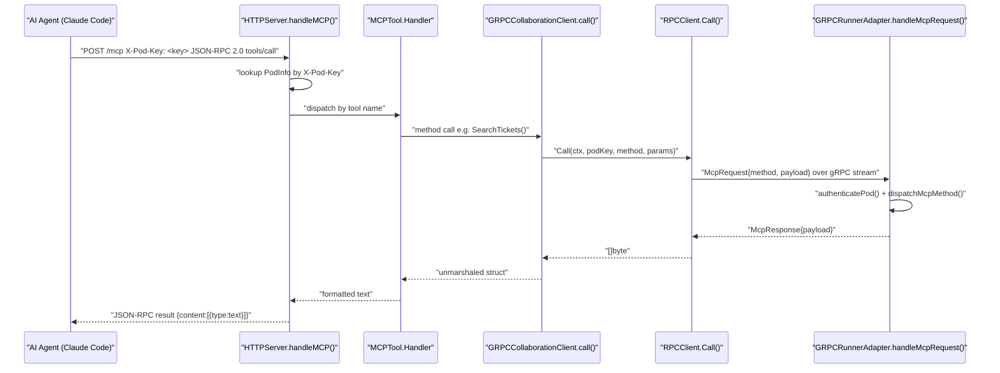
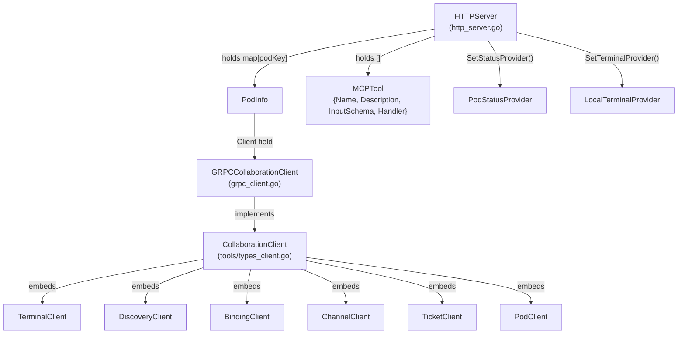
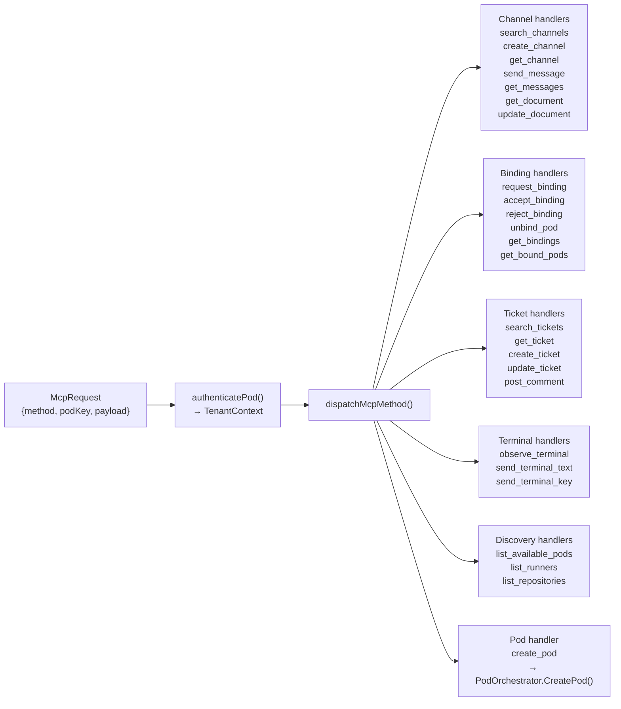

<!-- source: DeepWiki mcp.deepwiki.com · repo AgentsMesh/AgentsMesh · page 3.6 MCP Server · fetched 2026-10-26 -->

# MCP Server

<details>
<summary>Relevant source files</summary>

The following files were used as context for generating this wiki page:

- [README.md](README.md)
- [backend/internal/api/grpc/runner_adapter_mcp.go](backend/internal/api/grpc/runner_adapter_mcp.go)
- [backend/internal/api/grpc/runner_adapter_mcp_ticket.go](backend/internal/api/grpc/runner_adapter_mcp_ticket.go)
- [backend/internal/service/ticket/ticket_query.go](backend/internal/service/ticket/ticket_query.go)
- [backend/internal/service/ticket/ticket_query_test.go](backend/internal/service/ticket/ticket_query_test.go)
- [docs/images/architecture.svg](docs/images/architecture.svg)
- [runner/internal/mcp/grpc_client.go](runner/internal/mcp/grpc_client.go)
- [runner/internal/mcp/http_server.go](runner/internal/mcp/http_server.go)
- [runner/internal/mcp/http_tools_format_integration_test.go](runner/internal/mcp/http_tools_format_integration_test.go)
- [runner/internal/mcp/http_tools_ticket.go](runner/internal/mcp/http_tools_ticket.go)
- [runner/internal/mcp/tools/types_client.go](runner/internal/mcp/tools/types_client.go)
- [runner/internal/mcp/tools/types_entity.go](runner/internal/mcp/tools/types_entity.go)

</details>


This page covers the runner-side MCP (Model Context Protocol) HTTP server: how it is structured, how pods are registered, how AI agents discover and call tools, and how each tool category invokes the backend. The document covers code in `runner/internal/mcp/`.

For the backend's counterpart that receives and processes these tool calls over gRPC, see [MCP and Mesh Service (2.4)](#2.4). For how bindings and channels are managed at the backend domain level, see [MCP and Mesh Service (2.4)](#2.4). For the gRPC connection over which tool calls travel, see [gRPC Client (3.3)](#3.3).

---

## Overview

When the runner creates an AgentPod it starts a local HTTP server (`HTTPServer`) that speaks the Model Context Protocol. AI agents such as Claude Code connect to this server to access collaboration tools: observing other terminals, managing pod bindings, sending channel messages, searching tickets, and spawning new pods. Tool invocations arriving at the HTTP server are forwarded as `McpRequest` messages over the existing gRPC bidirectional stream to the backend, which executes the business logic and returns a result.

The entire server is scoped to `127.0.0.1` and is therefore only reachable by processes running on the same machine as the runner.

---

## HTTP Server

`HTTPServer` in [runner/internal/mcp/http_server.go:36-46]() is the central struct. It owns:

| Field | Type | Purpose |
|---|---|---|
| `rpcClient` | `*client.RPCClient` | Sends `McpRequest` messages to the backend over gRPC |
| `port` | `int` | Localhost port (set at construction time) |
| `pods` | `map[string]*PodInfo` | Registry of active pods indexed by pod key |
| `tools` | `[]*MCPTool` | Registered tool definitions (populated once at startup) |
| `statusProvider` | `PodStatusProvider` | Optional interface to query local pod agent status |
| `terminalProvider` | `LocalTerminalProvider` | Optional interface for direct local terminal access |

The server listens on three routes:

| Route | Handler | Purpose |
|---|---|---|
| `POST /mcp` | `handleMCP` | Main JSON-RPC 2.0 dispatch endpoint |
| `GET /health` | `handleHealth` | Health probe |
| `GET /pods` | `handlePods` | Debug – list registered pods |

`NewHTTPServer` in [runner/internal/mcp/http_server.go:72-87]() creates the struct and calls `registerTools()` immediately. Tools are registered once and never change at runtime.

`Start()` in [runner/internal/mcp/http_server.go:90-118]() wraps `http.Server.ListenAndServe` in a `safego.Go` goroutine. `Stop()` issues a graceful shutdown with a 5-second deadline.

Sources: [runner/internal/mcp/http_server.go:36-137]()

---

## Pod Registration

Pods must be registered before the AI agent running inside them can call any tool. The lifecycle is:

**Registration** – `RegisterPod()` in [runner/internal/mcp/http_server.go:140-155]() stores a `PodInfo` entry and creates a `GRPCCollaborationClient` bound to the pod's key. All subsequent tool calls for that pod use this client.

**Unregistration** – `UnregisterPod()` in [runner/internal/mcp/http_server.go:158-163]() removes the entry when a pod terminates.

`PodInfo` [runner/internal/mcp/http_server.go:49-57]() holds:

| Field | Description |
|---|---|
| `PodKey` | Unique identifier for the pod |
| `OrgSlug` | Organization slug for authorization context |
| `TicketID` / `ProjectID` | Optional associations |
| `AgentType` | String identifier of the AI agent |
| `Client` | `CollaborationClient` – the gRPC-backed tool implementation |

**Tool request authentication** – when `handleMCP` receives a request, it reads the `X-Pod-Key` HTTP header and looks up the corresponding `PodInfo`. Requests referencing an unregistered pod are rejected immediately.

Sources: [runner/internal/mcp/http_server.go:49-57](), [runner/internal/mcp/http_server.go:140-173]()

---

## MCP Configuration for Claude Code

`GenerateMCPConfig()` in [runner/internal/mcp/http_server.go:204-219]() produces the JSON configuration block that the runner injects into the agent's environment. The configuration instructs Claude Code to use `curl` as a stdio transport:

```json
{
  "mcpServers": {
    "agentsmesh-collaboration": {
      "command": "curl",
      "args": [
        "-X", "POST",
        "-H", "Content-Type: application/json",
        "-H", "X-Pod-Key: <pod-key>",
        "http://localhost:<port>/mcp",
        "-d", "@-"
      ]
    }
  }
}
```

Claude Code pipes JSON-RPC 2.0 messages through `stdin` into `curl`, which forwards them to the local HTTP server. The `X-Pod-Key` header is baked into the config, so the server knows which pod is calling.

Sources: [runner/internal/mcp/http_server.go:204-219]()

---

## Request Flow

**Title: MCP Tool Call – from AI Agent to Backend and Back**



Sources: [runner/internal/mcp/http_server.go:1-220](), [runner/internal/mcp/grpc_client.go:35-62](), [backend/internal/api/grpc/runner_adapter_mcp.go:17-44]()

---

## Tool Architecture

**Title: HTTPServer, CollaborationClient, and Tool Interfaces**



Sources: [runner/internal/mcp/http_server.go:36-68](), [runner/internal/mcp/tools/types_client.go:1-68](), [runner/internal/mcp/grpc_client.go:16-27]()

---

## Registered Tools

All tools are registered in `registerTools()` in [runner/internal/mcp/http_server.go:222-262](). Each `MCPTool` carries a JSON Schema (`InputSchema`) and a `MCPToolHandler` closure.

### Terminal Tools

| Tool Name | Method | Description |
|---|---|---|
| `observe_terminal` | `createObserveTerminalTool` | Read scrollback and screen from another pod's PTY |
| `send_terminal_text` | `createSendTerminalTextTool` | Send text input to another pod's terminal |
| `send_terminal_key` | `createSendTerminalKeyTool` | Send special key sequences (e.g. Enter, Ctrl-C) |
| `get_pod_status` | `createGetPodStatusTool` | Query agent status (executing/waiting/idle) from `PodStatusProvider` |

`observe_terminal` accepts `pod_key`, `lines`, `raw`, and `include_screen` parameters. `send_terminal_key` accepts a `keys` array of named key identifiers.

`get_pod_status` is special: it does not go through the gRPC stream. If the target pod key matches a pod running on the same runner, it queries `statusProvider.GetPodStatus()` directly. For remote pods it falls back to the backend call.

### Discovery Tools

| Tool Name | Description | Returns |
|---|---|---|
| `list_available_pods` | All pods in the organization available for collaboration | Markdown table of pod keys, statuses, creators |
| `list_runners` | Runners and their available agent types | Text summary with pod counts and agent list |
| `list_repositories` | Git repositories configured in the organization | Markdown table of IDs, names, providers |

### Binding Tools

Pod bindings grant one pod permission to interact with another. All binding operations require a prior binding relationship.

| Tool Name | Required Args | Description |
|---|---|---|
| `bind_pod` | `target_pod`, `scopes` | Request a binding from this pod to another |
| `accept_binding` | `binding_id` | Accept an incoming binding request |
| `reject_binding` | `binding_id`, `reason` | Reject an incoming binding request |
| `unbind_pod` | `target_pod` | Remove an existing binding |
| `get_bindings` | `status` (optional) | List bindings for this pod |
| `get_bound_pods` | — | List pod keys that are currently bound to this pod |

`scopes` is an array of `BindingScope` strings (e.g. `terminal:read`).

Sources: [runner/internal/mcp/http_server.go:222-262](), [runner/internal/mcp/tools/types_client.go:23-30](), [runner/internal/mcp/tools/types_entity.go:4-13]()

### Channel Tools

Channels are named communication spaces that can be associated with a repository or ticket.

| Tool Name | Required Args | Description |
|---|---|---|
| `search_channels` | — | Search by name, repository, ticket, or archived state |
| `create_channel` | `name` | Create a new channel |
| `get_channel` | `channel_id` | Fetch channel metadata |
| `send_channel_message` | `channel_id`, `content` | Post a message; supports `mentions` and `reply_to` |
| `get_channel_messages` | `channel_id` | Retrieve messages with optional time filters and mention filter |
| `get_channel_document` | `channel_id` | Read the channel's shared document |
| `update_channel_document` | `channel_id`, `document` | Replace the shared document |

Sources: [runner/internal/mcp/http_server.go:244-251](), [runner/internal/mcp/tools/types_entity.go:72-96]()

### Ticket Tools

Ticket tool definitions are in [runner/internal/mcp/http_tools_ticket.go]().

| Tool Name | Required Args | Description |
|---|---|---|
| `search_tickets` | — | Filter by status, priority, assignee, parent ticket, query string |
| `get_ticket` | `ticket_slug` | Retrieve a single ticket; supports `content_offset`/`content_limit` for paginated reading of long descriptions |
| `create_ticket` | `title` | Create a ticket; optional repository, content, priority, parent slug |
| `update_ticket` | `ticket_slug` | Update title, content, status, or priority |
| `post_comment` | `ticket_slug`, `content` | Add a comment; optional `parent_id` for threading |

`ticket_slug` is the human-readable identifier format (e.g. `AM-123`). The backend resolves slugs to internal IDs — see `GetTicketByIDOrSlug` in [backend/internal/service/ticket/ticket_query.go:43-64]().

Ticket content (stored as BlockNote JSON on the backend) is converted to plain text by the backend before being returned. The `content_offset` and `content_limit` parameters allow line-range pagination for large ticket bodies.

Sources: [runner/internal/mcp/http_tools_ticket.go:1-277](), [backend/internal/api/grpc/runner_adapter_mcp_ticket.go:35-87]()

### Pod Tools

| Tool Name | Required Args | Description |
|---|---|---|
| `create_pod` | `runner_id`, `agent_type_id` | Spawn a new AgentPod; accepts repository, ticket, branch, permission mode, credential profile, and config overrides |

`create_pod` delegates to `PodOrchestrator.CreatePod()` on the backend. On success it returns the new `pod_key` and initial `status`. See [backend/internal/api/grpc/runner_adapter_mcp_ticket.go:312-374]() for the full parameter set.

Sources: [runner/internal/mcp/http_server.go:259-261](), [backend/internal/api/grpc/runner_adapter_mcp_ticket.go:312-400]()

---

## GRPCCollaborationClient

`GRPCCollaborationClient` in [runner/internal/mcp/grpc_client.go:16-27]() is the concrete implementation of `CollaborationClient`. It holds a reference to `*client.RPCClient` and the current `podKey`.

Every method calls the private `call()` helper in [runner/internal/mcp/grpc_client.go:35-62](), which:

1. Marshals the parameters to JSON.
2. Invokes `RPCClient.Call(ctx, podKey, method, params)` — this sends a `McpRequest` protobuf message over the gRPC bidirectional stream and blocks until a `McpResponse` is received.
3. Unmarshals the response bytes into the expected result type.

The gRPC stream itself is managed by the runner's `RPCClient` (see [gRPC Client (3.3)](#3.3)). `GRPCCollaborationClient` does not manage connectivity; it only serializes domain calls into wire messages.

Sources: [runner/internal/mcp/grpc_client.go:1-491]()

---

## Backend-Side Dispatch

When a `McpRequest` arrives at the backend over the gRPC stream, `GRPCRunnerAdapter.handleMcpRequest()` in [backend/internal/api/grpc/runner_adapter_mcp.go:17-44]() handles it:

1. **Authentication** – `authenticatePod()` [backend/internal/api/grpc/runner_adapter_mcp.go:62-90]() verifies the pod key exists and belongs to the runner's organization. It constructs a `TenantContext` with the pod's creator as the acting user.
2. **Dispatch** – `dispatchMcpMethod()` [backend/internal/api/grpc/runner_adapter_mcp.go:93-160]() routes by method string to the appropriate handler (e.g. `mcpSearchTickets`, `mcpCreatePod`).
3. **Response** – `sendMcpResponse()` serializes the result and writes a `McpResponse` message back through the gRPC connection.

**Title: Backend MCP Dispatch – Method to Handler Mapping**



Sources: [backend/internal/api/grpc/runner_adapter_mcp.go:17-226](), [backend/internal/api/grpc/runner_adapter_mcp_ticket.go:92-400]()

---

## Local Providers

Two optional interfaces allow the MCP server to bypass the backend gRPC round-trip when interacting with pods on the same runner.

### PodStatusProvider

Defined in [runner/internal/mcp/http_server.go:17-21]():

```
GetPodStatus(podKey string) (agentStatus string, podStatus string, shellPid int, found bool)
```

Set via `SetStatusProvider()`. Used by the `get_pod_status` tool to report whether the agent is currently `executing`, `waiting`, or `idle` without incurring a network call.

### LocalTerminalProvider

Defined in [runner/internal/mcp/http_server.go:24-33]():

```
GetTerminalOutput(podKey string, lines int) (string, error)
SendTerminalText(podKey string, text string) error
SendTerminalKey(podKey string, keys []string) error
```

Set via `SetTerminalProvider()`. When set, an AutopilotController can interact with co-located pods directly through in-process function calls rather than through the backend's terminal relay path.

Sources: [runner/internal/mcp/http_server.go:17-33](), [runner/internal/mcp/http_server.go:176-189]()

---

## Tool Response Format

Tool handlers return their results as human-readable text rather than raw JSON. The MCP response wraps the text in a `content` array of `{type: "text", text: "..."}` blocks (standard MCP tool result format). This is intentional: AI models consume the text directly, so Markdown tables and key-value summaries are more token-efficient than JSON structures.

Examples from integration tests in [runner/internal/mcp/http_tools_format_integration_test.go]():

| Tool | Format |
|---|---|
| `list_available_pods` | Markdown table: Pod Key, Status, Creator, Ticket |
| `list_runners` | Multi-line text: Runner #N, Node, Status, Pods: X/Y, agent list |
| `get_ticket` | Key-value: `Ticket: AM-123 - Title`, `Status: in_progress \| Priority: high` |
| `get_channel_messages` | Prefixed lines: `[timestamp] pod-key: content` |
| `get_bound_pods` | Comma-separated: `Bound pods: pod-x, pod-y` |
| `send_terminal_text` | Plain: `Text sent successfully` |

Sources: [runner/internal/mcp/http_tools_format_integration_test.go:240-492]()

---

