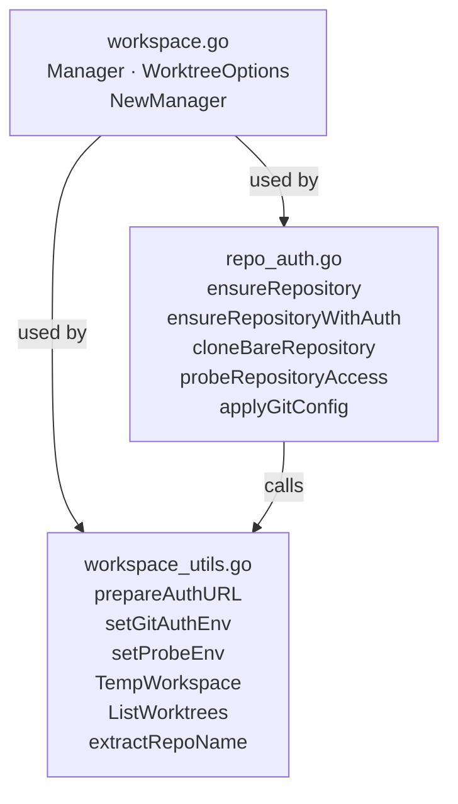
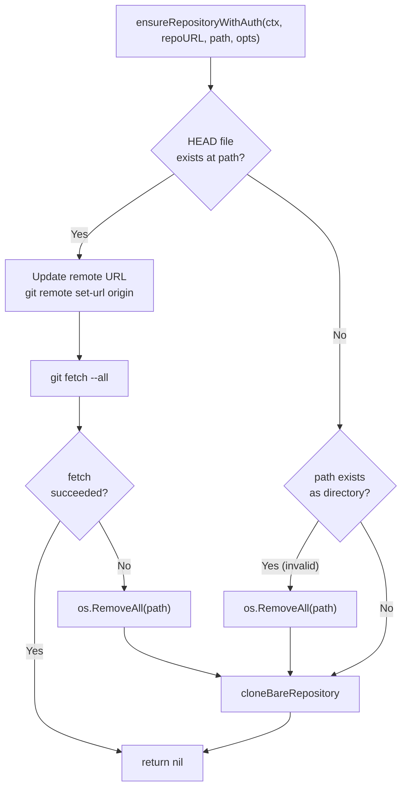
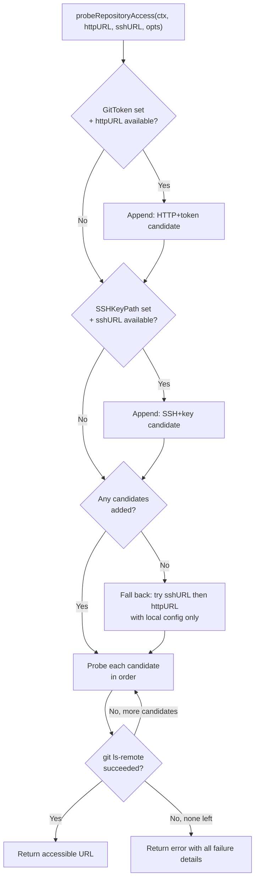
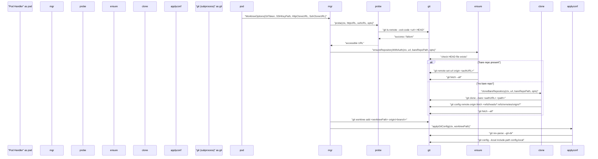

<!-- source: DeepWiki mcp.deepwiki.com · repo AgentsMesh/AgentsMesh · page 3.7 Workspace and Git Management · fetched 2026-10-26 -->

# Workspace and Git Management

<details>
<summary>Relevant source files</summary>

The following files were used as context for generating this wiki page:

- [.gitlab-ci.yml](.gitlab-ci.yml)
- [ci/backend.Dockerfile](ci/backend.Dockerfile)
- [ci/relay.Dockerfile](ci/relay.Dockerfile)
- [ci/runner.Dockerfile](ci/runner.Dockerfile)
- [ci/web-admin.Dockerfile](ci/web-admin.Dockerfile)
- [ci/web.Dockerfile](ci/web.Dockerfile)
- [runner/internal/workspace/repo_auth.go](runner/internal/workspace/repo_auth.go)
- [runner/internal/workspace/workspace.go](runner/internal/workspace/workspace.go)
- [runner/internal/workspace/workspace_utils.go](runner/internal/workspace/workspace_utils.go)
- [web/src/lib/terminalScheduler.ts](web/src/lib/terminalScheduler.ts)
- [web/vitest.config.ts](web/vitest.config.ts)

</details>


This page covers the workspace management subsystem in the Runner, located in `runner/internal/workspace/`. It describes how the runner clones repositories as bare Git repos, creates worktrees for individual pods, handles authentication (token and SSH), probes repository access, and provides utility functions for workspace directory management.

For how workspaces are referenced from the pod and terminal abstraction layer, see [Pod and Terminal Management](#3.4). For how MCP tools expose workspace operations to AI agents, see [MCP Server](#3.6).

---

## Overview

Each pod that works on a repository needs an isolated checkout. The workspace package implements this using Git's **bare repository + worktree** model:

1. A bare clone of the upstream repository is maintained as a shared cache.
2. Per-pod working directories are created as Git worktrees from that bare clone.
3. Authentication credentials (HTTPS token or SSH key) are applied at clone/fetch time without storing them permanently in the repository configuration.

**Directory layout on disk:**

```
{workspace_root}/
  repos/
    {repo-name}/          ← bare clone (shared cache)
      HEAD
      config
      refs/
      ...
  sandboxes/
    {podKey}/
      worktree/           ← git worktree checkout for this pod
  temp/
    {podKey}/             ← ephemeral working space (no git)
```

Sources: [runner/internal/workspace/workspace.go:1-70](), [runner/internal/workspace/workspace_utils.go:74-113]()

---

## Core Types

**`Manager`** is the central struct for the workspace subsystem.

| Field | Type | Purpose |
|---|---|---|
| `root` | `string` | Absolute path of the workspace root directory |
| `gitConfigPath` | `string` | Optional path to a supplemental git config file applied to each worktree |
| `mu` | `sync.Mutex` | Guards directory listing operations |

**`WorktreeOptions`** carries per-operation authentication and URL parameters.

| Field | Type | Purpose |
|---|---|---|
| `GitToken` | `string` | Personal access token or OAuth token for HTTPS authentication |
| `SSHKeyPath` | `string` | Filesystem path to the SSH private key |
| `HttpCloneURL` | `string` | HTTPS remote URL |
| `SshCloneURL` | `string` | SSH remote URL (e.g., `git@github.com:org/repo.git`) |

`WorktreeOption` is the functional-options type. The available constructors are `WithGitToken`, `WithSSHKeyPath`, `WithHttpCloneURL`, and `WithSshCloneURL`.

Sources: [runner/internal/workspace/workspace.go:12-70]()

---

## Module Structure

**Workspace package: `runner/internal/workspace`**



Sources: [runner/internal/workspace/workspace.go:1-70](), [runner/internal/workspace/repo_auth.go:1-221](), [runner/internal/workspace/workspace_utils.go:1-137]()

---

## Repository Lifecycle

### `ensureRepository` and `ensureRepositoryWithAuth`

`ensureRepository` is the unauthenticated entry point; it delegates to `ensureRepositoryWithAuth` with `nil` options.

`ensureRepositoryWithAuth` determines whether a bare repository already exists at the given path by checking for a `HEAD` file directly inside the directory (the bare-repo marker). Its logic follows three branches:



Sources: [runner/internal/workspace/repo_auth.go:16-60]()

### `cloneBareRepository`

This function performs the actual `git clone --bare` and then configures the repository for worktree use.

Steps:
1. Create the parent directory with `os.MkdirAll`.
2. Call `prepareAuthURL` to embed the token into the HTTPS URL if applicable.
3. Run `git clone --bare <url> <path>`.
4. On failure, remove any partial clone artifacts with `os.RemoveAll`.
5. Set the fetch refspec: `git config remote.origin.fetch +refs/heads/*:refs/remotes/origin/*`  
   This allows worktrees to reference branches as `origin/<branch>`.
6. Run `git fetch --all` to populate the `origin/*` refs.

Sources: [runner/internal/workspace/repo_auth.go:63-97]()

---

## Authentication

### Token-based HTTPS

`prepareAuthURL` embeds the token into the HTTPS URL using the `x-access-token` username convention:

```
https://x-access-token:<token>@host/path
```

This format is accepted by GitHub, GitLab, Azure DevOps, and Bitbucket without any platform-specific logic.

Sources: [runner/internal/workspace/workspace_utils.go:12-30]()

### SSH Key

`setGitAuthEnv` constructs a `GIT_SSH_COMMAND` environment variable that points to the provided key file:

```
GIT_SSH_COMMAND=ssh -i <keypath> -o StrictHostKeyChecking=no -o BatchMode=yes
```

`BatchMode=yes` ensures SSH never prompts for a passphrase; the runner is a daemon and cannot accept interactive input. `StrictHostKeyChecking=no` avoids blocking on unknown hosts.

### Probe-specific environment

`setProbeEnv` is a stricter variant of `setGitAuthEnv` used during access probing. Even when no `SSHKeyPath` is provided, it injects:

```
GIT_SSH_COMMAND=ssh -o StrictHostKeyChecking=no -o BatchMode=yes -o ConnectTimeout=30
```

The `ConnectTimeout=30` is added to prevent the probe from blocking indefinitely.

Both `setGitAuthEnv` and `setProbeEnv` always append `GIT_TERMINAL_PROMPT=0` and `GIT_ASKPASS=` to suppress any credential helper prompts.

Sources: [runner/internal/workspace/workspace_utils.go:32-71]()

---

## Repository Access Probing

`probeRepositoryAccess` is called before committing to a clone to verify that at least one access method actually works. It runs `git ls-remote --exit-code <url> HEAD` with a 60-second timeout per candidate.

**Candidate URL selection logic:**



The fallback path (no credential-matched candidates) handles `runner_local` mode where the runner relies on the user's local SSH agent or git credential helper.

Sources: [runner/internal/workspace/repo_auth.go:99-176]()

---

## Custom Git Configuration

`applyGitConfig` applies a supplemental git configuration file to a worktree. This is used to inject organization-specific settings (e.g., user name/email, signing keys) without modifying the shared bare repository.

Steps:
1. Read the file at `m.gitConfigPath`.
2. Run `git rev-parse --git-dir` inside the worktree to locate the actual `.git` directory (in a worktree, `.git` is a file, not a directory; this command resolves the real path).
3. Write the contents to `<gitdir>/config.local`.
4. Set `include.path = config.local` in the worktree's local config via `git config --local`.

Sources: [runner/internal/workspace/repo_auth.go:178-221]()

---

## Utility Functions

| Function | Location | Description |
|---|---|---|
| `TempWorkspace(podKey)` | `workspace_utils.go:74` | Returns `{root}/temp/{podKey}`, creating it with `os.MkdirAll` |
| `GetWorkspaceRoot()` | `workspace_utils.go:81` | Returns the configured `root` string |
| `ListWorktrees()` | `workspace_utils.go:86` | Scans `sandboxes/*/worktree` and returns paths that exist on disk |
| `extractRepoName(repoURL)` | `workspace_utils.go:116` | Normalizes SSH and HTTPS URLs to a `owner-repo` string for directory naming |

`ListWorktrees` acquires the `Manager` mutex before scanning to prevent races with concurrent worktree creation or deletion. It returns `nil` (not an error) if the `sandboxes/` directory does not yet exist.

`extractRepoName` handles both SSH (`git@github.com:user/repo.git`) and HTTPS (`https://github.com/user/repo.git`) URL formats, stripping the `.git` suffix and joining the owner and repo name with a hyphen.

Sources: [runner/internal/workspace/workspace_utils.go:73-137]()

---

## Data Flow: Pod Workspace Setup

The following diagram traces a complete workspace setup sequence, from receiving a pod command to having a ready worktree, showing which functions are called at each step.



Sources: [runner/internal/workspace/repo_auth.go:16-221](), [runner/internal/workspace/workspace_utils.go:32-71]()

---

## `NewManager` Initialization

`NewManager(root, gitConfigPath string)` creates the workspace root directory with `os.MkdirAll` if it does not exist and returns a `*Manager`. It logs the root path via the runner's structured logger (`logger.Runner()`).

The `gitConfigPath` argument may be an empty string, in which case `applyGitConfig` is a no-op (guarded by the `m.gitConfigPath == ""` early return at [runner/internal/workspace/repo_auth.go:183]()).

Sources: [runner/internal/workspace/workspace.go:58-70]()

---

