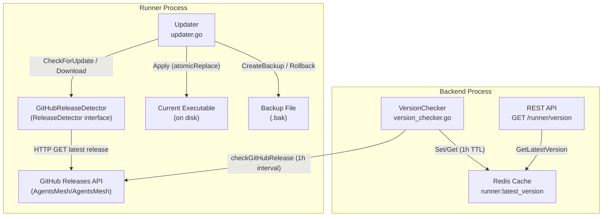
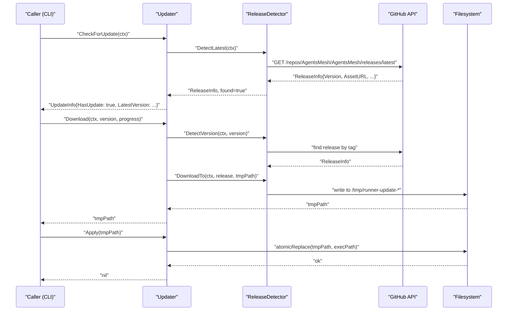
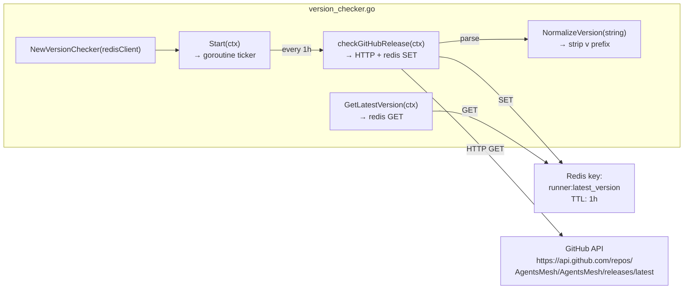

<!-- source: DeepWiki mcp.deepwiki.com · repo AgentsMesh/AgentsMesh · page 3.8 Auto-Update · fetched 2026-10-26 -->

# Auto-Update

<details>
<summary>Relevant source files</summary>

The following files were used as context for generating this wiki page:

- [.github/workflows/release.yml](.github/workflows/release.yml)
- [backend/internal/service/runner/version_checker.go](backend/internal/service/runner/version_checker.go)
- [backend/internal/service/runner/version_checker_test.go](backend/internal/service/runner/version_checker_test.go)
- [docs/rfc/RFC-003-runner-release-pipeline.md](docs/rfc/RFC-003-runner-release-pipeline.md)
- [runner/build/scripts/sign-darwin.sh](runner/build/scripts/sign-darwin.sh)
- [runner/internal/updater/updater.go](runner/internal/updater/updater.go)
- [runner/internal/updater/updater_test.go](runner/internal/updater/updater_test.go)

</details>


This page covers the runner's self-update mechanism and the backend service that tracks the latest available version. The runner updater (`runner/internal/updater`) handles checking, downloading, applying, and rolling back binary updates. The backend `VersionChecker` (`backend/internal/service/runner`) independently polls GitHub Releases and caches the result in Redis for use by the REST API.

For how the runner is built and released as a binary artifact, see the Release Process page ([8.2](#8.2)). For runner CLI commands including the `update` subcommand, see CLI Reference ([3.2](#3.2)).

---

## System Overview

The auto-update system has two independent components that both talk to the GitHub Releases API for `AgentsMesh/AgentsMesh`:

**Auto-Update Architecture**



Sources: [runner/internal/updater/updater.go:1-50](), [backend/internal/service/runner/version_checker.go:1-60]()

---

## Runner-Side: `updater` Package

### Key Types

| Type | File | Role |
|---|---|---|
| `Updater` | `updater.go` | Entry point for all update operations |
| `UpdateInfo` | `updater.go` | Describes an available update |
| `ReleaseDetector` | (interface) | Abstracts GitHub release discovery and download |
| `ReleaseInfo` | (interface impl) | Payload returned by `ReleaseDetector` |

**`UpdateInfo`** fields [runner/internal/updater/updater.go:24-32]():

| Field | Type | Description |
|---|---|---|
| `CurrentVersion` | `string` | Normalized version of the running binary |
| `LatestVersion` | `string` | Version string from GitHub release tag |
| `ReleaseNotes` | `string` | Release body text |
| `PublishedAt` | `time.Time` | GitHub release publication timestamp |
| `HasUpdate` | `bool` | `true` if `LatestVersion > CurrentVersion` |
| `AssetURL` | `string` | Direct download URL for the matching archive |
| `AssetName` | `string` | Archive filename (e.g., `agentsmesh-runner_1.2.0_linux_amd64.tar.gz`) |

### `Updater` Construction

`New` in [runner/internal/updater/updater.go:67-79]() accepts a version string and variadic `Option` functions:

| Option | Effect |
|---|---|
| `WithPrerelease(bool)` | Allow or block prerelease version updates |
| `WithReleaseDetector(ReleaseDetector)` | Inject a custom detector (used in tests) |
| `WithExecPathFunc(func() (string, error))` | Override executable path resolution (used in tests) |

Version normalization is done immediately on construction via the private `normalizeVersion` function [runner/internal/updater/updater.go:82-91](): empty strings and `"dev"` become `"v0.0.0-dev"`, and missing `v` prefixes are added.

### Update Operation Flow

**Runner Update Sequence**



Sources: [runner/internal/updater/updater.go:108-232]()

The convenience method `UpdateNow` [runner/internal/updater/updater.go:211-232]() combines all three steps. `UpdateToVersion` [runner/internal/updater/updater.go:235-249]() skips the check and goes directly to `Download` + `Apply` for a named version.

### `Apply` and Atomic Replacement

`Apply` [runner/internal/updater/updater.go:197-208]() resolves the running executable path via `execPathFunc` (defaults to `os.Executable`), then calls `atomicReplace(tmpPath, execPath)`. The `atomicReplace` function is platform-specific and not defined in `updater.go` itself — it handles the constraint that Windows cannot overwrite a running binary (requires a different strategy than a POSIX `rename` syscall).

On non-Windows systems, the downloaded archive is `chmod`-ed to `0755` after extraction [runner/internal/updater/updater.go:186-191]().

### Backup and Rollback

`CreateBackup` [runner/internal/updater/updater.go:276-289]() copies the current executable to `<execPath>.bak` using `copyFile`.

`Rollback` [runner/internal/updater/updater.go:257-273]() reads `<execPath>.bak` and calls `atomicReplace(backupPath, execPath)`. If no backup file exists, it returns an explicit error. The rollback does not restart the process; that is left to the caller.

### Prerelease Filtering

In `CheckForUpdate` [runner/internal/updater/updater.go:143-145](), if `allowPrerelease` is `false` (the default) and the latest release has a non-empty semver prerelease segment, `HasUpdate` is forced to `false` even if the semver ordinal is higher.

---

## Backend-Side: `VersionChecker`

The `VersionChecker` [backend/internal/service/runner/version_checker.go:32-38]() runs as a background goroutine in the backend process. Its sole purpose is to keep a Redis key up to date with the latest published runner version, so that the REST API can return this value cheaply without calling GitHub on every request.

### Construction and Lifecycle

`NewVersionChecker(redisClient *redis.Client)` [backend/internal/service/runner/version_checker.go:42-55]() returns `nil` if `redisClient` is nil. All methods check for nil receiver and degrade silently — the feature is opt-in and requires a Redis connection.

`Start(ctx context.Context)` [backend/internal/service/runner/version_checker.go:58-88]() launches two goroutines:

1. An **immediate first check** to populate the cache on startup.
2. A **ticker goroutine** that calls `checkGitHubRelease` every `defaultCheckInterval` (1 hour).

**Backend VersionChecker Component Map**



Sources: [backend/internal/service/runner/version_checker.go:1-157]()

### Redis Caching

| Constant | Value |
|---|---|
| `redisKeyLatestVersion` | `"runner:latest_version"` |
| `defaultCheckInterval` | `1 * time.Hour` |
| `redisCacheTTL` | `1 * time.Hour` |

`GetLatestVersion` [backend/internal/service/runner/version_checker.go:92-103]() is a synchronous read from Redis. Cache misses and Redis errors are treated identically: an empty string is returned and the error is suppressed. This prevents any Redis instability from surfacing to callers.

### GitHub API Request

`checkGitHubRelease` [backend/internal/service/runner/version_checker.go:112-151]() sends:

```
GET https://api.github.com/repos/AgentsMesh/AgentsMesh/releases/latest
Accept: application/vnd.github+json
User-Agent: AgentsMesh-Backend
```

The response is decoded into `githubRelease` [backend/internal/service/runner/version_checker.go:106-109]():

```go
type githubRelease struct {
    TagName string `json:"tag_name"`
    Draft   bool   `json:"draft"`
}
```

The `Draft` field is parsed but not currently used to filter results. A non-200 HTTP response, a JSON decode error, or an empty `tag_name` all result in a logged warning (not a fatal error).

### `NormalizeVersion`

The backend `NormalizeVersion` [backend/internal/service/runner/version_checker.go:155-157]() strips the `v` prefix and trims whitespace:

- `"v1.2.3"` → `"1.2.3"`
- `"1.2.3"` → `"1.2.3"`
- `"  v0.1.0-beta.1  "` → `"0.1.0-beta.1"`

The runner-side `normalizeVersion` does the opposite — it ensures the `v` prefix is present for semver comparison via `Masterminds/semver`.

---

## Version String Conventions

The two components use opposite normalization conventions:

| Component | Convention | Example input | Example output |
|---|---|---|---|
| `backend/NormalizeVersion` | Strip `v` prefix | `v1.2.3` | `1.2.3` |
| `runner/normalizeVersion` | Add `v` prefix | `1.2.3` | `v1.2.3` |

The runner uses `github.com/Masterminds/semver/v3` for comparison [runner/internal/updater/updater.go:14](), which requires the `v` prefix. The backend stores the version without prefix in Redis for use in JSON API responses.

---

## Interaction with the Release Pipeline

Runner binaries are published to GitHub Releases at `AgentsMesh/AgentsMesh` via GoReleaser in the GitHub Actions workflow [.github/workflows/release.yml:82-119](). Release assets follow the naming pattern:

```
agentsmesh-runner_<version>_<os>_<arch>.tar.gz   (Linux, macOS)
agentsmesh-runner_<version>_<os>_<arch>.zip       (Windows)
```

The `ReleaseDetector` implementation in the runner (`NewGitHubReleaseDetector`) selects the correct asset from the release by matching `runtime.GOOS` and `runtime.GOARCH` against the asset filename.

Sources: [.github/workflows/release.yml:77-119](), [runner/internal/updater/updater.go:8-10]()

---

