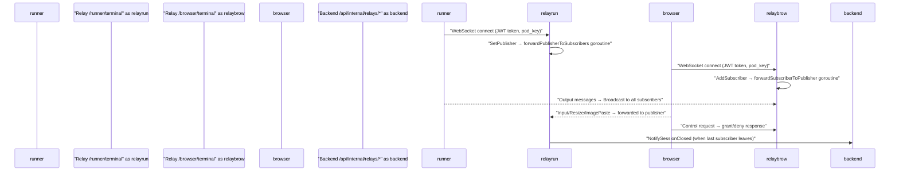
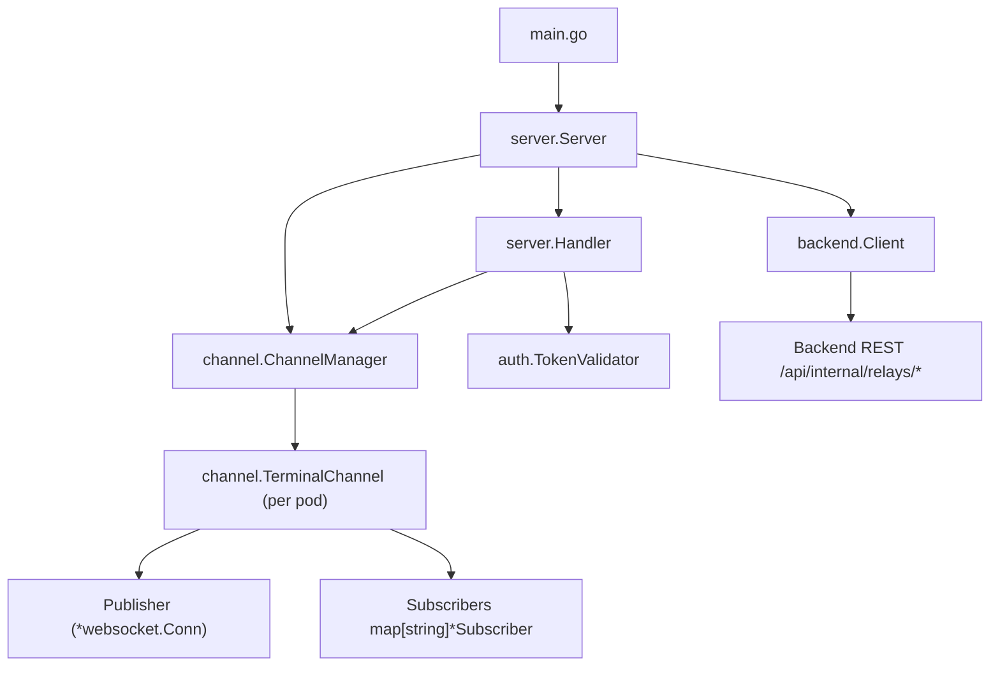
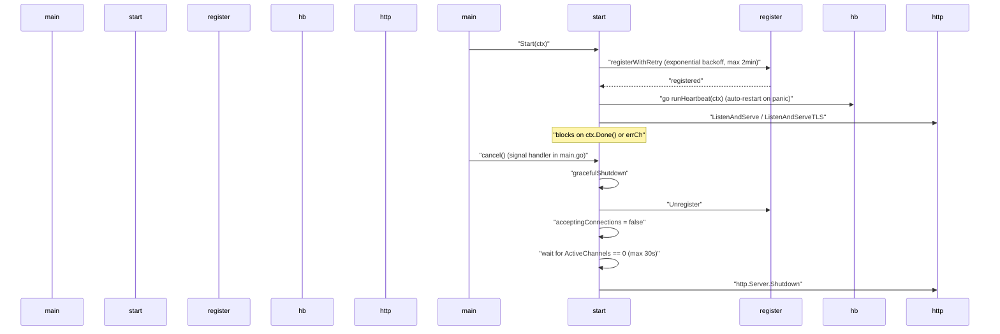

<!-- source: DeepWiki mcp.deepwiki.com · repo AgentsMesh/AgentsMesh · page 4 Relay · fetched 2026-10-26 -->

# Relay

<details>
<summary>Relevant source files</summary>

The following files were used as context for generating this wiki page:

- [relay/internal/backend/client.go](relay/internal/backend/client.go)
- [relay/internal/backend/client_test.go](relay/internal/backend/client_test.go)
- [relay/internal/channel/channel_manager_test.go](relay/internal/channel/channel_manager_test.go)
- [relay/internal/channel/helpers_test.go](relay/internal/channel/helpers_test.go)
- [relay/internal/channel/terminal_channel.go](relay/internal/channel/terminal_channel.go)
- [relay/internal/channel/terminal_channel_test.go](relay/internal/channel/terminal_channel_test.go)
- [relay/internal/server/handler_test.go](relay/internal/server/handler_test.go)
- [relay/internal/server/server.go](relay/internal/server/server.go)
- [relay/internal/server/server_test.go](relay/internal/server/server_test.go)

</details>


This page covers the Relay service: its role as a WebSocket intermediary, its internal structure, the publisher/subscriber channel model, and its lifecycle with the backend. For channel and session management internals see [Channel and Session Management](#4.1). For the backend registration and heartbeat protocol see [Backend Registration and Heartbeat](#4.2). For the runner-side WebSocket client that connects to the Relay, see [Relay Client](#3.5). For the web frontend's terminal connection pool that connects as a subscriber, see [Terminal Workspace](#5.1).

---

## Purpose

The Relay is an independent Go service that proxies terminal I/O between runners and browsers over WebSocket. It decouples the runner (which produces terminal output) from one or more browser sessions (which observe and optionally control the terminal). The backend does not carry any terminal data; it only coordinates which relay serves which pod.

The Relay:

- Accepts a single **publisher** WebSocket connection per pod from a runner
- Accepts multiple **subscriber** WebSocket connections per pod from browsers
- Forwards all publisher output to all subscribers (broadcast)
- Forwards subscriber input to the publisher (with input control enforcement)
- Registers itself with the backend on startup and sends periodic heartbeats
- Notifies the backend when all subscribers leave a channel

---

## High-Level Data Flow

**Relay data flow between runner, browser, and backend**



Sources: [relay/internal/server/server.go:139-143](), [relay/internal/channel/terminal_channel.go:364-458]()

---

## Service Structure

**Server package component map**



Sources: [relay/internal/server/server.go:19-30](), [relay/internal/server/server.go:33-90]()

### Key Types

| Type | Package | Role |
|---|---|---|
| `Server` | `server` | Top-level service; owns `ChannelManager`, `backend.Client`, `Handler`, and the `http.Server` |
| `Handler` | `server` | HTTP request handlers for WebSocket endpoints and health/stats |
| `ChannelManager` | `channel` | Manages all `TerminalChannel` instances; routes publisher/subscriber connections |
| `TerminalChannel` | `channel` | Per-pod bidirectional relay channel; enforces input control and output buffering |
| `Subscriber` | `channel` | Wraps a single browser WebSocket connection with a serialized write mutex |
| `Client` | `backend` | HTTP client for backend registration, heartbeat, and session-close notifications |
| `TokenValidator` | `auth` | Validates JWT tokens on incoming WebSocket upgrades |

Sources: [relay/internal/server/server.go:19-30](), [relay/internal/channel/terminal_channel.go:41-122](), [relay/internal/backend/client.go:19-51]()

---

## HTTP Endpoints

The Relay exposes four HTTP endpoints registered in `Server.Start`:

| Route | Handler | Description |
|---|---|---|
| `GET /runner/terminal` | `Handler.HandleRunnerWS` | Runner connects as publisher; JWT validated, pod key extracted |
| `GET /browser/terminal` | `Handler.HandleBrowserWS` | Browser connects as subscriber; JWT validated, subscriber limit checked |
| `GET /health` | `Handler.HandleHealth` | Returns `{"status":"ok"}` |
| `GET /stats` | `Handler.HandleStats` | Returns active channel counts, subscriber counts, pending connections |

Authentication on both WebSocket endpoints requires a JWT token supplied as the `token` query parameter. The token encodes the pod key. Missing or invalid tokens receive `HTTP 401`. Empty pod keys receive `HTTP 400`.

Sources: [relay/internal/server/server.go:139-143](), [relay/internal/server/handler_test.go:49-66]()

---

## Publisher / Subscriber Model

Each pod that has an active terminal session is represented by one `TerminalChannel` identified by its `PodKey`. The channel follows a producer-consumer / observer pattern:

- **Publisher** (runner): one connection per channel. Sends `Output` and `Snapshot` messages. Receives `Input`, `Resize`, and `ImagePaste` messages from the controlling subscriber.
- **Subscriber** (browser): up to `MaxSubscribersPerPod` connections per channel. Receives all publisher output via broadcast. May request input control.

**TerminalChannel state machine**

```mermaid
stateDiagram-v2
    [*] --> "Pending": "publisher or subscriber connects first"
    "Pending" --> "Active": "both publisher and ≥1 subscriber connected"
    "Active" --> "PublisherDisconnected": "runner WebSocket closes"
    "PublisherDisconnected" --> "Active": "runner reconnects within PublisherReconnectTimeout"
    "PublisherDisconnected" --> "Closed": "PublisherReconnectTimeout exceeded"
    "Active" --> "KeepAlive": "last subscriber disconnects"
    "KeepAlive" --> "Active": "subscriber reconnects within KeepAliveDuration"
    "KeepAlive" --> "Closed": "KeepAliveDuration exceeded → onAllSubscribersGone callback"
    "Closed" --> [*]
```

Sources: [relay/internal/channel/terminal_channel.go:144-176](), [relay/internal/channel/terminal_channel.go:237-274](), [relay/internal/channel/terminal_channel.go:461-496]()

### Input Control

At most one subscriber can hold input control at a time. The `controllerID` field in `TerminalChannel` tracks the current controller. Subscribers negotiate control by sending `MsgTypeControl` messages with actions `request`, `release`, or `query`. When no controller is set, any subscriber may send input.

| Action | Outcome |
|---|---|
| `request` | Granted if `controllerID` is empty; denied otherwise |
| `release` | Clears `controllerID` if sender is the current controller |
| `query` | Returns current `controllerID` as a `status` response |

`Input` and `ImagePaste` messages from a non-controlling subscriber are silently dropped by `CanInput`.

Sources: [relay/internal/channel/terminal_channel.go:499-573](), [relay/internal/channel/terminal_channel.go:407-458]()

### Output Buffering

`TerminalChannel` maintains a ring buffer of recent `Output` messages (`outputBuffer`, bounded by `OutputBufferCount` and `OutputBufferSize`). When a new subscriber connects, the buffer is replayed to that subscriber so it sees recent terminal output. When a `Snapshot` message arrives from the publisher, the buffer is cleared because the snapshot supersedes all prior output.

Sources: [relay/internal/channel/terminal_channel.go:104-107](), [relay/internal/channel/terminal_channel.go:316-362](), [relay/internal/channel/terminal_channel.go:392-404]()

---

## Message Forwarding

Two goroutines are started per connection:

**`forwardPublisherToSubscribers`** — started by `SetPublisher`. Reads from the publisher `*websocket.Conn` in a loop. Each message is buffered (if `Output`) and broadcast to all subscribers via `Broadcast`. If the read fails, `handlePublisherDisconnect` is called.

**`forwardSubscriberToPublisher`** — started by `AddSubscriber`. Reads from the subscriber `*websocket.Conn` in a loop. Dispatches messages:

- `MsgTypeControl` → `handleControlRequest` (handled locally, not forwarded)
- `MsgTypePing` → `EncodePong` sent back (handled locally)
- `MsgTypeInput`, `MsgTypeImagePaste` → forwarded to publisher via `writeToPublisher` if `CanInput` passes
- All other types → forwarded to publisher

`Broadcast` uses a snapshot-then-write pattern: subscribers are copied under a read lock, then writes happen without holding the lock. This prevents a slow subscriber from blocking `Stats()` and the heartbeat goroutine.

Sources: [relay/internal/channel/terminal_channel.go:364-405](), [relay/internal/channel/terminal_channel.go:407-459](), [relay/internal/channel/terminal_channel.go:283-314]()

---

## Configuration

Configuration is loaded into `config.Config` at startup. Key sections:

| Config Section | Fields | Purpose |
|---|---|---|
| `Server` | `Host`, `Port`, `ReadTimeout`, `WriteTimeout`, `TLS.Enabled`, `TLS.CertFile`, `TLS.KeyFile` | HTTP listener settings |
| `JWT` | `Secret`, `Issuer` | Token validation for WebSocket upgrades |
| `Backend` | `URL`, `InternalAPISecret`, `HeartbeatInterval` | Backend connection parameters |
| `Session` | `KeepAliveDuration`, `MaxBrowsersPerPod`, `RunnerReconnectTimeout`, `BrowserReconnectTimeout`, `PendingConnectionTimeout`, `OutputBufferSize`, `OutputBufferCount` | Channel lifecycle parameters |
| `Relay` | `ID`, `Name`, `URL`, `InternalURL`, `Region`, `Capacity`, `AutoIP` | Relay identity parameters sent to backend |

Sources: [relay/internal/server/server.go:33-90](), [relay/internal/server/server_test.go:32-62]()

### TLS

When `Server.TLS.Enabled` is true, the server uses `tls.Config.GetCertificate` for dynamic certificate loading. On each TLS handshake, it first checks whether `backend.Client` has a certificate received from the backend (via ACME), then falls back to files configured in `TLS.CertFile`/`TLS.KeyFile`. This allows certificate rotation via heartbeat without a server restart.

Sources: [relay/internal/server/server.go:156-202]()

---

## Startup and Shutdown Sequence

**`Server.Start` lifecycle**



`registerWithRetry` retries with exponential backoff (1s → 30s cap) for up to 2 minutes. This tolerates the relay starting before the backend HTTP server is fully initialized.

The heartbeat goroutine is wrapped in `runHeartbeat`, which restarts it after a 5-second delay if it exits unexpectedly (e.g., recovered panic).

Sources: [relay/internal/server/server.go:92-285]()

---

## Backend Communication

The `backend.Client` communicates with the backend over plain HTTP using the `X-Internal-Secret` header for authentication. It calls three internal endpoints:

| Endpoint | Method | Purpose |
|---|---|---|
| `/api/internal/relays/register` | POST | Register relay on startup; receives optional TLS cert and DNS-assigned URL |
| `/api/internal/relays/heartbeat` | POST | Periodic liveness ping; sends connection count, CPU/memory usage, round-trip latency; may receive TLS cert |
| `/api/internal/relays/session-closed` | POST | Notified when all subscribers leave a pod's channel |
| `/api/internal/relays/unregister` | POST | Sent during graceful shutdown |

The `SendHeartbeat` call measures round-trip latency and stores it in `lastLatencyMs` for inclusion in the next heartbeat. If the backend returns `HTTP 404` on a heartbeat, the client marks itself as unregistered and immediately attempts re-registration.

Sources: [relay/internal/backend/client.go:165-246](), [relay/internal/backend/client.go:293-411](), [relay/internal/backend/client.go:420-455]()

### Auto-IP Detection

When `AutoIP` is true and `RelayName` is set, `Register` calls `detectPublicIP` before sending the registration request. It queries three external services (`api.ipify.org`, `ifconfig.me/ip`, `icanhazip.com`) in sequence and uses the first successful result. If all fail, registration proceeds without an IP (a warning is logged).

Sources: [relay/internal/backend/client.go:248-284]()

---

