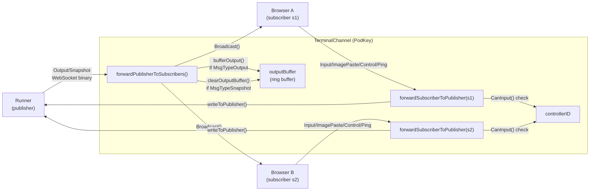
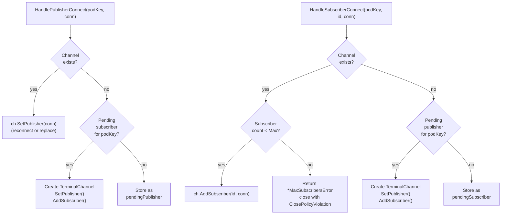
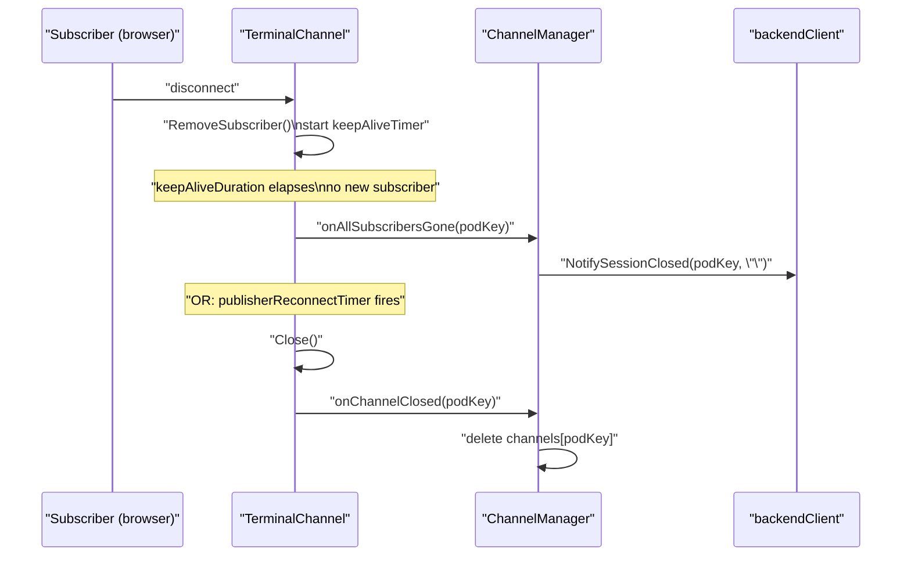

<!-- source: DeepWiki mcp.deepwiki.com · repo AgentsMesh/AgentsMesh · page 4.1 Channel and Session Management · fetched 2026-10-26 -->

# Channel and Session Management

<details>
<summary>Relevant source files</summary>

The following files were used as context for generating this wiki page:

- [relay/internal/backend/client.go](relay/internal/backend/client.go)
- [relay/internal/backend/client_test.go](relay/internal/backend/client_test.go)
- [relay/internal/channel/channel_manager_test.go](relay/internal/channel/channel_manager_test.go)
- [relay/internal/channel/helpers_test.go](relay/internal/channel/helpers_test.go)
- [relay/internal/channel/terminal_channel.go](relay/internal/channel/terminal_channel.go)
- [relay/internal/channel/terminal_channel_test.go](relay/internal/channel/terminal_channel_test.go)
- [relay/internal/server/handler_test.go](relay/internal/server/handler_test.go)
- [relay/internal/server/server.go](relay/internal/server/server.go)
- [relay/internal/server/server_test.go](relay/internal/server/server_test.go)

</details>


This page documents the channel and session management layer of the Relay service: the `TerminalChannel` and `ChannelManager` types, their internal state, and the rules governing publisher and subscriber lifecycles. For an overview of the Relay service itself and how it fits into the broader architecture, see [4](). For backend registration and heartbeat behavior, see [4.2]().

---

## Purpose

The Relay sits between browser clients and runners. Its core job is to multiplex a single runner WebSocket (the **publisher**) out to one or more browser WebSockets (the **subscribers**) for a given pod, while handling disconnections, buffering recent output, and arbitrating input control. The channel layer is entirely in the `relay/internal/channel` package.

---

## Core Types

### `TerminalChannel`

`TerminalChannel` [relay/internal/channel/terminal_channel.go:80-122]() is the central struct. One instance exists per active pod. It is identified by `PodKey` (the pod key, not a session ID).

| Field | Type | Purpose |
|---|---|---|
| `PodKey` | `string` | Unique channel identifier (pod key) |
| `publisher` | `*websocket.Conn` | The runner's WebSocket connection (at most one) |
| `publisherMu` | `sync.RWMutex` | Guards `publisher` and `publisherDisconnected` |
| `publisherWriteMu` | `sync.Mutex` | Serializes writes to publisher |
| `subscribers` | `map[string]*Subscriber` | Map of browser WebSocket connections |
| `subscribersMu` | `sync.RWMutex` | Guards subscriber map |
| `controllerID` | `string` | Subscriber with exclusive input rights (empty = any) |
| `controllerMu` | `sync.RWMutex` | Guards `controllerID` |
| `outputBuffer` | `[][]byte` | Ring buffer of recent `Output` messages |
| `outputBufferBytes` | `int` | Total byte count of buffer contents |
| `publisherDisconnected` | `bool` | True while publisher is temporarily absent |
| `keepAliveTimer` | `*time.Timer` | Fires when all subscribers have been absent for `KeepAliveDuration` |
| `publisherReconnectTimer` | `*time.Timer` | Fires if publisher does not reconnect within `PublisherReconnectTimeout` |
| `onAllSubscribersGone` | `func(podKey string)` | Callback when keep-alive expires |
| `onChannelClosed` | `func(podKey string)` | Callback on `Close()` |

Sources: [relay/internal/channel/terminal_channel.go:80-122]()

### `Subscriber`

`Subscriber` [relay/internal/channel/terminal_channel.go:41-53]() wraps a single browser WebSocket connection. Because `gorilla/websocket` does not support concurrent writes, each `Subscriber` has its own `writeMu` mutex.

```
type Subscriber struct {
    ID      string
    Conn    *websocket.Conn
    writeMu sync.Mutex
}
```

Sources: [relay/internal/channel/terminal_channel.go:41-53]()

### `ChannelConfig`

`ChannelConfig` [relay/internal/channel/terminal_channel.go:55-62]() holds per-channel tuning parameters.

| Field | Default | Meaning |
|---|---|---|
| `KeepAliveDuration` | 30s | Time to keep channel alive after all subscribers leave |
| `PublisherReconnectTimeout` | 30s | Time to wait for publisher to reconnect before closing |
| `SubscriberReconnectTimeout` | 30s | Reserved for future subscriber reconnect logic |
| `OutputBufferSize` | 256 KB | Max total byte size of the output ring buffer |
| `OutputBufferCount` | 200 | Max message count in the output ring buffer |

Sources: [relay/internal/channel/terminal_channel.go:55-73]()

---

## Data Flow

**Channel data flow: publisher-to-subscriber and subscriber-to-publisher**



Sources: [relay/internal/channel/terminal_channel.go:364-458]()

---

## Message Types

The relay protocol (`relay/internal/protocol` package) defines the message types that flow across WebSocket connections. The channel layer uses these to decide how to route each message.

| Message Type | Direction | Handling |
|---|---|---|
| `MsgTypeOutput` | Publisher → Subscribers | Broadcast + buffered in `outputBuffer` |
| `MsgTypeSnapshot` | Publisher → Subscribers | Broadcast + `clearOutputBuffer()` |
| `MsgTypeInput` | Subscriber → Publisher | Forwarded only if `CanInput()` is true |
| `MsgTypeImagePaste` | Subscriber → Publisher | Forwarded only if `CanInput()` is true |
| `MsgTypeControl` | Subscriber → Channel | Handled by `handleControlRequest()`, not forwarded |
| `MsgTypePing` | Subscriber → Channel | Replied to locally with `MsgTypePong`, not forwarded |
| `MsgTypeRunnerDisconnected` | Channel → Subscribers | Sent on publisher disconnect |
| `MsgTypeRunnerReconnected` | Channel → Subscribers | Sent on publisher reconnect |

Sources: [relay/internal/channel/terminal_channel.go:391-458]()

---

## Publisher Lifecycle

**Publisher (runner) lifecycle state machine**

```mermaid
stateDiagram-v2
    [*] --> "Pending": "HandlePublisherConnect()\nno active channel"
    "Pending" --> "Active": "matching subscriber arrives\nSetPublisher() called"
    [*] --> "Active": "HandlePublisherConnect()\nchannel already exists"
    "Active" --> "Disconnected": "ReadMessage() error\nhandlePublisherDisconnect()"
    "Disconnected" --> "Active": "SetPublisher() before timeout\nbroadcasts RunnerReconnected"
    "Disconnected" --> "Closed": "publisherReconnectTimer fires\nClose() called"
    "Active" --> "Closed": "Close() called"
    "Closed" --> [*]
```

Sources: [relay/internal/channel/terminal_channel.go:144-176](), [relay/internal/channel/terminal_channel.go:461-496]()

**`SetPublisher(conn *websocket.Conn)`** [relay/internal/channel/terminal_channel.go:144-176]():

1. Acquires `publisherMu`. Stores `conn`. Clears `publisherDisconnected`. Cancels any existing `publisherReconnectTimer`.
2. If an old connection exists, closes it so its `forwardPublisherToSubscribers` goroutine exits cleanly via a `ReadMessage` error.
3. If reconnecting (`wasDisconnected == true`), broadcasts `protocol.EncodeRunnerReconnected()` to all subscribers.
4. Spawns a new `forwardPublisherToSubscribers()` goroutine bound to the new connection.

**`handlePublisherDisconnect(disconnectedConn)`** [relay/internal/channel/terminal_channel.go:461-496]():

- Performs an **identity check**: if `c.publisher != disconnectedConn`, the publisher was already replaced by `SetPublisher`, so this call is a no-op.
- Otherwise: sets `publisher = nil`, `publisherDisconnected = true`, starts `publisherReconnectTimer`.
- After releasing `publisherMu`, broadcasts `protocol.EncodeRunnerDisconnected()`.

Sources: [relay/internal/channel/terminal_channel.go:144-176](), [relay/internal/channel/terminal_channel.go:461-496]()

---

## Subscriber Lifecycle

**`AddSubscriber(subscriberID string, conn *websocket.Conn)`** [relay/internal/channel/terminal_channel.go:193-234]():

1. Adds the `Subscriber` to the `subscribers` map.
2. Cancels any pending `keepAliveTimer`.
3. Sends all buffered `Output` messages from `outputBuffer` to the new subscriber. This allows a late-joining browser to see recent terminal output.
4. If the publisher is currently disconnected (`publisherDisconnected == true`), immediately sends `protocol.EncodeRunnerDisconnected()` to the new subscriber so it shows the correct state.
5. Spawns a `forwardSubscriberToPublisher(subscriberID)` goroutine.

**`RemoveSubscriber(subscriberID string)`** [relay/internal/channel/terminal_channel.go:237-274]():

1. Closes and removes the subscriber connection.
2. Releases `controllerID` if this subscriber held it.
3. If no subscribers remain, starts `keepAliveTimer`. When it fires, `onAllSubscribersGone(podKey)` is called (which in turn calls `backendClient.NotifySessionClosed()`).

Sources: [relay/internal/channel/terminal_channel.go:193-274]()

---

## Broadcast and Write Safety

`Broadcast(data []byte)` [relay/internal/channel/terminal_channel.go:287-314]() uses a **snapshot-then-write** pattern to avoid holding the subscriber lock during I/O:

1. Take a read lock on `subscribersMu` and copy subscriber pointers into a local slice.
2. Release the lock.
3. Write to each subscriber via `Subscriber.WriteMessage()`, which holds the per-subscriber `writeMu`.
4. Collect failed subscriber IDs and call `RemoveSubscriber` for each.

This prevents a slow or dead subscriber connection from blocking `Stats()`, `SubscriberCount()`, or the heartbeat callback.

The `writeWait` constant (`5 * time.Second`) is applied as a write deadline to every WebSocket write [relay/internal/channel/terminal_channel.go:13-21]().

Sources: [relay/internal/channel/terminal_channel.go:13-21](), [relay/internal/channel/terminal_channel.go:287-314]()

---

## Input Control

At most one subscriber holds input control at a time. The `controllerID` field tracks which subscriber (identified by its ID string) is the current controller. An empty `controllerID` means any subscriber may send input.

**Control request/response protocol:**

| Action sent | Condition | Response action |
|---|---|---|
| `request` | No current controller | `granted`, `Controller = subscriberID` |
| `request` | Another subscriber controls | `denied`, `Controller = existing controllerID` |
| `release` | Sender is controller | `released`, `Controller = ""` |
| `query` | Any | `status`, `Controller = current controllerID` |

`handleControlRequest` [relay/internal/channel/terminal_channel.go:499-540]() processes these entirely within the relay — control messages are never forwarded to the publisher.

`CanInput(subscriberID)` [relay/internal/channel/terminal_channel.go:543-549]() returns `true` if `controllerID == ""` or `controllerID == subscriberID`. Input and image-paste messages from subscribers who cannot input are silently discarded.

Sources: [relay/internal/channel/terminal_channel.go:499-573]()

---

## Output Buffer

The output buffer is a ring buffer that lets newly connected subscribers receive recent terminal output they missed.

**Eviction policy** (`bufferOutput` [relay/internal/channel/terminal_channel.go:317-339]()):

- If `len(outputBuffer) >= OutputBufferCount` **or** `outputBufferBytes + len(data) > OutputBufferSize`, the oldest message is evicted (FIFO).
- A single message larger than `OutputBufferSize` is not buffered at all.
- Copies of data are stored (not references) to avoid data races.

**Snapshot handling** [relay/internal/channel/terminal_channel.go:399-402]():

When a `MsgTypeSnapshot` arrives from the publisher, `clearOutputBuffer()` is called immediately. A snapshot encodes the full current terminal state, so all prior incremental output messages become redundant. New subscribers will receive the snapshot rather than stale incremental messages.

Sources: [relay/internal/channel/terminal_channel.go:317-362](), [relay/internal/channel/terminal_channel.go:391-404]()

---

## ChannelManager

`ChannelManager` coordinates multiple `TerminalChannel` instances and handles the race between a publisher and subscribers connecting in any order.

**`ChannelManagerConfig`** (from `server.go` [relay/internal/server/server.go:72-80]()):

| Config Field | Session Config Source | Purpose |
|---|---|---|
| `KeepAliveDuration` | `cfg.Session.KeepAliveDuration` | Passed to each `TerminalChannel` |
| `MaxSubscribersPerPod` | `cfg.Session.MaxBrowsersPerPod` | Upper limit on subscribers per channel |
| `PublisherReconnectTimeout` | `cfg.Session.RunnerReconnectTimeout` | Passed to each `TerminalChannel` |
| `SubscriberReconnectTimeout` | `cfg.Session.BrowserReconnectTimeout` | Passed to each `TerminalChannel` |
| `PendingConnectionTimeout` | `cfg.Session.PendingConnectionTimeout` | Max wait time for pending connections |
| `OutputBufferSize` | `cfg.Session.OutputBufferSize` | Passed to each `TerminalChannel` |
| `OutputBufferCount` | `cfg.Session.OutputBufferCount` | Passed to each `TerminalChannel` |

Sources: [relay/internal/server/server.go:72-81]()

### Pending Connection Matching

When a publisher or subscriber arrives for a pod key, the channel may not yet exist:

**Channel and ChannelManager connection states**



Sources: [relay/internal/channel/channel_manager_test.go:82-128](), [relay/internal/server/handler_test.go:177-236]()

### `MaxSubscribersError`

When a subscriber attempts to join a channel that has already reached `MaxSubscribersPerPod`, `HandleSubscriberConnect` returns a `*MaxSubscribersError`. The HTTP handler sends a WebSocket close frame with code `ClosePolicyViolation` (1008) before returning.

Sources: [relay/internal/channel/channel_manager_test.go:200-227](), [relay/internal/server/handler_test.go:177-236]()

### `ChannelStats`

`Stats()` returns a `ChannelStats` struct used by the heartbeat to report connection counts to the backend.

| Field | Meaning |
|---|---|
| `ActiveChannels` | Channels with an active publisher and at least one subscriber |
| `TotalSubscribers` | Sum of subscriber counts across all active channels |
| `PendingPublishers` | Publishers waiting for a matching subscriber |
| `PendingSubscribers` | Subscribers waiting for a matching publisher |

Sources: [relay/internal/channel/channel_manager_test.go:269-311](), [relay/internal/server/server.go:220-224]()

---

## Channel Closed Lifecycle

**Channel closure events and callbacks**



`Close()` [relay/internal/channel/terminal_channel.go:576-618]() is idempotent — a `closed` boolean checked under `closedMu` ensures the close logic runs at most once. On close:

1. Stops `keepAliveTimer` and `publisherReconnectTimer`.
2. Closes the publisher connection.
3. Closes all subscriber connections.
4. Empties the subscriber map.
5. Calls `onChannelClosed(podKey)`.

Sources: [relay/internal/channel/terminal_channel.go:576-618]()

---

## HTTP Endpoints and Handler Integration

The HTTP layer in `relay/internal/server/handler.go` upgrades WebSocket connections and hands them to the `ChannelManager`.

| Route | Handler | Calls |
|---|---|---|
| `/runner/terminal` | `HandleRunnerWS` | `channelManager.HandlePublisherConnect(podKey, conn)` |
| `/browser/terminal` | `HandleBrowserWS` | `channelManager.HandleSubscriberConnect(podKey, subscriberID, conn)` |
| `/health` | `HandleHealth` | Returns `{"status":"ok"}` |
| `/stats` | `HandleStats` | Returns `channelManager.Stats()` as JSON |

Token validation (JWT) is performed before upgrade. Missing or invalid tokens return HTTP 401. An empty `podKey` claim returns 400. The WebSocket upgrader uses 64 KB read and write buffers and allows all origins.

Sources: [relay/internal/server/server.go:139-143](), [relay/internal/server/handler_test.go:49-67](), [relay/internal/server/handler_test.go:97-118]()

---

## Graceful Shutdown

`gracefulShutdown` in `server.go` [relay/internal/server/server.go:243-285]() follows this sequence:

1. Calls `backendClient.Unregister()` (5 s timeout) to notify the backend.
2. Sets `acceptingConnections = false`.
3. Polls `channelManager.Stats().ActiveChannels` every second for up to 30 seconds, waiting for all channels to close naturally.
4. Calls `httpServer.Shutdown()` (10 s timeout).

The heartbeat goroutine (`runHeartbeat`) is wrapped in a restart loop: if it exits unexpectedly (e.g., panic recovery inside `StartHeartbeat`), it is restarted after a 5-second delay, unless the context is cancelled.

Sources: [relay/internal/server/server.go:214-285]()

---

