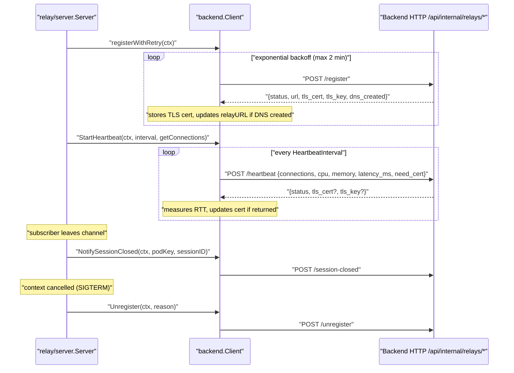
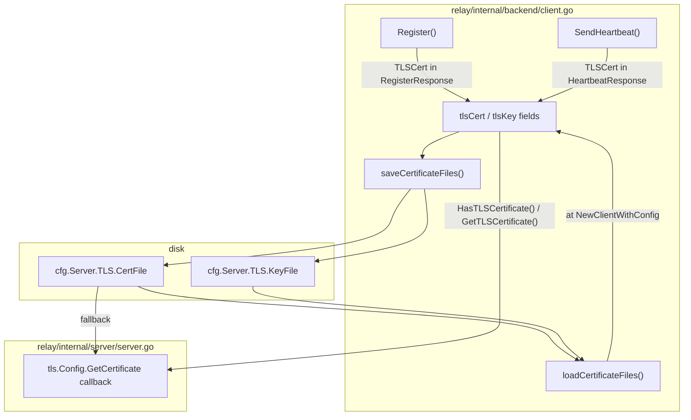
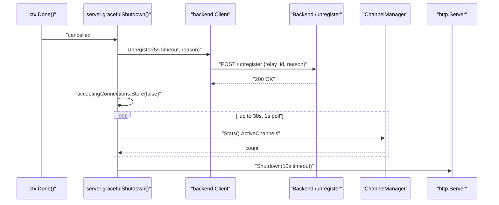

<!-- source: DeepWiki mcp.deepwiki.com · repo AgentsMesh/AgentsMesh · page 4.2 Backend Registration and Heartbeat · fetched 2026-10-26 -->

# Backend Registration and Heartbeat

<details>
<summary>Relevant source files</summary>

The following files were used as context for generating this wiki page:

- [backend/internal/api/rest/internal/relay_registration.go](backend/internal/api/rest/internal/relay_registration.go)
- [backend/internal/api/rest/internal/relay_registration_test.go](backend/internal/api/rest/internal/relay_registration_test.go)
- [backend/internal/config/config.go](backend/internal/config/config.go)
- [backend/internal/config/config_relay.go](backend/internal/config/config_relay.go)
- [backend/internal/service/relay/dns_service.go](backend/internal/service/relay/dns_service.go)
- [backend/internal/service/relay/dns_service_mock_test.go](backend/internal/service/relay/dns_service_mock_test.go)
- [backend/internal/service/relay/dns_service_sanitize_test.go](backend/internal/service/relay/dns_service_sanitize_test.go)
- [backend/migrations/000033_move_preparation_script_to_repository.down.sql](backend/migrations/000033_move_preparation_script_to_repository.down.sql)
- [backend/migrations/000033_move_preparation_script_to_repository.up.sql](backend/migrations/000033_move_preparation_script_to_repository.up.sql)
- [docs/images/logo.svg](docs/images/logo.svg)
- [relay/.env.example](relay/.env.example)
- [relay/internal/backend/client.go](relay/internal/backend/client.go)
- [relay/internal/backend/client_test.go](relay/internal/backend/client_test.go)
- [relay/internal/channel/channel_manager_test.go](relay/internal/channel/channel_manager_test.go)
- [relay/internal/channel/helpers_test.go](relay/internal/channel/helpers_test.go)
- [relay/internal/channel/terminal_channel.go](relay/internal/channel/terminal_channel.go)
- [relay/internal/channel/terminal_channel_test.go](relay/internal/channel/terminal_channel_test.go)
- [relay/internal/config/config.go](relay/internal/config/config.go)
- [relay/internal/config/config_test.go](relay/internal/config/config_test.go)
- [relay/internal/server/handler_test.go](relay/internal/server/handler_test.go)
- [relay/internal/server/server.go](relay/internal/server/server.go)
- [relay/internal/server/server_test.go](relay/internal/server/server_test.go)
- [web-admin/.env.example](web-admin/.env.example)

</details>


## Purpose and Scope

This page documents the relay's backend client: how a Relay instance registers itself with the Backend at startup, how it maintains a periodic heartbeat, how TLS certificates are provisioned and renewed, and how session-close events and graceful unregistration work.

This page covers the relay-side code in `relay/internal/backend/` and the corresponding backend-side handler in `backend/internal/api/rest/internal/`. For the relay's WebSocket channel model (publisher/subscriber), see [4.1](#4.1). For the backend's relay management service and DNS infrastructure, see the backend REST API documentation in [2.1](#2.1). For relay configuration loading, see [2.7](#2.7).

---

## Overview

When the relay process starts, it must introduce itself to the backend before accepting any WebSocket connections. The `Client` struct in [relay/internal/backend/client.go:19-51]() is the single component responsible for all relay-to-backend HTTP communication. The relay `Server` in [relay/internal/server/server.go:19-30]() owns exactly one `Client` instance and calls its methods during startup, operation, and shutdown.

**Lifecycle diagram: Relay ↔ Backend communication**



Sources: [relay/internal/backend/client.go:165-455](), [relay/internal/server/server.go:95-240]()

---

## Client Construction

Two constructors are available:

| Constructor | Use case |
|---|---|
| `NewClient(...)` | Simple construction with positional args |
| `NewClientWithConfig(cfg ClientConfig)` | Full configuration including auto-IP and cert file paths |

`NewClientWithConfig` additionally attempts to load any existing TLS certificate from disk at construction time, enabling certificate persistence across process restarts.

```
ClientConfig {
  BaseURL           string  // http://backend:8080
  InternalAPISecret string  // used as X-Internal-Secret header
  RelayID           string
  RelayName         string  // optional, enables DNS auto-registration
  RelayURL          string  // public WebSocket URL
  RelayInternalURL  string  // URL used by runners inside Docker network
  RelayRegion       string
  RelayCapacity     int
  AutoIP            bool    // call detectPublicIP() before Register
  CertFile          string  // path to persist cert PEM
  KeyFile           string  // path to persist key PEM
}
```

Sources: [relay/internal/backend/client.go:53-113]()

---

## Registration

`Register(ctx context.Context) error` [relay/internal/backend/client.go:165-246]() performs the following steps:

1. **Auto-IP detection** — If `autoIP` is true and `relayName` is set and `relayIP` is empty, `detectPublicIP` queries three external services sequentially (`api.ipify.org`, `ifconfig.me/ip`, `icanhazip.com`) and uses the first valid response.

2. **HTTP POST** to `/api/internal/relays/register` with the `RegisterRequest` body and an `X-Internal-Secret` header for authentication.

3. **Response handling**:
   - If `DNSCreated` is true and a URL is returned, the in-memory `relayURL` is updated to the DNS-generated address.
   - If `TLSCert` and `TLSKey` are non-empty (ACME provisioning), the cert is stored in memory and optionally written to `certFile`/`keyFile` for persistence.

4. Sets `c.registered = true`.

**Registration request and response structures:**

```
RegisterRequest {
  relay_id     string
  relay_name   string   // optional (DNS auto-registration)
  ip           string   // optional (auto-detected or blank)
  url          string   // public WebSocket URL
  internal_url string
  region       string
  capacity     int
}

RegisterResponse {
  status       string
  url          string   // populated if DNS record was created
  internal_url string
  dns_created  bool
  tls_cert     string   // PEM cert chain (if ACME enabled on backend)
  tls_key      string   // PEM private key
  tls_expiry   string   // RFC3339
}
```

Sources: [relay/internal/backend/client.go:115-246]()

### Retry Logic

The `Server` does not call `Register` directly. It calls `registerWithRetry` [relay/internal/server/server.go:93-125](), which retries with exponential backoff (starting at 1 second, capping at 30 seconds) for up to 2 minutes. This handles the Docker Compose startup ordering problem where the relay container starts before the backend HTTP server is ready.

Sources: [relay/internal/server/server.go:93-125]()

---

## Backend-Side Registration Handler

On the backend, the `RelayHandler.Register` method [backend/internal/api/rest/internal/relay_registration.go:16-117]() handles `POST /api/internal/relays/register`:

1. If `relay_name` and `ip` are provided and the `DNSService` is enabled, it creates a DNS A record mapping the generated subdomain to the relay's public IP. The final URL in the relay record replaces only the host component of the relay-reported URL (scheme and port are preserved).
2. Calls `h.relayManager.Register(info)` to add the relay to the in-memory relay registry.
3. If an `acmeManager` is configured, fetches the current TLS certificate and includes it in the response.

**DNS domain generation** is handled by `DNSService.GenerateRelayDomain` [backend/internal/service/relay/dns_service.go:57-63]():
```
"us-east-1" → "us-east-1.relay.agentsmesh.cn"  (given BaseDomain = "relay.agentsmesh.cn")
```

Sources: [backend/internal/api/rest/internal/relay_registration.go:16-117](), [backend/internal/service/relay/dns_service.go:57-63]()

---

## Heartbeat

### SendHeartbeat

`SendHeartbeat(ctx context.Context, connections int) error` [relay/internal/backend/client.go:293-376]():

1. Guards against calling before registration (`registered == false` → error).
2. Reads Go runtime memory stats (`runtime.MemStats`) for `MemoryUsage = Alloc/Sys * 100`. CPU usage is currently always `0` (placeholder).
3. Sets `NeedCert = true` if no TLS cert is held in memory.
4. POSTs `HeartbeatRequest` to `/api/internal/relays/heartbeat`.
5. Measures round-trip latency and stores it in `lastLatencyMs` for inclusion in the next heartbeat.
6. If the backend returns HTTP 404, clears `registered` to trigger re-registration.
7. If the response includes a TLS cert, stores it in memory and on disk.

**Heartbeat structures:**

| Field | Type | Notes |
|---|---|---|
| `relay_id` | string | Identity |
| `connections` | int | Active channels count |
| `cpu_usage` | float64 | Always 0 (not yet implemented) |
| `memory_usage` | float64 | Go heap alloc / sys ratio |
| `latency_ms` | int | Previous heartbeat RTT |
| `need_cert` | bool | True if no TLS cert held |

Sources: [relay/internal/backend/client.go:139-157](), [relay/internal/backend/client.go:293-376]()

### StartHeartbeat Loop

`StartHeartbeat(ctx context.Context, interval time.Duration, getConnections func() int)` [relay/internal/backend/client.go:457-507]() runs in a goroutine:

- Fires on `time.Ticker` at the configured interval (default: 10 seconds, from `BackendConfig.HeartbeatInterval`).
- Calls `getConnections()` in a separate goroutine with a 5-second timeout to prevent deadlock propagation from a blocked `ChannelManager.Stats()` call.
- On heartbeat failure, immediately calls `Register` to re-register if the relay became unknown to the backend.
- Recovers from panics and logs them without crashing.

The `Server.runHeartbeat` wrapper [relay/internal/server/server.go:214-240]() restarts `StartHeartbeat` if it exits unexpectedly (e.g., after a recovered panic), with a 5-second delay between restarts.

The `getConnections` callback supplied by the server is:

```go
func() int {
    stats := s.channelManager.Stats()
    return stats.ActiveChannels
}
```

Sources: [relay/internal/backend/client.go:457-507](), [relay/internal/server/server.go:214-240]()

---

## TLS Certificate Management

The relay supports receiving TLS certificates provisioned by the backend via ACME (Let's Encrypt). This avoids running a separate certificate manager inside each relay instance.

**Certificate data flow:**



Sources: [relay/internal/backend/client.go:517-577](), [relay/internal/server/server.go:155-194]()

Key accessor methods on `Client`:

| Method | Purpose |
|---|---|
| `HasTLSCertificate()` | Returns true if both cert and key are non-empty |
| `GetTLSCertificate()` | Returns `(cert string, key string)` |
| `GetTLSExpiry()` | Returns expiry as RFC3339 string |

The server's `GetCertificate` callback [relay/internal/server/server.go:161-185]() first tries the in-memory certificate from `backendClient`, then falls back to loading from `TLS.CertFile`/`TLS.KeyFile` on disk. The certificate update (via heartbeat) therefore takes effect on the next TLS handshake without a server restart.

---

## Session Close Notification

When all browser subscribers disconnect from a channel and the keep-alive timer expires, the `Server` calls `NotifySessionClosed` [relay/internal/backend/client.go:379-411]().

This is wired via the `onAllSubscribersGone` closure in `server.New` [relay/internal/server/server.go:58-68]():

```go
onAllSubscribersGone := func(podKey string) {
    ctx, cancel := context.WithTimeout(context.Background(), 10*time.Second)
    defer cancel()
    s.backendClient.NotifySessionClosed(ctx, podKey, "")
}
```

The notification POSTs `SessionClosedRequest` to `/api/internal/relays/session-closed`. Failures are logged but do not affect channel state.

Sources: [relay/internal/backend/client.go:379-411](), [relay/internal/server/server.go:58-68]()

---

## Graceful Unregistration

`Unregister(ctx context.Context, reason string) error` [relay/internal/backend/client.go:419-455]() is called by `gracefulShutdown` [relay/internal/server/server.go:242-285]() when the relay's context is cancelled (typically a SIGTERM forwarded by the process manager).

The shutdown sequence is:



After `Unregister` succeeds, `c.registered` is set to `false`. The unregister call is idempotent on the backend side: if the relay ID is not found, the handler returns `200 OK` with `status: not_found`.

Sources: [relay/internal/backend/client.go:419-455](), [relay/internal/server/server.go:242-285](), [backend/internal/api/rest/internal/relay_registration.go:119-150]()

---

## Configuration Reference

The relay-side configuration used by the client is loaded from environment variables via `relay/internal/config/config.go`. The relevant fields are:

| Config field | Env var | Default | Description |
|---|---|---|---|
| `Backend.URL` | `BACKEND_URL` | `http://backend:8080` | Base URL for all internal API calls |
| `Backend.InternalAPISecret` | `INTERNAL_API_SECRET` | — (required) | Value of `X-Internal-Secret` header |
| `Backend.HeartbeatInterval` | `HEARTBEAT_INTERVAL` | `10s` | Ticker interval for `StartHeartbeat` |
| `Relay.ID` | `RELAY_ID` | auto-generated from hostname | Sent in every request as `relay_id` |
| `Relay.Name` | `RELAY_NAME` | `""` | Enables DNS auto-registration |
| `Relay.AutoIP` | `RELAY_AUTO_IP` | `false` | Auto-detect public IP before registration |
| `Relay.URL` | `RELAY_URL` | derived from `PRIMARY_DOMAIN` | Sent as `url` in registration |
| `Relay.InternalURL` | `RELAY_INTERNAL_URL` | `""` | Docker-internal URL for runners |
| `Relay.Region` | `RELAY_REGION` | `default` | Geo-region tag |
| `Relay.Capacity` | `RELAY_CAPACITY` | `1000` | Max connections declared to backend |
| `Server.TLS.CertFile` | `TLS_CERT_FILE` | `""` | Path for cert persistence |
| `Server.TLS.KeyFile` | `TLS_KEY_FILE` | `""` | Path for key persistence |

Sources: [relay/internal/config/config.go:89-221]()

---

