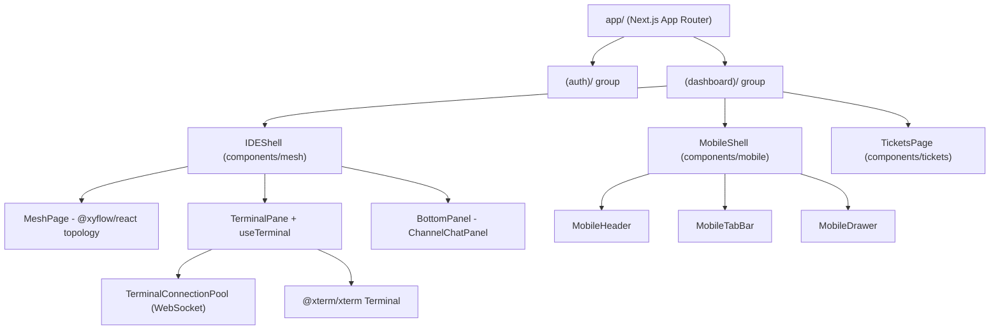
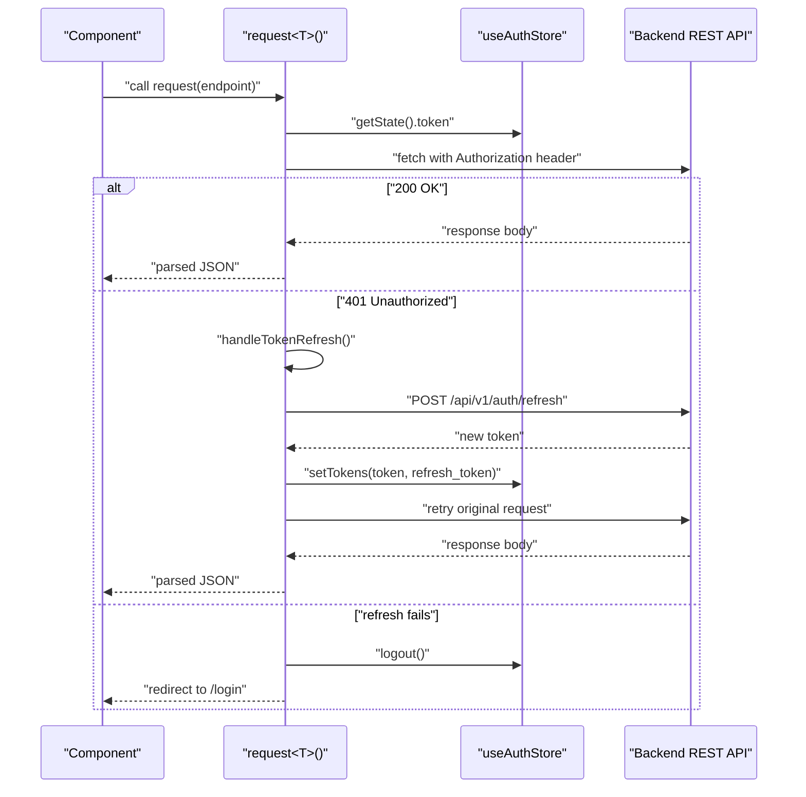
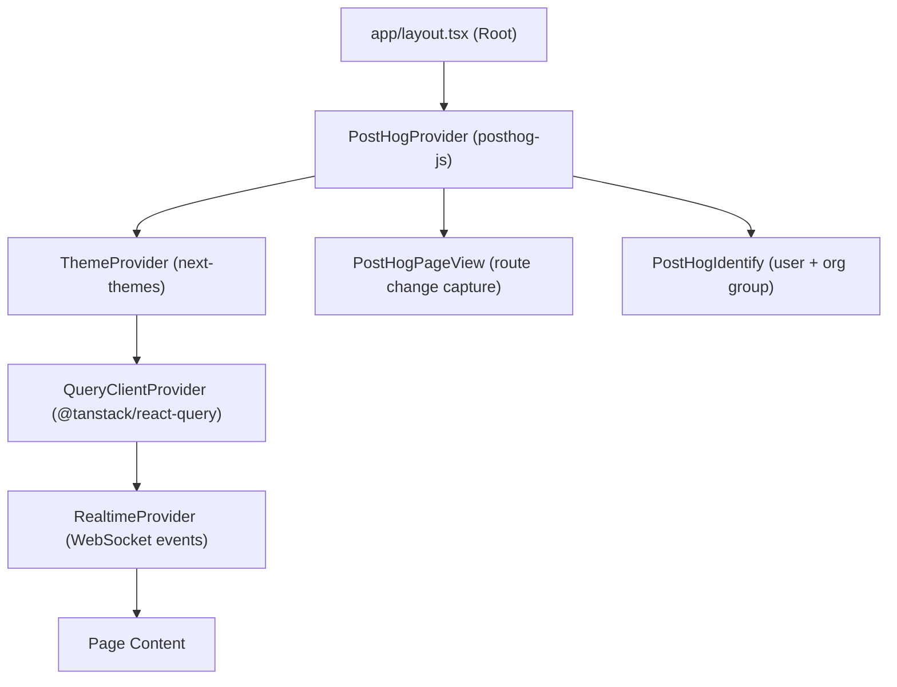
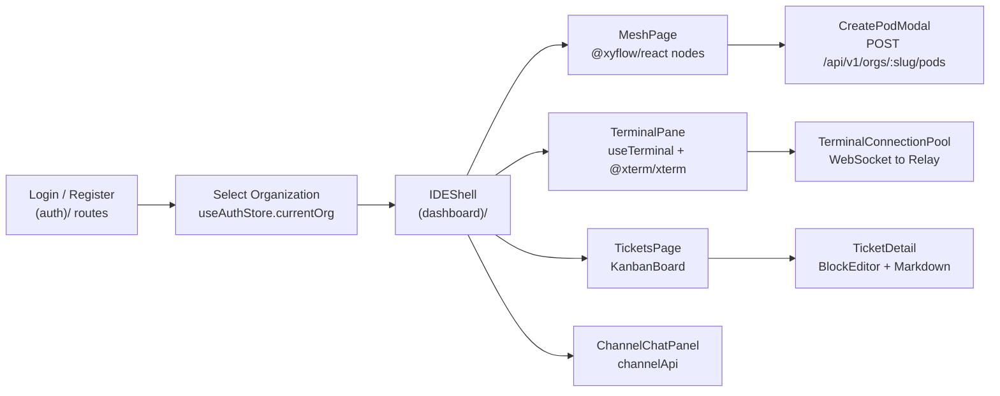

<!-- source: DeepWiki mcp.deepwiki.com · repo AgentsMesh/AgentsMesh · page 5 Web Frontend · fetched 2026-10-26 -->

# Web Frontend

<details>
<summary>Relevant source files</summary>

The following files were used as context for generating this wiki page:

- [.claude/skills/worktree/SKILL.md](.claude/skills/worktree/SKILL.md)
- [CLAUDE.md](CLAUDE.md)
- [deploy/dev/.gitignore](deploy/dev/.gitignore)
- [deploy/dev/backend.Dockerfile](deploy/dev/backend.Dockerfile)
- [deploy/dev/docker-compose.yml](deploy/dev/docker-compose.yml)
- [deploy/dev/init-seed.sh](deploy/dev/init-seed.sh)
- [deploy/dev/nginx/conf.d/default.conf](deploy/dev/nginx/conf.d/default.conf)
- [deploy/dev/nginx/nginx.conf](deploy/dev/nginx/nginx.conf)
- [deploy/dev/runner-entrypoint.sh](deploy/dev/runner-entrypoint.sh)
- [deploy/dev/runner.Dockerfile](deploy/dev/runner.Dockerfile)
- [deploy/dev/seed/seed.sql](deploy/dev/seed/seed.sql)
- [deploy/dev/traefik/dynamic/grpc.yml](deploy/dev/traefik/dynamic/grpc.yml)
- [deploy/dev/web.Dockerfile](deploy/dev/web.Dockerfile)
- [web/package.json](web/package.json)
- [web/pnpm-lock.yaml](web/pnpm-lock.yaml)
- [web/src/app/globals.css](web/src/app/globals.css)
- [web/src/components/mesh/MessageList.tsx](web/src/components/mesh/MessageList.tsx)
- [web/src/components/mobile/MobileShell.tsx](web/src/components/mobile/MobileShell.tsx)
- [web/src/components/ui/block-editor.tsx](web/src/components/ui/block-editor.tsx)
- [web/src/components/ui/markdown.tsx](web/src/components/ui/markdown.tsx)
- [web/src/lib/api/base.ts](web/src/lib/api/base.ts)
- [web/src/providers/PostHogProvider.tsx](web/src/providers/PostHogProvider.tsx)

</details>


This page documents the Next.js web application located in the `web/` directory. It covers the tech stack, directory structure, core libraries, API communication layer, theming system, analytics integration, and how the major UI surfaces connect. For specifics on individual subsystems, see:

- [Terminal Workspace](#5.1) — `TerminalConnectionPool`, `useTerminal`, xterm.js integration
- [Ticket Management](#5.2) — Kanban board, `useTicketStore`, `ticketApi`
- [AgentsMesh Network View](#5.3) — `IDEShell`, `MeshPage`, `WorkspaceManager`
- [Channels and Chat](#5.4) — `ChannelChatPanel`, `channelApi`, pod mentions
- [Real-time State Management](#5.5) — Zustand stores, `RealtimeProvider`
- [Environment and API Configuration](#5.6) — URL resolution, `getApiBaseUrl`, Next.js rewrites

---

## Purpose and Scope

The web frontend is the primary user interface for AgentsMesh. It runs as a Next.js 16 application (App Router) and provides:

- Authentication and organization management
- Terminal workspace for interacting with AI agent pods
- Kanban ticket tracking
- AgentsMesh topology visualization
- Channel-based multi-agent chat
- Real-time event handling over WebSocket

The frontend communicates with the Go backend over REST and WebSocket. It does **not** communicate directly with the Runner or Relay — those connections are brokered through the backend and Relay service respectively.

---

## Tech Stack

| Category | Library | Version |
|---|---|---|
| Framework | `next` | 16.1.1 |
| UI Runtime | `react`, `react-dom` | 19.2.3 |
| Language | TypeScript | ^5 |
| Styling | `tailwindcss` | ^4.2.1 |
| State | `zustand` | ^5.0.9 |
| Data Fetching | `@tanstack/react-query` | ^5.90.16 |
| Terminal | `@xterm/xterm` | ^6.0.0 |
| Graph/Flow | `@xyflow/react` | ^12.10.0 |
| Rich Text | `@blocknote/core`, `@blocknote/react`, `@blocknote/mantine` | ^0.46.0 |
| Drag & Drop | `@dnd-kit/core`, `@dnd-kit/sortable` | ^6.3.1, ^10.0.0 |
| UI Primitives | `@radix-ui/*` | various |
| Icons | `lucide-react` | ^0.562.0 |
| Animation | `framer-motion` | ^12.26.2 |
| Markdown | `react-markdown`, `remark-gfm` | ^10.1.0, ^4.0.1 |
| Virtualization | `@tanstack/react-virtual` | ^3.13.18 |
| i18n | `next-intl` | ^4.7.0 |
| Themes | `next-themes` | ^0.4.6 |
| Toasts | `sonner` | ^2.0.7 |
| Command Palette | `cmdk` | ^1.1.1 |
| Analytics | `posthog-js` | ^1.347.2 |
| Charts | `recharts` | ^3.6.0 |
| Resizable Panels | `react-resizable-panels` | ^4.3.3 |
| Testing | `vitest`, `@testing-library/react` | ^4.0.16, ^16.3.1 |

Sources: [web/package.json:1-83]()

---

## Application Structure

**Directory layout for `web/src/`:**

```
web/src/
├── app/                    # Next.js App Router pages
│   ├── (auth)/             # Login, register routes
│   ├── (dashboard)/        # Main application routes
│   └── api/                # Next.js API routes
├── components/
│   ├── ui/                 # Shared primitives (Button, Markdown, BlockEditor, etc.)
│   ├── mesh/               # AgentsMesh network view components
│   ├── mobile/             # Mobile-specific shell and navigation
│   └── ...                 # Feature-specific component directories
├── lib/
│   ├── api/                # API client modules
│   │   └── base.ts         # ApiError, request(), orgPath()
│   └── env.ts              # getApiBaseUrl() and URL resolution
├── stores/                 # Zustand stores
├── hooks/                  # Custom React hooks
├── messages/               # next-intl translation files
└── providers/              # React context providers
```

Sources: [CLAUDE.md:212-224]()

---

## Component and System Map

The following diagram maps the major UI surfaces to their corresponding code entities.

**Diagram: Frontend component hierarchy**



Sources: [web/src/components/mobile/MobileShell.tsx:1-74](), [web/src/components/mesh/MessageList.tsx:1-50](), [CLAUDE.md:212-224]()

---

## API Communication Layer

All HTTP requests go through the `request<T>()` function in [web/src/lib/api/base.ts:94-162](). This function:

1. Reads the current JWT from `useAuthStore`
2. Attaches `Authorization: Bearer <token>` to every request
3. On a `401` response, attempts a token refresh via `handleTokenRefresh()`
4. Retries the original request with the new token
5. If refresh fails, calls `logout()` and redirects to `/login`

The refresh logic is deduplicated: concurrent requests that hit a `401` share a single refresh `Promise` to avoid issuing multiple `/api/v1/auth/refresh` calls.

**Key exports from `base.ts`:**

| Export | Purpose |
|---|---|
| `ApiError` | Typed error class with `.status`, `.code`, `.serverMessage` |
| `request<T>(endpoint, options)` | Authenticated fetch with token refresh |
| `publicRequest<T>(endpoint)` | Unauthenticated GET |
| `orgPath(path)` | Prepends `/api/v1/orgs/:slug` to `path` using current org from store |
| `handleTokenRefresh()` | Deduplication wrapper for token refresh |

**Diagram: request() flow**



Sources: [web/src/lib/api/base.ts:1-193]()

---

## State Management

State is managed exclusively with Zustand stores in `web/src/stores/`. Each store corresponds to a domain:

| Store | File | Primary State |
|---|---|---|
| `useAuthStore` | `stores/auth.ts` | `user`, `token`, `refreshToken`, `currentOrg` |
| `usePodStore` | `stores/pod.ts` | Pod list, active pod |
| `useRunnerStore` | `stores/runner.ts` | Runner list and status |
| `useChannelStore` | `stores/channel.ts` | Channel messages and membership |
| `useWorkspaceStore` | `stores/workspace.ts` | Workspace and worktree state |
| `useIDEStore` | `stores/ide.ts` | IDE activity panel state, `_hasHydrated` |

Real-time updates arrive via WebSocket through `RealtimeProvider` and are dispatched into these stores. See [Real-time State Management](#5.5) for details.

Sources: [web/src/components/mobile/MobileShell.tsx:10-11](), [web/src/providers/PostHogProvider.tsx:7-8](), [CLAUDE.md:212-224]()

---

## Theming

The application supports four themes, defined as CSS variable sets in [web/src/app/globals.css:1-289]():

| Theme Class | Description |
|---|---|
| `:root` (default) | Light theme |
| `.dark` | Dark theme |
| `.solarized-light` | Solarized Light |
| `.solarized-dark` | Solarized Dark |

Each theme defines two groups of variables:

- **UI variables**: `--background`, `--foreground`, `--primary`, `--secondary`, `--muted`, `--border`, etc.
- **Terminal variables**: `--terminal-bg`, `--terminal-bg-secondary`, `--terminal-text`, `--terminal-border`, etc. (kept dark across all themes for readability)

The `@theme inline` block in the CSS maps these variables to Tailwind utility classes (e.g. `bg-background`, `text-primary`), making them available throughout the component tree.

Theme switching is handled by `next-themes`. Components that need to read the current theme directly (e.g. `BlockEditor`) use a `MutationObserver` on `document.documentElement.classList` to detect changes — see [web/src/components/ui/block-editor.tsx:31-58]().

Sources: [web/src/app/globals.css:1-289](), [web/src/components/ui/block-editor.tsx:31-58]()

---

## Key Shared UI Components

### `Markdown`

Located at [web/src/components/ui/markdown.tsx:87-113](), this component wraps `react-markdown` with:

- GitHub Flavored Markdown via `remark-gfm`
- Optional `compact` mode (smaller prose sizing)
- Optional `highlightMentions` — scans text nodes for `@word` patterns and wraps them in styled `<span>` elements

### `BlockEditor` / `BlockViewer`

Located at [web/src/components/ui/block-editor.tsx:105-176](), these components wrap `@blocknote/react`:

- `BlockEditor` — editable rich text with image upload via `/api/v1/orgs/:slug/files/upload`
- `BlockViewer` — read-only view of a BlockNote document (JSON string format)
- Both components detect the active theme automatically

### Mobile Layout

`MobileShell` ([web/src/components/mobile/MobileShell.tsx:35-74]()) provides the responsive mobile layout:

- `MobileHeader` — top bar with hamburger menu
- `MobileTabBar` — bottom navigation with 5 tabs
- `MobileDrawer` — left-side navigation overlay
- `MobileSidebar` — right-side content panel
- `MobileMoreMenu` — overflow actions

Rendering is gated on `useIDEStore._hasHydrated` to prevent flash of unhydrated content.

Sources: [web/src/components/ui/markdown.tsx:1-113](), [web/src/components/ui/block-editor.tsx:1-179](), [web/src/components/mobile/MobileShell.tsx:1-74]()

---

## Providers

**Diagram: Provider wrapping order and responsibilities**



**`PostHogProvider`** ([web/src/providers/PostHogProvider.tsx:79-89]()):
- Initializes PostHog with `advanced_disable_decide: true` to avoid polling `/flags` and `/config`
- `PostHogPageView` captures a `$pageview` event on every route change
- `PostHogIdentify` calls `ph.identify()` when `useAuthStore.user` changes, and `ph.group("organization", ...)` when `currentOrg` changes

Sources: [web/src/providers/PostHogProvider.tsx:1-89]()

---

## Main User Flows



| Flow | Entry Point | Key API |
|---|---|---|
| Authentication | `(auth)/login` | `POST /api/v1/auth/login` |
| Create pod | `CreatePodModal` | `POST /api/v1/orgs/:slug/pods` |
| Terminal session | `TerminalConnectionPool` | WebSocket via Relay |
| Ticket CRUD | `TicketsPage` / `TicketDetail` | `/api/v1/orgs/:slug/tickets` |
| Channel messaging | `ChannelChatPanel` | `/api/v1/orgs/:slug/channels` |
| Mesh topology | `MeshPage` | `/api/v1/orgs/:slug/mesh` |

Sources: [CLAUDE.md:135-171](), [web/src/lib/api/base.ts:164-172]()

---

## Development

The frontend runs locally (not in Docker) via Next.js with Turbopack:

```bash
cd web
pnpm install
pnpm dev          # starts on http://localhost:3000
```

API calls are proxied through Traefik to the backend (port configured in `deploy/dev/.env` as `HTTP_PORT`). In development, Next.js rewrites or the browser directly addresses `localhost:<HTTP_PORT>/api`. See [Environment and API Configuration](#5.6) for the full URL resolution logic.

Tests use Vitest and Testing Library:

```bash
pnpm test         # watch mode
pnpm test:run     # single run
pnpm test:coverage
```

Sources: [CLAUDE.md:76-86](), [web/package.json:5-14](), [deploy/dev/docker-compose.yml:245-247]()

---

