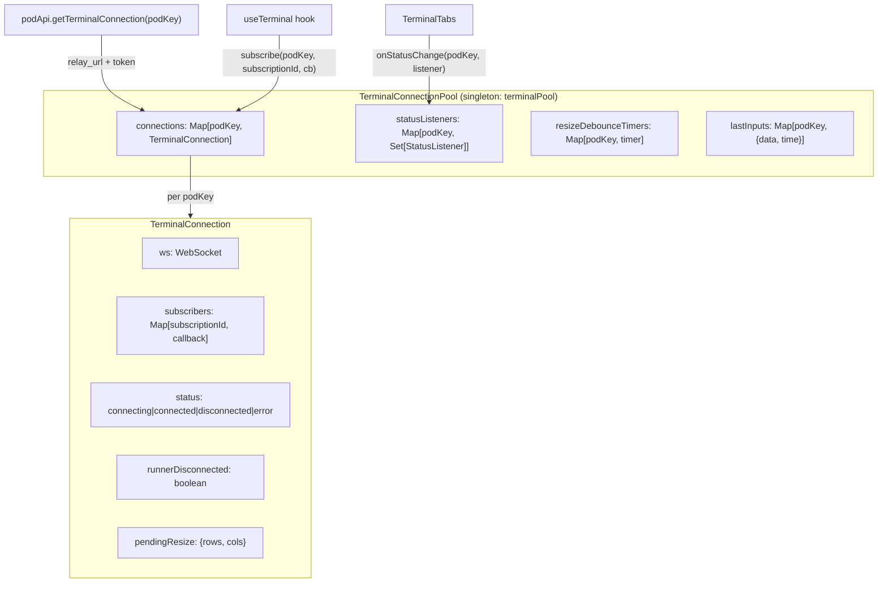
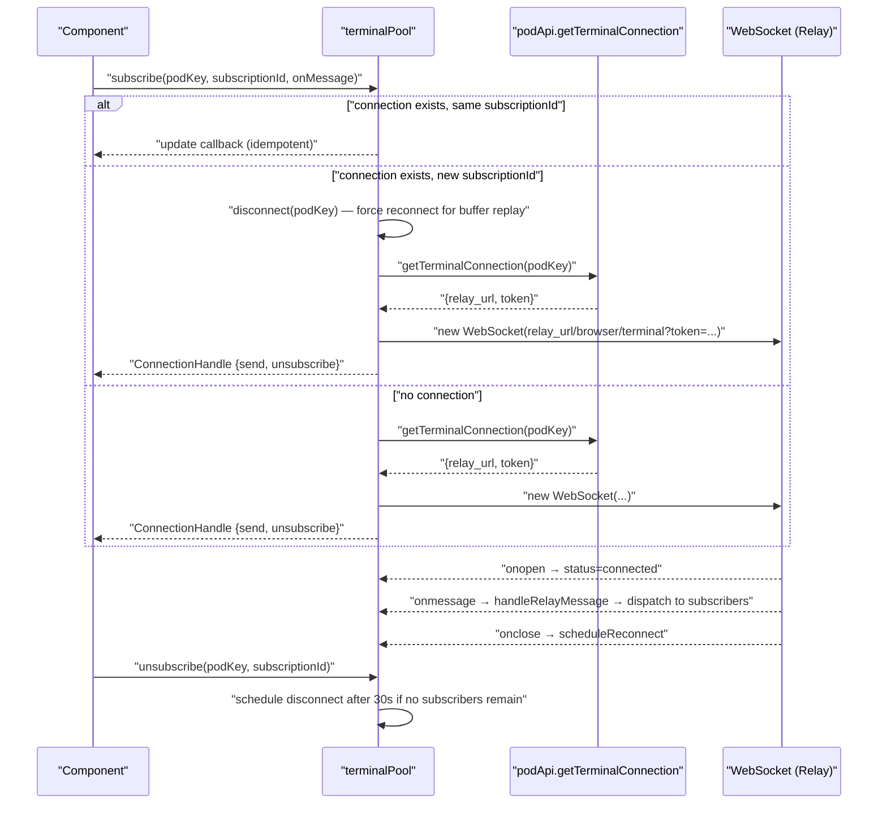
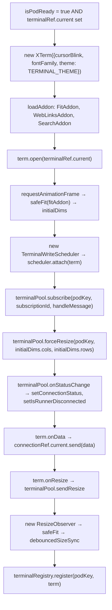
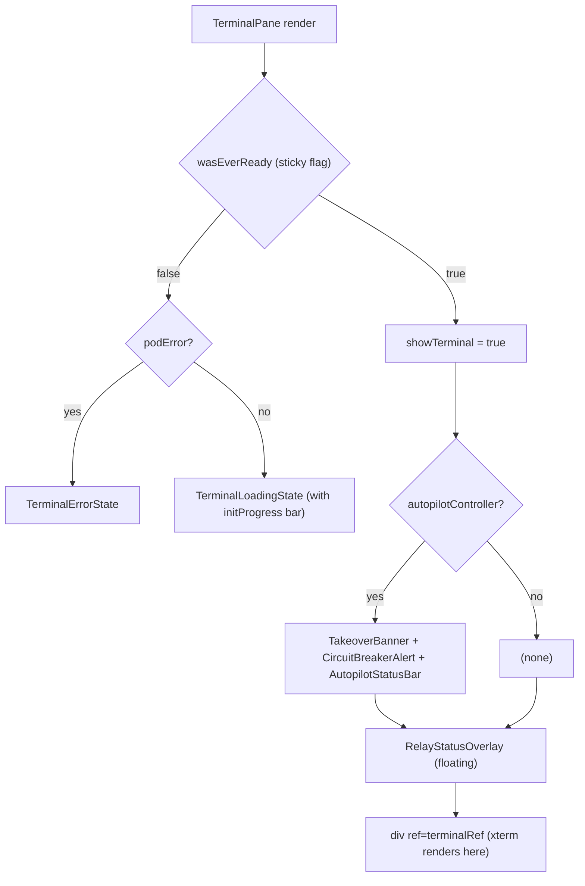
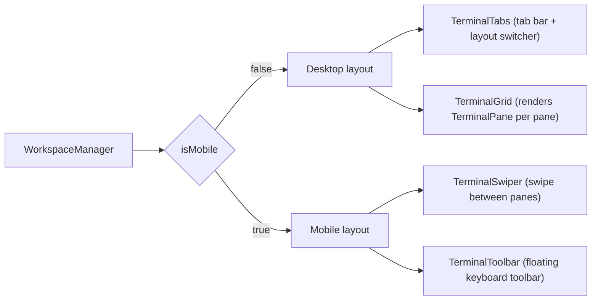
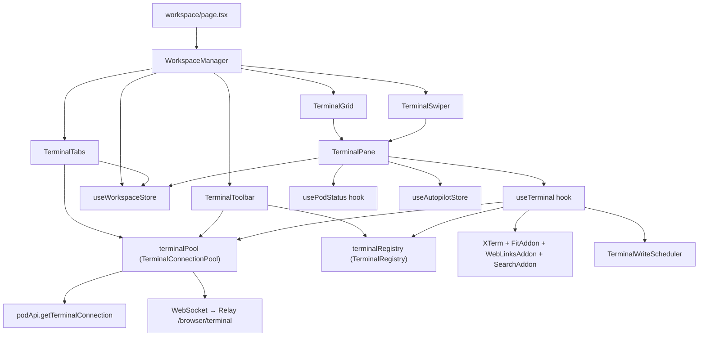

<!-- source: DeepWiki mcp.deepwiki.com · repo AgentsMesh/AgentsMesh · page 5.1 Terminal Workspace · fetched 2026-10-26 -->

# Terminal Workspace

<details>
<summary>Relevant source files</summary>

The following files were used as context for generating this wiki page:

- [web/src/app/(dashboard)/[org]/mesh/page.tsx](web/src/app/(dashboard)/[org]/mesh/page.tsx)
- [web/src/app/(dashboard)/[org]/workspace/page.tsx](web/src/app/(dashboard)/[org]/workspace/page.tsx)
- [web/src/components/ide/CreatePodModal.tsx](web/src/components/ide/CreatePodModal.tsx)
- [web/src/components/ide/IDEShell.tsx](web/src/components/ide/IDEShell.tsx)
- [web/src/components/ide/SideBar.tsx](web/src/components/ide/SideBar.tsx)
- [web/src/components/ide/sidebar/MeshSidebarContent.tsx](web/src/components/ide/sidebar/MeshSidebarContent.tsx)
- [web/src/components/ide/sidebar/RunnersSidebarContent.tsx](web/src/components/ide/sidebar/RunnersSidebarContent.tsx)
- [web/src/components/mobile/MobileHeader.tsx](web/src/components/mobile/MobileHeader.tsx)
- [web/src/components/mobile/MobileSidebar.tsx](web/src/components/mobile/MobileSidebar.tsx)
- [web/src/components/settings/organization/RunnersSettings.tsx](web/src/components/settings/organization/RunnersSettings.tsx)
- [web/src/components/tickets/TicketPodPanel.tsx](web/src/components/tickets/TicketPodPanel.tsx)
- [web/src/components/workspace/TerminalPane.tsx](web/src/components/workspace/TerminalPane.tsx)
- [web/src/components/workspace/TerminalSwiper.tsx](web/src/components/workspace/TerminalSwiper.tsx)
- [web/src/components/workspace/TerminalTabs.tsx](web/src/components/workspace/TerminalTabs.tsx)
- [web/src/components/workspace/TerminalToolbar.tsx](web/src/components/workspace/TerminalToolbar.tsx)
- [web/src/components/workspace/WorkspaceManager.tsx](web/src/components/workspace/WorkspaceManager.tsx)
- [web/src/hooks/useTerminal.ts](web/src/hooks/useTerminal.ts)
- [web/src/stores/terminalConnection.ts](web/src/stores/terminalConnection.ts)
- [web/src/stores/workspace.ts](web/src/stores/workspace.ts)

</details>


This page documents the browser-side terminal workspace: how WebSocket connections to the Relay are managed, how xterm.js terminals are initialized and sized, and how multiple terminal panes are arranged in desktop and mobile layouts.

For information about the Relay service that the browser connects to, see [4](). For information about the runner-side PTY management, see [3.4](). For the AgentsMesh Network view that also embeds terminal access, see [5.3]().

---

## Overview

The terminal workspace has three layers:

1. **Connection layer** — `TerminalConnectionPool` in `web/src/stores/terminalConnection.ts` manages WebSocket connections to the Relay, implements the binary protocol, and allows multiple UI components to share a single connection per pod.
2. **Terminal layer** — `useTerminal` hook in `web/src/hooks/useTerminal.ts` creates an xterm.js instance, attaches addons, and wires the connection pool to the terminal display.
3. **Layout layer** — `WorkspaceManager` in `web/src/components/workspace/WorkspaceManager.tsx` renders desktop or mobile layouts (`TerminalTabs`+`TerminalGrid` or `TerminalSwiper`+`TerminalToolbar`), driven by `useWorkspaceStore`.

**Data flow:**
- Browser ↔ Relay (WebSocket, binary protocol) — terminal I/O
- Browser → Backend (REST `podApi.getTerminalConnection`) — obtain Relay URL and token
- Backend → Runner (gRPC) — control commands (resize, etc.) are forwarded via Relay

---

## TerminalConnectionPool

`TerminalConnectionPool` (a singleton exported as `terminalPool` from [web/src/stores/terminalConnection.ts:106-653]()) is the central connection manager.

### Connection Pooling Model

Connections are keyed by `podKey`. Multiple React components subscribe to the same connection using a stable `subscriptionId`. When the last subscriber leaves, the connection stays open for 30 seconds before being torn down (configurable via `disconnectDelay`).

**TerminalConnectionPool architecture diagram**



Sources: [web/src/stores/terminalConnection.ts:106-170]()

### Binary Protocol (MsgType)

All WebSocket messages are prefixed with a 1-byte type code. The `MsgType` enum mirrors `relay/internal/protocol/message.go`.

| Constant | Value | Direction | Purpose |
|---|---|---|---|
| `Snapshot` | `0x01` | Relay → Browser | Full terminal state snapshot (JSON, includes `serialized_content`) |
| `Output` | `0x02` | Relay → Browser | Raw PTY output bytes |
| `Input` | `0x03` | Browser → Relay | Keyboard/paste input |
| `Resize` | `0x04` | Browser → Relay | Terminal resize (4 bytes: `cols uint16 BE`, `rows uint16 BE`) |
| `Ping` | `0x05` | Either | Keepalive ping |
| `Pong` | `0x06` | Either | Keepalive pong |
| `Control` | `0x07` | Relay → Browser | JSON control messages (e.g., `pty_resized`) |
| `RunnerDisconnected` | `0x08` | Relay → Browser | Runner disconnected notification |
| `RunnerReconnected` | `0x09` | Relay → Browser | Runner reconnected notification |
| `ImagePaste` | `0x0a` | Browser → Relay | Image paste (mime-type length byte + mime-type + image data) |

Sources: [web/src/stores/terminalConnection.ts:17-28]()

`encodeMessage(msgType, payload)` prepends the type byte. `decodeMessage(data)` strips it. See [web/src/stores/terminalConnection.ts:67-88]().

### subscribe() and Connection Lifecycle

**Connection lifecycle diagram**



Sources: [web/src/stores/terminalConnection.ts:180-237](), [web/src/stores/terminalConnection.ts:524-539]()

### Reconnection

On `onclose` or `onerror`, `scheduleReconnect` applies exponential backoff with ±20% jitter up to 30 seconds, retrying up to `maxReconnectAttempts` (5). On reconnect, all existing subscribers are preserved and re-attached to the new WebSocket. See [web/src/stores/terminalConnection.ts:584-633]().

### Input Deduplication

For multi-character inputs (e.g., IME composed strings), if the same string is sent within 50 ms, the second send is dropped. This prevents duplicate input on mobile with network latency. Single characters bypass deduplication. See [web/src/stores/terminalConnection.ts:414-432]().

### Resize Debouncing

`sendResize` debounces by 150 ms. `forceResize` bypasses debounce. If the WebSocket is still `CONNECTING`, the resize is queued as `pendingResize` and sent on `onopen`. See [web/src/stores/terminalConnection.ts:451-510]().

### Status Change Events

`onStatusChange(podKey, listener)` registers a listener that fires immediately with the current `RelayStatusInfo` and on every subsequent change. Components use this to reactively update connection status UI. See [web/src/stores/terminalConnection.ts:132-153]().

---

## useTerminal Hook

`useTerminal` in [web/src/hooks/useTerminal.ts]() creates and manages an xterm.js terminal bound to a DOM element. It is the main integration point between the connection pool and the rendered terminal.

### Signature

```
useTerminal(podKey: string, fontSize: number, isPodReady: boolean, isActive: boolean): UseTerminalResult
```

Returns `{ terminalRef, xtermRef, fitAddonRef, connectionStatus, isRunnerDisconnected, syncSize }`.

### Initialization sequence

**useTerminal initialization diagram**



Sources: [web/src/hooks/useTerminal.ts:136-399]()

### Key design decisions

| Decision | Implementation |
|---|---|
| Stable `subscriptionId` | `"terminal-${podKey}"` — prevents WebSocket teardown on React StrictMode remount |
| AbortController | Prevents a late-resolving `subscribe()` from storing a stale handle if the effect cleaned up first |
| `TerminalWriteScheduler` | Batches `xterm.write()` calls into animation frames, reducing call rate from thousands/s to ~60/s |
| `safeFit` | Checks `proposeDimensions()` before calling `fitAddon.fit()` to guard against zero-size containers |
| `debouncedSizeSync` vs `forceImmediateSizeSync` | Resize events use debounce (100ms); pane activation and initial connect use force-immediate |
| IME composition guard | `compositionstart`/`compositionend` listeners set `isComposing`; `onData` skips if composing |
| Image paste | Intercepts `ClipboardEvent` on terminal container for `image/*` MIME types, sends via `terminalPool.sendImage` |
| Page visibility | On `visibilitychange → visible`, re-fits and debounced-syncs size |
| Font size changes | Handled in a separate `useEffect` with `fontSize` dep; does not recreate the terminal |

Sources: [web/src/hooks/useTerminal.ts:192-231](), [web/src/hooks/useTerminal.ts:233-290](), [web/src/hooks/useTerminal.ts:291-325](), [web/src/hooks/useTerminal.ts:404-471]()

### Terminal Theme

`TERMINAL_THEME` in [web/src/hooks/useTerminal.ts:29-51]() sets a VS Code dark-compatible colour scheme (background `#1e1e1e`, foreground `#d4d4d4`, selection `#264f78`).

---

## TerminalPane Component

`TerminalPane` in [web/src/components/workspace/TerminalPane.tsx]() is the top-level UI component for a single terminal session. It composes `useTerminal`, pod status tracking, and autopilot overlays.

### Props

| Prop | Type | Description |
|---|---|---|
| `paneId` | `string` | Unique workspace pane identifier |
| `podKey` | `string` | Pod key, passed to `useTerminal` and `terminalPool` |
| `isActive` | `boolean` | Whether this pane is the focused pane |
| `onClose` | `() => void` | Callback when user closes the pane |
| `showHeader` | `boolean` | Show/hide `TerminalPaneHeader` (default: true) |

### Render logic



The "sticky ready" flag (`wasEverReady`) is important: once the terminal was ever visible, transient pod status regressions do not unmount it. See [web/src/components/workspace/TerminalPane.tsx:88-92]().

`RelayStatusOverlay` shows a floating banner when `connectionStatus !== 'connected'` or `isRunnerDisconnected === true`.

Sources: [web/src/components/workspace/TerminalPane.tsx:130-215]()

---

## useWorkspaceStore

`useWorkspaceStore` in [web/src/stores/workspace.ts:90-233]() is a persisted Zustand store managing pane layout state.

### State shape

| Field | Type | Description |
|---|---|---|
| `panes` | `TerminalPane[]` | Ordered list of open panes |
| `activePane` | `string \| null` | `paneId` of the focused pane |
| `gridLayout` | `GridLayout` | Desktop grid: `{ type: "1x1"|"1x2"|"2x1"|"2x2"|"custom", rows, cols }` |
| `mobileActiveIndex` | `number` | Index of the visible pane on mobile |
| `terminalFontSize` | `number` | Font size in pixels (clamped 10–24, default 14) |

### Key actions

| Action | Behaviour |
|---|---|
| `addPane(podKey)` | Adds pane or activates existing pane for `podKey`; returns `paneId` |
| `removePane(paneId)` | Removes pane; adjusts `activePane` and `mobileActiveIndex` |
| `setActivePane(paneId)` | Sets active pane and syncs `mobileActiveIndex` |
| `setGridLayout(layout)` | Changes grid layout |
| `setTerminalFontSize(size)` | Clamps and sets font size |

Persistence key is `"agentsmesh-workspace"` (localStorage via `zustand/persist`). Version 2 migration removes obsolete `title` and `isActive` fields from persisted panes. See [web/src/stores/workspace.ts:200-232]().

### TerminalRegistry

`TerminalRegistry` in [web/src/stores/workspace.ts:12-35]() is a simple `Map<podKey, XTerm>` for cross-component access to xterm instances. `useTerminal` registers on mount and unregisters on cleanup. `TerminalToolbar` uses it via `terminalRegistry.scrollToBottom(podKey)`.

Sources: [web/src/stores/workspace.ts:1-35]()

---

## Workspace Layout

`WorkspaceManager` in [web/src/components/workspace/WorkspaceManager.tsx]() selects desktop or mobile layout based on `useBreakpoint().isMobile`.

### Layout selection diagram



Sources: [web/src/components/workspace/WorkspaceManager.tsx:91-128]()

### Desktop: TerminalTabs

`TerminalTabs` in [web/src/components/workspace/TerminalTabs.tsx]() renders:
- One tab per pane with a reactive `ConnectionDot` (green/yellow/red/gray) driven by `terminalPool.onStatusChange`.
- A `+` button to open the pod selector modal.
- Layout controls: 1×1, 1×2 (columns), 2×1 (rows), 2×2 grid, and fullscreen toggle.

`ConnectionDot` subscribes to `terminalPool.onStatusChange` in a `useEffect`, which fires immediately with current status. See [web/src/components/workspace/TerminalTabs.tsx:163-181]().

### Mobile: TerminalSwiper

`TerminalSwiper` in [web/src/components/workspace/TerminalSwiper.tsx]() renders one `TerminalPane` at a time and supports horizontal swipe to switch between panes using `@use-gesture/react`'s `useDrag`. It uses `axis: "lock"` mode to avoid conflicting with vertical terminal scrolling. If horizontal drag > 50px or velocity > 0.5, it advances/retreats the index. See [web/src/components/workspace/TerminalSwiper.tsx:32-83]().

### Mobile: TerminalToolbar

`TerminalToolbar` in [web/src/components/workspace/TerminalToolbar.tsx]() is a floating keyboard toolbar with two rows of keys. It sends raw escape sequences directly via `terminalPool.send`. It supports toggleable `CTRL` and `ALT` modifier states (Blink Shell–style: modifiers are consumed on the next key press and reset). Special keys include ESC, Ctrl+C/D/Z, arrow keys, HOME/END, PgUp/PgDn, TAB, and common symbols.

---

## Component Dependency Map

**Component and store dependency diagram**



Sources: [web/src/components/workspace/WorkspaceManager.tsx](), [web/src/components/workspace/TerminalPane.tsx](), [web/src/hooks/useTerminal.ts](), [web/src/stores/terminalConnection.ts](), [web/src/stores/workspace.ts]()

---

## Workspace Page

`WorkspacePage` in [web/src/app/(dashboard)/[org]/workspace/page.tsx]() is the Next.js route component for the `/[org]/workspace` path. It:

1. Waits for `useWorkspaceStore._hasHydrated` before rendering.
2. Handles the `?pod=xxx` query parameter: if a pod key is present and not already open, calls `addPane(podKey)` and replaces the URL to prevent re-opening on refresh.
3. Shows an empty state with a **Create Pod** button when `panes.length === 0`.
4. Renders `WorkspaceManager` when panes exist.

Sources: [web/src/app/(dashboard)/[org]/workspace/page.tsx]()

---

## Opening a Terminal from Other Views

Pods can be opened in the workspace terminal from other parts of the application:

| Source | Mechanism |
|---|---|
| `TicketPodPanel` | Calls `addPane(pod.pod_key)` then `router.push(".../workspace")` on "Connect" click |
| `IDEShell` / `MobileSidebar` | After pod creation via `CreatePodModal`, calls `addPane(pod.pod_key)` |
| `MeshSidebarContent` | "Open terminal" button calls `addPane(podKey)` then navigates to workspace |
| Query param `?pod=` | `WorkspacePage` reads `searchParams.get("pod")` and calls `addPane` |

Sources: [web/src/components/tickets/TicketPodPanel.tsx:181-185](), [web/src/components/ide/IDEShell.tsx:99-109](), [web/src/components/ide/sidebar/MeshSidebarContent.tsx:106-110](), [web/src/app/(dashboard)/[org]/workspace/page.tsx:25-47]()

---

