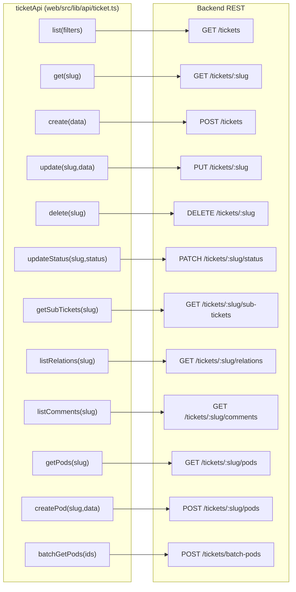
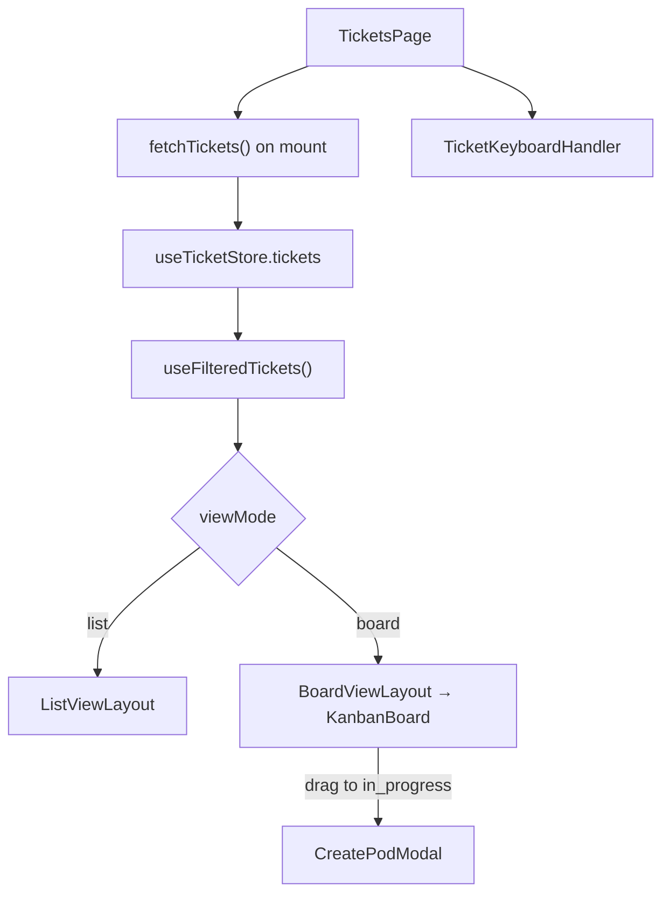
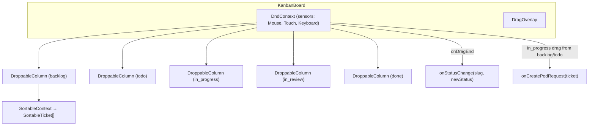
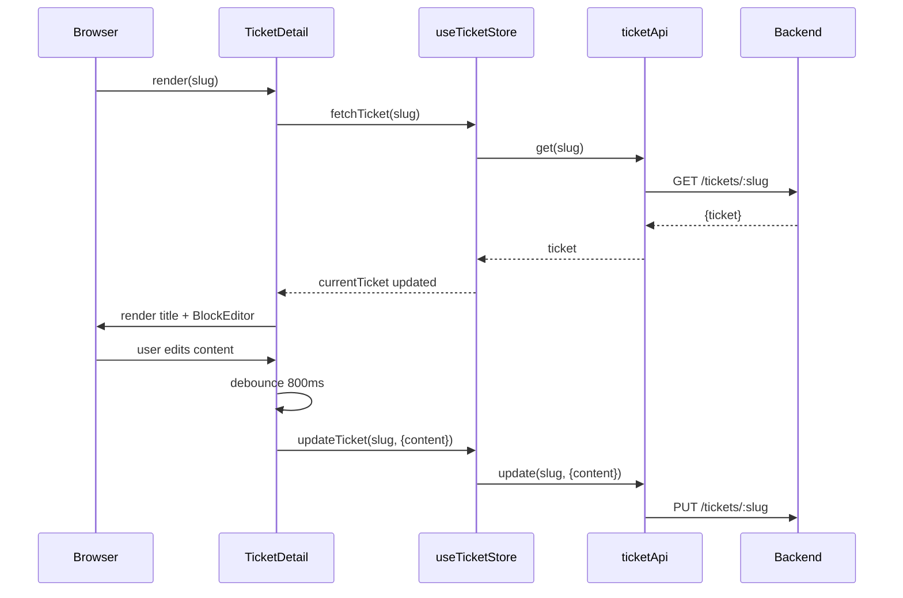
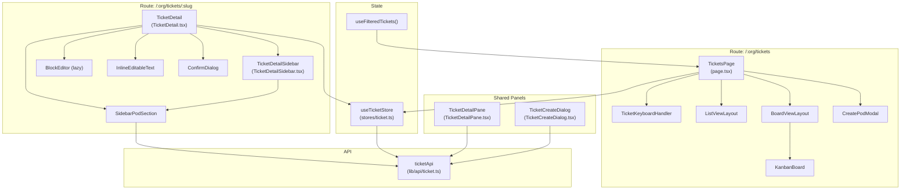

<!-- source: DeepWiki mcp.deepwiki.com · repo AgentsMesh/AgentsMesh · page 5.2 Ticket Management · fetched 2026-10-26 -->

# Ticket Management

<details>
<summary>Relevant source files</summary>

The following files were used as context for generating this wiki page:

- [web/src/app/(dashboard)/[org]/tickets/components/BoardViewLayout.tsx](web/src/app/(dashboard)/[org]/tickets/components/BoardViewLayout.tsx)
- [web/src/app/(dashboard)/[org]/tickets/components/ListViewLayout.tsx](web/src/app/(dashboard)/[org]/tickets/components/ListViewLayout.tsx)
- [web/src/app/(dashboard)/[org]/tickets/page.tsx](web/src/app/(dashboard)/[org]/tickets/page.tsx)
- [web/src/components/billing/CancelSubscriptionDialog.tsx](web/src/components/billing/CancelSubscriptionDialog.tsx)
- [web/src/components/settings/organization/__tests__/APIKeysSettings.test.tsx](web/src/components/settings/organization/__tests__/APIKeysSettings.test.tsx)
- [web/src/components/tickets/KanbanBoard.tsx](web/src/components/tickets/KanbanBoard.tsx)
- [web/src/components/tickets/TicketCreateDialog.tsx](web/src/components/tickets/TicketCreateDialog.tsx)
- [web/src/components/tickets/TicketDetail.tsx](web/src/components/tickets/TicketDetail.tsx)
- [web/src/components/tickets/TicketDetailPane.tsx](web/src/components/tickets/TicketDetailPane.tsx)
- [web/src/components/tickets/TicketDetailSidebar.tsx](web/src/components/tickets/TicketDetailSidebar.tsx)
- [web/src/components/tickets/__tests__/TicketCard.test.tsx](web/src/components/tickets/__tests__/TicketCard.test.tsx)
- [web/src/components/tickets/__tests__/TicketCreateDialog.test.tsx](web/src/components/tickets/__tests__/TicketCreateDialog.test.tsx)
- [web/src/components/tickets/__tests__/TicketDetail.test.tsx](web/src/components/tickets/__tests__/TicketDetail.test.tsx)
- [web/src/components/tickets/index.ts](web/src/components/tickets/index.ts)
- [web/src/components/ui/__tests__/responsive-dialog.test.tsx](web/src/components/ui/__tests__/responsive-dialog.test.tsx)
- [web/src/components/ui/responsive-dialog.tsx](web/src/components/ui/responsive-dialog.tsx)
- [web/src/components/workspace/TerminalStateViews.tsx](web/src/components/workspace/TerminalStateViews.tsx)
- [web/src/components/workspace/__tests__/TerminalStateViews.test.tsx](web/src/components/workspace/__tests__/TerminalStateViews.test.tsx)
- [web/src/lib/api/ticket.ts](web/src/lib/api/ticket.ts)
- [web/src/stores/__tests__/ticket.test.ts](web/src/stores/__tests__/ticket.test.ts)
- [web/src/stores/ticket.ts](web/src/stores/ticket.ts)

</details>


This page documents the ticket management UI in the web frontend: the data model, Zustand store, REST API client, page layout, board and list views, ticket detail view, creation dialog, and keyboard navigation. Ticket management concerns everything under the `/(dashboard)/[org]/tickets` route.

For backend ticket persistence and querying, see [2.5](). For real-time ticket updates delivered via WebSocket, see [5.5](). For pod creation that can be triggered from a ticket, see [5.3]().

---

## Data Model

Ticket data types are defined in [web/src/lib/api/ticket.ts]() and re-exported from [web/src/stores/ticket.ts]().

| Type | Values | Notes |
|------|--------|-------|
| `TicketStatus` | `backlog`, `todo`, `in_progress`, `in_review`, `done` | Maps directly to backend enum |
| `TicketPriority` | `none`, `low`, `medium`, `high`, `urgent` | Controls sort/display order |

The core shape is `TicketData` [web/src/lib/api/ticket.ts:7-32]():

| Field | Type | Description |
|-------|------|-------------|
| `id` | `number` | Internal DB id |
| `number` | `number` | Sequential per-org number |
| `slug` | `string` | Human-readable id, e.g. `PROJ-42` |
| `title` | `string` | Short title |
| `content` | `string?` | Rich text body (block editor JSON) |
| `status` | `TicketStatus` | Current workflow state |
| `priority` | `TicketPriority` | Urgency level |
| `due_date` | `string?` | ISO date string |
| `assignees` | `Array<{user_id, user}>?` | Organization members assigned |
| `labels` | `Array<{id, name, color}>?` | Color-tagged categories |
| `repository_id` | `number?` | Linked git repository |
| `parent_ticket` | `{id, slug, title}?` | Parent if this is a sub-ticket |

The store's `Ticket` interface extends `TicketData` with an optional `child_tickets` field for nested sub-tickets.

---

## `useTicketStore` — Zustand Store

**Source:** [web/src/stores/ticket.ts]()

All ticket state is managed by a single Zustand store created with `create<TicketState>`. Components use individual selectors (`useTicketStore(state => state.X)`) to avoid unnecessary re-renders from unrelated state changes.

**State Model:**

```
TicketState
├── tickets: Ticket[]            -- flat list loaded by fetchTickets()
├── currentTicket: Ticket|null   -- loaded by fetchTicket(slug)
├── selectedTicketSlug: string|null  -- lightweight selection (no fetch)
├── labels: Label[]
├── filters: TicketFilters       -- server-side filter params
├── uiFilters: TicketUIFilters   -- client-side multi-select (status, priority)
├── viewMode: "list" | "board"
├── loading: boolean
├── error: string|null
└── totalCount: number
```

**Key actions:**

| Action | Description |
|--------|-------------|
| `fetchTickets(filters?)` | Calls `ticketApi.list()`, merges with existing filters |
| `fetchTicket(slug)` | Calls `ticketApi.get(slug)`, sets `currentTicket` |
| `createTicket(data)` | Calls `ticketApi.create()`, prepends to `tickets` |
| `updateTicket(slug, data)` | Calls `ticketApi.update()`, patches in-place |
| `updateTicketStatus(slug, status)` | Optimistic update → `ticketApi.updateStatus()`, rollback on failure |
| `deleteTicket(slug)` | Calls `ticketApi.delete()`, removes from `tickets` |
| `toggleStatus(status)` | Toggles `uiFilters.selectedStatuses` (multi-select) |
| `togglePriority(priority)` | Toggles `uiFilters.selectedPriorities` |
| `clearUIFilters()` | Resets both UI filter arrays |
| `setViewMode(mode)` | Switches between `"list"` and `"board"` |

**`useFilteredTickets` selector** [web/src/stores/ticket.ts:303-322]():

A derived selector hook that applies UI filters (search text, selected statuses, selected priorities) client-side via `useMemo`. This is the single source of truth for what tickets are displayed — used by both list and board views.

**Status/priority display helpers:**

- `getStatusInfo(status: TicketStatus)` — returns `{label, color, bgColor}`
- `getPriorityInfo(priority: TicketPriority)` — returns `{label, color, icon}`

Sources: [web/src/stores/ticket.ts]()

---

## `ticketApi` — REST API Client

**Source:** [web/src/lib/api/ticket.ts:76-400]()

All calls go through `request()` with `orgPath("/tickets")` as the base path. The `orgPath` helper prefixes the current organization slug from the auth context.

**Architecture diagram — `ticketApi` methods to backend endpoints:**



Sources: [web/src/lib/api/ticket.ts]()

---

## `TicketsPage` — Route Entry Point

**Source:** [web/src/app/(dashboard)/[org]/tickets/page.tsx]()

This is the `"use client"` Next.js page component rendered at `/:org/tickets`. It orchestrates:

1. Fetching tickets via `fetchTickets()` on mount (with local loading state separate from store's shared `loading`)
2. Reading the filtered ticket list from `useFilteredTickets()`
3. Dispatching to either `ListViewLayout` or `BoardViewLayout` based on `viewMode`
4. Rendering `TicketKeyboardHandler` for J/K keyboard navigation
5. Managing the `CreatePodModal` that auto-opens when a ticket is dragged to `in_progress` on the board

**Data flow:**



Sources: [web/src/app/(dashboard)/[org]/tickets/page.tsx]()

---

## Views

### List View

**Source:** [web/src/app/(dashboard)/[org]/tickets/components/ListViewLayout.tsx]()

`ListViewLayout` checks `tickets.length` against `VIRTUALIZATION_THRESHOLD = 50`. Below the threshold it renders `TicketListView`; above it renders `VirtualizedTicketList` (a windowed list) to handle large datasets efficiently.

Clicking a ticket navigates directly to `/:org/tickets/:slug` (no split pane).

### Board View — `KanbanBoard`

**Source:** [web/src/components/tickets/KanbanBoard.tsx]()

Renders a horizontal scroll of five `DroppableColumn` components, one per `TicketStatus`. Uses `@dnd-kit/core` for drag-and-drop.

**Column configuration:**

| Status | Color bar |
|--------|-----------|
| `backlog` | Gray |
| `todo` | Blue |
| `in_progress` | Yellow |
| `in_review` | Purple |
| `done` | Green |

**DnD architecture:**



- `SortableTicket` wraps `TicketCard` with `useSortable` from `@dnd-kit/sortable`.
- Collision detection uses a custom strategy: pointer-within columns takes priority, falling back to rect-intersection against ticket cards which then resolves to the card's owning column.
- When a ticket is dragged from `backlog` or `todo` into `in_progress`, `onCreatePodRequest` fires — this triggers `CreatePodModal` in `TicketsPage`.
- `useTicketPrefetch` is called `onMouseEnter` for each card to prefetch ticket data before the user navigates.

Sources: [web/src/components/tickets/KanbanBoard.tsx](), [web/src/app/(dashboard)/[org]/tickets/components/BoardViewLayout.tsx]()

---

## `TicketDetail` — Full Page Detail View

**Source:** [web/src/components/tickets/TicketDetail.tsx]()

Rendered at `/:org/tickets/:slug`. Fetches the ticket via `fetchTicket(slug)` and uses individual store selectors to avoid re-renders from unrelated store changes (e.g., a WebSocket event calling `fetchTickets()` would not re-render the detail view).

**Layout:** Two-column on desktop (`flex-row`), stacked on mobile (`flex-col`).

- **Left column (main content):**
  - `InlineEditableText` — click-to-edit title, saves on blur with `updateTicket(slug, {title})`
  - `LabelsList` — colored label chips
  - `BlockEditor` (lazy-loaded) — rich text body, debounced auto-save at 800ms via `contentSaveTimerRef`
  - `SubTicketsList`, `RelationsList`, `CommitsList` — linked entities
  - `CommentsList` — hidden on mobile (shown in sidebar slot instead)

- **Right column (`TicketDetailSidebar`):**
  - Pod execution panel (`SidebarPodSection`)
  - Properties panel: status, priority, due date, assignees, timestamps
  - Delete button with `ConfirmDialog`

**State management pattern:**

`TicketDetail` uses a local `loadedSlug` state (rather than the store's shared `loading` flag) to determine initial loading. This prevents the skeleton from re-appearing when unrelated WebSocket events trigger `fetchTickets()`.



Sources: [web/src/components/tickets/TicketDetail.tsx]()

---

## `TicketDetailSidebar` — Properties and Pod Panel

**Source:** [web/src/components/tickets/TicketDetailSidebar.tsx]()

The sidebar has two main sections:

### `SidebarPodSection`

Calls `ticketApi.getPods(ticketSlug)` on mount. Displays pods in two groups:

- **Active pods** — status `running` or `initializing` — shown with a pulsing indicator dot and hover actions (connect terminal, open in new tab)
- **Inactive/previous pods** — collapsed inside a `<details>` element

| Pod Status | Dot style |
|-----------|-----------|
| `running` | Green, animated pulse |
| `initializing` | Yellow, animated pulse |
| `failed` | Red, static |
| Other | Gray, static |

Clicking "Execute" opens `CreatePodModal` with `ticketContext` pre-filled. The "Connect" action calls `addPane(podKey)` from `useWorkspaceStore` then navigates to `/:org/workspace`.

### Properties Panel

Inline property rows using `StatusSelect` and `PrioritySelect` dropdowns. Changes call back to `TicketDetail`'s `handleStatusChange` / `handlePriorityChange`, which dispatch to the store.

Sources: [web/src/components/tickets/TicketDetailSidebar.tsx]()

---

## `TicketDetailPane` — Inline Side Panel

**Source:** [web/src/components/tickets/TicketDetailPane.tsx]()

A lighter-weight ticket view used in the mesh/IDE shell (see [5.3]()) where clicking a ticket opens a panel rather than navigating away. It:

- First checks `useTicketStore.tickets` for a cached ticket (for instant display)
- Falls back to `ticketApi.get(slug)` if not cached
- Skips the API fetch if the ticket is absent from the store (e.g., deleted)
- Uses `BlockViewer` (read-only) instead of `BlockEditor`
- Supports inline title editing, status/priority selects, and repository reassignment
- Embeds `TicketPodPanel`
- Has a footer link to navigate to the full detail page

Sources: [web/src/components/tickets/TicketDetailPane.tsx]()

---

## `TicketCreateDialog` — Creation Form

**Source:** [web/src/components/tickets/TicketCreateDialog.tsx]()

A `ResponsiveDialog` (modal on desktop, bottom drawer on mobile via `vaul`) with these fields:

| Field | Component | Default |
|-------|-----------|---------|
| Title | `<Input>` (required) | — |
| Priority | `<Select>` | `medium` |
| Assignees | Custom dropdown with checkboxes | none |
| Content | `BlockEditor` (lazy-loaded) | — |

**Form state** is held in a local `form: FormData` object. On submit, it calls `ticketApi.create()` directly (not through the store action) and invokes the `onCreated(id, slug)` callback.

When `parentTicketSlug` is provided, the dialog title changes to "Create Sub-ticket" and `parentSlug` is passed to `ticketApi.create()`.

**Mobile vs desktop rendering** is controlled by `useBreakpoint()`. On mobile, the `BlockEditor` uses a shorter `min-h-[100px]`; on desktop it uses `min-h-[150px]`. The footer reverses button order on mobile via `flex-col-reverse`.

Sources: [web/src/components/tickets/TicketCreateDialog.tsx]()

---

## Keyboard Navigation — `TicketKeyboardHandler`

**Source:** [web/src/components/tickets/index.ts:14]() (exported from `TicketKeyboardHandler.tsx`)

`TicketsPage` renders `TicketKeyboardHandler` as a sibling to the view layout. It handles global `keydown` events when `enabled` is true:

| Key | Action |
|-----|--------|
| `j` / `ArrowDown` | Move selection to next ticket |
| `k` / `ArrowUp` | Move selection to previous ticket |
| `Enter` | Navigate to selected ticket's detail page (`onOpenDetail`) |
| `Escape` | Clear selection (`onCloseDetail`) |

`keyboardSelectedSlug` is kept in `TicketsPage` local state (not the store). It controls a highlight style on the focused ticket card but does not perform navigation on its own — only `Enter` navigates.

---

## `useTicketExtraData` Hook

**Source:** [web/src/components/tickets/index.ts:28]() (from `hooks.ts`)

A shared hook used by both `TicketDetail` and `TicketDetailPane`. When `enabled` is true (i.e., the ticket is loaded), it fetches in parallel:

- `ticketApi.getSubTickets(slug)` → `subTickets`
- `ticketApi.listRelations(slug)` → `relations`
- `ticketApi.listCommits(slug)` → `commits`
- `ticketApi.listComments(slug)` → `comments`

Also exposes `addComment`, `updateComment`, `deleteComment` handlers.

---

## Component Map



Sources: [web/src/components/tickets/index.ts](), [web/src/app/(dashboard)/[org]/tickets/page.tsx](), [web/src/components/tickets/TicketDetail.tsx](), [web/src/components/tickets/TicketDetailSidebar.tsx](), [web/src/components/tickets/TicketDetailPane.tsx](), [web/src/components/tickets/TicketCreateDialog.tsx](), [web/src/stores/ticket.ts](), [web/src/lib/api/ticket.ts]()

---

