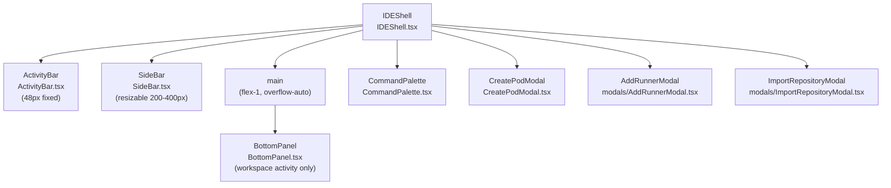
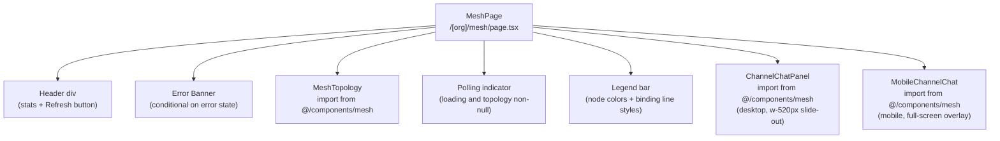
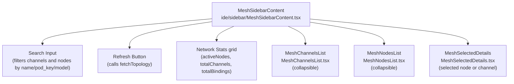
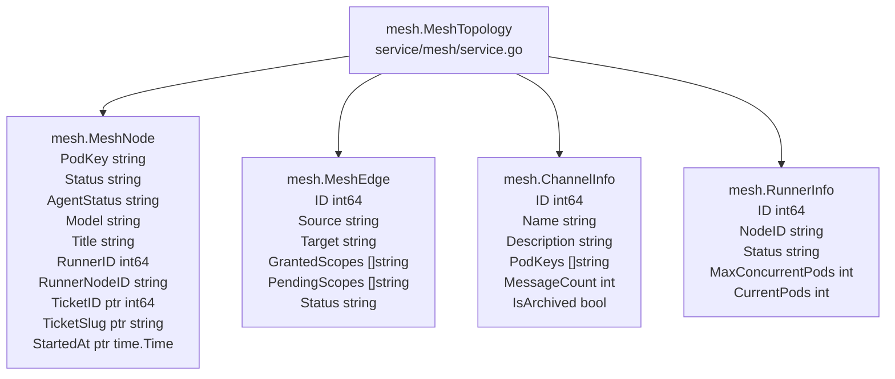
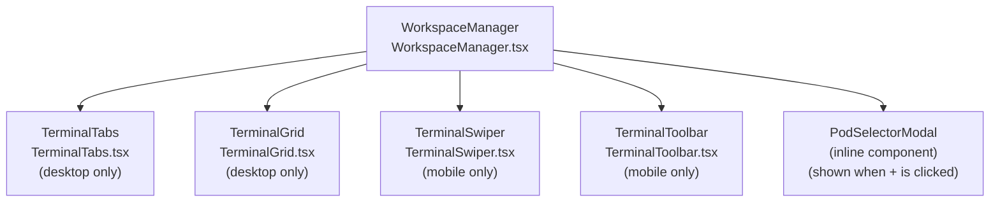
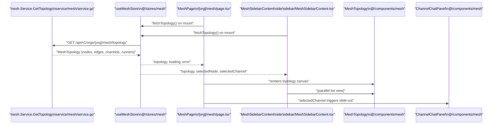

<!-- source: DeepWiki mcp.deepwiki.com · repo AgentsMesh/AgentsMesh · page 5.3 AgentsMesh Network View · fetched 2026-10-26 -->

# AgentsMesh Network View

<details>
<summary>Relevant source files</summary>

The following files were used as context for generating this wiki page:

- [backend/internal/service/mesh/service.go](backend/internal/service/mesh/service.go)
- [web/src/app/(dashboard)/[org]/mesh/page.tsx](web/src/app/(dashboard)/[org]/mesh/page.tsx)
- [web/src/components/ide/CreatePodModal.tsx](web/src/components/ide/CreatePodModal.tsx)
- [web/src/components/ide/IDEShell.tsx](web/src/components/ide/IDEShell.tsx)
- [web/src/components/ide/SideBar.tsx](web/src/components/ide/SideBar.tsx)
- [web/src/components/ide/sidebar/MeshSidebarContent.tsx](web/src/components/ide/sidebar/MeshSidebarContent.tsx)
- [web/src/components/ide/sidebar/RunnersSidebarContent.tsx](web/src/components/ide/sidebar/RunnersSidebarContent.tsx)
- [web/src/components/settings/organization/RunnersSettings.tsx](web/src/components/settings/organization/RunnersSettings.tsx)
- [web/src/components/tickets/TicketPodPanel.tsx](web/src/components/tickets/TicketPodPanel.tsx)
- [web/src/components/workspace/TerminalTabs.tsx](web/src/components/workspace/TerminalTabs.tsx)
- [web/src/components/workspace/WorkspaceManager.tsx](web/src/components/workspace/WorkspaceManager.tsx)
- [web/src/lib/api/pod.ts](web/src/lib/api/pod.ts)
- [web/src/messages/de/app.json](web/src/messages/de/app.json)
- [web/src/messages/en/app.json](web/src/messages/en/app.json)
- [web/src/messages/es/app.json](web/src/messages/es/app.json)
- [web/src/messages/fr/app.json](web/src/messages/fr/app.json)
- [web/src/messages/ja/app.json](web/src/messages/ja/app.json)
- [web/src/messages/ko/app.json](web/src/messages/ko/app.json)
- [web/src/messages/pt/app.json](web/src/messages/pt/app.json)
- [web/src/messages/zh/app.json](web/src/messages/zh/app.json)

</details>


This page covers the desktop IDE shell (`IDEShell`) and the AgentsMesh network topology page (`MeshPage`). It documents the persistent IDE layout structure, the topology visualization for multi-agent networks, pod creation modals, and the terminal workspace management components.

For the channel chat system that appears as a slide-out panel on the Mesh page, see [Channels and Chat](#5.4). For the Zustand stores and real-time event dispatch that power mesh and workspace state, see [Real-time State Management](#5.5). For terminal connection details (xterm.js, WebSocket, binary protocol), see [Terminal Workspace](#5.1).

---

## IDEShell

`IDEShell` is the outer desktop layout wrapper used by all authenticated pages. It lives at [web/src/components/ide/IDEShell.tsx]() and renders a persistent three-panel structure.

**IDEShell Desktop Layout**



Sources: [web/src/components/ide/IDEShell.tsx:32-43](), [web/src/components/ide/IDEShell.tsx:138-189]()

The layout comment inside `IDEShell` describes the geometry:

```
┌──────────┬──────────────┬─────────────────────────────────┐
│ Activity │  Side Bar    │       Main Content Area         │
│   Bar    │  (resizable) │                                 │
│  (48px)  │              ├─────────────────────────────────┤
│          │              │  Bottom Panel (workspace only)  │
└──────────┴──────────────┴─────────────────────────────────┘
```

`BottomPanel` is rendered only when `activeActivity === "workspace"` [web/src/components/ide/IDEShell.tsx:159]().

### Activity Types and Sidebar Dispatch

`getSidebarContent(activity, callbacks)` [web/src/components/ide/IDEShell.tsx:51-73]() maps the active activity to a sidebar component. The active activity is read from `useIDEStore`.

| `ActivityType` | Sidebar Component |
|---|---|
| `"workspace"` | `WorkspaceSidebarContent` |
| `"tickets"` | `TicketsSidebarContent` |
| `"mesh"` | `MeshSidebarContent` |
| `"repositories"` | `RepositoriesSidebarContent` |
| `"runners"` | `RunnersSidebarContent` |
| `"settings"` | `SettingsSidebarContent` |
| `"loops"` | `LoopsSidebarContent` |

### Global Modals

`IDEShell` owns three application-level modals triggered by callbacks passed to sidebar content components:

| Modal | Triggering callback | Wired into |
|---|---|---|
| `CreatePodModal` | `onCreatePod` | `WorkspaceSidebarContent` |
| `AddRunnerModal` | `onAddRunner` | `RunnersSidebarContent` |
| `ImportRepositoryModal` | `onImportRepo` | `RepositoriesSidebarContent` |

On successful pod creation, `handlePodCreated` [web/src/components/ide/IDEShell.tsx:99-109]() calls `addPane(pod.pod_key)` from `useWorkspaceStore` and `fetchPods()` from `usePodStore` before navigating to the workspace.

### SideBar Resize

`SideBar` [web/src/components/ide/SideBar.tsx]() reads and writes `sidebarWidth` from `useIDEStore`. The resize handle is a 1px-wide `div` on the right edge. On `mousedown` it sets `isResizing = true` and document-level `mousemove` / `mouseup` handlers clamp the new width to `[200, 400]` px [web/src/components/ide/SideBar.tsx:52-73]().

The `SideBar` header contains an organization dropdown that calls `router.push` to the equivalent page in the selected org [web/src/components/ide/SideBar.tsx:111-118]().

---

## MeshPage

`MeshPage` [web/src/app/(dashboard)/[org]/mesh/page.tsx]() is served at `/{org}/mesh`. It renders the multi-agent topology visualization and manages the channel chat overlay.

**MeshPage Component Structure**



Sources: [web/src/app/(dashboard)/[org]/mesh/page.tsx:57-205]()

### Header Statistics

The header computes three stats from `useMeshStore.topology`:

| Display | Computation |
|---|---|
| Active pods | `topology.nodes.filter(n => n.status === "running" \|\| n.status === "initializing").length` |
| Channel count | `topology.channels.filter(c => !c.is_archived).length` |
| Binding count | `topology.edges.length` |

Both are memoized with `useMemo` [web/src/app/(dashboard)/[org]/mesh/page.tsx:30-40]().

### Chat Panel Behavior

When `selectedChannel` is non-null, the chat panel is shown. The layout differs by breakpoint (from `useBreakpoint`):

- **Desktop**: A fixed 520px-wide `div` positioned `absolute top-0 right-0 h-full` slides in using `translate-x-0` / `translate-x-full` CSS transitions [web/src/app/(dashboard)/[org]/mesh/page.tsx:178-195]().
- **Mobile**: `MobileChannelChat` is rendered as a full-screen overlay.

Pressing `Escape` on desktop calls `selectChannel(null)` [web/src/app/(dashboard)/[org]/mesh/page.tsx:48-55]().

### Legend

| Color / Style | Meaning |
|---|---|
| Green square | Running |
| Yellow square | Initializing |
| Gray square | Terminated |
| Red square | Failed |
| Blue square | Channel |
| Solid green line | Active binding |
| Dashed yellow line | Pending binding |

---

## Mesh Sidebar

`MeshSidebarContent` [web/src/components/ide/sidebar/MeshSidebarContent.tsx]() renders inside `SideBar` when the `"mesh"` activity is active. It provides a searchable list view of the same topology shown on `MeshPage`.

**MeshSidebarContent Structure**



Sources: [web/src/components/ide/sidebar/MeshSidebarContent.tsx:133-215]()

### Filtering Logic

Both `filteredChannels` and `filteredNodes` are computed with `useMemo` to avoid creating new array references on every render [web/src/components/ide/sidebar/MeshSidebarContent.tsx:64-85]():

- **Channels**: matches `searchQuery` against `channel.name`.
- **Nodes**: matches `searchQuery` against `node.pod_key` and `node.model`.

### Node and Channel Interaction

| User action | Effect |
|---|---|
| Click a node | `selectNode(node.pod_key)` → updates `MeshSelectedDetails` |
| Click a channel | `selectChannel(channel.id)` → updates `MeshSelectedDetails` and triggers chat on `MeshPage` |
| Click "Open Terminal" on a node | `addPane(podKey)` + `router.push("/{org}/workspace")` |

---

## Topology Data Model

The topology is assembled by `mesh.Service.GetTopology` [backend/internal/service/mesh/service.go:46-147]() and returned as `mesh.MeshTopology`.

**MeshTopology Data Model**



Sources: [backend/internal/service/mesh/service.go:46-147](), [backend/internal/service/mesh/service.go:149-177]()

### Backend Assembly Steps

`GetTopology` builds the topology in four stages:

| Step | Source | Filter |
|---|---|---|
| Nodes | `podService.ListPods` (limit 100) | `pod.IsActive()` |
| Edges | `bindingService.GetBindingsForPod` for each active pod | `BindingStatusActive`, deduplicated by `binding.ID` |
| Channels | `channelService.ListChannels` (limit 50) | `IncludeArchived: false`; `PodKeys` from `channel_pods` table |
| Runners | DB query on `runner` table | `organization_id = orgID AND is_enabled = true` |

`podToNode` [backend/internal/service/mesh/service.go:150-177]() maps an `agentpod.Pod` to `mesh.MeshNode`, populating `RunnerNodeID`/`RunnerStatus` from `pod.Runner` and `TicketSlug`/`TicketTitle` from `pod.Ticket` when those associations are preloaded.

---

## useMeshStore

`useMeshStore` (from `@/stores/mesh`) is the Zustand store that holds all client-side mesh state. Both `MeshPage` and `MeshSidebarContent` subscribe to it independently using granular selectors to avoid unnecessary re-renders.

| Field | Type | Description |
|---|---|---|
| `topology` | `MeshTopology \| null` | Full topology from last `fetchTopology` call |
| `loading` | `boolean` | True while a fetch is in flight |
| `error` | `string \| null` | Error message from last failed fetch |
| `selectedNode` | `string \| null` | `pod_key` of the currently selected node |
| `selectedChannel` | `number \| null` | `id` of the currently selected channel |

Key actions:

| Action | Effect |
|---|---|
| `fetchTopology()` | GETs topology from backend, sets `topology` |
| `selectNode(podKey)` | Sets `selectedNode` |
| `selectChannel(id \| null)` | Sets `selectedChannel`; `null` dismisses chat panel |
| `clearError()` | Clears `error` |

Both `MeshPage` [web/src/app/(dashboard)/[org]/mesh/page.tsx:26-28]() and `MeshSidebarContent` [web/src/components/ide/sidebar/MeshSidebarContent.tsx:47-51]() call `fetchTopology()` on mount. Subsequent real-time updates arrive via `RealtimeProvider` (see [Real-time State Management](#5.5)).

---

## CreatePodModal

`CreatePodModal` [web/src/components/ide/CreatePodModal.tsx]() is a modal dialog that wraps the shared `CreatePodForm` component. It is used in two contexts:

1. **Global workspace context** — triggered by the "New Pod" button in `WorkspaceSidebarContent` via `IDEShell`.
2. **Ticket context** — triggered from `TicketPodPanel` with an explicit `ticketContext` prop.

### Props

| Prop | Type | Description |
|---|---|---|
| `open` | `boolean` | Controls visibility |
| `onClose` | `() => void` | Called on cancel or after creation |
| `onCreated` | `(pod?: PodData) => void` | Called after successful creation |
| `ticketContext?` | `TicketContext` | Scopes the form to a ticket |

### Ticket Context Behavior

When `ticketContext` is supplied, `formConfig` is built with [web/src/components/ide/CreatePodModal.tsx:30-46]():

- `scenario: "ticket"` 
- A `promptGenerator` that produces: `"Work on ticket {slug}: {title}\n\n{description}"`

This prompt is pre-filled into the "Initial Prompt" field of `CreatePodForm`.

Focus is managed with `useFocusTrap`, which traps keyboard navigation inside the modal while `open` is true.

---

## WorkspaceManager and TerminalTabs

`WorkspaceManager` [web/src/components/workspace/WorkspaceManager.tsx]() renders the terminal workspace inside `IDEShell`'s main content area when `activeActivity === "workspace"`.

**WorkspaceManager Component Structure**



Sources: [web/src/components/workspace/WorkspaceManager.tsx:92-130]()

`PodSelectorModal` lists all pods where `status === "running"` and `pod_key` is not already in `useWorkspaceStore.panes`. Selecting one calls `addPane(podKey)`.

### TerminalTabs

`TerminalTabs` [web/src/components/workspace/TerminalTabs.tsx]() renders the tab bar and layout controls. Each tab corresponds to one pane in `useWorkspaceStore.panes`.

**Tab sub-components:**

| Component | Source | Description |
|---|---|---|
| `ConnectionDot` | `terminalPool.onStatusChange(podKey, cb)` | Colored dot showing WebSocket connection state |
| `TabPaneTitle` | `usePodStore` (find by `pod_key`) | Human-readable pod name via `getPodDisplayName` |

`ConnectionDot` maps pool status to CSS classes [web/src/components/workspace/TerminalTabs.tsx:163-181]():

| Pool status | CSS |
|---|---|
| `"connected"` | `bg-green-500` |
| `"connecting"` | `bg-yellow-500 animate-pulse` |
| `"error"` | `bg-red-500` |
| _(other)_ | `bg-gray-500` |

**Layout controls** update `useWorkspaceStore.gridLayout`:

| Button | `gridLayout.type` | Icon |
|---|---|---|
| Single view | `"1x1"` | `Square` |
| Two columns | `"1x2"` | `Columns` |
| Two rows | `"2x1"` | `Rows` |
| 2×2 grid | `"2x2"` | `Grid2X2` |

Fullscreen toggle uses `document.documentElement.requestFullscreen()` / `document.exitFullscreen()`, with a `fullscreenchange` listener that keeps `isFullscreen` state in sync [web/src/components/workspace/WorkspaceManager.tsx:61-81]().

---

## TicketPodPanel

`TicketPodPanel` [web/src/components/tickets/TicketPodPanel.tsx]() appears in the ticket detail view and lists all pods associated with a ticket. It fetches data with `ticketApi.getPods(ticketSlug)`.

Active pods (status `"running"` or `"initializing"`) are shown at the top. Inactive pods are hidden under a `<details>` element labelled with the count [web/src/components/tickets/TicketPodPanel.tsx:143-155]().

Each active pod row (`PodItem`) offers two actions [web/src/components/tickets/TicketPodPanel.tsx:181-197]():

| Action | Effect |
|---|---|
| **Connect** | `useWorkspaceStore.addPane(pod.pod_key)` + navigate to `/{org}/workspace` |
| **Open in new tab** | `window.open("/{org}/workspace?pod={pod_key}", "_blank")` |

`TicketPodPanel` also renders `CreatePodModal` with a `ticketContext` built from `ticketId`, `ticketSlug`, `ticketTitle`, and `repositoryId` [web/src/components/tickets/TicketPodPanel.tsx:95-109]().

---

## Cross-Component Data Flow

**Topology data flow: backend to UI**



Sources: [web/src/app/(dashboard)/[org]/mesh/page.tsx:26-28](), [web/src/components/ide/sidebar/MeshSidebarContent.tsx:47-51](), [backend/internal/service/mesh/service.go:46-147]()

---

