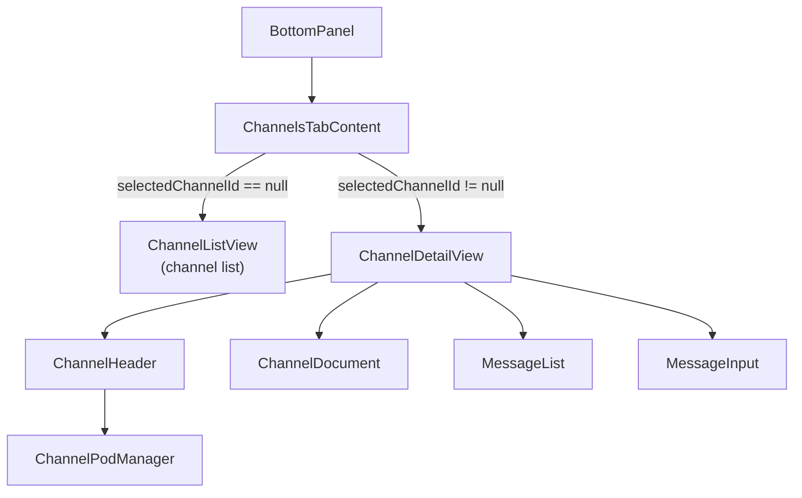
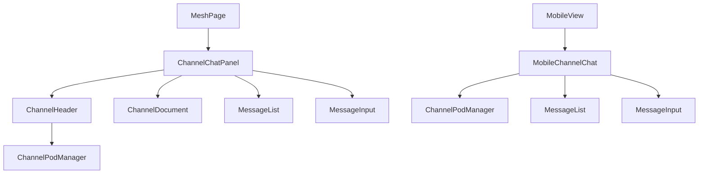
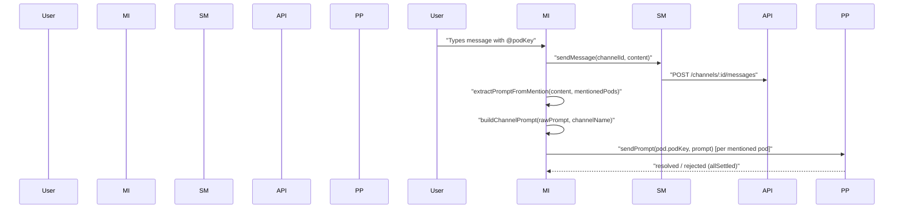
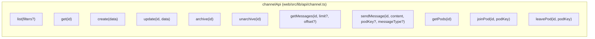
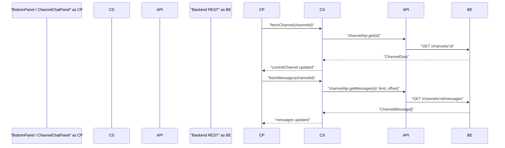

<!-- source: DeepWiki mcp.deepwiki.com · repo AgentsMesh/AgentsMesh · page 5.4 Channels and Chat · fetched 2026-10-26 -->

# Channels and Chat

<details>
<summary>Relevant source files</summary>

The following files were used as context for generating this wiki page:

- [web/src/components/ide/BottomPanel.tsx](web/src/components/ide/BottomPanel.tsx)
- [web/src/components/ide/BottomPanel/ChannelDetailView.tsx](web/src/components/ide/BottomPanel/ChannelDetailView.tsx)
- [web/src/components/ide/BottomPanel/types.ts](web/src/components/ide/BottomPanel/types.ts)
- [web/src/components/mesh/ChannelChatPanel.tsx](web/src/components/mesh/ChannelChatPanel.tsx)
- [web/src/components/mesh/ChannelHeader.tsx](web/src/components/mesh/ChannelHeader.tsx)
- [web/src/components/mesh/ChannelPodManager.tsx](web/src/components/mesh/ChannelPodManager.tsx)
- [web/src/components/mesh/MobileChannelChat.tsx](web/src/components/mesh/MobileChannelChat.tsx)
- [web/src/lib/api/channel.ts](web/src/lib/api/channel.ts)

</details>


This page documents the channel chat UI system in the web frontend: how channels are listed and navigated, the chat panel components, pod membership management, the `channelApi` client, and the message-sending flow including `@mention` forwarding to pod terminals. For the backend channel and binding model, see [2.4](). For the Zustand `channelStore` and real-time event updates, see [5.5](). For the AgentsMesh network topology view that hosts the desktop chat panel, see [5.3]().

---

## Overview

Channels are multi-party communication threads that can include both human users and AI pods. The chat system surfaces in two contexts:

| Context | Component | Use case |
|---|---|---|
| IDE bottom panel (desktop) | `BottomPanel` → `ChannelsTabContent` | Embedded chat within the IDE layout |
| Mesh sidebar / full page (desktop) | `ChannelChatPanel` | Standalone channel chat in the mesh view |
| Mobile full-screen | `MobileChannelChat` | Full-viewport overlay on small screens |

When a user sends a message that `@mentions` a pod, the message is posted to the channel **and** the prompt is forwarded directly to that pod's terminal via `podApi.sendPrompt`.

---

## BottomPanel and the Channels Tab

`BottomPanel` ([web/src/components/ide/BottomPanel.tsx:44-382]()) is the resizable panel at the bottom of the IDE layout. It hosts five tabs, each rendered as a discrete content component:

| Tab ID | Icon | Content component |
|---|---|---|
| `channels` | `MessageSquare` | `ChannelsTabContent` |
| `activity` | `Activity` | `ActivityTabContent` |
| `autopilot` | `Bot` | `AutopilotPanelContent` |
| `delivery` | `GitPullRequest` | `DeliveryTabContent` |
| `info` | `Info` | `InfoTabContent` |

The set of available tabs is defined in `TAB_IDS` ([web/src/components/ide/BottomPanel.tsx:42]()).

**Tab and panel state** is managed by `useIDEStore`: `bottomPanelOpen`, `bottomPanelHeight`, `bottomPanelTab`, and their setters. The panel supports mouse-drag resizing, clamped between 100 px and 60% of window height ([web/src/components/ide/BottomPanel.tsx:153-177]()).

**Channel state** for the bottom panel is held locally (`selectedChannelId`) and in `useChannelStore` (`currentChannel`, `messages`, `messagesLoading`). When `selectedChannelId` is set, `fetchChannel` and `fetchMessages` are triggered ([web/src/components/ide/BottomPanel.tsx:83-94]()).

**Channels shown** in the tab are derived from the mesh topology, not fetched independently:

```
podChannels = topology.channels.filter(c => c.pod_keys.includes(selectedPodKey))
```

[web/src/components/ide/BottomPanel.tsx:119-122]()

Sources: [web/src/components/ide/BottomPanel.tsx:1-385]()

---

## Component Hierarchy

**BottomPanel channels tab flow:**



**Standalone mesh / mobile chat flow:**



Sources: [web/src/components/ide/BottomPanel.tsx:336-353](), [web/src/components/ide/BottomPanel/ChannelDetailView.tsx:1-105](), [web/src/components/mesh/ChannelChatPanel.tsx:1-167](), [web/src/components/mesh/MobileChannelChat.tsx:1-205]()

---

## ChannelChatPanel

`ChannelChatPanel` ([web/src/components/mesh/ChannelChatPanel.tsx]()) is the desktop chat panel used in the mesh view. It accepts `channelId` and `onClose` props.

**Lifecycle:**
- On mount (or `channelId` change): calls `fetchChannel(channelId)` and `fetchMessages(channelId)`.
- On unmount: calls `setCurrentChannel(null)` to clear shared store state.

**Data sources:**
- `useChannelStore` — `currentChannel`, `messages`, `messagesLoading`, `sendMessage`
- `useMeshStore` — `topology` (for pod count on the channel)

**Pod count** is resolved by looking up the channel in `topology.channels` first, falling back to `currentChannel.pods.length` ([web/src/components/mesh/ChannelChatPanel.tsx:45-46]()).

**Message transformation:** Raw `ChannelMessage` objects from the store are mapped to a `TransformedMessage` shape before being passed to `MessageList`. This resolves `sender_pod_info` and `sender_user` (GORM JSON tag names) into typed `pod` and `user` fields ([web/src/components/mesh/ChannelChatPanel.tsx:92-114]()).

**Pagination:** `fetchMessages(channelId, 50, messages.length)` fetches older messages when the user scrolls up. The `hasMore` flag is `messages.length >= 50 && messages.length % 50 === 0` ([web/src/components/mesh/ChannelChatPanel.tsx:81-83](), [web/src/components/mesh/ChannelChatPanel.tsx:150-154]()).

Sources: [web/src/components/mesh/ChannelChatPanel.tsx:1-167]()

---

## MobileChannelChat

`MobileChannelChat` ([web/src/components/mesh/MobileChannelChat.tsx]()) is a fixed-position full-screen overlay (`fixed inset-0 z-50`) for mobile viewports. Its logic mirrors `ChannelChatPanel` exactly, with layout differences:

- Uses `ArrowLeft` back button in the header instead of a close `X`.
- Displays `ChannelDocument` inline when present.
- Loading state uses a skeleton placeholder header ([web/src/components/mesh/MobileChannelChat.tsx:122-136]()).

Sources: [web/src/components/mesh/MobileChannelChat.tsx:1-205]()

---

## Message Sending with Pod Mentions

Both `ChannelChatPanel` and `MobileChannelChat` (and `BottomPanel`) share the same `handleSendMessage` logic. The flow is:

**Message send + pod mention forwarding:**



Key functions involved:

| Function | File | Role |
|---|---|---|
| `extractPromptFromMention` | `web/src/components/mesh/MessageInput.tsx` | Strips mention syntax, extracts raw prompt text |
| `buildChannelPrompt` | `web/src/components/mesh/MessageInput.tsx` | Wraps raw prompt with channel context metadata |
| `sendMessage` | `useChannelStore` | Posts the message to the backend channel |
| `podApi.sendPrompt` | `web/src/lib/api/pod.ts` | Sends the prompt to a specific pod's terminal |

`Promise.allSettled` is used so a failure to forward to one pod does not block the others ([web/src/components/mesh/ChannelChatPanel.tsx:68-71]()).

Sources: [web/src/components/mesh/ChannelChatPanel.tsx:58-78](), [web/src/components/mesh/MobileChannelChat.tsx:63-83](), [web/src/components/ide/BottomPanel.tsx:192-213]()

---

## ChannelPodManager

`ChannelPodManager` ([web/src/components/mesh/ChannelPodManager.tsx]()) is a `Popover` that manages which pods belong to a channel. It appears in both `ChannelHeader` and `MobileChannelChat`.

**Two display modes:**
- `compact=false` (default): shows a `Bot + count` pill button
- `compact=true`: shows a minimal `Bot + count` inline button (used in the bottom panel header)

**On popover open**, it loads two datasets concurrently ([web/src/components/mesh/ChannelPodManager.tsx:51-66]()):
1. `channelApi.getPods(channelId)` — pods currently joined to the channel
2. `usePodStore.fetchPods({ status: "running" })` — all running pods in the org

**Available pods** = running or initializing pods not already joined ([web/src/components/mesh/ChannelPodManager.tsx:70-75]()).

**Actions:**
- `handleJoin(podKey)` → `channelApi.joinPod(channelId, podKey)` → refreshes pod list → calls `onPodsChanged()`
- `handleLeave(podKey)` → `channelApi.leavePod(channelId, podKey)` → refreshes pod list → calls `onPodsChanged()`

The `onPodsChanged` callback propagates up to trigger `fetchTopology()` so the mesh graph updates to reflect new pod-channel edges.

Sources: [web/src/components/mesh/ChannelPodManager.tsx:1-255]()

---

## ChannelHeader

`ChannelHeader` ([web/src/components/mesh/ChannelHeader.tsx]()) renders the top bar of a chat panel.

| Prop | Purpose |
|---|---|
| `name` | Channel name (displayed as `#name`) |
| `description` | Optional subtitle |
| `podCount` | Shown in the `ChannelPodManager` trigger |
| `channelId` | Passed to `ChannelPodManager` |
| `compact` | `true` for bottom panel embedding |
| `onPodsChanged` | Forwarded to `ChannelPodManager` |

Sources: [web/src/components/mesh/ChannelHeader.tsx:1-121]()

---

## ChannelDocument

`ChannelDocument` is rendered when `currentChannel.document` is non-empty ([web/src/components/mesh/ChannelChatPanel.tsx:144-146]()). It displays a collapsible markdown preview of the channel's document field. This field is a free-form markdown string stored on the channel record.

Sources: [web/src/components/mesh/ChannelChatPanel.tsx:144-146](), [web/src/components/mesh/MobileChannelChat.tsx:183-185](), [web/src/components/ide/BottomPanel/ChannelDetailView.tsx:79-81]()

---

## channelApi

`channelApi` ([web/src/lib/api/channel.ts]()) is the REST client for all channel operations. All routes are scoped to the current organization via `orgPath("/channels")`.



**Endpoint mapping:**

| Method | HTTP | Path |
|---|---|---|
| `list` | `GET` | `/org/:slug/channels?...` |
| `get` | `GET` | `/org/:slug/channels/:id` |
| `create` | `POST` | `/org/:slug/channels` |
| `update` | `PUT` | `/org/:slug/channels/:id` |
| `archive` | `POST` | `/org/:slug/channels/:id/archive` |
| `unarchive` | `POST` | `/org/:slug/channels/:id/unarchive` |
| `getMessages` | `GET` | `/org/:slug/channels/:id/messages?limit&offset` |
| `sendMessage` | `POST` | `/org/:slug/channels/:id/messages` |
| `getPods` | `GET` | `/org/:slug/channels/:id/pods` |
| `joinPod` | `POST` | `/org/:slug/channels/:id/pods` |
| `leavePod` | `DELETE` | `/org/:slug/channels/:id/pods/:podKey` |

**Core data types** defined in this file:

- `ChannelData` — channel record with `id`, `name`, `description`, `document`, optional `repository_id`, `ticket_id`, `ticket_slug`, `is_archived`
- `ChannelMessage` — message record with `sender_pod_info` and `sender_user` (GORM JSON tag names)

Sources: [web/src/lib/api/channel.ts:1-137]()

---

## BottomPanel/types.ts — Shared Type Contracts

[web/src/components/ide/BottomPanel/types.ts]() defines the shared TypeScript interfaces for all bottom panel tab content components:

| Type | Purpose |
|---|---|
| `TabContentProps` | Base props: `selectedPodKey`, `t` |
| `ChannelsTabContentProps` | Extends base with channel list and chat props |
| `ActivityTabContentProps` | Extends base with binding edge props |
| `TransformedMessage` | Normalized message shape consumed by `MessageList` |

`TransformedMessage` maps the raw `ChannelMessage` (with `sender_pod_info` / `sender_user`) into a cleaner `pod` / `user` shape with camelCase keys ([web/src/components/ide/BottomPanel/types.ts:49-65]()).

Sources: [web/src/components/ide/BottomPanel/types.ts:1-66]()

---

## Data Flow Summary

**Reading channel messages:**



Real-time message updates (new messages arriving over WebSocket) are handled by `RealtimeProvider` dispatching into `useChannelStore` — see [5.5]() for that layer.

Sources: [web/src/components/mesh/ChannelChatPanel.tsx:33-42](), [web/src/components/ide/BottomPanel.tsx:83-94](), [web/src/lib/api/channel.ts:97-110]()

---

